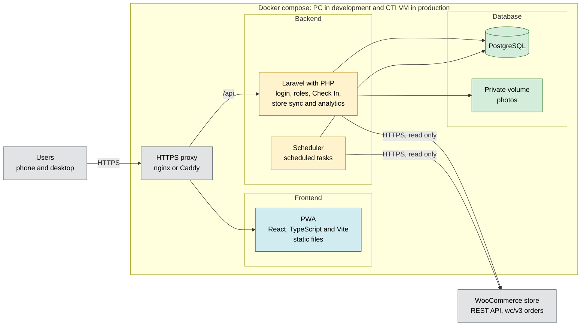

# Project Context

Last updated: 2026-11-05

The proposal (`docs/capstone_proposal/main.tex`) is the current baseline until further notice. This document says what changes it and why. The requirements are in `docs/requirements/SRS.md` and the open questions in `docs/decisions/` (`cti.md`, `gym.md`, `team.md`). `docs/capstone_proposal/v0/` is frozen: changes to the proposal go in a new version.

`Proposal:LINE` means a line of `docs/capstone_proposal/main.tex` (v0, frozen), the submitted capstone proposal.

Statuses: **Decided** (the team agreed on it), **Proposed** (needs confirmation), **Pending** (information is missing).

## 1. What changed since the proposal

| Topic | Proposal | Now | Why |
|---|---|---|---|
| Stack | React, TypeScript and Vite on Vercel; Supabase for Auth, PostgreSQL, Edge Functions, Storage and Realtime (Proposal:348-350) | Same PWA; Laravel backend; PostgreSQL in a container; everything in `docker-compose` | Something CTI can host in December, with no external services holding student data and at the lowest cost (section 2) |
| Real time | Optional real-time updates (Proposal:350) | Polling every 20 to 30 s first. Live updates (SSE or WebSockets) later, only if CTI allows them and time remains. The Objective 3 test compares values after each screen updates (Decided, Q&A 2026-10-13) | Occupancy only changes with a Check In, a check-out or an automatic close. SSE did not work through the tunnel and was not tested on the CTI VM. Decided: Staff check each person out, so occupancy counts open sessions (E-115) |
| Login | Supabase Auth with JWT; "institutional login" (Proposal:120, 350) | Own accounts with Sanctum and Fortify (Proposed). No SAML | Some paid members have no institutional email |
| Hosting | Vercel and Supabase on free plans, only for the demo (Proposal:348, 468) | `docker-compose` on each member's PC in development and on a CTI VM in production, running Rocky Linux 10 (E-123); its own UPRM subdomain, with the gym dashboard as a path under it (E-124). The team's access to the production server from off campus needs a VPN, requested by the project owner. The gym wants Check In to work from any network, mobile data included (gym.md, G-31); whether CTI's network allows it is open (cti.md, M-01) | What is tested is what runs in December |
| Language | Not stated | Spanish by default and English for all texts. One language per account: the User picks it when creating the account and changes it in the profile preferences; each staff account has its own language. No language button in the top bar (E-64). Texts in translation files from the start | Requested after the proposal |
| Paid member registration | Authorization Number; "email" without saying which one (Proposal:204) | Authorization Number, typed in the one registration field: exactly 10 digits is a student number and goes to athlete registration, anything else is an Authorization Number (E-153). The system shows the payment email masked and creates the account at that moment. The account email is always the WooCommerce payment email. No email verification. Protections: a lookup limit per IP and a global limit that only slows lookups and alerts the Administrator, never blocks (E-53), the same message for invalid, claimed and ended-term numbers with a contact number, release of a mistaken claim by Administrators, recovery by the owner with the password reset. The number can include letters, its length is not checked because it can change (6 and 7 characters have been seen), and it is unique across all orders (E-128, E-153). Lookups use only the current term's orders (E-71). If the app does not have the number yet, it asks the store right then and retries (E-127) | Some members have no institutional email. The Authorization Number reaches the payer by email, which serves as the check. A short number can be guessed, so lookups need limits. 3 of 69 real orders end in a letter, so registration cannot expect digits only (E-128). One registration field (E-153, which replaces E-112): a paid member who types a student number is told it is only for athletes and to use the Authorization Number from the receipt email |
| Athlete registration | Student number in the roster and confirm the institutional email (Proposal:206) | Same, typed in the same field as the Authorization Number (exactly 10 digits, E-153), and the account is created after opening a link sent to the roster email. An athlete not in the roster gets a clear message and a contact number. The team assumes the app has mail (E-61). That link is the only way to register: there is no in-person code (E-117). If the link fails, the athlete calls the office at 265-3866. A person not in the roster waits until an Administrator adds them | The student number is not secret: someone could claim another athlete's number first. An earlier idea of setting the password right away was dropped for this reason. A clear message helps athletes who were left off the list |
| Gym roles and roster | Separate User, Staff and Administrator roles; the Administrator maintains the roster (Proposal:175-177, 206, 218) | Personal staff accounts, with no shared gym account, no PIN and no recovery code (E-114). Each Staff member and Administrator has an email, a password and a role. Staff see sessions, check people out, verify Gym IDs, do assisted Check In and corrections, mark a photo as pending and see the roster read only (E-59). Administrators manage the roster by hand, terms, the store sync, schedules, notices, information, staff accounts, backups and the audit log. Analytics are open to every role. The Administrators are the two department secretaries and the department director; the install command creates the first one, and Administrators invite Staff by email. No review step for roster entries | Team decision (Q&A 2026-10-13, changed 2026-11-04 after the gym meeting). The audit log must say who did what, and desk staff change often |
| Demo and real data | Final integrated prototype; free plans for the demo | Demo in December before professors. "Complete" means all 5 objectives, without Stretch: roster, permissions, schedules, closures and analytics are committed; the roster tool and the Install button move to the MVP. Real WooCommerce data only to test the integration; fake data in development | Objectives 4 and 5 test items the scope table called Secondary; the team chose to meet every objective. Less student data on the team's PCs |
| Refunds | Re-import handles corrected, refunded or cancelled orders (Proposal:371); risk criterion names them (Proposal:456) | Refunds are made in the UPR Payment Gateway portal, outside WordPress and WooCommerce, so the store never shows them: none of the 84 orders read on 2026-11-04 has a refund. The team will not ask for access to the gateway or to Finance systems just for refunds. When the department refunds a membership, an Administrator revokes the authorization by hand with the revoke tool, with a reason, and the Administrator manual says so. If a refund is ever recorded in WooCommerce (status `refunded`), the sync revokes it on its own. A buyer who paid the wrong price is the department's mistake to fix, not a case the app handles. Each order stores whether the buyer is a student or an employee, for statistics (E-120) | The department does refund in some cases, for example when the gym stays closed. The earlier rule of no refunds (REQ-F-27) no longer holds. v1 of the proposal must still correct Proposal:371 and Proposal:456 |
| Athletes-only periods | Not stated | Administrators mark schedule slots as athletes only. Paid members cannot Check In then and see a notice. When a User does Check In or has an active session and an athletes-only period starts while the session is open, the app shows the start time of the period. The session is never cut. No separate lead-time setting | The gym has periods for athletes (team note), and members need to know before they try to Check In |
| Athletes and time | 60-minute session for everyone (Proposal:365) | A session stays open until Staff check the person out. A session nobody closes ends by itself 2 hours after Check In ("closed automatically"). A published closure or the end of a term ends every active session at once ("closed by closure"). Occupancy counts open sessions. A person may come back the same day, and each entry counts as a visit. The 60 minutes are a guide Staff apply when the gym is full; the app does not enforce them (E-115) | Team decision (2026-11-04). The department wants Staff to mark exits, and a check-out gives a real count of people inside |
| Type change and renewal | One account across types (Proposal:202, 356) | Renewal and type change happen inside the existing account: a new Authorization Number with the same payment email attaches to it; "I am an athlete" links a roster record after the User opens a link sent to the roster email (E-58). The account email does not change | One account and one history per person, with no staff merging |
| Safety records | Waivers, emergency contacts, documents and medical warnings, if the gym needs them (Proposal:220) | Waiver acceptance with full name, email and emergency contact (name and phone). No street address, documents or medical warnings. Staff see it from the Staff dashboard | Least sensitive data that covers an emergency |
| Session security | Not stated | 10 failed sign-in attempts, then a growing wait. No inactivity timeout for Users: the session lasts until sign out or sign in on another device. The one-device rule applies only to Users. A Staff sign-in ends after 2 hours without a person tapping or typing, and an Administrator sign-in after 20 minutes; deactivating a staff account ends its open sessions at once (E-130) | A timeout could sign a user out between Check In and the front desk |
| Account deletion | Not stated | The user requests it from the app, only without an active authorization. Personal data and photos are deleted; anonymous Check In counts stay | Less personal data kept, and analytics keep working |
| Audit log | Records Staff actor and time (Proposal:212, 513) | Records the staff account, time, IP address, device and browser, and values before and after, for corrections, assisted Check In, roster, terms, schedules, store syncs, manual entries and the other actions of REQ-NF-39. Every entry is kept 5 years, also when it mentions a deleted user (E-125). Only Administrators see it, and they can filter roster changes (E-126) | Personal accounts let the log name the person (E-114) |
| Analytics | The Administrator reviews utilization analytics (Proposal:220, Objective 5 in Proposal:184-190) | Facility statistics (visits per day and per hour with the peak hour, occupancy over time, average and maximum occupancy, athletes against student members and employee members, visits per sport, distinct people) open to every signed-in role, with aggregated counts only and no names. The Administrator also downloads an end-of-term summary (E-121). Manual entries from the paper log count and can be filtered out (E-119) | Team decision (Q&A 2026-10-14, 2026-11-04). The counts hold no personal data, and users can plan when to go. v1 of the proposal must change who sees analytics |
| Manual authorization | Access comes only from a paid WooCommerce order or the roster (Proposal:204-206, 371) | Administrators can grant an authorization by hand to an existing account, until the end of a chosen term, and revoke one. A reason of at least 10 characters is required, and the action is logged with time, IP and reason (E-86). It counts as a paid member for every rule (E-126) | Team decision (Q&A 2026-10-14). Fixes order errors. It gives access without a WooCommerce payment record, so it must be logged |
| Order to term | Not stated | An order belongs to the term that contains its payment date. Orders dated outside every term give no authorization and are counted as skipped on the Store sync screen. Assumed: the store only sells memberships while a term runs | Team decision (Q&A 2026-10-14). Gym to confirm |
| Store sync | An Export Orders file, loaded by the Administrator, with re-import and undo (Proposal:369, 371) | Paid memberships come from the store's REST API (wc/v3 orders), read with a read-only key kept in the server's environment file. Two ways to read: at registration, when a person types an Authorization Number the app does not have yet, the app asks the store right then and retries; and a full sync at least 3 times a day that picks up changes to known orders. Only orders with status `completed` give access. If a known order becomes `cancelled` or `refunded`, the sync revokes its authorization. The Administrator sees when the last sync ran and its counts, and has a "Sync now" button. There is no file upload, no re-import screen and no undo of an import (E-127). The VM needs outbound HTTPS to the store: an open item for CTI | Team decision (2026-11-04). A person who just paid must register at once, and a file loaded by hand lags behind the store. With no file there is nothing to undo. Each order gives order id, Authorization Number (meta field PGPAY_AUTHNUM of the "UPR Payment Gateway"), buyer name, payment email, product variation, status and paid date; the term comes from the paid date. The order's student number is not stored, and address, phone, IP and marketing fields are never stored |
| Session corrections | "Permitted corrections" not defined (Proposal:210) | Check-out is the routine way a session ends. End early and void are corrections. A void keeps the record but stops counting | Fixes mistakes without losing the trail |
| Staff-assisted Check In | Staff use "an approved identification method" (Proposal:212) | Paid member: Staff search by name and compare the stored photo, no receipt needed. Athlete: student number. Rejected for paid members during athletes-only periods | Team decision (E-49, E-54) |
| Follow-up rules | Not stated | Terms never overlap (E-48). A User with no active authorization sees a banner and Check In grayed out. The "expired" banner asks to renew; any other cause shows the contact number. Both show "I am an athlete" and the Authorization Number field, and the User still sees schedules, notices, information and analytics (E-67, E-97, E-100, which replace E-50). Releasing a wrong claim deletes only that authorization and its photo, and the account stays; an account whose only authorization is released is still open (E-87, which replaces E-52) | Team decision (2026-10-14, 2026-10-17, 2026-10-19) |
| One roster | Athlete lists each semester, digitized by the Administrator (Proposal:206) | One roster, entered by hand by Administrators, with no file import. Each record has name, sport, student number and institutional email. An athlete stays until an Administrator removes them. Each new term the athlete only uploads a new photo; the waiver is not asked again (E-116) | The department keeps the lists in Word, so there is no file to import |
| Photo pending and manual entries | Not stated | Staff mark an account "photo pending" when the photo does not match the person. Check In stays off until the person uploads a new photo from the phone. Whether the upload clears the mark by itself or Staff approve it is open (E-118). After an outage, Administrators enter the paper log as manual entries, with an audit log entry each (E-119) | Team decision (2026-11-04). Staff do not take photos. Up to one week down is acceptable |
| Data kept, backups and server | Not stated | Every kind of data is kept 5 years (E-125). A User account is deleted 5 years after its last sign-in or Check In; while it is active, each visit, sync record and audit log entry is deleted 5 years after it was created (E-131). Only the current photo is kept: the previous term's photo is deleted when the new one arrives (E-135). The server shrinks each photo to about 0.5 MB (E-138). Backups go to a second virtual disk on the same VM every two weeks, the last two are kept, and the Administrator panel can back up now, download and restore (E-122). The server runs Rocky Linux 10, and one install command sets it up (E-123) | Team decision (2026-11-04). Losing the whole VM loses the backups too; the team accepts that risk |

## 2. Stack decisions and why

| Layer | Choice | Status |
|---|---|---|
| Frontend | PWA with React, TypeScript and Vite (as in the proposal) | Decided |
| Frontend hosting | Static files served by nginx inside `docker-compose`, on the same origin as the API. Vercel out of the plan | Decided |
| Interface language | Spanish by default and English for all texts, one language per account, no language button (E-64). Texts in translation files from the start, in React and in Laravel. API errors are a code that the PWA translates (E-154) | Decided |
| Backend | Laravel (PHP 8.3 or higher) | Decided |
| Database | PostgreSQL in a container | Decided |
| Single active session per user | PostgreSQL exclusion constraint on the session time range (`btree_gist` extension), written in SQL inside the migrations. Authorization Number and roster claims use UNIQUE constraints | Decided |
| Login | Sanctum (cookies for the SPA) and Fortify (registration, password recovery, email link for athletes, attempt limits) | Proposed |
| Single active device | On sign in, the user's other sessions are deleted, or `current_session_id` is stored on the user and a middleware checks it. Chosen during implementation. Applies only to Users, not to staff accounts | Decided |
| Permissions | Personal staff accounts with a role of Staff or Administrator, in a table separate from User accounts. Laravel Policies check the role, plus database constraints (replaces RLS) | Decided (accounts, E-114); Proposed (Policies) |
| Photos | Private disk on a volume. JPEG, PNG or HEIC up to 10 MB, converted to JPEG without location metadata | Proposed (storage); Decided (types and size) |
| On-screen occupancy | Periodic polling every 20 to 30 seconds; live updates later if possible | Decided |
| Session close (2 hours) | Staff check-out sets the end. A session nobody closes ends 2 hours after Check In, calculated on the server when queried. A closure or the end of a term closes every active session. Scheduled task for cleanup | Decided (rule, E-115); Proposed (query method) |
| External authentication (SAML) | Not used. Own accounts. The account email is the one already in the record: the WooCommerce payment email for paid members and the institutional email from the roster for athletes | Decided. The paid member's email is not verified |
| Supabase and Vercel | Out of the plan. CTI services only | Decided (Q&A 2026-10-13) |
| Athlete registration | Student number looked up in the roster, confirm the institutional email, password and photo. The account is created only after opening the link sent to the email in the record. Athletes not in the roster get a clear message | Decided |
| Containers | `docker-compose`: proxy (nginx or Caddy), PHP, PostgreSQL, scheduled tasks, and in development a fake mail server | Decided |
| Single origin | The PWA at `/` and the API at `/api` under the same domain name. The gym dashboard is a path under the same name (E-124) | Proposed |
| Domain | The app gets its own UPRM subdomain and does not replace the department's site. The name is still to pick. The project owner files a domain ticket with the name; CTI assigns the IP (E-124) | Decided |
| Development | On each member's PC with Docker Desktop. Phone tests through a tunnel | Decided |
| Production | CTI VM. The project owner (the gym director) files the VM ticket, the domain ticket and the team's VPN request with CTI; the team cannot file them. The team gives him the size and the name | Decided |
| Server | Rocky Linux 10 with Docker CE. One install command, run once with sudo by the team or a technician, sets the firewall and SELinux, starts the app, creates the first Administrator and schedules the backups. The same command restores a backup on a new server. Administrators never use Docker or the server (E-123) | Decided |
| Mail in production | Needed for athlete registration and password reset. The team assumes the app has mail, so the email-link flows are built (E-61). In production a mail service on the VM (CTI suggests Postfix) relays through the CTI mail gateway once CTI authorizes the VM (cti.md, M-07). If CTI does not authorize it, an external provider, which needs approval because account emails leave the CTI VM (M-11). No provider is chosen. In development: fake mail server | Pending (CTI) |
| Where data is stored | Section 7 | Pending |
| API contract | Documented with OpenAPI, and API tests that do not depend on the framework | Proposed |
| Who looks after the system | Asked to the gym (gym.md, G-01). CTI says it is the owner's question and that CTI has no people to adopt the system | Pending |
| Budget | Minimum cost for the gym. Rely on CTI where possible | Decided |

Reasons:

- **No SAML.** The design already creates its own accounts. Some paid members have no institutional email: they identify with the Authorization Number and their email is the payment email, which is already in the WooCommerce record. Athletes use their institutional email, and their lists already exist. SAML would leave out paid members who are not from UPR. CTI said it is not needed with internal authentication.
- **PostgreSQL and not MySQL.** The single active session rule is expressed with an exclusion constraint on time ranges, which MySQL and MariaDB do not have (Proposal:511 asks for constraints that prevent overlapping active sessions and duplicate claims). MySQL can emulate partial unique indexes with functional indexes, but not exclusion constraints. A partial index does not work here because PostgreSQL does not allow `now()` in its condition. Laravel supports PostgreSQL.
- **Containers from the start.** What is tested on the PC is what runs on the VM. December is a deployment, not a migration.
- **Laravel.** CTI recommended it and uses it in its own migration. CTI will not maintain it: it has no people to adopt the project. It brings login, sessions, email verification and attempt limits as official, free packages (MIT license): less security code to write.
- **Supabase out.** If the backend and PostgreSQL run in the containers, Supabase does not add what is needed. It adds an external dependency, student data outside UPRM, and the free plan pauses after a week without use. Auth, RLS, Storage, Realtime and Edge Functions have a direct replacement in Laravel.
- **Vercel out.** With the PWA on Vercel and the API somewhere else, the browser sees two sites and cookie login stops being reliable. The free plan is only for personal non-commercial use. It is an external service with student data that CTI has not approved, and one more piece to look after when the PWA is static files that nginx serves just as well. Automatic previews per PR are lost; they are replaced with a tunnel. Reconsidered only if the VM is delayed and something public is needed.
- **Cookies and a single origin.** No CORS and no cross-domain cookies. Sanctum advises against tokens for a first-party SPA. The cookie must not declare the domain of all of UPRM, so other `uprm.edu` applications cannot read it.
- **Periodic polling.** Occupancy is an estimate that only changes with a Check In or an expiration. A delay of 20 to 30 seconds does not change any decision. It can be replaced later without touching the rest. The test that requires the same value on all interfaces (Proposal:166) is measured after each screen updates.
- **Personal staff accounts.** The audit log has to say who did what, and desk staff change often, so every Staff member and Administrator signs in as themselves, with no PIN and no recovery code (E-114). A separate table keeps User rules (one device, deletion) apart from staff rules, and a student employee can have both accounts with the same email. The Administrators are the two department secretaries and the director.

Migrating between Laravel and Node (reasoned estimate, not measured): the frontend does not change if the API contract stays the same; the database does not change if the critical rules are in SQL; the backend is rewritten (login, Check In, WooCommerce sync, roles and scheduled tasks).

## 3. Team rules

- Everyone uses the same `docker-compose` and the same Docker images, with a pinned version (never `latest`).
- Production images are built in one place, not on each laptop. On a Mac with an M chip, build for `linux/amd64`.
- Do not use ports 5000 or 7000 (AirPlay on macOS).
- Consistent upper and lower case in file names: Linux tells them apart and Windows and macOS do not.
- Real data outside git and synced folders (OneDrive). Original athlete lists in a protected folder outside the repository. The WooCommerce read-only key only in the environment file of the server and of the lead's computer. It is never shared by chat or committed; the team develops with fake data, and at delivery the key is revoked and a new one is made for the server only (E-137).
- Protection of `main` is on: a PR and 1 approved review from another member are required (team.md, E-28).
- Changes enter `main` through branches and pull requests reviewed by at least one member who is not the author (Proposal:515; was SRS REQ-NF-45).
- Development uses fake data (was SRS REQ-NF-08; also in SRS REQ-NF-07).
- Server credentials live in protected configuration, outside the repository (Proposal:509; was SRS REQ-NF-18).
- Database migrations are reproducible, and the development configuration is separate from the production configuration (Proposal:515; was SRS REQ-NF-32).

## 4. What CTI said

- CTI creates the VM when the project owner files a ticket on the CTI web page (menu Solicitudes): it clones a template, typically the same day to about a day depending on urgency, and gives the first account, with sudo, to the owner. In the meeting CTI described no evaluation or approval step (to confirm, cti.md M-04, M-05). The server runs Rocky Linux 10, since CTI is moving its own servers to it (E-123).
- CTI does not manage or maintain the server or the application and has no people to adopt it. The owner must define the long-term plan. Part of the deployment work after December (install, configuration, accounts, user orientation) is the owner's, and CTI asked that he know it now.
- CTI recommends Laravel. CTI adopted it in its own new migration, mainly for the learning curve, and has suggested it to other projects. CTI's general line for a new system is Linux, Apache and MySQL, but the framework, the database and containers are the team's choice.
- SAML is only needed if authentication is external.
- CTI asked to talk with the user (the gym) about implementation and continuity.
- CTI did not answer whether development can use external services and migrate later.
- Meeting with the CTI contact on 2026-10-22: [summary in Announcements](https://github.com/Th3-Minorities/natatorio-gym-app/discussions/59). Answers are in cti.md.
- The VM and the domain are separate tickets. The team's access from off campus needs a VPN that the owner requests (a VPN ticket or an email listing the team's emails). The owner answers for every account he authorizes.
- Mail: CTI relays through its gateway after it authorizes the VM (cti.md, M-07).
- The data may stay on the VM disk. Where backups go is the team's decision (cti.md, M-13, M-06).
- Users reaching the app from off campus, the 60 minutes, the roster updates, the waiver form and who takes the photo were the gym's decisions, and the gym answered them on 2026-11-04 (gym.md, G-21, G-31 to G-34).
- CTI is Centro de Tecnologías de Información. Requests: https://www.uprm.edu/cti/, menu Solicitudes (checked 2026-10-24). The gym director has the CTI contact's phone number.
- Adopted: the installer, as one install command (team.md, E-123), and an audit log nobody can edit, with search and export (E-108). Still proposed: a written disaster recovery plan (E-110). CTI did not say whether they are conditions for the VM.

## 5. Tested on a PC with Windows 11 Home and a Samsung

| Test | Result |
|---|---|
| Docker Desktop with Linux containers | Works |
| HTTPS without a domain with Cloudflare Quick Tunnel | Works |
| Location on a Samsung (Chrome) through the tunnel | Works. 19 m accuracy at home |
| WebSocket through the tunnel | Works |
| SSE through the tunnel | Does not work |
| Installable PWA in Chrome | Yes, with manifest and 192 and 512 px icons |
| Service worker | Registers |

Notes:

- Chrome does not always show the install prompt. Solved with a custom button that uses the `beforeinstallprompt` event. It only works in Chromium-based browsers. On iPhone it is installed by hand from Share.
- Location has to be measured inside the gym.
- Cloudflare Quick Tunnel changes URL every time. The free ngrok plan gives a fixed URL, with 20,000 requests and 1 GB per month.

## 6. Diagram

**Type:** Container diagram. **Use it to:** see at a glance which parts run where. The detailed version is in `docs/design/architecture.md`.

## 7. Privacy and where data is stored

FERPA is a U.S. federal law that protects students' education records.

Verified:

- The Department of Education page says it gives the right to access records and request corrections, and that those rights pass to the student on entering a postsecondary institution. It does not define which schools it covers or what a record is.
- A search showed UPR documents that say they comply with the law, which applies to institutions that receive funds from the federal Department of Education. Those PDFs could not be opened. It is an indication, not a confirmation.

We do not know:

- Whether gym data (student number, athlete status, photo, Check Ins) counts as an education record. UPRM decides.
- Whether another law applies to emergency contacts. They are sensitive data even if they do not fall under FERPA.

Already in the design: Staff see only the essentials, there is an audit log and photos are private. No street address, documents or medical warnings are stored. IP addresses in the audit log are personal data.

Missing: confirm with the Registrar's Office or with CTI whether the gym is covered; the privacy notice in Spanish and English, which the team drafts and the gym approves (E-126); do not send student data to external services without approval. Retention: every kind of data is kept 5 years (E-125), counted as in E-131. A backup downloaded from the Administrator panel (E-122) is an encrypted file that needs a password to open, because it holds every photo and every person's data (E-137).

Options by data type. **Not decided.** The current design stores everything on the CTI VM. The only outside call today is the compromised-password check, which sends no student data (E-98). An external mail provider would be a second one, only if CTI does not authorize the VM on its mail gateway, and with approval (E-61, M-11).

| Data | Options | What to ask |
|---|---|---|
| Database (accounts, authorizations, sessions) | PostgreSQL volume on the CTI VM. An external database service only with approval. CTI said the VM disk may hold the data; the team decides | Is the VM disk encrypted? Who has access to the server? |
| Photos and documents | Private volume on the VM. CTI or UPRM storage if it exists. An external service only with approval. CTI said the VM disk may hold them | Does CTI offer storage? Can student photos be stored in an external service? |
| Backups | A second virtual disk on the same VM, every two weeks, the last two kept, plus an Administrator download and restore (E-122). Losing the whole VM loses the backups too; the team accepts that risk | Does CTI offer snapshots or storage? |
| Original athlete lists | Protected folder outside the repository. Not in OneDrive or git | The department keeps the athlete lists in Word (E-116). Who has access? |
| WooCommerce read-only API key | The environment file of the server and of the lead's computer only (E-127, E-137). Not in the database, git, logs or chat. Revoked at delivery and replaced by a new key for the server only | Who at the department's WordPress issues it? Can the VM reach the store over HTTPS? |
| Athlete registration and password reset emails | CTI relay through its mail gateway after CTI authorizes the VM (M-07). An external provider only if it does not, and with approval (E-61) | Who sets SPF and DKIM? Final sender (commonly a no-reply address at the server's domain; the owner may want another) |

## 8. Not verified

- That the install command works on Rocky Linux 10 with Docker CE, the firewall and SELinux (E-123): not tested yet.
- The nginx configuration for SSE.
- Cookie behavior inside the installed PWA on iPhone.
- Whether the Authorization Number is compared with or without regard to letter case. The number is unique across all orders and can include letters (E-128).
- Whether WebSockets and SSE work on ngrok.
- Costs of a rented server.
- Whether the store owner gives the team a read-only API key for the production store, and whether CTI allows outbound HTTPS from the VM to the store (E-127). The team read 84 orders on 2026-11-04.

## 9. Sources

- [Laravel: authentication](https://laravel.com/docs/13.x/authentication)
- [Laravel Sanctum](https://laravel.com/docs/13.x/sanctum)
- [Laravel: deployment and requirements](https://laravel.com/docs/13.x/deployment)
- [Laravel: database and pooled connections](https://laravel.com/docs/13.x/database)
- [MDN: cookies, SameSite and Domain](https://developer.mozilla.org/en-US/docs/Web/HTTP/Guides/Cookies)
- [MDN: Geolocation requires HTTPS](https://developer.mozilla.org/en-US/docs/Web/API/Geolocation_API)
- [MDN: custom install button](https://developer.mozilla.org/en-US/docs/Web/Progressive_web_apps/How_to/Trigger_install_prompt)
- [Cloudflare Quick Tunnels](https://developers.cloudflare.com/tunnel/get-started/quick-tunnels/)
- [Supabase: pricing](https://supabase.com/pricing)
- [Vercel Hobby](https://vercel.com/docs/plans/hobby)
- MIT licenses: [Laravel](https://github.com/laravel/framework), [Sanctum](https://github.com/laravel/sanctum), [Fortify](https://github.com/laravel/fortify)
