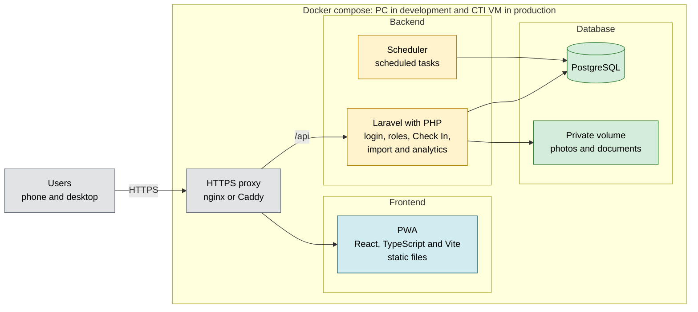

# Project Context

Last updated: 2026-10-11

The proposal (`docs/capstone_proposal/main.tex`) is the current baseline until further notice. This document says what changes it and why. The requirements are in `docs/requirements/SRS.md` and the open questions in `docs/decisions.md`. `docs/capstone_proposal/v0/` is frozen: changes to the proposal go in a new version.

Statuses: **Decided** (the team agreed on it), **Proposed** (needs confirmation), **Pending** (information is missing).

## 1. What changed since the proposal

| Topic | Proposal | Now | Why |
|---|---|---|---|
| Stack | React, TypeScript and Vite on Vercel; Supabase for Auth, PostgreSQL, Edge Functions, Storage and Realtime (`main.tex:348-350`) | Same PWA; Laravel backend; PostgreSQL in a container; everything in `docker-compose` | Something CTI can host in December, with no external services holding student data and at the lowest cost (section 2) |
| Real time | Optional real-time updates (`main.tex:350`) | Periodic polling every 20 to 30 s (Proposed) | Occupancy only changes with a Check In or an expiration. SSE did not work through the tunnel |
| Login | Supabase Auth with JWT; "institutional login" (`main.tex:120, 350`) | Own accounts with Sanctum and Fortify (Proposed). No SAML | Some paid members have no institutional email |
| Hosting | Vercel and Supabase on free plans, only for the demo (`main.tex:348, 468`) | `docker-compose` on each member's PC in development and on a CTI VM in production; UPRM subdomain | What is tested is what runs in December |
| Language | Not stated | Spanish by default, button to switch everything to English; texts in translation files from the start | Requested after the proposal |
| Paid member registration | Authorization Number; "email" without saying which one (`main.tex:204`) | Authorization Number; the account email is the WooCommerce payment email | Some members have no institutional email |
| Athlete registration | Student number in the roster and confirm the institutional email (`main.tex:206`) | Same, and the account is created after opening a link sent to the roster email | The student number is not secret |
| Staff and roster | The Administrator maintains the roster (`main.tex:206, 218`) | Only designated Staff, with a separate permission, digitize and change the roster each semester. A record entered this way is preapproved. Who designates: Pending | Some of the department staff are Staff and already do this work with the lists each semester |
| Demo and real data | Final integrated prototype; free plans for the demo | Demo in December before professors, with the project "complete" (what it means: Pending). Real WooCommerce data only to test the integration; fake data in development | Less student data on the team's PCs |

## 2. Stack decisions and why

| Layer | Choice | Status |
|---|---|---|
| Frontend | PWA with React, TypeScript and Vite (as in the proposal) | Decided |
| Frontend hosting | Static files served by nginx inside `docker-compose`, on the same origin as the API. Vercel out of the plan | Decided |
| Interface language | Spanish by default and a button to switch all texts to English. Texts in translation files from the start, in React and in Laravel | Decided |
| Backend | Laravel (PHP 8.3 or higher) | Decided |
| Database | PostgreSQL in a container | Decided |
| Single active session per user | PostgreSQL exclusion constraint on the session time range (`btree_gist` extension), written in SQL inside the migrations. Authorization Number and roster claims use UNIQUE constraints | Decided |
| Login | Sanctum (cookies for the SPA) and Fortify (registration, password recovery, email verification) | Proposed |
| Single active device | On sign in, the user's other sessions are deleted, or `current_session_id` is stored on the user and a middleware checks it. Chosen during implementation. Whether it applies to Staff and Administrator: Pending | Decided |
| Permissions | Laravel Policies plus database constraints (replaces RLS) | Proposed |
| Photos and documents | Private disk on a volume | Proposed |
| On-screen occupancy | Periodic polling every 20 to 30 seconds | Proposed, needs confirmation |
| Session expiration (60 min) | Calculated on the server when queried. Scheduled task for cleanup | Proposed |
| External authentication (SAML) | Not used. Own accounts. The account email is the one already in the record: the WooCommerce payment email for paid members and the institutional email from the roster for athletes | Decided. Whether the paid member's email is verified and how: Pending |
| Supabase | Out of the plan. Only reconsidered if CTI does not provide a VM or does not allow containers | Proposed (confirmation is still open) |
| Athlete registration | Student number looked up in the roster, confirm the institutional email, password and photo. The account is created only after opening the link sent to the email in the record | Decided. Same response whether or not it is in the roster: Proposed |
| Containers | `docker-compose`: proxy (nginx or Caddy), PHP, PostgreSQL, scheduled tasks, and in development a fake mail server | Decided |
| Single origin | The PWA at `/` and the API at `/api` under the same domain name | Proposed |
| Domain | Provided by UPRM | Decided |
| Development | On each member's PC with Docker Desktop. Phone tests through a tunnel | Decided |
| Production | CTI VM, to be requested now | Decided |
| Mail in production | CTI SMTP or relay if it exists. If not, an external provider only with approval, because student emails and names go through a third party. In development: fake mail server | Pending |
| Where data is stored | Section 7 | Pending |
| API contract | Documented with OpenAPI, and API tests that do not depend on the framework | Proposed |
| Who looks after the system | Defined later | Pending |
| Budget | Minimum cost for the gym. Rely on CTI where possible | Decided |

Reasons:

- **No SAML.** The design already creates its own accounts. Some paid members have no institutional email: they identify with the Authorization Number and their email is the payment email, which is already in the WooCommerce record. Athletes use their institutional email, and their lists already exist. SAML would leave out paid members who are not from UPR. CTI said it is not needed with internal authentication.
- **PostgreSQL and not MySQL.** The single active session rule is expressed with an exclusion constraint on time ranges, which MySQL and MariaDB do not have (`main.tex:511` asks for constraints that prevent overlapping active sessions and duplicate claims). MySQL can emulate partial unique indexes with functional indexes, but not exclusion constraints. A partial index does not work here because PostgreSQL does not allow `now()` in its condition. Laravel supports PostgreSQL.
- **Containers from the start.** What is tested on the PC is what runs on the VM. December is a deployment, not a migration.
- **Laravel.** CTI recommended it based on earlier projects; CTI can help in the VM evaluation, but CTI will not maintain it. It brings login, sessions, email verification and attempt limits as official, free packages (MIT license): less security code to write.
- **Supabase out.** If the backend and PostgreSQL run in the containers, Supabase does not add what is needed. It adds an external dependency, student data outside UPRM, and the free plan pauses after a week without use. Auth, RLS, Storage, Realtime and Edge Functions have a direct replacement in Laravel.
- **Vercel out.** With the PWA on Vercel and the API somewhere else, the browser sees two sites and cookie login stops being reliable. The free plan is only for personal non-commercial use. It is an external service with student data that CTI has not approved, and one more piece to look after when the PWA is static files that nginx serves just as well. Automatic previews per PR are lost; they are replaced with a tunnel. Reconsidered only if the VM is delayed and something public is needed.
- **Cookies and a single origin.** No CORS and no cross-domain cookies. Sanctum advises against tokens for a first-party SPA. The cookie must not declare the domain of all of UPRM, so other `uprm.edu` applications cannot read it.
- **Periodic polling.** Occupancy is an estimate that only changes with a Check In or an expiration. A delay of 20 to 30 seconds does not change any decision. It can be replaced later without touching the rest. The test that requires the same value on all interfaces (`main.tex:166`) must be measured after an update.

Migrating between Laravel and Node (reasoned estimate, not measured): the frontend does not change if the API contract stays the same; the database does not change if the critical rules are in SQL; the backend is rewritten (login, Check In, WooCommerce import, roles and scheduled tasks).

## 3. Team rules

- Everyone uses the same `docker-compose` and the same Docker images, with a pinned version (never `latest`).
- Production images are built in one place, not on each laptop. On a Mac with an M chip, build for `linux/amd64`.
- Do not use ports 5000 or 7000 (AirPlay on macOS).
- Consistent upper and lower case in file names: Linux tells them apart and Windows and macOS do not.
- Real data outside git and synced folders (OneDrive). Original lists and WooCommerce exports in a protected folder outside the repository.
- Protection of `main` (not yet turned on): first require a PR and block direct push; when the other two members have write access, require 1 approved review.

## 4. What CTI said

- CTI can create a VM (Ubuntu 26 or Rocky 10), after an evaluation.
- CTI does not manage or maintain the server or the application. The team must define the plan.
- He recommends Laravel (PHP, MySQL) because he has used it in earlier projects. He does not require it.
- SAML is only needed if authentication is external.
- He asked to talk with the user (the gym) about implementation and continuity.
- He did not answer whether development can use external services and migrate later.

## 5. Tested on a PC with Windows 11 Home and a Samsung

| Test | Result |
|---|---|
| Docker Desktop with Linux containers | Works |
| HTTPS without a domain with Cloudflare Quick Tunnel | Works |
| Location on a Samsung (Chrome) through the tunnel | Works. 19 m accuracy at home |
| WebSocket through the tunnel | Works |
| SSE through the tunnel | Does not work |
| Installable PWA in Chrome | Yes, with manifest and 192 and 512 px icons |
| Service worker | Registers |

Notes:

- Chrome does not always show the install prompt. Solved with a custom button that uses the `beforeinstallprompt` event. It only works in Chromium-based browsers. On iPhone it is installed by hand from Share.
- Location has to be measured inside the gym.
- Cloudflare Quick Tunnel changes URL every time. The free ngrok plan gives a fixed URL, with 20,000 requests and 1 GB per month.

## 6. Diagram

## 7. Privacy and where data is stored

FERPA is a U.S. federal law that protects students' education records.

Verified:

- The Department of Education page says it gives the right to access records and request corrections, and that those rights pass to the student on entering a postsecondary institution. It does not define which schools it covers or what a record is.
- A search showed UPR documents that say they comply with the law, which applies to institutions that receive funds from the federal Department of Education. Those PDFs could not be opened. It is an indication, not a confirmation.

We do not know:

- Whether gym data (student number, athlete status, photo, Check Ins) counts as an education record. UPRM decides.
- Whether another law applies to emergency contacts and medical notices. They are sensitive data even if they do not fall under FERPA.

Already in the design: Staff see only the essentials, there is an audit log and photos are private.

Missing: confirm with the Registrar's Office or with CTI whether the gym is covered; a privacy notice in Spanish and English; retention rules; do not send student data to external services without approval.

Options by data type. **Not decided.** The current design stores everything on the CTI VM, with no external services.

| Data | Options | What to ask |
|---|---|---|
| Database (accounts, authorizations, sessions) | PostgreSQL volume on the CTI VM. An external database service only with approval | Is the VM disk encrypted? Who has access to the server? |
| Photos and documents | Private volume on the VM. CTI or UPRM storage if it exists. An external service only with approval | Does CTI offer storage? Can student photos be stored in an external service? |
| Backups | Copy outside the VM: CTI storage, another UPRM server or an approved external service | Where can backups go? How long are they kept? |
| Original lists and WooCommerce exports | Protected folder outside the repository. Not in OneDrive or git | Where does the department keep them today and who has access? |
| Verification emails | CTI SMTP. An external provider only with approval | Is there SMTP and with what sender address? |

## 8. Not verified

- That Rocky 10 uses Podman.
- The nginx configuration for SSE.
- Cookie behavior inside the installed PWA on iPhone.
- Whether WebSockets and SSE work on ngrok.
- Costs of a rented server.
- Whether CTI developers maintain Laravel applications. Inferred from CTI's email.
- Whether the WooCommerce API is available to the team. There is authorized access to Orders and Export Orders (`main.tex:369`).
- The meaning of the acronym CTI.

## 9. Sources

- [Laravel: authentication](https://laravel.com/docs/13.x/authentication)
- [Laravel Sanctum](https://laravel.com/docs/13.x/sanctum)
- [Laravel: deployment and requirements](https://laravel.com/docs/13.x/deployment)
- [Laravel: database and pooled connections](https://laravel.com/docs/13.x/database)
- [MDN: cookies, SameSite and Domain](https://developer.mozilla.org/en-US/docs/Web/HTTP/Guides/Cookies)
- [MDN: Geolocation requires HTTPS](https://developer.mozilla.org/en-US/docs/Web/API/Geolocation_API)
- [MDN: custom install button](https://developer.mozilla.org/en-US/docs/Web/Progressive_web_apps/How_to/Trigger_install_prompt)
- [Cloudflare Quick Tunnels](https://developers.cloudflare.com/tunnel/get-started/quick-tunnels/)
- [Supabase: pricing](https://supabase.com/pricing)
- [Vercel Hobby](https://vercel.com/docs/plans/hobby)
- MIT licenses: [Laravel](https://github.com/laravel/framework), [Sanctum](https://github.com/laravel/sanctum), [Fortify](https://github.com/laravel/fortify)
