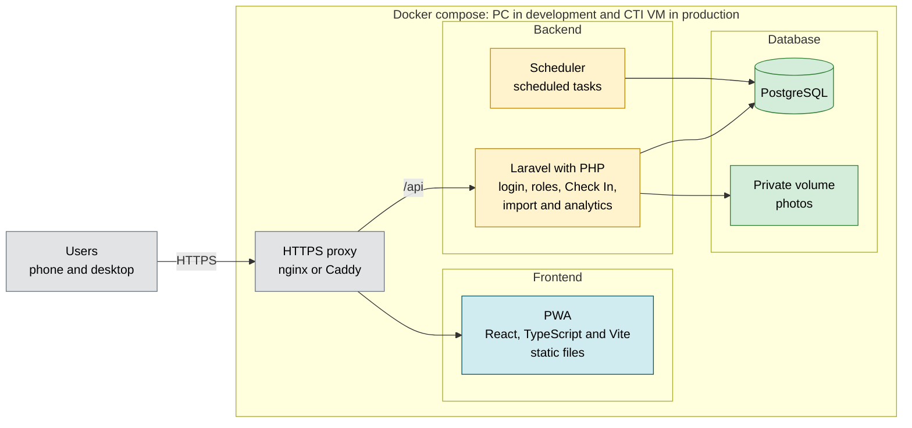

# Project Context

Last updated: 2026-10-14

The proposal (`docs/capstone_proposal/main.tex`) is the current baseline until further notice. This document says what changes it and why. The requirements are in `docs/requirements/SRS.md` and the open questions in `docs/decisions/` (`cti.md`, `gym.md`, `team.md`). `docs/capstone_proposal/v0/` is frozen: changes to the proposal go in a new version.

`Proposal:LINE` means a line of `docs/capstone_proposal/main.tex` (v0, frozen), the submitted capstone proposal.

Statuses: **Decided** (the team agreed on it), **Proposed** (needs confirmation), **Pending** (information is missing).

## 1. What changed since the proposal

| Topic | Proposal | Now | Why |
|---|---|---|---|
| Stack | React, TypeScript and Vite on Vercel; Supabase for Auth, PostgreSQL, Edge Functions, Storage and Realtime (Proposal:348-350) | Same PWA; Laravel backend; PostgreSQL in a container; everything in `docker-compose` | Something CTI can host in December, with no external services holding student data and at the lowest cost (section 2) |
| Real time | Optional real-time updates (Proposal:350) | Polling every 20 to 30 s first. Live updates (SSE or WebSockets) later, only if CTI allows them and time remains. The Objective 3 test compares values after each screen updates (Decided, Q&A 2026-10-13) | Occupancy only changes with a Check In or an expiration. SSE did not work through the tunnel and was not tested on the CTI VM |
| Login | Supabase Auth with JWT; "institutional login" (Proposal:120, 350) | Own accounts with Sanctum and Fortify (Proposed). No SAML | Some paid members have no institutional email |
| Hosting | Vercel and Supabase on free plans, only for the demo (Proposal:348, 468) | `docker-compose` on each member's PC in development and on a CTI VM in production; UPRM subdomain | What is tested is what runs in December |
| Language | Not stated | Spanish by default, button to switch everything to English; texts in translation files from the start | Requested after the proposal |
| Paid member registration | Authorization Number; "email" without saying which one (Proposal:204) | Authorization Number only. The system shows the payment email masked and creates the account at that moment. The account email is always the WooCommerce payment email. No email verification. Protections: a lookup limit per IP and a global limit that only slows lookups and alerts the Administrator, never blocks (E-53), the same message for invalid and claimed numbers with a contact number, release of a mistaken claim by PIN holders, recovery by the owner with the password reset | Some members have no institutional email. The Authorization Number reaches the payer by email, which serves as the check. A 6-digit number can be guessed, so lookups need limits. Whether it is unique across orders is not verified |
| Athlete registration | Student number in the roster and confirm the institutional email (Proposal:206) | Same, and the account is created after opening a link sent to the roster email. An athlete not in the roster gets a clear message and a contact number. If CTI has no outgoing mail, Staff (no PIN needed) register in person athletes already in the roster; a person not in the roster waits until a PIN holder adds them | The student number is not secret: someone could claim another athlete's number first. An earlier idea of setting the password right away was dropped for this reason. A clear message helps athletes who were left off the list |
| Gym roles and roster | Separate User, Staff and Administrator roles; the Administrator maintains the roster (Proposal:175-177, 206, 218) | One shared gym account. Without the PIN (Staff) it sees sessions, verifies Gym IDs, does assisted Check In and corrections. With the PIN (Administrator) it manages the roster, terms, imports, schedules, notices, information, the audit log and the PIN. Staff see the current-term roster read only (E-59, gym to confirm). Analytics are open to every role, not behind the PIN. No designated roster Staff and no review step. A one-time recovery code on paper resets the gym password and PIN (E-60) | Team decision (Q&A 2026-10-13). One PIN known only to the administration protects sensitive actions. The audit log replaces a review of roster entries |
| Demo and real data | Final integrated prototype; free plans for the demo | Demo in December before professors. "Complete" means all 5 objectives, without Stretch: roster, permissions, schedules, closures and analytics are committed; the roster tool and the Install button move to the MVP. Real WooCommerce data only to test the integration; fake data in development | Objectives 4 and 5 test items the scope table called Secondary; the team chose to meet every objective. Less student data on the team's PCs |
| Refunds | Re-import handles corrected, refunded or cancelled orders (Proposal:371); risk criterion names them (Proposal:456) | No refunds or cancellations. Memberships only expire at the end of the term. The import only handles new and corrected orders. REQ-F-27 removed | The gym does not refund memberships. v1 of the proposal must drop refunds and cancellations from Proposal:371 and from the criterion in Proposal:456 |
| Athletes-only periods | Not stated | PIN holders mark schedule slots as athletes only. Paid members cannot Check In then and see a notice. When a User does Check In or has an active session and an athletes-only period starts within that 60-minute session, the app shows the start time of the period. The session is never cut. No separate lead-time setting | The gym has periods for athletes (team note), and members need to know before they try to Check In |
| Athletes and time | 60-minute session for everyone (Proposal:365) | Same session for counting. Athletes have no time limit in the gym and can see their account | Team decision (Q&A 2026-10-13). Occupancy needs one counting rule for everyone |
| Type change and renewal | One account across types (Proposal:202, 356) | Renewal and type change happen inside the existing account: a new Authorization Number with the same payment email attaches to it; "I am an athlete" links a roster record after the User opens a link sent to the roster email (E-58). The account email does not change | One account and one history per person, with no staff merging |
| Safety records | Waivers, emergency contacts, documents and medical warnings, if the gym needs them (Proposal:220) | Waiver acceptance with full name, email and emergency contact (name and phone). No street address, documents or medical warnings. Staff see it from the Staff dashboard | Least sensitive data that covers an emergency |
| Session security | Not stated | 10 failed sign-in attempts, then a growing wait. No inactivity timeout: the session lasts until sign out or sign in on another device. The one-device rule applies only to Users | A timeout could sign a user out between Check In and the front desk. The gym account is shared, so the one-device rule does not fit it |
| Account deletion | Not stated | The user requests it from the app, only without an active authorization. Personal data and photos are deleted; anonymous Check In counts stay | Less personal data kept, and analytics keep working |
| Audit log | Records Staff actor and time (Proposal:212, 513) | Records account, time, IP address, device and browser, and values before and after, for corrections, assisted Check In, roster, terms, schedules, imports and PIN changes. Each entry is kept until the end of the term in which it happened, also when it mentions a deleted user (Decided, 2026-10-14). Only PIN holders see it | With one shared account the log cannot name a person; time and IP let the gym cross-check the shift schedule if someone misused the account |
| Analytics | The Administrator reviews utilization analytics (Proposal:220, Objective 5 in Proposal:184-190) | Facility statistics (peak hours, use by day and hour, occupancy over time, average and maximum occupancy, paid members versus athletes, distinct people) open to every signed-in role, with aggregated counts only and no names. Not behind the PIN. Other metrics set in design | Team decision (Q&A 2026-10-14). The counts hold no personal data, and users can plan when to go. v1 of the proposal must change who sees analytics |
| Manual authorization | Access comes only from a paid WooCommerce order or the roster (Proposal:204-206, 371) | PIN holders can grant an authorization by hand to an existing account, until the end of a chosen term, and revoke one. Proposed: a reason is required and the action is logged with time, IP and reason | Team decision (Q&A 2026-10-14). Fixes order errors. It gives access without a WooCommerce payment record, so it must be logged |
| Order to term | Not stated | An order belongs to the term that contains its payment date. Orders dated outside every term are rejected and listed in the import result. Assumed: the store only sells memberships while a term runs | Team decision (Q&A 2026-10-14). Gym to confirm |
| Import undo | Not stated | Any import can be undone; its membership records, dependent authorizations and their term photos are deleted; accounts stay, and people upload a new photo when they claim again (E-57) | Team decision (Q&A 2026-10-14, design review 2026-10-14). A wrong file must not leave wrong access. The photo belongs to the authorization, so it goes with it |
| PIN session | Not stated | The PIN is active only in the browser where it was typed, and stays active until 15 minutes without a tap or key press (polling does not count); a warning appears after 10 minutes; the warning says the PIN closes in 5 minutes. The PIN state lives in that browser's session; a PIN version on the gym account closes the PIN in every browser when it changes (E-56) | Team decision (Q&A 2026-10-14) |
| Session corrections | "Permitted corrections" not defined (Proposal:210) | End early and void. A void keeps the record but stops counting | Fixes mistakes without losing the trail |
| Staff-assisted Check In | Staff use "an approved identification method" (Proposal:212) | Paid member: Staff search by name and compare the stored photo, no receipt needed. Athlete: student number. Rejected for paid members during athletes-only periods | Team decision (E-49, E-54) |
| Follow-up rules | Not stated | Terms never overlap (E-48). A User with no active authorization sees status, Authorization Number field, contact number, schedules, notices, information and analytics, but cannot Check In (E-50). The PIN warning has a "Keep going" button (E-51). Releasing a wrong claim deletes the account it created and its photo (E-52) | Team decision (2026-10-14) |

## 2. Stack decisions and why

| Layer | Choice | Status |
|---|---|---|
| Frontend | PWA with React, TypeScript and Vite (as in the proposal) | Decided |
| Frontend hosting | Static files served by nginx inside `docker-compose`, on the same origin as the API. Vercel out of the plan | Decided |
| Interface language | Spanish by default and a button to switch all texts to English. Texts in translation files from the start, in React and in Laravel | Decided |
| Backend | Laravel (PHP 8.3 or higher) | Decided |
| Database | PostgreSQL in a container | Decided |
| Single active session per user | PostgreSQL exclusion constraint on the session time range (`btree_gist` extension), written in SQL inside the migrations. Authorization Number and roster claims use UNIQUE constraints | Decided |
| Login | Sanctum (cookies for the SPA) and Fortify (registration, password recovery, email link for athletes, attempt limits) | Proposed |
| Single active device | On sign in, the user's other sessions are deleted, or `current_session_id` is stored on the user and a middleware checks it. Chosen during implementation. Applies only to Users, not to the gym account | Decided |
| Permissions | One shared gym account; Administrator actions need a PIN, stored hashed, with limited attempts. Laravel Policies plus database constraints (replaces RLS) | Decided (PIN model); Proposed (Policies) |
| Photos | Private disk on a volume. JPEG, PNG or HEIC up to 10 MB, converted to JPEG without location metadata | Proposed (storage); Decided (types and size) |
| On-screen occupancy | Periodic polling every 20 to 30 seconds; live updates later if possible | Decided |
| Session expiration (60 min) | Calculated on the server when queried. Scheduled task for cleanup | Proposed |
| External authentication (SAML) | Not used. Own accounts. The account email is the one already in the record: the WooCommerce payment email for paid members and the institutional email from the roster for athletes | Decided. The paid member's email is not verified |
| Supabase and Vercel | Out of the plan. CTI services only | Decided (Q&A 2026-10-13) |
| Athlete registration | Student number looked up in the roster, confirm the institutional email, password and photo. The account is created only after opening the link sent to the email in the record. Athletes not in the roster get a clear message | Decided |
| Containers | `docker-compose`: proxy (nginx or Caddy), PHP, PostgreSQL, scheduled tasks, and in development a fake mail server | Decided |
| Single origin | The PWA at `/` and the API at `/api` under the same domain name | Proposed |
| Domain | Provided by UPRM | Decided |
| Development | On each member's PC with Docker Desktop. Phone tests through a tunnel | Decided |
| Production | CTI VM, to be requested now | Decided |
| Mail in production | CTI SMTP or relay. Needed for athlete registration and password reset. Only the email-link flow is built. If CTI confirms it has none, the in-person flow is built: Staff (no PIN needed) register athletes already in the roster, and there is no password reset. An external provider was not chosen. In development: fake mail server | Pending (CTI) |
| Where data is stored | Section 7 | Pending |
| API contract | Documented with OpenAPI, and API tests that do not depend on the framework | Proposed |
| Who looks after the system | Asked to the gym (gym.md, G-01) | Pending |
| Budget | Minimum cost for the gym. Rely on CTI where possible | Decided |

Reasons:

- **No SAML.** The design already creates its own accounts. Some paid members have no institutional email: they identify with the Authorization Number and their email is the payment email, which is already in the WooCommerce record. Athletes use their institutional email, and their lists already exist. SAML would leave out paid members who are not from UPR. CTI said it is not needed with internal authentication.
- **PostgreSQL and not MySQL.** The single active session rule is expressed with an exclusion constraint on time ranges, which MySQL and MariaDB do not have (Proposal:511 asks for constraints that prevent overlapping active sessions and duplicate claims). MySQL can emulate partial unique indexes with functional indexes, but not exclusion constraints. A partial index does not work here because PostgreSQL does not allow `now()` in its condition. Laravel supports PostgreSQL.
- **Containers from the start.** What is tested on the PC is what runs on the VM. December is a deployment, not a migration.
- **Laravel.** CTI recommended it based on earlier projects; CTI can help in the VM evaluation, but CTI will not maintain it. It brings login, sessions, email verification and attempt limits as official, free packages (MIT license): less security code to write.
- **Supabase out.** If the backend and PostgreSQL run in the containers, Supabase does not add what is needed. It adds an external dependency, student data outside UPRM, and the free plan pauses after a week without use. Auth, RLS, Storage, Realtime and Edge Functions have a direct replacement in Laravel.
- **Vercel out.** With the PWA on Vercel and the API somewhere else, the browser sees two sites and cookie login stops being reliable. The free plan is only for personal non-commercial use. It is an external service with student data that CTI has not approved, and one more piece to look after when the PWA is static files that nginx serves just as well. Automatic previews per PR are lost; they are replaced with a tunnel. Reconsidered only if the VM is delayed and something public is needed.
- **Cookies and a single origin.** No CORS and no cross-domain cookies. Sanctum advises against tokens for a first-party SPA. The cookie must not declare the domain of all of UPRM, so other `uprm.edu` applications cannot read it.
- **Periodic polling.** Occupancy is an estimate that only changes with a Check In or an expiration. A delay of 20 to 30 seconds does not change any decision. It can be replaced later without touching the rest. The test that requires the same value on all interfaces (Proposal:166) is measured after each screen updates.
- **One gym account with a PIN.** Per-person gym accounts add sign-ins and account management the gym does not do today. A PIN keeps sensitive actions away from the front desk. The cost: the audit log cannot name a person, so the gym checks the shift schedule using the time and IP address.

Migrating between Laravel and Node (reasoned estimate, not measured): the frontend does not change if the API contract stays the same; the database does not change if the critical rules are in SQL; the backend is rewritten (login, Check In, WooCommerce import, roles and scheduled tasks).

## 3. Team rules

- Everyone uses the same `docker-compose` and the same Docker images, with a pinned version (never `latest`).
- Production images are built in one place, not on each laptop. On a Mac with an M chip, build for `linux/amd64`.
- Do not use ports 5000 or 7000 (AirPlay on macOS).
- Consistent upper and lower case in file names: Linux tells them apart and Windows and macOS do not.
- Real data outside git and synced folders (OneDrive). Original lists and WooCommerce exports in a protected folder outside the repository.
- Protection of `main` (not yet turned on): first require a PR and block direct push; when the other two members have write access, require 1 approved review.
- Changes enter `main` through branches and pull requests reviewed by at least one member who is not the author (Proposal:515; was SRS REQ-NF-45).
- Development uses fake data (was SRS REQ-NF-08; also in SRS REQ-NF-07).
- Server credentials live in protected configuration, outside the repository (Proposal:509; was SRS REQ-NF-18).
- Database migrations are reproducible, and the development configuration is separate from the production configuration (Proposal:515; was SRS REQ-NF-32).

## 4. What CTI said

- CTI can create a VM (Ubuntu 26 or Rocky 10), after an evaluation.
- CTI does not manage or maintain the server or the application. The team must define the plan.
- He recommends Laravel (PHP, MySQL) because he has used it in earlier projects. He does not require it.
- SAML is only needed if authentication is external.
- He asked to talk with the user (the gym) about implementation and continuity.
- He did not answer whether development can use external services and migrate later.

## 5. Tested on a PC with Windows 11 Home and a Samsung

| Test | Result |
|---|---|
| Docker Desktop with Linux containers | Works |
| HTTPS without a domain with Cloudflare Quick Tunnel | Works |
| Location on a Samsung (Chrome) through the tunnel | Works. 19 m accuracy at home |
| WebSocket through the tunnel | Works |
| SSE through the tunnel | Does not work |
| Installable PWA in Chrome | Yes, with manifest and 192 and 512 px icons |
| Service worker | Registers |

Notes:

- Chrome does not always show the install prompt. Solved with a custom button that uses the `beforeinstallprompt` event. It only works in Chromium-based browsers. On iPhone it is installed by hand from Share.
- Location has to be measured inside the gym.
- Cloudflare Quick Tunnel changes URL every time. The free ngrok plan gives a fixed URL, with 20,000 requests and 1 GB per month.

## 6. Diagram

**Type:** Container diagram. **Use it to:** see at a glance which parts run where. The detailed version is in `docs/design/architecture.md`.

## 7. Privacy and where data is stored

FERPA is a U.S. federal law that protects students' education records.

Verified:

- The Department of Education page says it gives the right to access records and request corrections, and that those rights pass to the student on entering a postsecondary institution. It does not define which schools it covers or what a record is.
- A search showed UPR documents that say they comply with the law, which applies to institutions that receive funds from the federal Department of Education. Those PDFs could not be opened. It is an indication, not a confirmation.

We do not know:

- Whether gym data (student number, athlete status, photo, Check Ins) counts as an education record. UPRM decides.
- Whether another law applies to emergency contacts. They are sensitive data even if they do not fall under FERPA.

Already in the design: Staff see only the essentials, there is an audit log and photos are private. No street address, documents or medical warnings are stored. IP addresses in the audit log are personal data.

Missing: confirm with the Registrar's Office or with CTI whether the gym is covered; a privacy notice in Spanish and English; retention rules; do not send student data to external services without approval.

Options by data type. **Not decided.** The current design stores everything on the CTI VM, with no external services.

| Data | Options | What to ask |
|---|---|---|
| Database (accounts, authorizations, sessions) | PostgreSQL volume on the CTI VM. An external database service only with approval | Is the VM disk encrypted? Who has access to the server? |
| Photos and documents | Private volume on the VM. CTI or UPRM storage if it exists. An external service only with approval | Does CTI offer storage? Can student photos be stored in an external service? |
| Backups | Copy outside the VM: CTI storage, another UPRM server or an approved external service | Where can backups go? How long are they kept? |
| Original lists and WooCommerce exports | Protected folder outside the repository. Not in OneDrive or git | Where does the department keep them today and who has access? |
| Athlete registration and password reset emails | CTI SMTP. An external provider was not chosen | Is there SMTP and with what sender address? |

## 8. Not verified

- That Rocky 10 uses Podman.
- The nginx configuration for SSE.
- Cookie behavior inside the installed PWA on iPhone.
- Whether the Authorization Number is unique across orders. It may be a card approval code that can repeat (team.md, E-30).
- Whether WebSockets and SSE work on ngrok.
- Costs of a rented server.
- Whether CTI developers maintain Laravel applications. Inferred from CTI's email.
- Whether the WooCommerce API is available to the team. There is authorized access to Orders and Export Orders (Proposal:369).
- The meaning of the acronym CTI.

## 9. Sources

- [Laravel: authentication](https://laravel.com/docs/13.x/authentication)
- [Laravel Sanctum](https://laravel.com/docs/13.x/sanctum)
- [Laravel: deployment and requirements](https://laravel.com/docs/13.x/deployment)
- [Laravel: database and pooled connections](https://laravel.com/docs/13.x/database)
- [MDN: cookies, SameSite and Domain](https://developer.mozilla.org/en-US/docs/Web/HTTP/Guides/Cookies)
- [MDN: Geolocation requires HTTPS](https://developer.mozilla.org/en-US/docs/Web/API/Geolocation_API)
- [MDN: custom install button](https://developer.mozilla.org/en-US/docs/Web/Progressive_web_apps/How_to/Trigger_install_prompt)
- [Cloudflare Quick Tunnels](https://developers.cloudflare.com/tunnel/get-started/quick-tunnels/)
- [Supabase: pricing](https://supabase.com/pricing)
- [Vercel Hobby](https://vercel.com/docs/plans/hobby)
- MIT licenses: [Laravel](https://github.com/laravel/framework), [Sanctum](https://github.com/laravel/sanctum), [Fortify](https://github.com/laravel/fortify)
