# Staff account and administration flows

This document draws what staff accounts do: signing in as Staff or Administrator, the install command that creates the first Administrator, inviting and deactivating staff accounts, and each Administrator task (the WooCommerce store sync, academic terms, the athlete roster, manual authorizations, release of a claimed Authorization Number, account deletion, manual entries from the paper log, and backups). It marks every action that writes an audit log entry. Staff session screens are out of scope (Check In flows). Requirements come from `docs/requirements/SRS.md` v0.10 and the team decisions E-56 to E-128 in `docs/decisions/team.md`. The shared gym account, the PIN and the recovery code of E-56 to E-83 were replaced by personal staff accounts (E-114). Entity names follow the logical data model in `docs/design/data-model.md`.

Legend: nodes in red with the word **AUDIT** write one audit log entry (REQ-NF-39). "Proposed" marks a rule this design suggests and the team must confirm (see "Design decisions to confirm"). "Decided" marks a rule the team already chose. "To confirm" or "pending" marks an open item that nobody has decided yet.

## Diagrams

### 1. Staff account states

**Type:** State diagram. **Use it to:** build the staff sign-in, the invitation and the deactivation, and write test cases for each move between states.

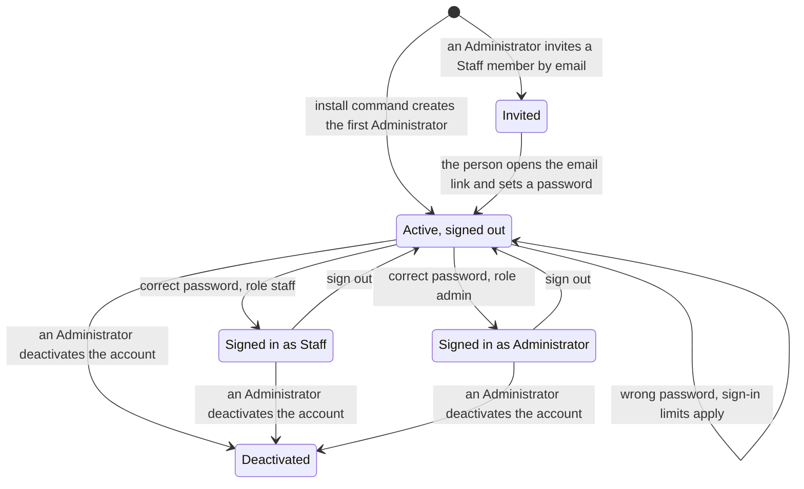

**About this diagram:** every Staff member and Administrator has a personal account with an email, a password and a role of `staff` or `admin` (E-114, REQ-F-52). There is no shared gym account, no PIN and no recovery code. The sign-in limits are those of REQ-F-07. An Administrator action is allowed by the role, so there is no step between Staff and Administrator, and no Lock button or "Administrator mode" bar.

Notes:

- The one-device rule does not apply to staff accounts (REQ-F-03): a person can be signed in on several computers. Whether staff sessions end after some time without activity is not decided (gap 18).
- A deactivated account cannot sign in. It is never deleted, so the audit log keeps pointing at it (data-model D13). Whether its open sessions end at once is not decided (gap 19).
- The Administrators are the two department secretaries and the department director (E-114). The install command creates the first one (section 3). Administrators invite Staff by email (section 4). How the other Administrators are added is not decided (gap 20).
- Staff and Administrators share one dashboard on a path under the app's name (E-124). The dashboard menu shows the Administrator items only to Administrators (REQ-NF-10). This is a design choice that follows from E-114 and the team should confirm it.
- The staff sign-in is N-11. The User sign-in has no link to it, so Staff reach it by typing the dashboard address (E-65).
- Each staff account has its own language, stored on the account and changed in its preferences, with no extra permission (E-104, data-model D11). The rule of no language button in the top bar (E-64) applies to the User app, not to the gym dashboard.
- A staff account is separate from a User account, so a student employee can have both with the same email (data-model D13).

### 2. Backend check on every gym request

**Type:** Sequence diagram. **Use it to:** write the backend check that guards every Staff and Administrator route, and its tests.

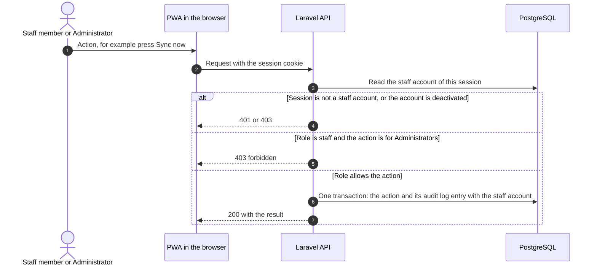

**About this diagram:** the interface hides Administrator items from Staff, but the backend decides by role (REQ-F-52), so a request that skips the interface gets the same answer. The audit log entry is written in the same transaction as the action and names the staff account (REQ-NF-39).

Notes:

- With no PIN there is no timeout that closes Administrator mode, so unsaved input on a form is not lost for that reason.
- A middleware can check `deactivated_at` on every request, so a deactivated account stops working at once (data-model gap 9, to confirm during implementation).

### 3. Install command and first Administrator

**Type:** System flow. **Use it to:** write the install command and its tests.

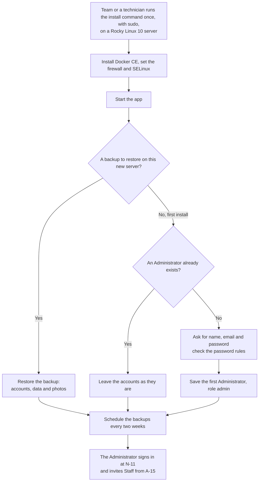

**About this diagram:** this is the install command of REQ-F-88 and REQ-NF-52 (E-114, E-123). Administrators never use Docker or the server. The same command restores a backup on a new server (E-123). No audit entry is written for the first Administrator because no gym action has happened yet. The password rules are those of REQ-NF-51 (E-63). The command can be a Laravel artisan command called by the install script, for example `php artisan gym:install`.

Notes:

- Password rules (E-63): at least 10 characters, no rules about mixing letters, digits or symbols, at least 64 characters allowed, and a check against leaked passwords with Laravel `Password::min(10)->uncompromised()`. That check calls an outside service (haveibeenpwned.com, k-anonymity), so it needs a test for the case when the service does not answer. NIST SP 800-63B-4 asks for 15 characters for single-factor passwords. The team chose 10 for typing on a phone. Staff accounts are assumed to follow the same rule (to confirm).
- Forgetting a staff password: not decided (gap 1).

### 4. Invite and deactivate staff accounts

**Type:** User flow. **Use it to:** build the Staff accounts screen (A-15) and its error messages.

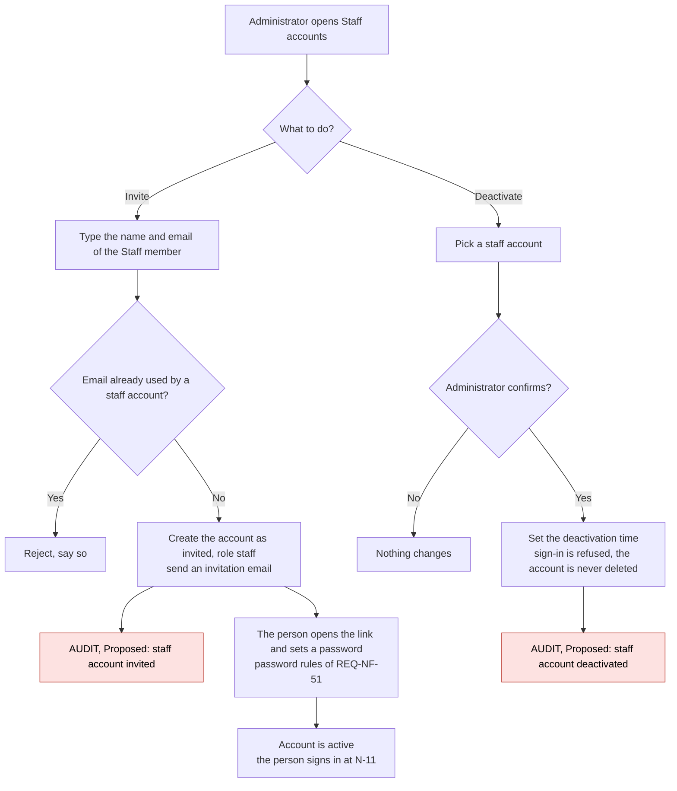

**About this diagram:** only Administrators invite Staff and deactivate accounts (REQ-F-88, E-114). Deactivating is how access is withdrawn when a person leaves. The invitation email, its link and its validity are design details, like the athlete link (REG-6). The two audit entries are Proposed: REQ-NF-39 does not list them yet.

### 5. Recovery with the recovery code (removed)

Removed by E-114 (2026-11-04). The paper recovery code and its sign-in screen (N-12) no longer exist, because there is no shared gym account to recover. The section number stays so references from issues and docs resolve. Recovering a forgotten staff password is not decided (gap 1).

### 6. WooCommerce store sync

**Type:** System flow. **Use it to:** write the sync job, the lookup at registration, their order rules and their tests.

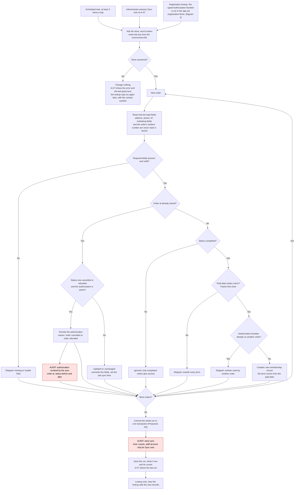

**About this diagram:** the app reads the store's REST API with a read-only key kept in the server's environment file; there is no file upload (E-127, REQ-F-28). The same job runs in three ways: the scheduled task (at least 3 times a day, to pick up changes to known orders), the Sync now button on A-07, and the registration lookup when the typed Authorization Number is not known yet, so a person who just paid registers at once (REQ-F-97). Reading an order twice updates or confirms the same record by order id, so nothing is duplicated (REQ-F-30). Only orders with status `completed` give access. A known order that becomes `cancelled` or `refunded` loses its authorization (REQ-F-98). The Authorization Number is unique across all orders, so a second order with the same number is skipped (E-128). The sync cannot see a refund made in the UPR Payment Gateway portal: an Administrator revokes those by hand (section 12, E-120). A failed run changes no record (REQ-F-99). The transaction waits on D5.

Notes:

- Fields kept (REQ-F-29): order id, Authorization Number (meta field PGPAY_AUTHNUM of the "UPR Payment Gateway"), buyer name, payment email, product variation (student or employee membership, for statistics, E-120), status, paid date and the last sync time. The term comes from the paid date. The order's student number is not stored (athletes' student numbers come from the roster). Address, phone, IP and marketing fields are never stored.
- The term comes from the paid date (REQ-F-22), not from today, so the sync works even when no term covers today. Time zone: America/Puerto_Rico.
- "Unchanged" means the order was confirmed (REQ-F-30). The run counts it with "updated".
- The run counts orders created, updated, revoked and skipped (REQ-F-99). The audit entry of a scheduled run or a registration lookup has no staff account; the one of Sync now names the Administrator (REQ-NF-39).
- Registration lookups go through the failed lookup limits of REQ-F-71, so guessing numbers cannot flood the store with requests (REQ-F-97).
- The saved run holds the counts and the rows of the run. Rows hold a name and an email, and the record is kept 5 years (REQ-NF-05, E-125).
- The VM needs outbound HTTPS to the store. This is an open item for CTI (SRS 2.5).

### 7. Undo of an import (removed)

Removed by E-127 (2026-11-04). There is no uploaded file any more, so there is no import to undo and no re-import. A changed order updates its record at the next sync, and a `cancelled` or `refunded` order is revoked (section 6). A wrong authorization is fixed with the manual revoke (section 12) or the release (section 13). The section number stays so references from issues and docs resolve.

### 8. Academic terms

**Type:** User flow. **Use it to:** build the term create and edit screens and their error messages.

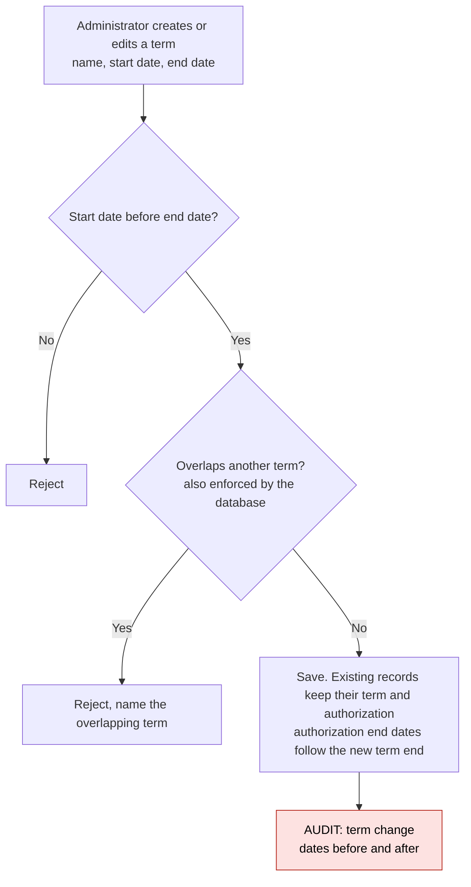

**About this diagram:** an edit is never blocked because orders or roster records fall outside the new dates (E-88). The store sells only while a term runs (assumption G-26, still to confirm with the gym), so this case is rare. Terms are never deleted (E-107): a term created by mistake is fixed by editing its dates, and A-04 has no delete button and no delete states. Gaps between terms are allowed (REQ-F-21). The overlap rule can use a PostgreSQL exclusion constraint on the date range, the same tool as the one-session rule (`context.md` section 2; depends on M-09). When a term ends, every active session closes at once, shown as closed by closure (E-115).

### 9. No term for the current date

**Type:** System flow. **Use it to:** write what each feature does when no term covers today, and its tests.

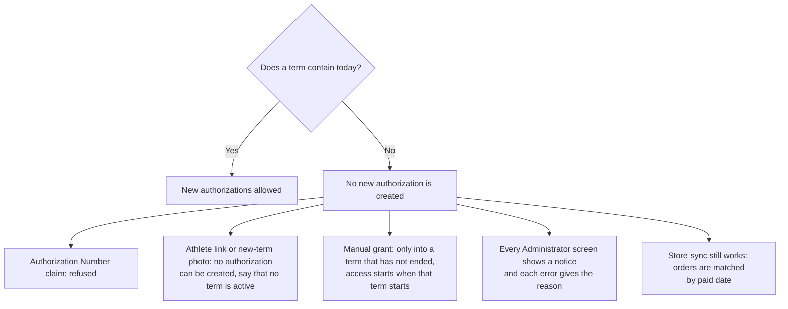

**About this diagram:** the athlete lookup message is that of REQ-F-76. The notice and the reason in each error are Decided (D9).

### 10. Athlete roster: add, edit, remove

**Type:** User flow. **Use it to:** build the roster screen (A-05) and its error messages.

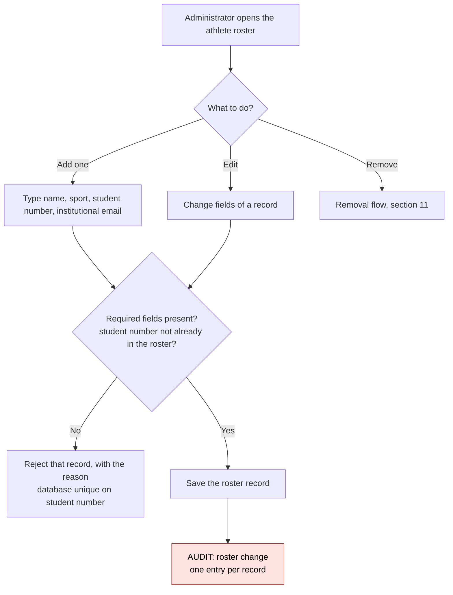

**About this diagram:** the roster is one list, not one per term, and Administrators fill it by hand (E-116, REQ-F-49). There is no file import, because the department keeps the lists in Word, so the earlier upload path and the CTI proposal to accept an Excel or CSV file no longer apply. Each record has name, sport, student number and institutional email (REQ-F-51). Adding, editing and removing stay Administrator only (REQ-F-49, REQ-F-52); one audit entry per record is D10. Staff see the roster read only, with search by name or student number (E-59).

An athlete stays on the roster until an Administrator removes them, across terms. Each new term the athlete only uploads a new photo and the waiver is not asked again (E-116, registration-flows diagram 8). The audit log filters roster changes, so there is no separate roster report (E-126).

### 11. Removing and reinstating an athlete mid-term

**Type:** System flow. **Use it to:** write what a roster removal changes at once, the Reinstate action on A-05, and their tests.

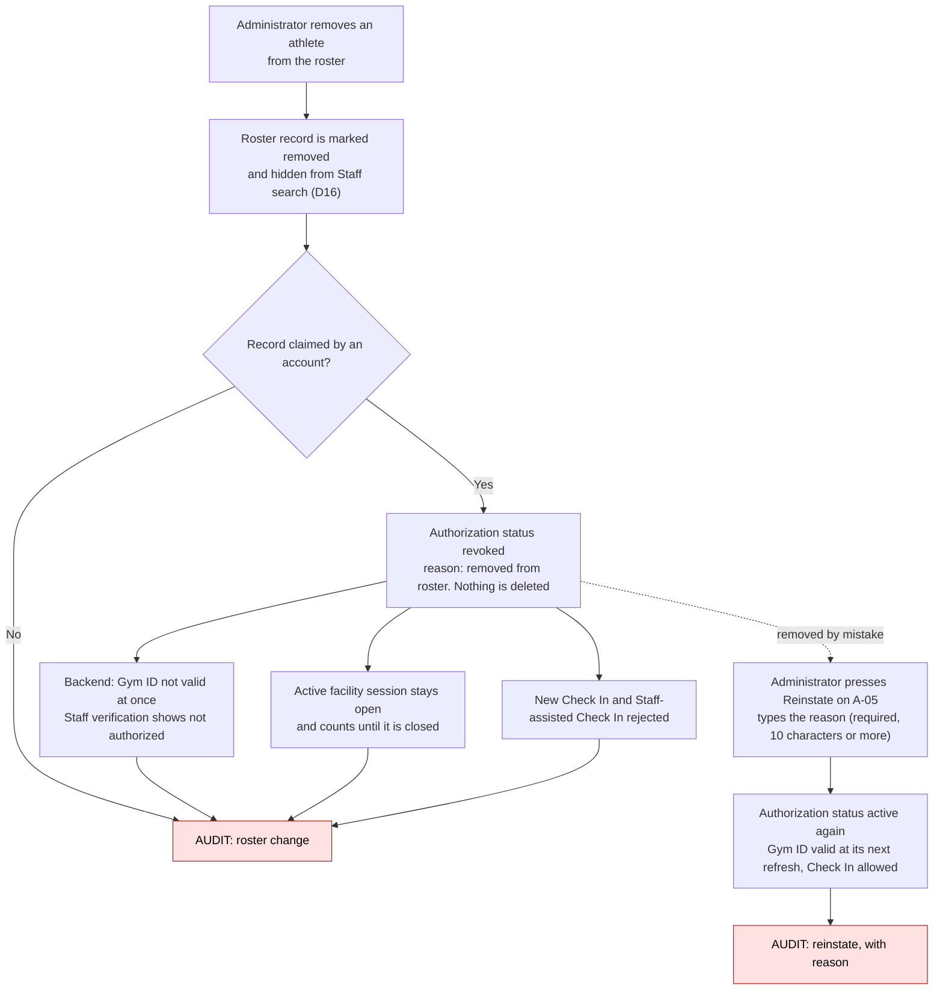

**About this diagram:** the backend answer changes at once; the athlete's phone shows it at its next refresh of the Gym ID. The authorization is revoked, not deleted, so REQ-F-49 holds and the history keeps its source (E-93). There is no cascade delete from the roster record to the authorization.

The revoked authorization keeps its roster record claimed, so the athlete cannot claim the record again. An athlete removed by mistake is brought back with Reinstate on A-05, which returns the revoked authorization to active (E-95). Each reinstate writes an audit entry with its reason. The reason is required and has at least 10 characters, as for a manual grant (E-86). Reinstate is refused with a message when the person already has an active authorization in that term; the database rejects it too, because only one active authorization per term is allowed (E-94).

### 12. Manual grant and revoke of an authorization

**Type:** User flow. **Use it to:** build the grant and revoke screens and their error messages.

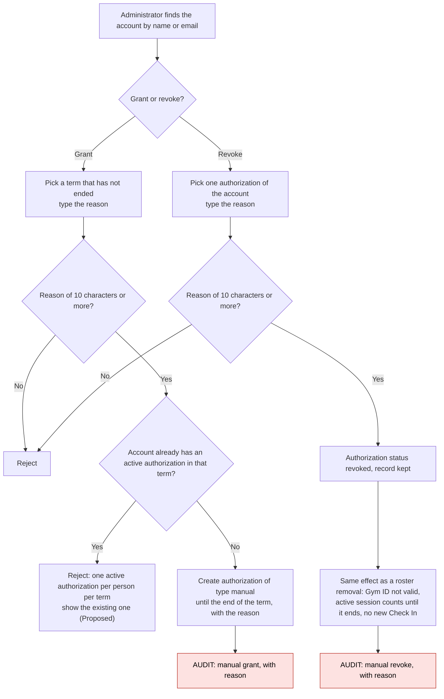

**About this diagram:** a manual grant needs an existing account (REQ-F-87). The reason is required free text of 10 characters or more for grant and revoke, and goes to the audit log (E-86, D11). A person holds one active authorization per term, so a manual grant is rejected when they already have one (E-68, E-94). A revoked authorization does not block a new grant. Revoking a paid authorization does not free its Authorization Number; that is a release (section 13).

Notes:

- A manually granted User gives the term photo the same way as an athlete: the app asks for it on U-02 before Check In (E-69).
- The revoke is how the department's refunds are handled (E-120). Refunds are made in the UPR Payment Gateway portal, outside WordPress and WooCommerce, so the store never shows them and the sync cannot revoke them. When the department refunds a membership, an Administrator finds the account, picks the authorization and revokes it with a reason that says it was refunded. The Administrator manual describes this task (REQ-NF-53). If a refund is ever recorded in WooCommerce as `refunded`, the sync revokes it on its own (section 6).
- A manual authorization counts as a paid member for every rule (E-126). Statistics keep `manual` as its own value (E-82); how C-05 shows it next to student members, employee members and athletes is to confirm.

### 13. Release of a claimed Authorization Number

**Type:** System flow. **Use it to:** write the release action, its confirm screen and its tests.

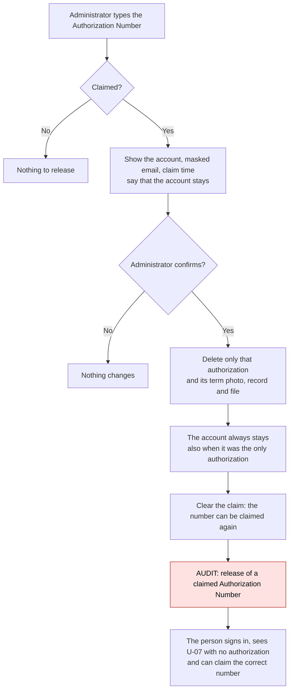

**About this diagram:** a release never deletes the account (E-106). That holds when the claim created the account, when the account has other authorizations (E-87, D12), and when the released authorization was its only one. The photo of the released authorization is deleted with it (E-57). Account deletion stays a separate action (section 14). With no authorization left, the person sees U-07 after sign-in and can claim the correct number. The confirm screen (A-09) says that the account stays. No rule reads the `created_account` flag any more; whether to keep it is to confirm in the data model.

### 14. Account deletion when a User asks

**Type:** System flow. **Use it to:** write the deletion action and check what data it removes and keeps.

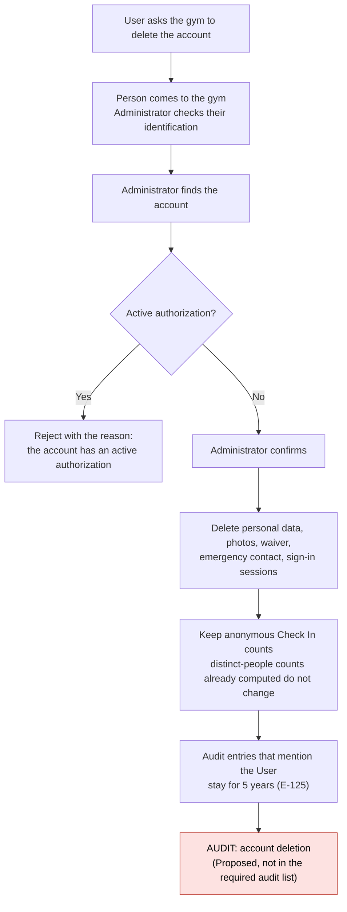

**About this diagram:** this is the same deletion the User can do in the app (REQ-F-09). When a User asks the Administrator, the owner is confirmed in person with identification at the gym (E-89). REQ-NF-39 does not list it as an audited action (gap 2).

### 15. Global lookup limit alert

**Type:** System flow. **Use it to:** write the global lookup counter, the slowdown and the alert entry, and their tests.

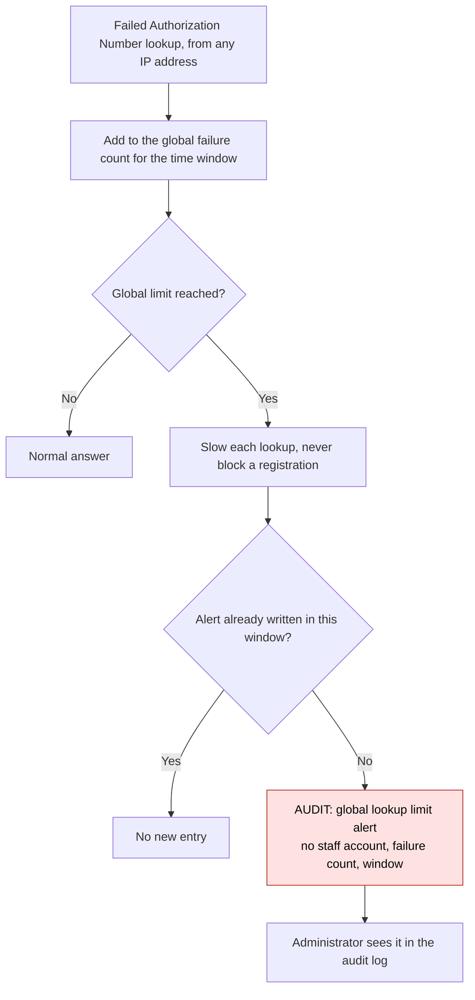

**About this diagram:** the limit values belong to the registration design (REQ-F-71). One alert per window keeps the log readable (D13).

### 16. Schedules, closures, notices and facility information

**Type:** System flow. **Use it to:** write the save rules for these items and decide which ones write an audit entry.

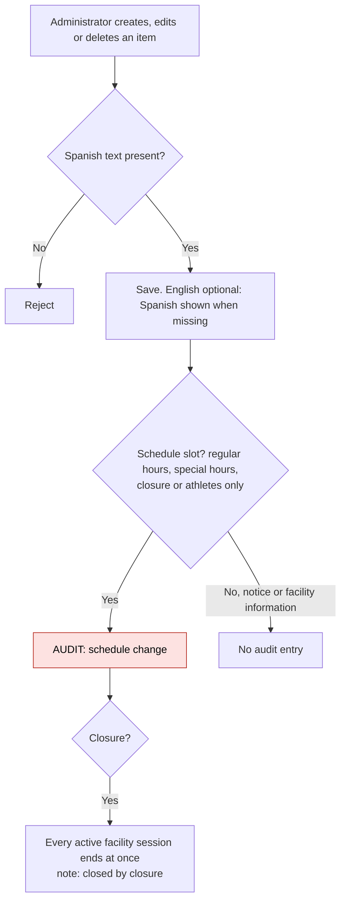

**About this diagram:** simple create, edit and delete (REQ-F-55, REQ-F-58). REQ-NF-39 lists schedule changes but not notices or facility information. Schedules live in one table: each slot is weekly or has a concrete date, so the regular schedule is written once and exceptions are separate rows (E-90). The gym contact number is part of the facility information and is edited in A-12 (E-66). Publishing a closure ends every active session at once (E-115, REQ-F-38).

### 17. Audit log entry and supporting data

**Type:** Entity-relationship diagram. **Use it to:** write the migrations and constraints for staff accounts, store sync runs and the audit log.

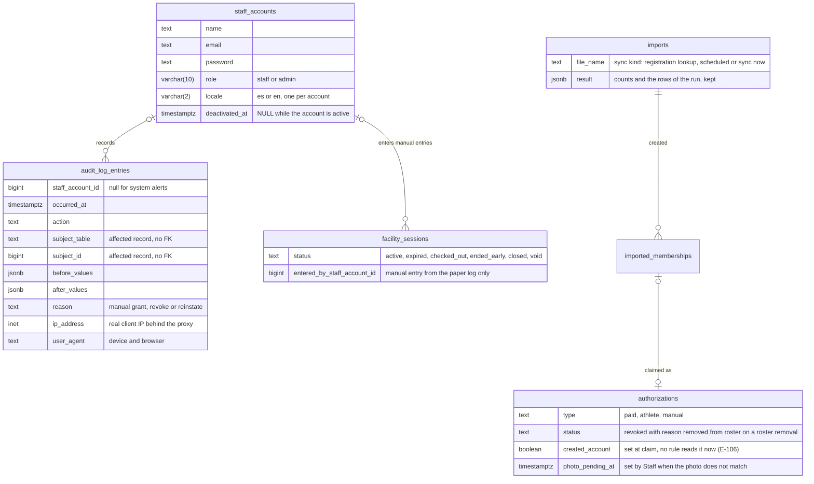

**About this diagram:** only the fields these flows need; other entities and fields belong to the data model design (`docs/design/data-model.md`), which rules where the two differ (E-93, data-model D13 to D18). There is no PIN state and no recovery code (E-114).

Corrections made to match the data model (E-93):

- Staff and Administrators are rows of `staff_accounts`, apart from `users`. The audit log points at `staff_account_id`, so it names the person (D13).
- `imports` holds one row per store sync run (E-127): the sync kind in `file_name` and the `result`. It has no uploaded-by or uploaded-at and no `undone_at`, because there is no file and no undo. The audit log records the run with the staff account (empty for a scheduled run or a lookup) and time (REQ-NF-39).
- Removing an athlete from the roster sets the authorization to `revoked` with the reason "removed from roster". There is no cascade delete.
- `staff_accounts.locale` is the language of that account (E-64, E-104, data-model D11).
- `authorizations.created_account` no longer drives the release (E-106). Whether to keep the column is to confirm.

Actions that write an audit log entry (REQ-NF-39):

| Action | Role | Where drawn |
|---|---|---|
| Staff correction (end early, void) | Staff | Check In flows (out of scope here) |
| Staff-assisted Check In, as an exception | Staff | Check In flows |
| Roster change (add, edit, remove) | Administrator | Sections 10, 11 |
| Reinstate of a removed athlete, with reason (E-95) | Administrator | Section 11 |
| Term change | Administrator | Section 8 |
| Schedule change, closures included | Administrator | Section 16 |
| Store sync run, and each authorization it revokes (E-127) | Administrator for Sync now; system for a scheduled run or a registration lookup | Section 6 |
| Release of a claimed Authorization Number | Administrator | Section 13 |
| Manual grant or revoke, with reason | Administrator | Section 12 |
| Manual entry from the paper log (E-119); names who entered it | Administrator | Section 18 |
| Global lookup limit alert | System | Section 15 |
| Account deletion on User request (Proposed, not in the list) | Administrator | Section 14 |
| Staff account invited or deactivated (Proposed, not in the list) | Administrator | Section 4 |
| Backup now or restore (Proposed, not in the list) | Administrator | Section 19 |
| Proposed (E-108): sign in and sign out of staff accounts | Staff member or Administrator | Section 1 |

Each entry holds the staff account, time, IP address, device and browser, and values before and after (REQ-NF-39). Only Administrators can read the log, and they can filter roster changes, so there is no separate roster report (E-126). Proposed (E-108, CTI's request to student projects): no screen or request edits or deletes an entry, for anyone. The Administrator can search by staff account and date range and export to CSV or Excel. Secrets are never written: a password change records only that it changed. Retention: 5 years, like every other kind of data (REQ-NF-05, E-125).

### 18. Manual entries from the paper log

**Type:** User flow. **Use it to:** build the Manual entries screen (A-17) and its error messages.

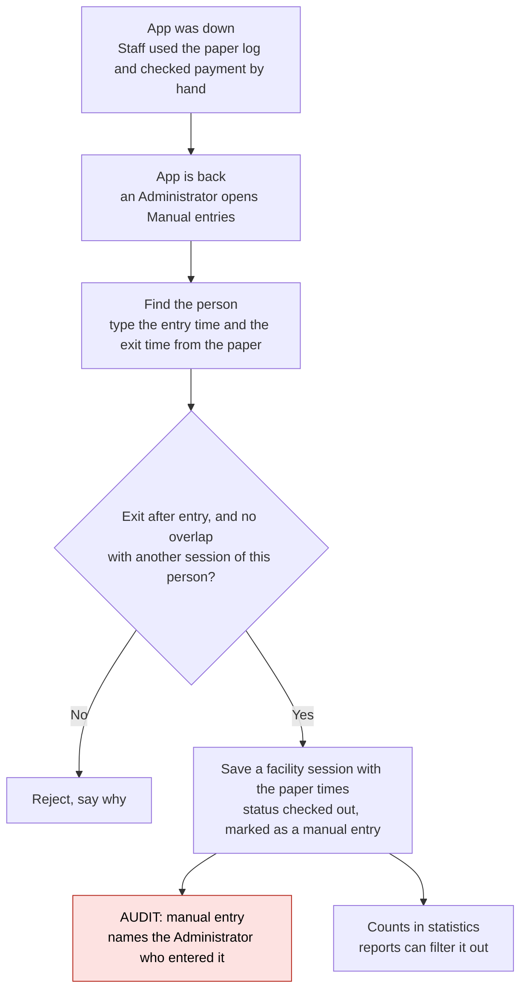

**About this diagram:** this is REQ-F-95 (E-119). Up to one week down is acceptable (REQ-NF-31). Only Administrators enter manual entries, because desk staff change often. The row is a normal facility session with `entered_by_staff_account_id` set (data-model D18), so statistics keep working in one place. The overlap check is the exclusion constraint that guards the one-session rule. A person on the paper log with no account cannot get a manual entry, because a session belongs to a User; how to handle that case is not decided.

### 19. Backups

**Type:** System flow. **Use it to:** build the Backups screen (A-16), the scheduled task and their tests.

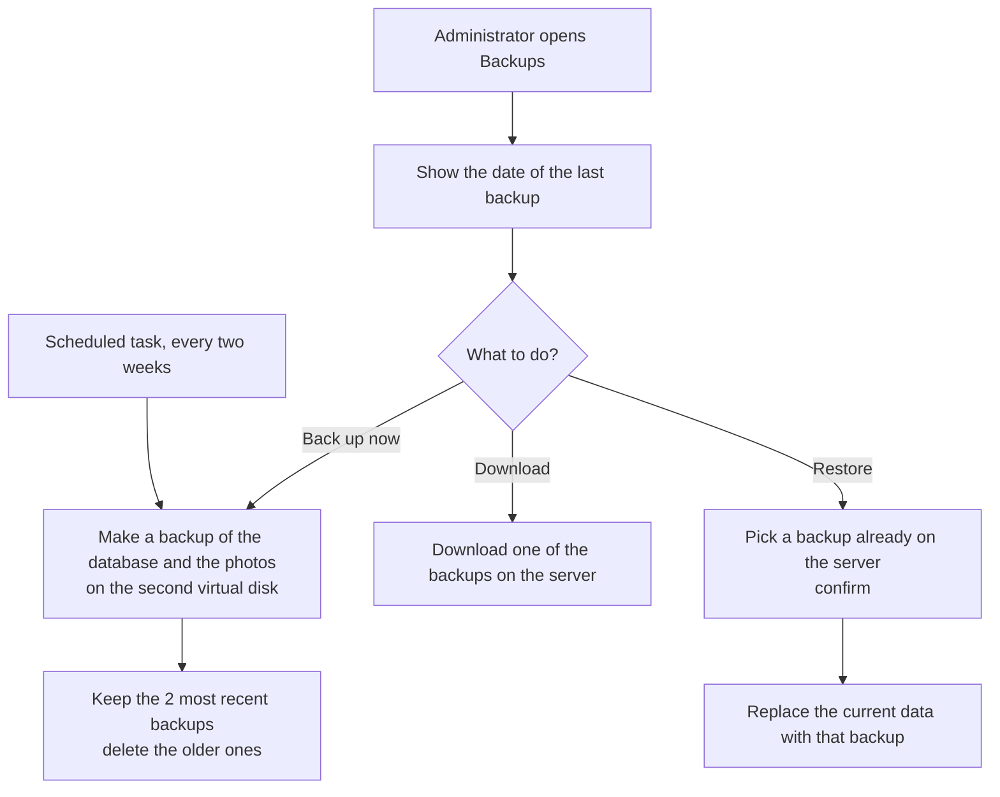

**About this diagram:** this is REQ-NF-06 (E-122). The second disk is attached to the same VM, so losing the whole VM loses the backups too; the team accepts that risk. Restore takes only a backup already on the server, so there is no upload. A restore replaces everything saved after that backup, audit log entries included. The same install command restores a backup on a new server (section 3). Administrators never use Docker or the server (E-123). A downloaded backup holds all personal data and photos on the computer that downloads it (`context.md` section 7).

## Design decisions to confirm

Marked Decided when the owner chose in the design review (October 2026) or the team chose earlier. D14 to D16 and the extension of D12 were decided on 2026-10-20 (E-101 to E-107). D1 to D4 and D14 were replaced on 2026-11-04 by E-114 (personal staff accounts, no PIN). D5 and D13 are still Proposed and stay open for the PR review.

**D1. PIN format.** Replaced by E-114: there is no PIN.

**D2. PIN attempt limit and wait.** Replaced by E-114: there is no PIN. Sign-in attempts follow REQ-F-07.

**D3. How the backend learns about person activity.** Replaced by E-114: there is no PIN to close after inactivity. Staff session time limits are open (gap 18).

**D4. Effect of a PIN change on other browsers.** Replaced by E-114: there is no PIN.

**D5. Sync transaction.** Proposed (rewritten by E-127).
- A: the run first reads every page of orders from the store, then writes everything in one transaction. A store error or a database error changes nothing (REQ-F-99). Row-level skips (invalid field, outside every term, repeated number) do not stop the rest.
- B: one transaction per order. A crash leaves a half-finished run, and the next run has to finish it.
- Recommendation: A. A few hundred orders fit easily in one transaction (reasoned estimate, not measured: 84 orders were read on 2026-11-04).

**D6. Import result layout.** Replaced by E-127: there is no import result screen. A-07 is the Store sync screen. It shows when the last sync ran, its counts (created, updated, revoked, skipped), the skipped orders with the reason, the error of a failed run and the Sync now button (REQ-F-99). The layout is a wireframe decision.

**D7. Undo after people checked in with those authorizations.** Replaced by E-127: there is no undo.

**D8. What undo removes when a later import touched the same orders.** Replaced by E-127: there is no undo.

**D9. Message when no term covers today.** Decided (E-85): option A.
- A: a banner on every Administrator screen ("No academic term covers today. New authorizations cannot be created. Add a term.") plus the same reason in any error it causes.
- B: only the error at the moment something fails.
- Decided: A. Why: the Administrator learns about it before a member is refused at the front desk.

**D10. Audit entries for roster changes.** Decided (E-116): the roster has no file import, so each record added, changed or removed writes one audit entry.
- Why: REQ-NF-39 says "each roster change", and per-record entries keep before and after simple.

**D11. Reason for manual grant and revoke.** Decided (E-86): option A.
- A: required free text, at least 10 characters, for both grant and revoke.
- B: required pick list (order error, payment not found in the store, other) plus optional text.
- C: optional.
- Decided: A. Why: REQ-NF-39 already says "with its reason" for grant and revoke. The reason goes to the audit log, and the data model keeps its CHECK for it.

**D12. Release when the account created by the claim has other authorizations.** Decided (E-87): option A.
- A: remove only the released authorization; keep the account.
- B: delete the account anyway, as REQ-F-74 reads literally, losing the other authorizations.
- Decided: A. Release deletes only that authorization and its term photo; the account, other authorizations and history stay. Why: it follows the rule that nobody loses their history (E-69). REQ-F-74 says so in SRS v0.7.
- Extended, decided (E-106): the account is kept in every release case, also when the released authorization was its only one. The person signs in, sees U-07 and can claim the correct number. REQ-F-74 and the A-09 confirm text must say so.

**D13. One alert per window for the global lookup limit.**
- A: one audit entry when the limit is first reached in a window, with the count.
- B: one entry per slowed lookup. Can flood the log during an attack.
- Recommendation: A.

**D14. Lock button and the Administrator menu screen.** Replaced by E-114 (2026-11-04): there is no Lock button, no "Administrator mode" bar and no PIN. A-03 stays removed (E-102). A-14 is removed and A-15 to A-17 are new; the other A IDs do not change.

**D15. Where staff accounts change their language.** Decided (E-104, owner, 2026-10-20), updated by E-114 and data-model D11: each staff account stores its own language and changes it in its preferences.
- The control is C-06 on the dashboard and may also be a button in the dashboard top bar. The wireframe picks the placement.
- The rule of no language button in the top bar (E-64) applies to the User app, not to the gym dashboard.

**D16. Deleting a term.** Decided (E-107), owner, 2026-10-20: terms are never deleted.
- A term created by mistake is fixed by editing its dates (E-88). A-04 has no delete button and no delete states.

## Gaps and questions

1. **Forgotten staff password.** Not decided. Staff accounts have an email and a password, so a reset by email like REQ-F-06 is the natural way, but no decision covers it.
2. **Audit list misses some actions.** REQ-NF-39 does not list account deletion by the Administrator (REQ-F-09), staff account invites and deactivations, or backup actions. All look like they belong. Drawn as Proposed.
3. **Photos after undo.** Resolved by E-57 for the release of an added authorization, which deletes the authorization with its term photo, record and file. The import undo it also covered was removed by E-127.
4. **Corrected order that changes email or Authorization Number of a claimed membership.** REQ-F-30 updates the record and REQ-F-11 says the account email is the payment email. Not said: does the account email change, and does the old number stay claimed? Suggest: update the membership, keep the account email, flag the row in the sync result.
5. **Editing a term after records exist.** Resolved (E-88): the edit is allowed. Records keep their term and authorization, and only the authorization end date follows the new term end. REQ-F-22 now says that a record belongs to the term it was assigned, even if dates change later (SRS v0.7). Terms are never deleted (E-107, D16), so the missing term deletion in the SRS is settled.
6. **Photo for a manual grant.** Resolved (E-69): the athlete rule. The User gives the term photo on U-02 before Check In.
7. **Account deletion during an active facility session.** REQ-F-09 and REQ-F-74 do not say what happens to an active session of a deleted account. Suggest: void is wrong (it changes counts); keep the session anonymous and let it expire.
8. **Checking that the User asked.** Resolved (E-89): the request is confirmed in person with identification at the gym.
9. **Audit entries with no staff account.** The data model links every audit entry to a staff account, but the global lookup alert (REQ-F-71) is written by the system. Drawn with an empty staff account.
10. **Duplicate Authorization Number across orders.** Decided (E-128, which replaces E-71): the number is unique across all orders, not only per term. The sync skips the second order with the same number, and a lookup that matches two orders is denied with the gym contact number. Resolved by the read of 84 orders on 2026-11-04: no value repeats among the 69 paid ones (E-55, G-19). If the gateway ever repeats a code, the Administrator sees the skipped order on A-07.
11. **Gym ID "at once".** REQ-F-49 says the Gym ID stops being valid at once. The backend does; the phone shows it at its next refresh. The Check In flows should set how often the Gym ID screen refreshes.
12. **Retention of the saved sync rows.** Resolved by E-125: kept 5 years like every other kind of data (REQ-NF-05). The saved sync run holds the names and emails of the orders it lists.
13. **Lock button and the A-03 menu screen.** Resolved by E-114: there is no PIN, no Lock button and no Administrator mode bar. A-03 stays removed (E-102).
14. **Staff account language.** Resolved by E-104 (D15) and E-114: each staff account has its own language, changed in its preferences. The wireframe picks the placement.
15. **Roster record after a removal.** Resolved by D16: a removal sets `removed_at`, hides the record from Staff search and revokes the authorization with the reason "removed from roster", and nothing is deleted by cascade (E-93). The revoked authorization keeps the roster record claimed, so the athlete cannot claim it again; Reinstate on A-05 is the way back (E-95). Still to confirm: email links sent before a removal must stop working (the backend checks `removed_at` when a link is opened), and the exact wording of the message shown when Reinstate is refused. Decided: Reinstate is refused when the person already has an active authorization in that term, and the database rejects it too (E-94); the reason is required, 10 characters or more, as in E-86.
16. **Release when the released authorization was the account's only one.** Resolved by E-106 (D12): the account is kept without an authorization. The person signs in, sees U-07 and can claim the correct number.
17. **People missing from a new roster list.** Resolved by E-116: there is one roster and an athlete stays until an Administrator removes them, so a new term needs no new list.
18. **Staff session time limits.** Not decided. The old PIN timeout is gone. Whether staff sessions, especially Administrator ones, end after some time without activity is open (data-model gap 18).
19. **Deactivation and open sessions.** Not decided whether deactivating an account ends its open sessions at once (data-model gap 9). A middleware that checks `deactivated_at` on every request would do it.
20. **How the other Administrators are added.** The install command creates the first Administrator and Administrators invite Staff (E-114). Nothing says how the second secretary and the director get their Administrator accounts.
21. **Store access.** Open. The sync needs a read-only API key from the store owner and outbound HTTPS from the VM to the store, which is a question for CTI (E-127, SRS 2.5). The key lives only in the server's environment file.
22. **Letter case of the Authorization Number.** Open. The number can include letters (E-128). Whether the lookup compares with or without regard to case is not decided.

## Traceability

| Requirement or decision | Where it appears |
|---|---|
| REQ-F-09 | 14. Account deletion when a User asks |
| REQ-F-21 | 8. Academic terms; 9. No term for the current date |
| REQ-F-28 | 6. WooCommerce store sync; D5; gap 21 |
| REQ-F-29 | 6. WooCommerce store sync (kept fields and notes) |
| REQ-F-30 | 6. WooCommerce store sync (order id check) |
| REQ-F-31 (removed) | 7. Undo of an import (removed by E-127); D7, D8 replaced |
| REQ-F-97 | 6. WooCommerce store sync (registration lookup) |
| REQ-F-98 | 6. WooCommerce store sync (cancelled or refunded orders); 12. Manual grant and revoke (notes) |
| REQ-F-99 | 6. WooCommerce store sync (A-07 and its counts); D6 |
| REQ-F-49 | 10. Athlete roster; 11. Removing and reinstating an athlete mid-term |
| REQ-F-52 | 1. Staff account states; 2. Backend check on every gym request |
| REQ-F-74 | 13. Release of a claimed Authorization Number; D12 (E-106) |
| REQ-F-87 | 12. Manual grant and revoke; 9. No term for the current date; D11 |
| REQ-F-88 | 3. Install command and first Administrator; 4. Invite and deactivate staff accounts |
| REQ-F-89 (removed) | 5. Recovery with the recovery code (removed by E-114) |
| REQ-F-95 | 18. Manual entries from the paper log |
| REQ-NF-39 | 17. Audit log entry and supporting data; AUDIT nodes in sections 4 to 16 and 18 |
| REQ-NF-48 (removed) | 1. Staff account states (no PIN, E-114); D1 to D4 replaced |
| REQ-NF-06 | 19. Backups |
| REQ-NF-52 | 3. Install command and first Administrator |
| E-56 | Replaced by E-114: 1. Staff account states; D4 |
| E-57 | 13. Release of a claimed Authorization Number; gap 3 (the import undo it also covered was removed by E-127) |
| E-59 | 10. Athlete roster (Staff read-only view) |
| E-60 | Replaced by E-114: 5. Recovery with the recovery code (removed); gap 1 |
| E-61 | Mail is assumed available; the in-person tool is removed by E-117 |
| E-62 | Removed by E-117 (no in-person registration): audit action table no longer lists it |
| E-63 | 3. Install command and first Administrator (notes) |
| E-64 | 1. Staff account states (notes); 17. Audit log entry and supporting data; gap 14 (resolved by E-104) |
| E-65 | 1. Staff account states (notes); gap 13 (resolved by E-114) |
| E-66 | 16. Schedules, closures, notices and facility information |
| E-68 | 12. Manual grant and revoke |
| E-69 | 12. Manual grant and revoke (notes); D12; gap 6 |
| E-71 | Replaced by E-128: 6. WooCommerce store sync; gap 10 |
| E-78 | Replaced by E-114 (recovery code): 5. Recovery with the recovery code (removed); gap 1 |
| E-82 | 12. Manual grant and revoke (notes) |
| E-83 | Replaced by E-114 (PIN format): D1 |
| E-84 | Replaced by E-127 (import result and undo): 6. WooCommerce store sync; 7. Undo of an import (removed); 17. Audit log entry and supporting data; D6, D7, D8; gap 12 |
| E-85 | 9. No term for the current date; D9 |
| E-86 | 12. Manual grant and revoke; D11 |
| E-87 | 13. Release of a claimed Authorization Number; D12 |
| E-88 | 8. Academic terms; gap 5 |
| E-89 | 14. Account deletion when a User asks; gap 8 |
| E-90 | 16. Schedules, closures, notices and facility information |
| E-93 | D2 (replaced by E-114); 6. WooCommerce store sync (notes); 11. Removing and reinstating an athlete mid-term; 17. Audit log entry and supporting data; gap 15 |
| E-94 | 12. Manual grant and revoke; gap 15 |
| E-95 | 11. Removing and reinstating an athlete mid-term; Audit action table; gap 15 |
| E-101 | Replaced by E-114: D14; gap 13 |
| E-102 | D14; gap 13 |
| E-104 | 1. Staff account states (notes); 17. Audit log entry and supporting data; D15; gap 14 |
| E-106 | 13. Release of a claimed Authorization Number; 17. Audit log entry and supporting data; D12; gap 16 |
| E-107 | 8. Academic terms; D16; gap 5 |
| E-114 | 1 to 5; 17. Audit log entry and supporting data; D1 to D4, D14, D15; gaps 1, 18, 19, 20 |
| E-115 | 8. Academic terms (term end closes sessions); 11. Removing and reinstating an athlete mid-term; 16. Schedules, closures, notices and facility information (closure closes sessions) |
| E-116 | 10. Athlete roster: add, edit, remove; 11. Removing and reinstating an athlete mid-term; D10; gap 17 |
| E-119 | 18. Manual entries from the paper log; 17. Audit action table |
| E-120 | 6. WooCommerce store sync (refunded orders, student or employee); 12. Manual grant and revoke (notes, refunds) |
| E-122 | 19. Backups |
| E-123 | 3. Install command and first Administrator; 19. Backups |
| E-125 | 6. WooCommerce store sync (notes); 14. Account deletion when a User asks; 17. Audit log entry and supporting data; gap 12 |
| E-126 | 12. Manual grant and revoke (manual authorization counts as paid); 17. Audit log entry and supporting data (roster changes filter) |
| E-127 | 6. WooCommerce store sync; 7. Undo of an import (removed); 17. Audit log entry and supporting data; D5, D6, D7, D8; gap 21 |
| E-128 | 6. WooCommerce store sync (unique number); gaps 10, 22 |
| Also used: REQ-F-03, F-07, F-22, F-51, F-55, F-58, F-71, F-76 | Sections 1, 6, 9, 10, 15, 16 |
