# Gym account and administration flows

This document draws what the shared gym account does: signing in as Staff, unlocking Administrator actions with the PIN, recovery with the recovery code, and each Administrator task (WooCommerce import and undo, academic terms, athlete roster, manual authorizations, release of a claimed Authorization Number, account deletion, PIN and password changes). It marks every action that writes an audit log entry. Staff session screens are out of scope (Check In flows). Requirements come from `docs/requirements/SRS.md` v0.5 and the team decisions E-56 to E-60. Entity names follow the logical data model in `docs/design/design-notes.md`.

Legend: nodes in red with the word **AUDIT** write one audit log entry (REQ-NF-39). "Proposed" marks a rule this design suggests and the team must confirm (see "Design decisions to confirm"). "Decided" marks a rule the team already chose.

## Diagrams

### 1. Gym account and PIN states

**Type:** State diagram. **Use it to:** build the PIN dialog, the Lock button and the 5-minute warning, and write test cases for each move between states.

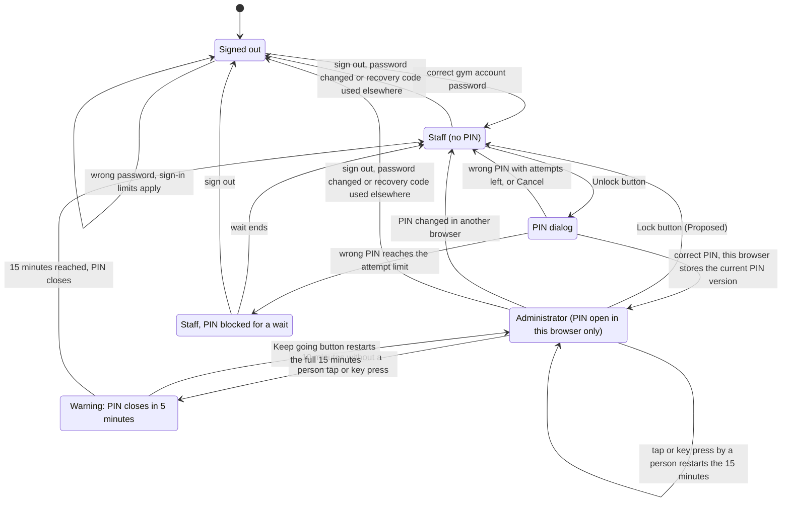

**About this diagram:** the sign-in limits are those of REQ-F-07. The PIN state lives in the session data of each browser (E-56), so unlocking in one browser never unlocks another (REQ-NF-48).

Notes:

- The one-device rule does not apply to the gym account (REQ-F-03): many browsers can be signed in as Staff at once.
- A PIN change raises the PIN version of the gym account. Every other browser holds the old version, so its PIN closes at its next request (E-56, D4).
- Automatic polling (REQ-F-43) never counts as activity. The "Keep going" button takes keyboard focus and is read by screen readers (WCAG 2.2.1, REQ-NF-48).
- The PIN attempt limit and wait are a design decision (D2). Staff work stays available during the PIN wait.

### 2. Backend check on every Administrator request

**Type:** Sequence diagram. **Use it to:** write the backend check that guards every Administrator route, and its tests.

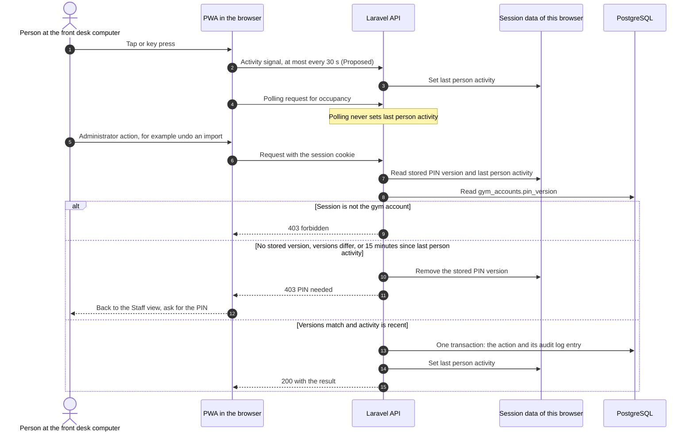

**About this diagram:** the interface hides Administrator screens without the PIN, but the backend decides (REQ-F-52), so a request that skips the interface gets the same answer. The PIN state and last person activity live in the session data, not in columns (E-56). The activity signal is design decision D3.

Notes:

- Unsaved input on an Administrator form is lost when the PIN closes. The PWA shows the warning 5 minutes before, so this is rare.
- The warning timer runs in the PWA. The backend enforces the 15-minute cut with the last person activity stored in the session data.

### 3. First setup of the gym account

**Type:** System flow. **Use it to:** write the install command and its tests.

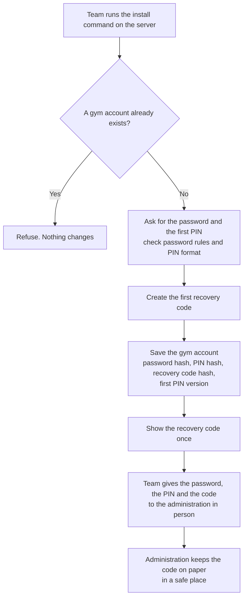

**About this diagram:** this runs once (REQ-F-88), for example as `php artisan gym:install`. There is only one gym account (REQ-F-52), so the command never creates a second one. The recovery code comes from E-60 and REQ-F-89; no audit entry is written because no gym action has happened yet.

### 4. Change of gym account password and PIN

**Type:** User flow. **Use it to:** build the Security settings screens and their error messages.

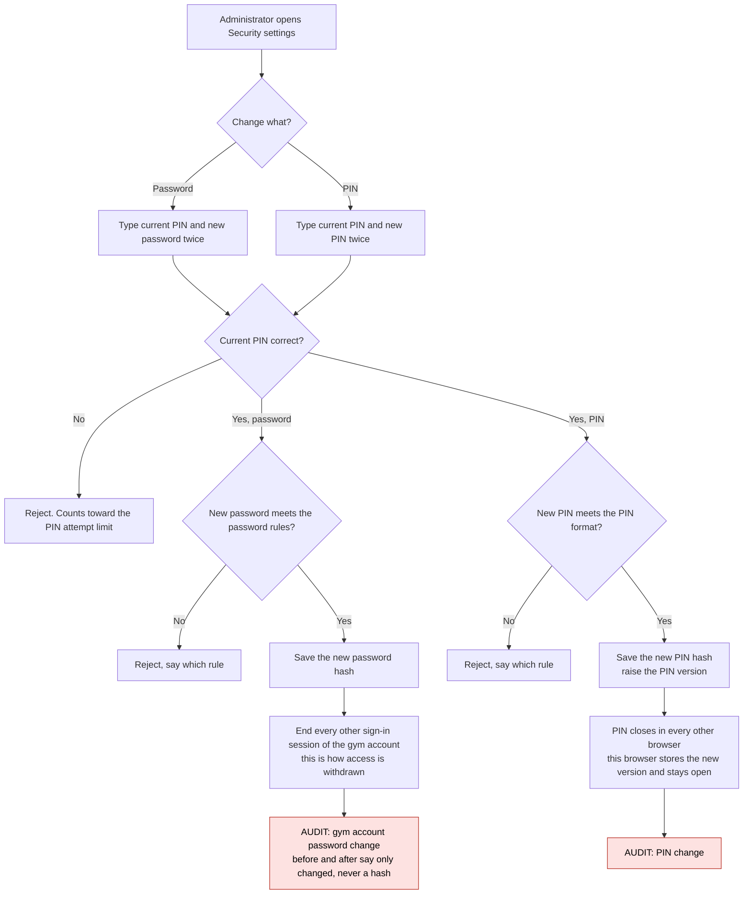

**About this diagram:** only PIN holders can change the PIN (REQ-NF-48). The browser where the change was made stays signed in. Closing the PIN everywhere else is Decided (E-56, D4).

### 5. Recovery with the recovery code

**Type:** User flow. **Use it to:** build the recovery screens on the gym account sign-in page, their error messages, and the attempt limit tests.

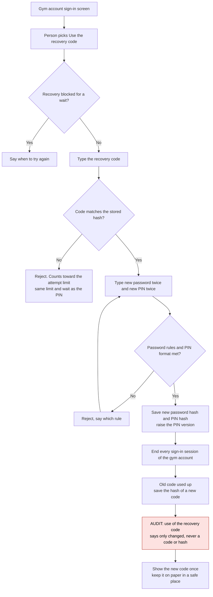

**About this diagram:** this is E-60 and REQ-F-89. Saving, using up the old code and the audit entry happen in one transaction; the new code is shown only after it commits. If the paper is lost too, only the server install command remains (see gap 1).

### 6. WooCommerce import and re-import

**Type:** System flow. **Use it to:** write the import job, its row rules and its tests.

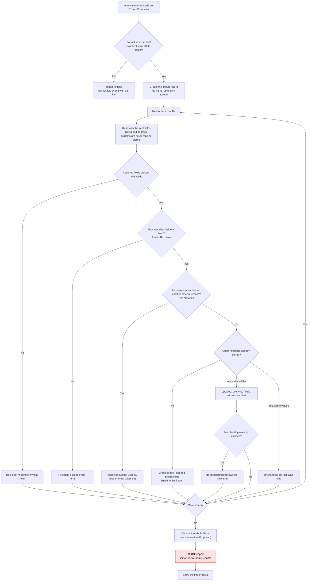

**About this diagram:** re-import of a corrected file (reconciliation) is the same flow: orders match by order reference, so nothing is duplicated (REQ-F-30). The column check waits on E-55, the duplicate number rule on E-30, the transaction on D5 and the result layout on D6.

Notes:

- Fields kept (REQ-F-29): name, email, student number when present, membership details, Authorization Number, order reference, status, payment date, term, last synchronization time. Billing and address data are never copied.
- The term comes from the payment date (REQ-F-22), not from today, so an import works even when no term covers today. Time zone: America/Puerto_Rico.
- "Unchanged" means the order was confirmed (REQ-F-30). The result counts it with "updated" (D6).

### 7. Undo of an import

**Type:** System flow. **Use it to:** write the undo action, its confirm screen and its tests.

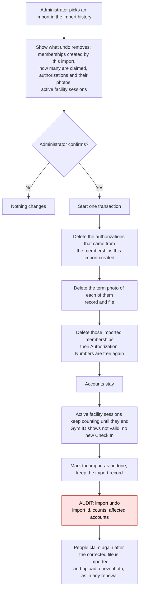

**About this diagram:** undo is allowed at any time (REQ-F-31) and deletes the photos with their authorizations (E-57). Photo files should be deleted only after the transaction commits, so a rollback never loses a file (Proposed). Active sessions follow D7; older records follow D8.

Notes: undo removes only the memberships the import created; it does not roll back changes that import made to older records (D8). Past facility sessions stay, so analytics do not change.

### 8. Academic terms

**Type:** User flow. **Use it to:** build the term create and edit screens and their error messages.

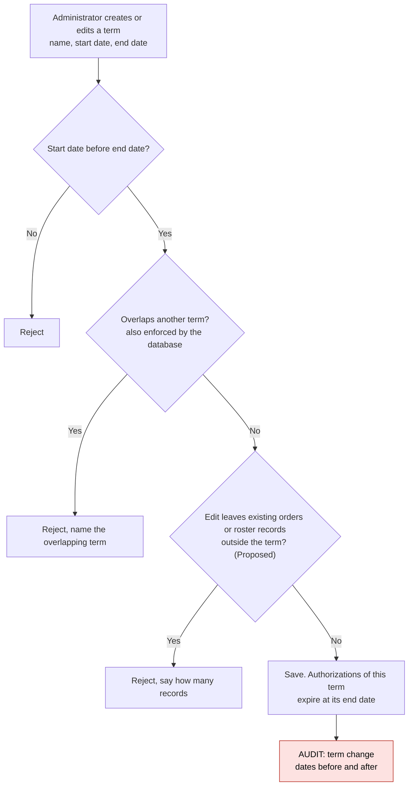

**About this diagram:** gaps between terms are allowed (REQ-F-21). The overlap rule can use a PostgreSQL exclusion constraint on the date range, the same tool as the one-session rule (`context.md` section 2; depends on M-09).

### 9. No term for the current date

**Type:** System flow. **Use it to:** write what each feature does when no term covers today, and its tests.

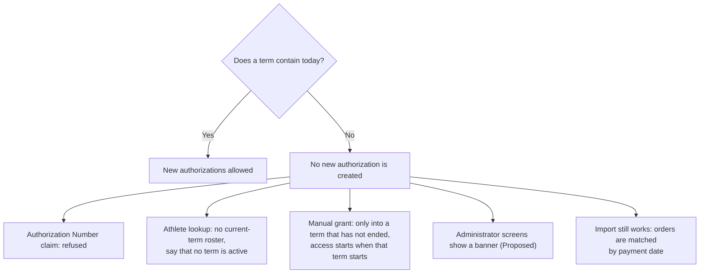

**About this diagram:** the athlete lookup message is that of REQ-F-76. The banner is design decision D9.

### 10. Athlete roster: create, import, change

**Type:** User flow. **Use it to:** build the roster screens, the list import, and their error messages.

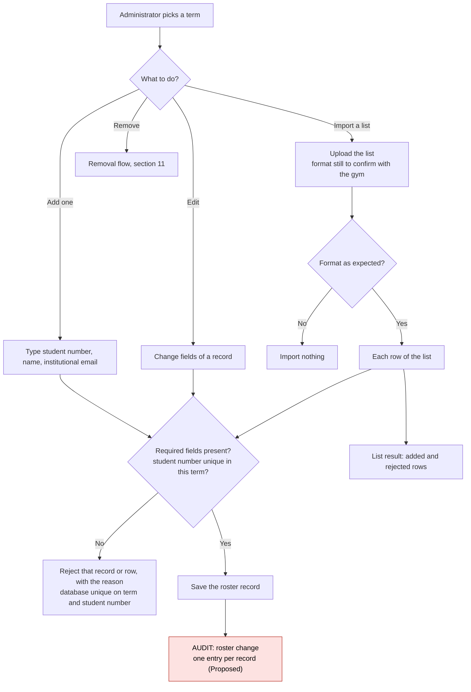

**About this diagram:** minimum fields are student number, name, institutional email and term (REQ-F-51; final list pending G-10). Adding, editing, removing and importing stay Administrator only (REQ-F-49, REQ-F-52); one audit entry per record is D10. Staff now have a read-only view of the current-term roster with search by name or student number (E-59, still to be confirmed by the gym).

### 11. Removing an athlete mid-term

**Type:** System flow. **Use it to:** write what a roster removal changes at once, and its tests.

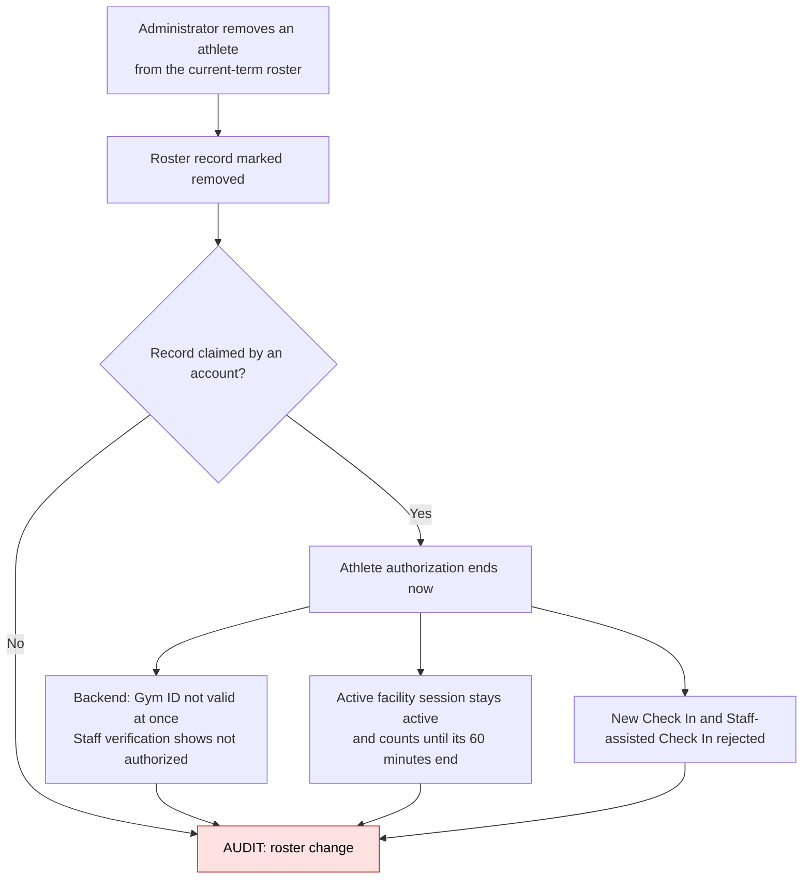

**About this diagram:** the backend answer changes at once; the athlete's phone shows it at its next refresh of the Gym ID. The record is marked, not deleted, so the authorization history keeps its source.

### 12. Manual grant and revoke of an authorization

**Type:** User flow. **Use it to:** build the grant and revoke screens and their error messages.

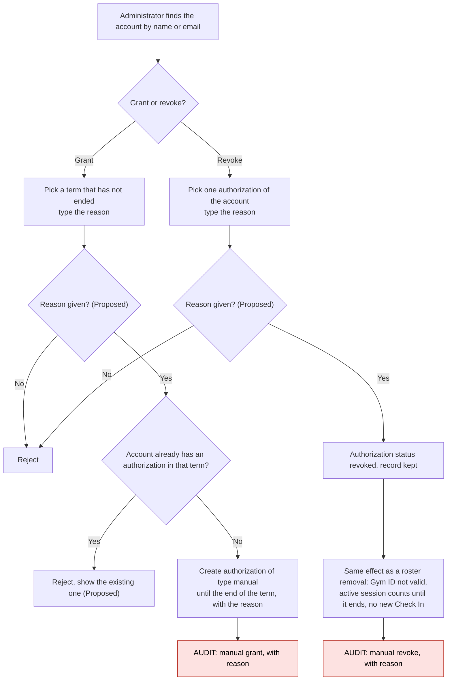

**About this diagram:** a manual grant needs an existing account (REQ-F-87). The reason rule is D11. Revoking a paid authorization does not free its Authorization Number; that is a release (section 13).

### 13. Release of a claimed Authorization Number

**Type:** System flow. **Use it to:** write the release action, its confirm screen and its tests.

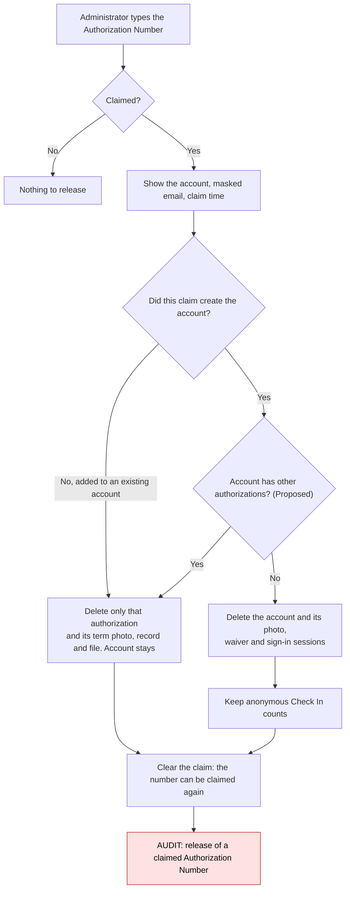

**About this diagram:** deleting the photo of an added authorization is Decided (E-57); keeping an account that has other authorizations is D12. "Did this claim create the account" needs a flag on the authorization saved at claim time (REQ-F-13 saves account and claim together, so the flag is known then).

### 14. Account deletion when a User asks

**Type:** System flow. **Use it to:** write the deletion action and check what data it removes and keeps.

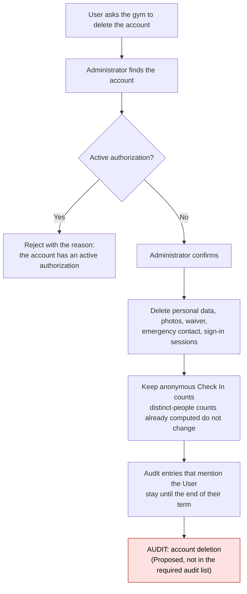

**About this diagram:** this is the same deletion the User can do in the app (REQ-F-09). REQ-NF-39 does not list it as an audited action (gap 2).

### 15. Global lookup limit alert

**Type:** System flow. **Use it to:** write the global lookup counter, the slowdown and the alert entry, and their tests.

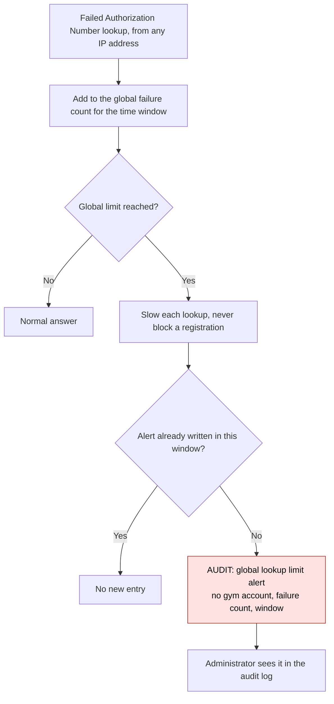

**About this diagram:** the limit values belong to the registration design (REQ-F-71). One alert per window keeps the log readable (D13).

### 16. Schedules, closures, notices and facility information

**Type:** System flow. **Use it to:** write the save rules for these items and decide which ones write an audit entry.

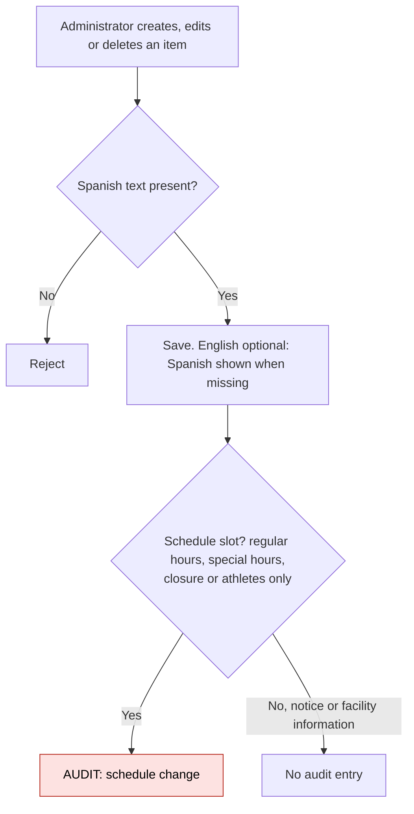

**About this diagram:** simple create, edit and delete (REQ-F-55, REQ-F-58). REQ-NF-39 lists schedule changes but not notices or facility information.

### 17. Audit log entry and supporting data

**Type:** Entity-relationship diagram. **Use it to:** write the migrations and constraints for the gym account, imports and the audit log.

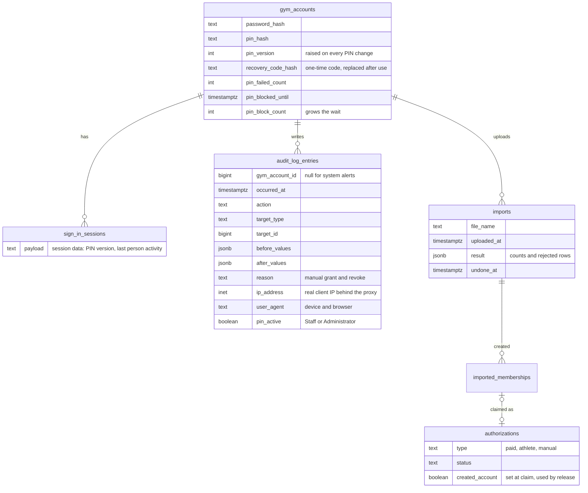

**About this diagram:** only the fields these flows need; other entities and fields belong to the data model design. The PIN state is kept in the session data, not in session columns, and `pin_version` replaces a per-session unlock time (E-56). `recovery_code_hash` comes from E-60; whether recovery attempts share the PIN counters or get their own follows D2.

Actions that write an audit log entry (REQ-NF-39):

| Action | Role | Where drawn |
|---|---|---|
| Staff correction (end early, void) | Staff | Check In flows (out of scope here) |
| Staff-assisted Check In, as an exception | Staff | Check In flows |
| In-person athlete registration (only if no mail, REQ-F-77) | Staff | Registration flows |
| Roster change (add, import row, edit, remove) | Administrator | Sections 10, 11 |
| Term change | Administrator | Section 8 |
| Schedule change | Administrator | Section 16 |
| Import | Administrator | Section 6 |
| Import undo | Administrator | Section 7 |
| Release of a claimed Authorization Number | Administrator | Section 13 |
| Manual grant or revoke, with reason | Administrator | Section 12 |
| PIN change | Administrator | Section 4 |
| Gym account password change | Administrator | Section 4 |
| Use of the recovery code (E-60, REQ-F-89) | Person at the sign-in screen, not signed in | Section 5 |
| Global lookup limit alert | System | Section 15 |
| Account deletion on User request (Proposed, not in the list) | Administrator | Section 14 |
| PIN block after too many attempts (Proposed, not in the list) | Staff | Section 1 |

Each entry holds the gym account, time, IP address, device and browser, and values before and after (REQ-NF-39). Only Administrators can read the log. Secrets are never written: a password, PIN or recovery code change records only that it changed. Retention: until the end of the term in which the entry happened (REQ-NF-05).

## Design decisions to confirm

All Proposed unless marked Decided. The team decides the Proposed ones in the PR review.

**D1. PIN format.**
- A: 4 digits. Fast to type. NIST SP 800-63B-4 section 3.2.10 (activation secrets) sets 4 as the minimum it SHALL accept. Easier to guess or see over a shoulder.
- B: 6 to 12 digits. NIST 3.2.10 says SHOULD be at least 6. One million options at 6 digits, still easy on a numeric keypad.
- C: any characters, 8 or more. Stronger, but slower at the front desk and harder to share safely.
- Recommendation: B, digits only, plus a short block list (000000, 123456 and similar). The PIN is a second secret on top of the gym password, which is closest to the NIST activation secret case; the analogy is not exact.

**D2. PIN attempt limit and wait.**
- A: 5 wrong PINs in a row, counted per gym account across all browsers, then a 5-minute wait that doubles on each new block, up to 1 hour. A success resets the count. Mirrors REQ-F-07.
- B: 10 wrong PINs, then the PIN is disabled until the team resets it on the server (NIST 3.2.10 style). Strong, but a front desk user could lock the administration out, and the reset needs server access (REQ-NF-23 conflict).
- C: count per browser only. Simple, but opening a new browser gives new attempts.
- Recommendation: A. Counting per gym account closes the new-browser trick, and the wait ends on its own. NIST 3.2.2 sets 100 failed attempts as the upper bound; A is far below it. Also log each block (see Gaps). The recovery code uses the same limit (E-60).

**D3. How the backend learns about person activity.**
- A: the PWA sends a small activity signal on tap or key press, at most every 30 seconds; requests the person triggers carry a header that also counts. Polling sends neither. The backend stores the time in the session data (E-56) and enforces 15 minutes.
- B: the PWA tracks the timer alone and tells the backend to close the PIN. Simple, but a modified client keeps the PIN open, which breaks REQ-F-52.
- Recommendation: A. The cut can be up to 30 seconds late, which does not matter for a 15-minute rule.

**D4. Effect of a PIN change on other browsers.** Decided (E-56): a PIN change raises `pin_version`, which closes the PIN in every other browser; they stay signed in as Staff.

**D5. Import transaction.**
- A: whole file in one transaction. A crash or a database error imports nothing. Row-level rejects (bad field, outside every term) do not stop the rest.
- B: one transaction per order. A crash leaves half a file, and undo has to clean it.
- Recommendation: A. A few hundred orders per file fit easily in one transaction (reasoned estimate, not measured).

**D6. Import result layout.**
- A: counts at the top (created, updated, rejected; "unchanged" shown inside updated), then one table per group: order reference, name, term, and the reason for rejected rows. Saved with the import so it can be opened later.
- B: as A, plus a CSV download of the rejected rows to fix in WooCommerce.
- C: counts only. Not enough: REQ-F-28 asks to list the orders.
- Recommendation: A first, B if time remains.

**D7. Undo after people checked in with those authorizations.**
- A: always allowed. Active facility sessions follow the roster-removal rule: they count until they end, the Gym ID shows not valid, no new Check In. Past sessions stay.
- B: allowed, but the confirm screen shows how many people have active sessions and past Check Ins, and asks to confirm again.
- C: blocked once anyone checked in. This contradicts REQ-F-31 ("undo any import at any time") and would need an SRS change.
- Recommendation: A with the counts of B on the confirm screen (section 7, the first screen after picking the import).

**D8. What undo removes when a later import touched the same orders.**
- A: undo deletes the memberships the import created, even if a later import updated them. Updates an import made to older records are not rolled back; the fix is to re-import a correct file.
- B: keep a copy of the old values for every update and restore them on undo. Complete, but more data and code.
- C: allow undo only of the latest import. Simple, but contradicts "any import".
- Recommendation: A. Reconciliation already handles wrong values.

**D9. Message when no term covers today.**
- A: a banner on every Administrator screen ("No academic term covers today. New authorizations cannot be created. Add a term.") plus the same reason in any error it causes.
- B: only the error at the moment something fails.
- Recommendation: A. The Administrator learns about it before a member is refused at the front desk.

**D10. Audit entries for a roster import.**
- A: one entry per record added, changed or removed, with a shared batch id.
- B: one entry per list import with the whole list as "after".
- Recommendation: A. REQ-NF-39 says "each roster change", and per-record entries keep before and after simple.

**D11. Reason for manual grant and revoke.**
- A: required free text, at least 10 characters, for both grant and revoke.
- B: required pick list (order error, payment not imported, other) plus optional text.
- C: optional.
- Recommendation: A. REQ-NF-39 already says "with its reason" for grant and revoke; the list in B can come later if reasons repeat.

**D12. Release when the account created by the claim has other authorizations.**
- A: remove only the released authorization; keep the account.
- B: delete the account anyway, as REQ-F-74 reads literally, losing the other authorizations.
- Recommendation: A. Deleting an account with another valid authorization removes access the person still has. Needs a small SRS wording change.

**D13. One alert per window for the global lookup limit.**
- A: one audit entry when the limit is first reached in a window, with the count.
- B: one entry per slowed lookup. Can flood the log during an attack.
- Recommendation: A.

## Gaps and questions

1. **Forgotten PIN or gym password.** Resolved by E-60: the recovery code (section 5). Still open: if the paper is lost too, the install command refuses to run when a gym account exists (section 3), so it needs a reset option.
2. **Audit list misses two actions.** REQ-NF-39 does not list account deletion by the Administrator (REQ-F-09) or PIN blocks after too many attempts (REQ-NF-48). Both look like they belong. Drawn as Proposed.
3. **Photos after undo.** Resolved by E-57: undo and the release of an added authorization delete the authorization with its term photo, record and file.
4. **Corrected order that changes email or Authorization Number of a claimed membership.** REQ-F-30 updates the record and REQ-F-11 says the account email is the payment email. Not said: does the account email change, and does the old number stay claimed? Suggest: update the membership, keep the account email, flag the row in the import result.
5. **Editing a term after records exist.** REQ-F-21 allows edits, but moving dates can leave imported orders or roster records outside their term (REQ-F-22). Drawn as a Proposed reject. The SRS also has no term deletion.
6. **Photo for a manual grant.** REQ-F-26 needs a current photo per term. REQ-F-87 does not say how a manually granted User gives it. Suggest the athlete rule: ask at the next sign-in, before Check In.
7. **Account deletion during an active facility session.** REQ-F-09 and REQ-F-74 do not say what happens to an active session of a deleted account. Suggest: void is wrong (it changes counts); keep the session anonymous and let it expire.
8. **Checking that the User asked.** REQ-F-09 lets the Administrator delete on the User's request but does not say how the request is confirmed (in person with ID, from the account email).
9. **Audit entries with no gym account.** The data model links every audit entry to the gym account, but the global lookup alert (REQ-F-71) is written by the system. Drawn with an empty gym account.
10. **Duplicate Authorization Number across orders.** Still open (E-30, E-55, G-19). The import rejects the second order as a planned path only.
11. **Gym ID "at once".** REQ-F-49 says the Gym ID stops being valid at once. The backend does; the phone shows it at its next refresh. The Check In flows should set how often the Gym ID screen refreshes.

## Traceability

| Requirement or decision | Where it appears |
|---|---|
| REQ-F-09 | 14. Account deletion when a User asks |
| REQ-F-21 | 8. Academic terms; 9. No term for the current date |
| REQ-F-28 | 6. WooCommerce import and re-import; D6 |
| REQ-F-29 | 6. WooCommerce import and re-import (kept fields and notes) |
| REQ-F-30 | 6. WooCommerce import and re-import (order reference check) |
| REQ-F-31 | 6. WooCommerce import and re-import; 7. Undo of an import; D7, D8 |
| REQ-F-49 | 10. Athlete roster; 11. Removing an athlete mid-term |
| REQ-F-52 | 1. Gym account and PIN states; 2. Backend check on every Administrator request |
| REQ-F-74 | 13. Release of a claimed Authorization Number; D12 |
| REQ-F-87 | 12. Manual grant and revoke; 9. No term for the current date; D11 |
| REQ-F-88 | 3. First setup of the gym account; 4. Change of gym account password and PIN |
| REQ-F-89 | 3. First setup of the gym account; 5. Recovery with the recovery code |
| REQ-NF-39 | 17. Audit log entry and supporting data; AUDIT nodes in sections 4 to 16 |
| REQ-NF-48 | 1. Gym account and PIN states; 2. Backend check; 4. Change of PIN; D1 to D4 |
| E-56 | 1. Gym account and PIN states; 2. Backend check; 4. Change of PIN; 17. Audit log entry and supporting data; D4 |
| E-57 | 7. Undo of an import; 13. Release of a claimed Authorization Number; gap 3 |
| E-59 | 10. Athlete roster (Staff read-only view) |
| E-60 | 3. First setup of the gym account; 5. Recovery with the recovery code; 17. Audit log entry and supporting data; gap 1 |
| Also used: REQ-F-03, F-07, F-22, F-51, F-55, F-58, F-71, F-76 | Sections 1, 6, 9, 10, 15, 16 |
