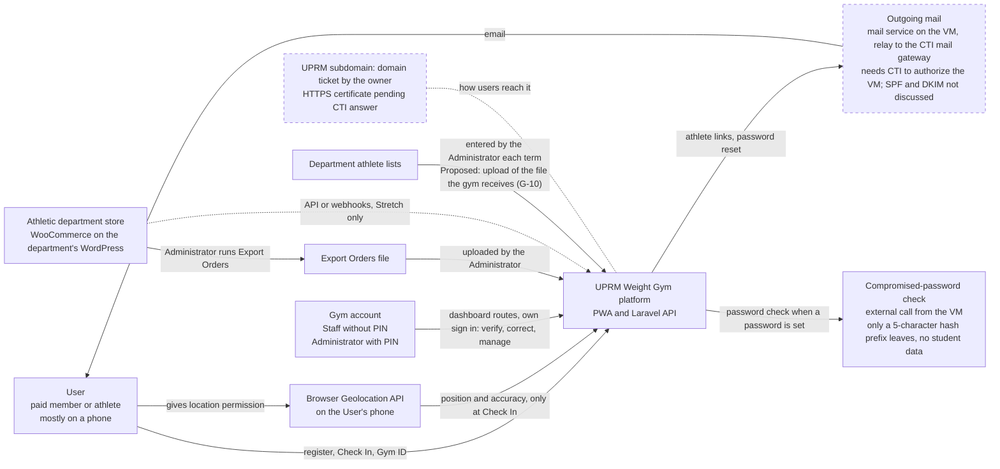
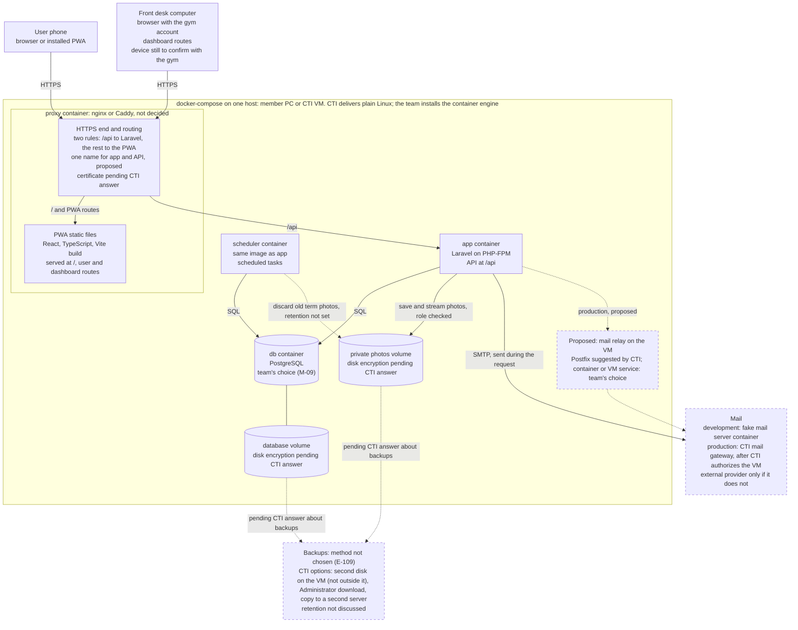
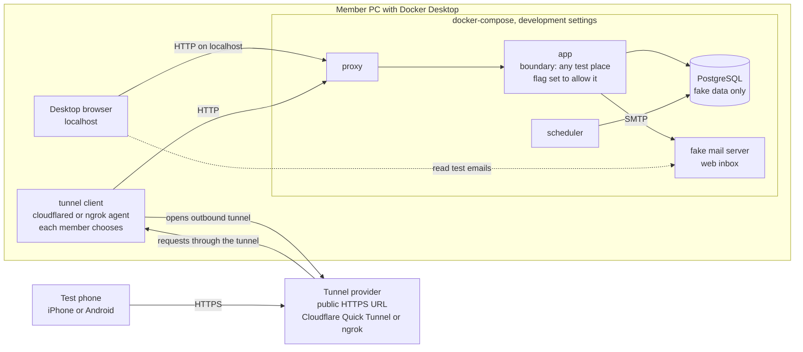
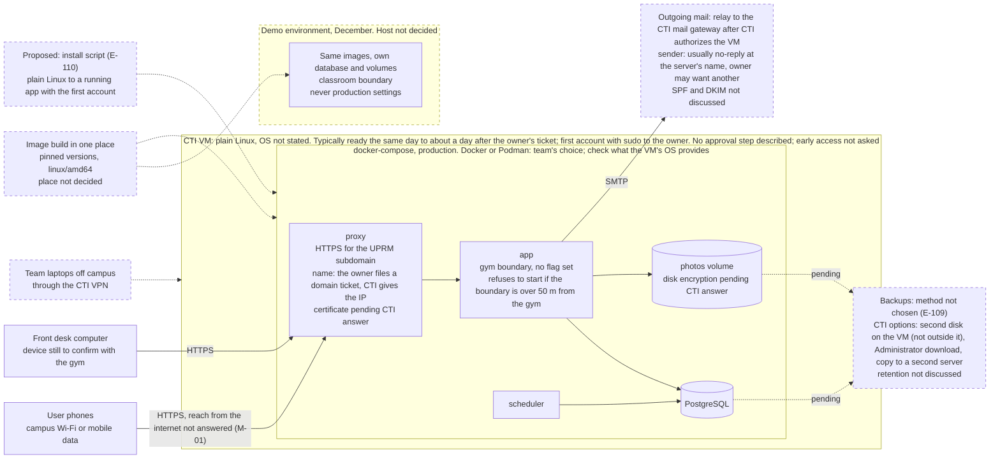
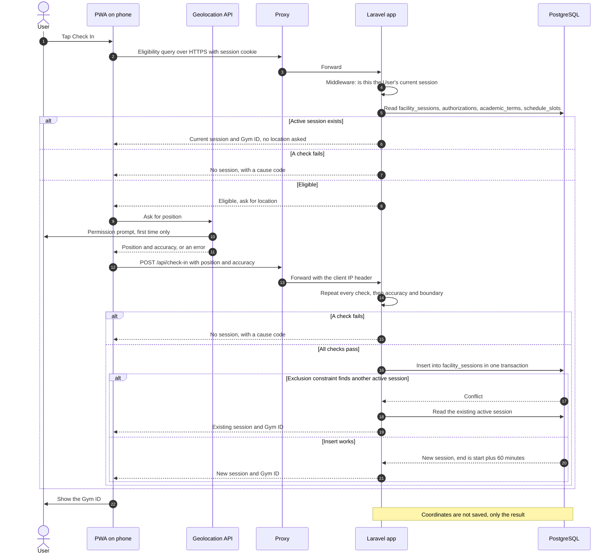

# Architecture and Deployment

This document shows how the system is built and where it runs. It replaces the Supabase and Vercel picture of the proposal (`docs/capstone_proposal/diagrams/01_architecture.png`) with the current stack: a React PWA, a Laravel backend and PostgreSQL, all in `docker-compose` (`docs/context.md` section 2). It covers the outside systems, the containers, development versus production, the demo environment, and the path of one Check In from the phone to the database. Inside the diagrams, items that still wait for CTI say "pending CTI answer" in words. The table "Pending CTI items" after diagram 4 maps them to their question IDs (`docs/decisions/cti.md`). Dashed lines and dashed boxes mean pending or proposed. CTI described a path for mail: a mail service on the VM (CTI suggests Postfix) relays to the CTI mail gateway after CTI authorizes the VM. The mail box stays dashed until CTI authorizes the VM. The app assumes mail exists (E-61).

## Diagrams

### 1. System context

**Type:** Context diagram. **Use it to:** agree on which outside systems the team must connect to, and which of them wait on CTI.

Only the Administrator brings in WooCommerce data, by uploading an Export Orders file. There is no API link in the MVP. How the store and the app would talk later (WordPress sends the data, or the app asks for it) is not decided, and no technical contact is named (G-35).

**About this diagram:** the mail box waits on CTI authorizing the VM (M-07) and the name box on M-03. The dashed WooCommerce link is REQ-F-32 (Stretch, M-12). The password check is E-63. It sends no student data, so it is not submitted to M-11 (E-98).

Notes:

- Location goes from the Geolocation API to the PWA, which sends it to the backend with the Check In. Coordinates are not stored, only the result of the check (REQ-NF-03, REQ-NF-11).
- Mail is assumed available (E-61). CTI described a relay through its mail gateway once it authorizes the VM, so an external provider is probably not needed. If CTI does not authorize the VM, the team uses an external SMTP or transactional mail provider, because this is a prototype (the team's own fallback, E-61). An external provider sends student email addresses out of the CTI VM, so it needs approval (M-11).
- Mail carries two kinds of athlete links: the athlete registration link and, since E-58, the "I am an athlete" link that a signed-in User gets at the institutional email of the roster record. Both use the same single-use link mechanism: an `email_links` table with a hash, an expiry and single use (data-model D9). Password reset links use Laravel's `password_reset_tokens` table, not `email_links`.
- Staff can still register an athlete in person. Staff generate a one-time code that lasts 15 minutes, and the athlete fills in the rest on their own phone (E-62). The code is another type in `email_links`, with the same method (data-model D9). The tool stays now that mail exists (REQ-F-77).
- Passwords use Laravel's built-in handling. There is no external identity service (E-63). The rule is a minimum of 10 characters, no mixing rules, and a check against known compromised passwords with `Password::min(10)->uncompromised()` (E-63). That check is an external call, but only a 5-character hash prefix leaves the VM: no names, emails, photos or full password. It is not submitted to M-11 (E-98). The tests need a case where the service does not answer (#30). The same rule for the gym account is assumed, not confirmed.
- The gym account signs in on its own dashboard routes, with no link from the User sign-in (E-65). It is not a separate app (to confirm, E-65).
- Payments stay in WooCommerce. The system never talks to the payment side (REQ-F-28, REQ-F-29).

### 2. Containers on one host

**Type:** Container diagram. **Use it to:** write the `docker-compose` file, the proxy rules and the volume setup.

The same `docker-compose` file runs on a member's PC and on the CTI VM. Only the proxy publishes a port. Every other container is on the internal compose network.

**About this diagram:** pending items are M-03 (certificate), M-13 (disk encryption), M-07 (CTI authorizing the VM) and M-06 (backup method and retention). The proxy choice is D1 and is still proposed. The `/api` rule is D2, the scheduler is D3 and mail during the request is D4. The front desk device is gym question G-06. Photo retention is REQ-NF-04.

Notes:

- The proxy has no route to the photos volume. A photo is read only through a Laravel route that checks the role (REQ-NF-20). Uploads are JPEG, PNG or HEIC up to 10 MB, saved as JPEG without location metadata (REQ-NF-24).
- Proposed (E-111): a storage estimate (bytes per photo, people, uploads per term) and cleanup options for the gym and UPRM to choose. The scheduler does the automatic part (REQ-NF-04). No period is set by the team (G-03).
- The service worker in the PWA does not cache `/api` responses, so stale data is never shown as current (`design-notes.md`, REQ-NF-26). Screens poll `/api` every 20 to 30 seconds (REQ-F-43).
- The scheduler does cleanup and retention, and marks old sessions as expired. The backend still computes session expiry at query time, from backend time (REQ-NF-01, REQ-F-38, check-in D3).
- Email goes out during the request. There is no queue and no worker container for now (D4).
- Both the User app and the gym dashboard are routes of the same PWA code (to confirm, E-65). The two proxy rules cover both (D2).

### 3. Development on each member's PC

**Type:** Deployment diagram. **Use it to:** set up the stack on each member's PC and test location on a real phone.

Each member runs the full stack with Docker Desktop. The desktop browser uses `localhost`. Phones reach the PC through an HTTPS tunnel, because the Geolocation API needs HTTPS (REQ-NF-12).

**About this diagram:** the free test boundary comes from REQ-NF-29 and D6. The tunnel choice is D7.

Notes:

- Tested on Windows 11 with a Samsung phone: Quick Tunnel gives HTTPS, location works, WebSocket works, SSE does not (`context.md` section 5). ngrok was not tested with the app.
- Each member picks a tunnel. The tunnel host lives in one `.env` variable, so switching tunnels changes one value (D7).
- The tunnel provider ends HTTPS and can see the traffic. Only fake data goes through it (REQ-NF-07, REQ-NF-09).
- Do not publish ports 5000 or 7000 (`context.md` section 3).

### 4. Production and demo

**Type:** Deployment diagram. **Use it to:** plan the CTI VM setup, the image build and the separate demo environment.

Production runs on a CTI VM with a UPRM subdomain and HTTPS. Who asks: the project owner. The VM and the domain are separate tickets on the CTI request page; the team's VPN is a VPN ticket or an email from him with the team's emails. CTI assigns the IP and acts only on the owner's request. The team gives the owner the size and the name. The December demo runs in a separate environment with the classroom boundary, so the classroom boundary never reaches production (REQ-NF-29, team decision E-42). Where the demo runs is not decided (D5).

**About this diagram:** pending CTI items are M-01 (reach from the internet), M-03, M-04, M-05, M-06, M-07 (authorization), M-13 and M-18 (ports); see the table below. The demo host is D5 and the build place is D8. The 50 m rule is D6.

Notes:

- The 50 m startup check is how REQ-NF-29 is enforced (`design-notes.md`, team decision E-16). The 50 m check always runs at startup. Only a flag allows another boundary, and development and the demo set it. Production does not set it. Without the flag, a boundary farther than 50 m stops the app from starting (D6).
- Server credentials live in protected configuration outside the repository. Development and production settings are separate (`context.md` section 3).
- Whoever has administrator access to the VM can read the database and the photos volume. That conflicts with REQ-NF-23 if team members run the server (M-16, gym G-01). CTI usually creates an account with sudo for the owner, who passes it to the team or makes another; off campus the team needs a VPN the owner requests, and the owner answers for those accounts. CTI has no staff to take over the system, and part of the install and orientation after December is the owner's.
- If the gym account password and PIN are lost, the paper recovery code from the install command sets new ones from the gym account sign-in screen (E-60, REQ-F-89). If the paper is lost too, only running the install command on the server remains, so it needs someone with server access (M-16).
- If an external mail provider is used, the SMTP arrow leaves the VM, and student email addresses go with it (M-11).
- Proposed VM request (E-111): CTI's usual size for a web app is 2 processors, 4 GB of memory and 40 to 60 GB of disk. The team recommends the numbers, backed by a storage estimate. A second backup disk, if chosen, is agreed with whoever creates the VM, probably in the same request.
- Restore is open (E-110): an 'upload backup' action in the app after a fresh install (CTI's picture) or a step on the server. An in-app restore would exceed the planned 10 MB upload limit and would replace audit log entries.

### Pending CTI items on these diagrams

| ID | Question | Where it shows | If the answer is bad |
|---|---|---|---|
| M-01 | Can phones on mobile data reach the VM? Not answered; off-campus use by Users is a gym question (G-31) | Diagram 4, phone to proxy | Campus only: no Check In on mobile data. Hosting plan changes. Automatic certificates (D1, Caddy) would not work either |
| M-02 | Containers on the VM: Docker, Podman or none (answered: team's choice) | Diagrams 2 and 4, host box | No containers: deployment redesigned on CTI services |
| M-03 | Who makes the subdomain and certificate; app and API on one name | Diagrams 1, 2 and 4, proxy | Two names: cookie login design changes (cross-site cookies, CORS) |
| M-04 | What CTI needs to approve the VM, and how long | Diagram 4, VM box | Late VM: no production in December. CTI stated no conditions and described no approval step (to confirm). CTI did not say whether its usual requests (audit log, installer, disaster plan) are conditions; any condition becomes a new requirement |
| M-05 | Early access to the VM | Diagram 4, VM box | First real deployment happens close to the demo. Demo option D5 A is at risk |
| M-06 | Where backups go and for how long | Diagrams 2 and 4, backup box | Partly answered: the team decides among CTI's three options. The second disk is not outside the VM (REQ-NF-06). Retention and CTI snapshots still open |
| M-07 | Outgoing mail: answered A in principle (CTI relay after CTI authorizes the VM). Open: the authorization, SPF and DKIM, the sender. External provider only if CTI declines | Diagrams 1, 2 and 4, mail box | CTI cannot provide it: the team uses an external SMTP or transactional provider (E-61), which needs approval (M-11) because email addresses leave the VM. "No mail" is no longer a plan |
| M-09 | PostgreSQL accepted (answered: team's choice) | Diagrams 2 and 4, database | MySQL required: REQ-F-17 and REQ-F-36 need a new design |
| M-13 | Data on the VM disk, disk encryption (data on the VM disk: answered; encryption still pending) | Diagrams 2 and 4, volumes | Disk not encrypted: team decides whether to encrypt files itself |
| M-18 | Which ports are open to the VM (80 and 443), and whether a firewall request is needed | Diagram 4, proxy | Port closed: nobody reaches the app |

Also relevant, not in the list asked for this issue: M-11 (external services approval, affects the tunnel and an external mail provider; the compromised-password check is not submitted, E-98), M-12 (WooCommerce API, Stretch only) and M-16 (who administers the server).

### 5. Request path: one Check In

**Type:** Sequence diagram. **Use it to:** write the Check In endpoint, its tests, and the PWA calls.

From the phone to the database. Endpoint paths are examples only; the API contract is separate work (OpenAPI, `context.md` section 2). Responses go back through the proxy; the diagram skips that hop.

**About this diagram:** the first branch is REQ-F-37, the session check REQ-F-03 (data-model D3), the boundary check REQ-NF-29, the cause code on failure REQ-F-33 (E-74), and not saving coordinates REQ-NF-03. The two-step order is check-in D1.

Notes:

- The check order is: connection, active session, authorization, photo, open, athletes-only, permission, accuracy, boundary. The eligibility query runs the checks that need no location. The final POST repeats every check (check-in D1). Location permission is checked only on the phone; the backend requires a position and checks accuracy and boundary.
- The server rejects with a fixed code per cause, for example `check_in.location_denied`. The app writes the text in the account's language (E-74). REQ-F-33 gains two causes: location unavailable and new term photo needed.
- One sign-in session per User: the valid session is stored in `users.current_session_id`, and a middleware compares it on every request. Old rows are deleted (data-model D3).
- The `sign_in_sessions` table keeps no IP and no browser: both columns are NULL (E-91). Gym actions stay traceable through the audit log, which records IP, device and browser (REQ-NF-39).
- Attempt counters live in the `cache` table, keyed by IP and email for sign in, and the PIN counters sit there too (E-91, E-93). They are temporary and are discarded when the wait ends. The "discarded" part is a default the owner did not object to.
- The database, not the PWA, guarantees one active session per User, also under simultaneous requests (REQ-F-36, REQ-NF-42). This needs PostgreSQL (M-09). The exclusion constraint ignores void rows (`WHERE status <> 'void'`), so an early end shortens the period (check-in D4).
- Schedule and athletes-only checks use `schedule_slots` (REQ-F-33, REQ-F-82). If an athletes-only period starts inside the 60 minutes, the response carries its start time (REQ-F-83).

## Design decisions to confirm

D2, D3, D4, D6 and D7 are **Decided** (owner, 2026-10-19) and can be revisited. D1, D5 and D8 are still **Proposed**. The team decides them in the PR review.

### D1: Proxy, nginx or Caddy

**Status:** Proposed.

`context.md` lists "nginx or Caddy". Both can serve the static PWA files and pass `/api` to PHP-FPM.

- **A. nginx.** Widely used with Laravel, and `context.md` already names it for the static files. It does not get certificates by itself: the certificate comes from CTI, or the team adds certbot and a renewal job.
- **B. Caddy.** Gets and renews certificates by itself, with a short config. That only works if the VM is reachable from the internet (or DNS can be changed by the team) and UPRM allows that kind of certificate (M-01, M-03). If CTI hands over a certificate, this advantage is gone.

Recommendation: wait for M-03. If CTI gives the certificate, A, because it is the most familiar option. If the team must get it and the VM is public, B. Development does not depend on this choice, since the tunnel gives HTTPS.

### D2: All backend routes under `/api`

**Status:** Decided (owner, 2026-10-19), A.

Laravel packages add their own paths by default: Sanctum's CSRF cookie route and Fortify's sign in, registration and password reset routes are not under `/api`.

- **A. Move them under `/api`** with the route prefix setting of each package. The proxy needs two rules: `/api` to Laravel, everything else to the PWA (with `index.html` as fallback for app routes).
- **B. Keep the defaults** and list each path in the proxy. More rules, and paths like `/login` can clash with PWA routes.

Decision: A. One simple rule, and it matches the glossary ("API under `/api`"). Sanctum, Fortify, Policies and the OpenAPI contract stay as written in `context.md`. Confirm the prefix settings when the project is set up.

### D3: How scheduled tasks run

**Status:** Decided (owner, 2026-10-19), A.

- **A. A scheduler container** from the same image as `app`, running Laravel's scheduler loop. Same in development and production.
- **B. Cron on the host** calling the app container every minute. Needs access to the host cron, and differs between a PC and the VM.
- **C. Cron inside the app container.** Two processes in one container, harder to restart one alone.

Decision: A. It is what `context.md` already lists as a container, and it behaves the same everywhere.

### D4: Sending email during the request or through a queue

**Status:** Decided (owner, 2026-10-19), A.

- **A. During the request.** No extra container. If SMTP fails, the user sees an error at once and can try again. The request takes a bit longer.
- **B. Queue in the database plus a worker container.** Fast response and retries. One more container, and failed jobs must be watched by someone.

Decision: A. Email is only for athlete registration links, "I am an athlete" links (E-58) and password resets, a small volume. Move to B if the CTI relay turns out slow (M-07). Proposed: with a local relay, a gateway failure queues mail instead of showing an error at once, so someone must watch the relay queue.

### D5: Where the demo environment runs

**Status:** Proposed.

- **A. A second compose project on the CTI VM** with its own name, database and volumes. Shows the real deployment. Needs a second subdomain (M-03), room on the VM (M-04), access in time (M-05), and reach from the classroom (M-01).
- **B. A member's laptop with a tunnel** in the classroom. No CTI dependency. Depends on the classroom network and the tunnel; it is not the production setup.

Recommendation: A if the VM is ready in time, with B prepared as a fallback in any case.

### D6: How the app knows it must enforce the gym boundary

**Status:** Decided (owner, 2026-10-19), C.

The 50 m startup check must run in production and must not block development or the demo (REQ-NF-29).

- **A. Run the check when the environment name is `production`.** Demo uses another name. Simple. A wrong name in production turns the check off without notice.
- **B. Run the check only when a flag is on.** Forgetting the flag in production turns the check off without notice.
- **C. Always run the check, unless a flag that allows a non-gym boundary is on.** Development and demo set the flag. Forgetting it makes the app refuse to start, which is noticed at once.

Decision: C. A mistake fails safe: the classroom boundary cannot reach production by a missing setting.

### D7: Tunnel for phone tests

**Status:** Decided (owner, 2026-10-19), each member picks.

- **A. Cloudflare Quick Tunnel.** No account, already tested (location and WebSocket work, SSE does not). The URL changes every run, so the app URL settings (and Sanctum's list of first-party domains, to confirm during setup) must change every run.
- **B. ngrok free plan.** Fixed URL, so settings are set once. Limits of 20,000 requests and 1 GB per month (`context.md` section 5). Not tested with the app yet. One phone polling every 25 seconds uses about 144 requests per hour.

Decision: each member chooses, and the tunnel host lives in one `.env` value so both work. B is easier for daily work because of the fixed URL; A is the fallback when the ngrok quota runs out.

### D8: Where production images are built

**Status:** Proposed.

`context.md` says images are built in one place, never on each laptop.

- **A. Build on the VM** from a tagged commit. No registry. The VM needs the build tools and internet access to download base images (M-04).
- **B. Build in GitHub Actions** and push to a private registry; the VM pulls by tag. Repeatable and always `linux/amd64`. Needs a registry token on the VM and outbound access to the registry (M-04).

Recommendation: A for December, because it has fewer parts. Move to B if the team wants automatic builds later. If the install script is adopted, it must install the container engine and get the images: option A needs build tools in the script, option B a registry token.

## Gaps and questions

1. **REQ-NF-12 says "all traffic" goes over HTTPS.** In development the desktop browser uses plain HTTP on `localhost` (browsers treat `localhost` as secure, so location still works), and the tunnel client talks plain HTTP to the proxy on the same PC. Inside the compose network, proxy to app is not encrypted either. Suggest the SRS say "all traffic between the client and the server". Confidence 8: based on the tested tunnel setup in `context.md` section 5; the `localhost` rule is from browser behavior, not checked in this project.
2. **REQ-NF-09 and the tunnel.** The tunnel provider ends HTTPS and can read the traffic. That is fine with fake data only, but the real-data import test (REQ-NF-07, M-17) must not go through a tunnel. The SRS does not say this. Confidence 8.
3. **REQ-NF-29 does not say where the demo runs or what data it uses.** Real student data in a classroom demo would conflict with REQ-NF-07. Suggest "demo uses fake data" unless the gym says otherwise. See D5 and D6.
4. **REQ-NF-01 depends on a correct clock.** Backend time decides expiry, so the VM clock must be synced. No CTI question asks about time sync. Suggest adding it to M-04.
5. **Real client IP for the audit log (REQ-NF-39).** If CTI puts its own proxy in front of the VM (M-01 answer C), the real IP passes two proxies, and Laravel must trust both. The trusted proxy list depends on M-01. The attempt counters keyed by IP (E-91) depend on the same list.
6. **REQ-NF-06 has no frequency or recovery target.** It says "backups" and "a tested restore", not how often or how much data may be lost. The database and the photos volume should be copied together so they match. CTI asks every project for a written disaster plan: how often, which data, the steps to recover. CTI's minimum advice is a daily backup in the afternoon, or Fridays. CTI's view is that losing about a week is not much when a backup exists, and CTI expects the team to agree the backup and restore procedure with the owner (E-109).
7. **An external mail provider sends data out of the VM.** If CTI does not authorize the VM on its mail gateway, the fallback provider (E-61) receives student email addresses, which needs approval (M-11). M-11 asks who approves such services. The compromised-password check (E-63) is also an external call, but it sends no student data, only a 5-character hash prefix, so it is not submitted to M-11 (E-98).
8. **The route paths of the gym dashboard are not set.** E-65 says the dashboard lives on its own routes in the same codebase. The path names, and whether the build is shared with the User app, are not written anywhere. The owner said "different routes" and the same-codebase part is a reading still to confirm.
9. **The name of the flag in D6 is not set.** D6 does not name it.

## Traceability

| Requirement | Where it appears |
|---|---|
| REQ-NF-10 | 2. Containers on one host (one PWA build served at `/` to phone and desktop, including the dashboard routes) |
| REQ-NF-12 | 2. Containers on one host, 3. Development on each member's PC (tunnel), 4. Production and demo (proxy HTTPS), Gaps 1 |
| REQ-NF-20 | 2. Containers on one host (private photos volume, reached only through the app) |
| REQ-NF-21 | 5. Request path: one Check In notes (attempt counters in `cache`, E-91) |
| REQ-NF-29 | 3. Development on each member's PC, 4. Production and demo, 5. Request path: one Check In, D5, D6 |
| REQ-NF-01 | 2. Containers on one host notes, Gaps 4 |
| REQ-NF-03 | 1. System context notes, 5. Request path: one Check In |
| REQ-NF-04 | 2. Containers on one host (scheduler to photos, pending) |
| REQ-NF-06 | 2. Containers on one host and 4. Production and demo (backup box, M-06), Gaps 6 |
| REQ-NF-07 | 3. Development on each member's PC (fake data), Gaps 2 and 3 |
| REQ-NF-09 | 3. Development on each member's PC notes, Gaps 2 |
| REQ-NF-11 | 1. System context, 5. Request path: one Check In |
| REQ-NF-23 | 4. Production and demo notes |
| REQ-NF-24 | 2. Containers on one host notes |
| REQ-NF-26 | 2. Containers on one host notes |
| REQ-NF-39 | 5. Request path: one Check In (client IP header, audit log), Gaps 5 |
| REQ-NF-42 | 5. Request path: one Check In notes |
| REQ-F-03 | 5. Request path: one Check In (middleware and `users.current_session_id`, data-model D3) |
| REQ-F-06, REQ-F-15, REQ-F-75, REQ-F-77 | 1. System context (mail, M-07, in-person tool kept, E-62) |
| REQ-F-28, REQ-F-29 | 1. System context (Export Orders file) |
| REQ-F-32 | 1. System context (dashed API link, Stretch) |
| REQ-F-33, REQ-F-82, REQ-F-83 | 5. Request path: one Check In (cause codes, E-74) |
| REQ-F-36, REQ-F-37 | 5. Request path: one Check In |
| REQ-F-38 | 2. Containers on one host notes |
| REQ-F-43 | 2. Containers on one host notes |
| REQ-F-89 (E-60 recovery code) | 4. Production and demo notes |
| E-58 ("I am an athlete" link by mail) | 1. System context (mail), M-07 row, D4 |
| E-61 (mail assumed available) | 1. System context, 2. Containers on one host, 4. Production and demo, M-07 row, D4, Gaps 7 |
| E-63, E-98, REQ-NF-51 (passwords in Laravel, compromised-password check) | 1. System context (diagram and notes), Gaps 7 |
| E-65 (gym dashboard on its own routes) | 1. System context, 2. Containers on one host, Gaps 8 |
| E-62, data-model D9 (in-person code, `email_links`) | 1. System context notes |
| Check-in D1, E-74 (two-step Check In, cause codes) | 5. Request path: one Check In |
| Data-model D3, E-91, E-93 (one session per User, no IP in sessions, counters in `cache`) | 5. Request path: one Check In notes, Gaps 5 |
| Check-in D4, check-in D3 (exclusion constraint, expiry task) | 5. Request path: one Check In notes, 2. Containers on one host notes |
| Architecture D2, D3, D4, D6, D7 | D2, D3, D4, D6, D7 |

E-56 (PIN state in the browser session), E-57 (photos on import undo) and E-59 (Staff see the roster) change no diagram in this file.
