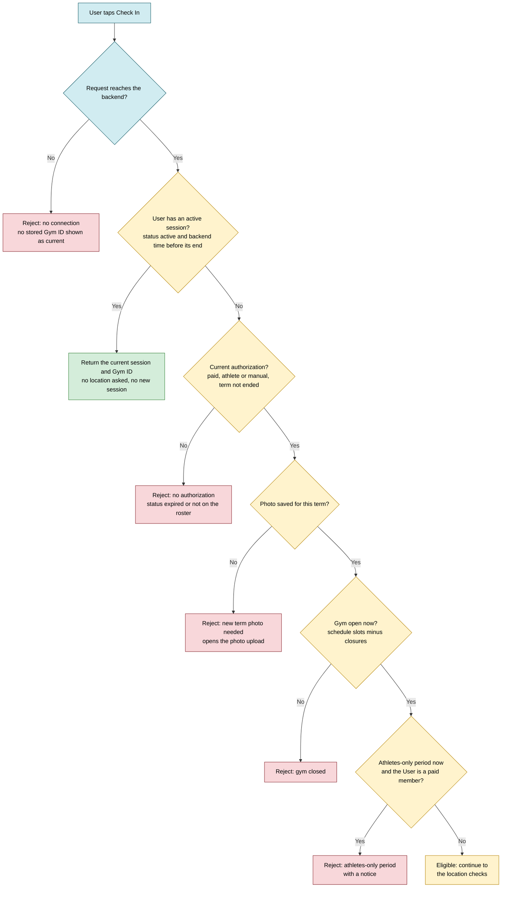
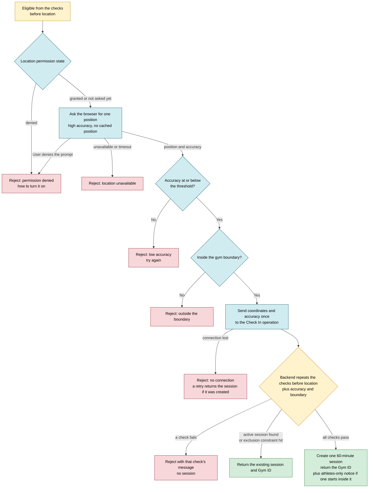
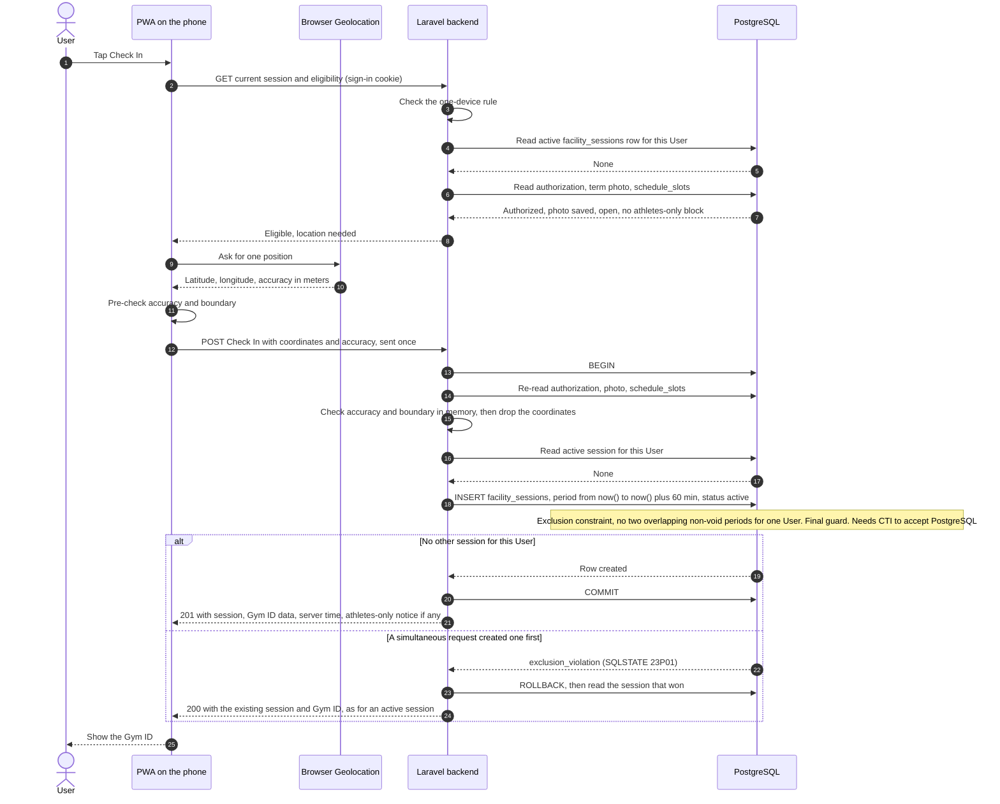
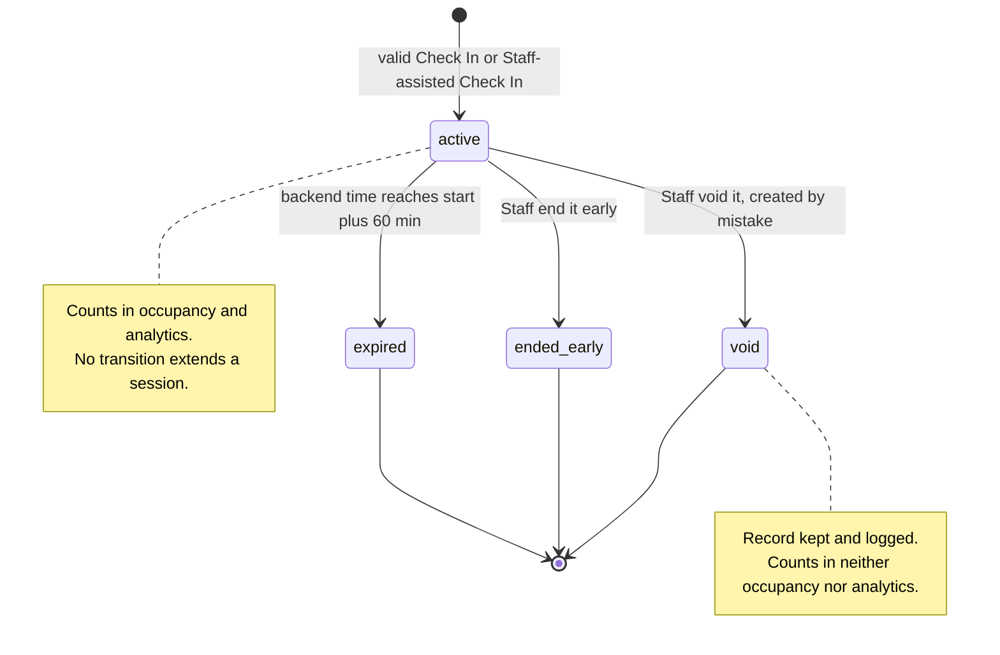
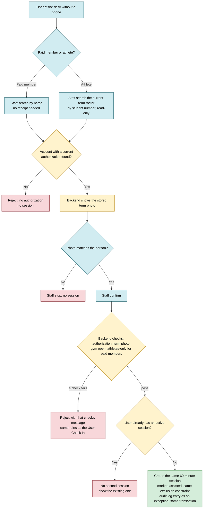
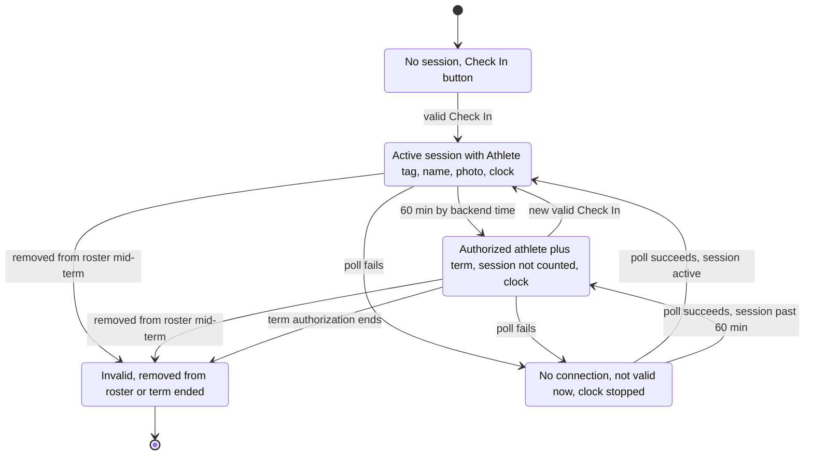
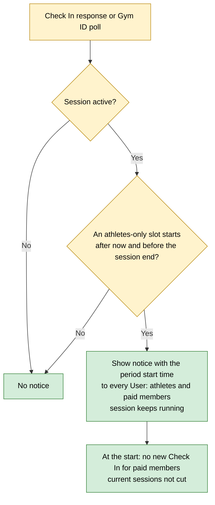
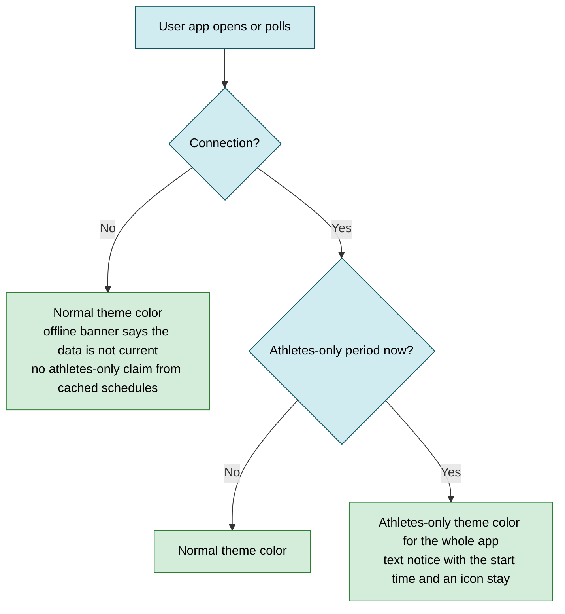
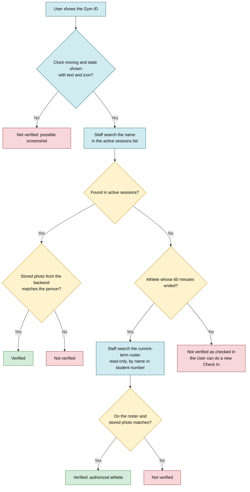

# Check In, session and Gym ID flows

This document draws how Check In decides, how a facility session lives and ends, how Staff do an assisted Check In and verify a Gym ID, what the Gym ID shows in each state, and how occupancy is counted. It covers SRS sections 3.6, 3.7 and 3.8 (GitHub issue #6). The backend is Laravel and the database is PostgreSQL (`docs/context.md` section 2). The single active session rule depends on a PostgreSQL exclusion constraint, so it depends on CTI accepting PostgreSQL (M-09). Values the SRS leaves to design are in "Design decisions to confirm".

## Diagrams

Legend used in the flowcharts: blue nodes run on the phone (PWA) or are Staff actions, yellow nodes run on the backend, red nodes are rejections, green nodes are outcomes that show a session.

### 1. Check In checks before location

**Type:** System flow. **Use it to:** write the backend eligibility check, its order, and one test per rejection.

**About this diagram:** Location is asked only when a new session must be created (REQ-F-37), so every check that does not need location runs first; the order and its reasons are in D1. Each rejection maps to one message key: `check_in.offline`, `check_in.no_authorization`, `check_in.photo_required`, `check_in.gym_closed`, `check_in.athletes_only` (full list in D5).

- "No connection" is detected on the phone: the request fails or times out. There is no offline Check In (REQ-NF-26, SRS 2.4).
- The athlete photo check comes from REQ-F-26. A paid member uploads the photo at registration and renewal, so in practice only athletes get the "new term photo needed" rejection.
- The athletes-only check applies only to paid members (REQ-F-82). Manual authorizations: see Gaps.

### 2. Check In location checks and session creation

**Type:** System flow. **Use it to:** build the location step on the phone and the backend Check In operation, with its error messages.

**About this diagram:** The rejections map to the keys `check_in.location_denied`, `check_in.location_unavailable`, `check_in.low_accuracy` and `check_in.outside_boundary` (D5). Accuracy and boundary follow D2. The final submit repeats every check in the order set in D1, except the location permission: only the phone knows it. The backend requires a position and checks accuracy and boundary.

- Location comes from the browser Geolocation API (REQ-NF-11). The permission state is read before asking where the browser allows it; otherwise the error of the position request tells denied, unavailable or timeout apart.
- The phone checks accuracy and boundary only to answer fast. The backend repeats every check except the location permission and is the only one that decides. The client is never trusted for authorization. Location is a condition, not proof of presence (SRS 3.6).
- Coordinates travel once in the Check In request and are not stored. Only the result of the location check may be stored on the session (REQ-NF-03). The boundary, accuracy threshold and gym coordinates come from environment configuration (REQ-NF-28, REQ-NF-29).
- The 50 m check always runs at startup. Only a flag allows another boundary; development and the demo set it, production does not. Without the flag, a boundary farther than 50 m stops the app from starting (architecture D6, Decided (owner, 2026-10-19), open to revision).

### 3. Successful Check In

**Type:** Sequence diagram. **Use it to:** write the Check In endpoint, its transaction, and the test for two simultaneous requests.

**About this diagram:** Step 3 is the one-device rule (REQ-F-03). The exclusion constraint is the final guard of REQ-F-36 and depends on CTI accepting PostgreSQL (M-09). The 200 answer follows REQ-F-37.

- Steps 13 to 24 are the single protected operation: re-check, look for an active session and create one, in one transaction. The read in step 16 gives a clean answer in the normal case. Under simultaneous requests both reads can see nothing, so the constraint decides (REQ-NF-42 tests this).
- Backend time is the database clock `now()` (REQ-NF-01). The response carries server time so the phone can count minutes left for a paid member without trusting its own clock. Athletes never see minutes left (E-75).

### 4. Facility session states

**Type:** State diagram. **Use it to:** write the session status column, the Staff corrections, and the rule for what counts in occupancy and analytics.

- expired is computed from backend time with no checkout (REQ-F-38). It counts in analytics as a visit, not in occupancy. ended_early counts the same way, with its real end time.
- Only Staff and Administrators can end early or void (REQ-F-48). Each correction is an audit log entry (REQ-NF-39). Staff cannot extend a session or create one without authorization.
- Staff can void only active sessions (E-80). Staff already list active sessions, so there is no list of past sessions, and past statistics do not change. Who fixes a mistake found the next day is still open (see Gaps).

### 5. Staff-assisted Check In

**Type:** User flow. **Use it to:** build the Staff assisted Check In screens and write its test cases.

**About this diagram:** Covers REQ-F-46. The athlete search uses the read-only current-term roster that Staff see (E-59, still to be confirmed by the gym).

- Location is not checked: Staff are at the desk, so the person is in the gym. Every other rule of the User Check In applies (REQ-F-46), including the athletes-only rejection for paid members (REQ-F-82).
- Staff can only read the roster here; adding, editing, removing or importing roster records stays with the Administrator (E-59).
- "Check In this athlete" on the roster screen (S-05) opens the assisted Check In screen (S-03) with the student number already filled in (E-81). Staff and Administrators always see the student number in full, on every screen they use.
- The assisted session goes through the same protected operation as diagram 3, so the exclusion constraint also guards it. A connection is required (REQ-NF-26). The audit log entry follows REQ-NF-39.

### 6. Gym ID states: paid member

**Type:** State diagram. **Use it to:** build the paid member Gym ID screen and what it shows in each state.

- After 60 minutes the Gym ID says "expired" with text and an icon, not only color (REQ-F-40, REQ-NF-14). Nobody has to leave (REQ-F-38).
- The clock runs on the phone while the Gym ID is live, so Staff can tell a live screen from a screenshot. There is no code or QR (REQ-F-40). It shows the time with seconds as text, changes at most once per second and never flashes (E-75, WCAG 2.2.2).
- The Gym ID shows a tag, "Member" for a paid member, with text and an icon, and a color different from the athlete tag (E-75). The colors are the owner's choice and are not picked yet. They must not repeat the athletes-only theme color of diagram 8, so one color never means two things.
- Without a connection the app does not show a stored Gym ID as current (REQ-NF-26). It shows "not valid now" and the clock stops (E-77). A persistent banner at the top of the screen says the data is not current, with an "updated at" time. The same applies to the athlete Gym ID below.
- If an athletes-only period starts inside the active session, the Gym ID shows a notice with its start time while the session is active. The session is never cut (REQ-F-83).

### 7. Gym ID states: athlete

**Type:** State diagram. **Use it to:** build the athlete Gym ID screen and what it shows in each state.

- The athlete Gym ID stays valid while the term authorization is active; the 60 minutes are only a counting rule (REQ-F-38, REQ-F-40). Staff check the read-only current-term roster for an athlete in a_valid (REQ-F-45, E-59).
- Removed from the roster mid-term: the Gym ID is invalid at once, the current session keeps counting until it ends, and no new Check In is allowed (REQ-F-49).
- Text for a_valid (E-75): "Authorized athlete" plus the term, for example "Authorized athlete, Fall 2026", with the clock and an icon (REQ-NF-14). It never says "expired" or "session ended". Athletes never see minutes left, at any time (REQ-F-40 in SRS v0.7). The Staff active sessions list follows the same rule (E-99).
- The Gym ID shows a tag, "Athlete", with text and an icon, and a color different from the member tag (E-75). The colors are the owner's choice and are not picked yet. Same clock, offline and athletes-only notice rules as the paid member Gym ID.

### 8. Athletes-only notice during a session

**Type:** System flow. **Use it to:** write the backend rule that adds the notice to the Check In and Gym ID answers, and its tests.

- Covers REQ-F-83 and the rejection side of REQ-F-82. Times shown as ISO date plus 12-hour time in `America/Puerto_Rico` (REQ-NF-37, REQ-NF-38).
- Every User sees the notice, athletes and paid members (E-76).

#### Theme color during the athletes-only period

**Type:** System flow. **Use it to:** build the theme switch of the User app (REQ-F-90, E-76).

- The whole theme of the User app changes color, so every User sees at a glance which period it is. The Staff and Administrator dashboard does not change color (REQ-F-90).
- Color is never the only signal (REQ-NF-14): the text notice and an icon stay (WCAG 1.4.1).
- Without a connection the app returns to the normal color and does not claim an athletes-only period from cached schedules (REQ-F-90, REQ-NF-26).
- The theme colors, and the colors of the Member and Athlete tags on the Gym ID, are the owner's choice and are not picked yet. They must not overlap, so one color never means two things.

### 9. Occupancy counting

**Type:** System flow. **Use it to:** write the occupancy query and endpoint, and the polling on the User, Staff and Administrator screens.

- Occupancy is the count of active sessions (REQ-F-41). Because the count is done at query time with backend time, every request already reflects the last Check In, expiration or Staff correction. Expiry is never late.
- Every screen polls the same endpoint every 20 to 30 seconds (REQ-F-43, interval in D6), so all three show the same value after each one updates (REQ-F-42). A failed poll marks the value as not current (REQ-NF-26): the screen keeps the loaded content with "updated at TIME", the persistent offline banner shows, and occupancy shows no number (E-77).
- An athlete removed mid-term keeps counting until the session ends (REQ-F-49). Voided sessions never count. Athletes who stay past 60 minutes are not counted.

### 10. Staff verification of a Gym ID

**Type:** User flow. **Use it to:** build the Staff verification screens (active sessions list and roster search) and write test cases.

**About this diagram:** Covers REQ-F-44 and REQ-F-45. The roster search is the read-only current-term roster Staff see under E-59 (still to be confirmed by the gym).

- Staff verify against backend data, not only the User's screen (REQ-F-45). The active sessions list shows Check In time, authorization and Gym ID (REQ-F-44). It shows minutes left for paid members; for an athlete it shows "athlete" and the Check In time, never minutes left (E-99). A search is a fresh request, so verification never waits for the next poll.
- Staff see only photo, authorization, waiver and emergency contact (REQ-NF-19). The roster list they see is read-only and limited to the current term (E-59). The student number is shown in full (E-81).

## Design decisions to confirm

"Decided, revisable" means the owner accepted the recommendation and can still change it.

### D1. Order of the Check In checks and the two-call flow

Status: Decided (owner, 2026-10-17), option A.

- A. Phone first asks the backend for the current session and eligibility (connection, active session, authorization, photo, open, athletes-only). Only if eligible, it asks location and sends one Check In request, where the backend repeats all checks. Pro: no location prompt when Check In would fail anyway; matches REQ-F-37; the same GET serves the Gym ID screen. Con: two requests, about one extra round trip toward the 3 second target (REQ-NF-16).
- B. Ask location first, then one request that checks everything. Pro: one request. Con: asks location from people with no authorization or when the gym is closed; the User fixes location only to learn the gym is closed.
- C. One POST with no location first; the backend answers "location needed" or the active session; the phone retries with location. Pro: one endpoint. Con: the same round trips as A with a less clear contract.

Decision: A, because the User gets no location prompt when Check In would fail anyway. The eligibility query comes first, then location, then one final submit that repeats every check except the location permission, which only the phone knows (the backend requires a position and checks accuracy and boundary). Order: connection (nothing works without it), active session (REQ-F-37 must win over all other checks), authorization (the most basic rule, REQ-F-33), term photo (part of the authorization, REQ-F-26), gym open (applies to everyone), athletes-only (needs the authorization type), then location permission, accuracy, boundary. Accuracy comes before boundary because a boundary result with a poor fix cannot be trusted, and "low accuracy" tells the User to retry instead of moving.

### D2. Accuracy and boundary rule

Status: Proposed. Values come from measurement at the gym (REQ-NF-28) and stay out of this issue. One part is decided (architecture D6, owner, 2026-10-19, revisable): the 50 m check always runs at startup. Only a flag allows another boundary; development and the demo set it, production does not. Without the flag, a boundary farther than 50 m stops the app from starting.

- A. Two separate checks: accuracy at or below a threshold, and distance to the gym coordinates at or below the boundary radius. Pro: simple, each failure has its own message. Con: a fix near the edge with a large accuracy radius can pass.
- B. Distance plus accuracy at or below the boundary radius (the whole uncertainty circle inside the boundary). Pro: strict. Con: rejects people inside the gym when accuracy is poor indoors.
- C. Distance minus accuracy at or below the boundary radius. Pro: lenient indoors. Con: easier to pass from outside.

Recommendation: A, because it maps one to one to the SRS messages and the measurement at the gym can tune both numbers. The threshold and radius are environment settings with a development placeholder (for example 50 m) that is replaced after the gym tests.

### D3. How expiry is computed

Status: Decided (owner, 2026-10-19), option A, revisable.

- A. Query time is the rule: a session is active while status is active and `now()` is before its end. A scheduled task also marks old rows as expired, only for tidy data. Pro: expiry is exact; the task can fail without wrong counts. Con: one more moving part.
- B. Query time only, never store expired. Pro: least code. Con: every reader (Staff list, analytics) must apply the same time rule.
- C. Scheduled task only. Pro: simple queries. Con: occupancy is wrong until the task runs; breaks REQ-F-38 by up to the task interval.

Decision: A, because expiry is exact and the task can fail without wrong counts. The rule lives in one place in the backend so all readers share it.

### D4. Exclusion constraint and early end

Status: Decided (owner, 2026-10-19), option A, revisable. Depends on PostgreSQL (M-09).

- A. `EXCLUDE USING gist (user_id WITH =, period WITH &&) WHERE (status <> 'void')`, and ending early cuts the period to the real end time. Pro: the stored period is the real visit, which analytics need anyway. Con: the period changes after insert.
- B. Same constraint with `WHERE (status = 'active')`, period kept at 60 minutes, real end stored in another column. Pro: the period never changes. Con: two end values to keep straight.

Decision: A, because the stored period is the real visit, which analytics need anyway. An early end shortens the period. It needs the `btree_gist` extension, written in SQL in the migration (`context.md` section 2).

### D5. Error message keys and response shape

Status: Decided (owner, 2026-10-17), option A (E-74).

- A. The backend returns a stable code per reason (`check_in.offline` is phone only; `check_in.no_authorization`, `check_in.photo_required`, `check_in.gym_closed`, `check_in.athletes_only`, `check_in.location_denied`, `check_in.location_unavailable`, `check_in.low_accuracy`, `check_in.outside_boundary`) and the app writes the text in the account's language. Pro: one test per code; texts change without code changes (REQ-NF-34). Con: frontend and backend share a list.
- B. The backend returns translated text only. Pro: one place. Con: the phone cannot react per reason (open photo upload, show how to turn on location), and tests depend on wording.

Decision: A, because the app can react to each cause (open the photo upload, show how to turn on location). Two causes are added to REQ-F-33: location unavailable and new term photo needed. The texts are written later (REQ-F-33 "Texts: design").

### D6. Polling interval

Status: Proposed. REQ-F-43 allows 20 to 30 seconds.

- A. 20 seconds. Pro: freshest. Con: 50% more requests and battery than 30.
- B. 30 seconds. Pro: fewer requests and less battery on phones. Con: up to 30 seconds of delay on a value that changes only with Check In, expiry or a correction.
- C. 20 for Staff screens, 30 for User screens. Pro: fresh where Staff work. Con: two values to test.

Recommendation: B, one setting, polling only while the page is visible. Minutes left (paid members only) and the clock run on the phone from the server end time, so they do not depend on the interval, and Staff searches are fresh requests.

## Gaps and questions

1. Decided (E-74): REQ-F-33 adds "location unavailable or timeout", which the Geolocation API can return, with its own key `check_in.location_unavailable`. REQ-F-33 now lists it (SRS v0.7).
2. Decided (E-74): REQ-F-33 adds "new term photo needed", because REQ-F-26 blocks Check In without it. REQ-F-33 now lists it (SRS v0.7).
3. REQ-F-82 rejects "paid members" during athletes-only periods. It does not say what happens to a User with a manual authorization (REQ-F-87). Proposed: treat manual as paid member, since it fixes order errors.
4. Decided (E-76): every User sees the athletes-only notice, athletes and paid members.
5. Decided (E-80): Staff can void only active sessions, so past statistics do not change (REQ-F-48). Open: who fixes a mistake found the next day.
6. Resolved by E-59 (still to be confirmed by the gym): Staff see the current-term roster read-only and search it by name or student number, for athlete verification and assisted Check In.
7. Athletes-only slots and regular hours: if an athletes-only slot falls outside regular hours, is the gym open for athletes? Depends on the slot list (G-28).
8. No rule for a closure published, or a term ending, during an active session. Proposed: the session is not cut, like REQ-F-83.
9. Staff-assisted Check In for an athlete on the roster with no account: no session is possible because sessions belong to a User. In-person registration (REQ-F-77) covers the missing account: Staff generate a one-time code that lasts 15 minutes, and the athlete fills in the rest on their own phone (E-62). The Staff tool stays even when mail works. Whether the gym accepts that Staff cannot do the assisted Check In in this case is still pending.
10. REQ-NF-03: coordinates must also stay out of request logs and error reports. Not stated in the SRS; noted for implementation.

## Traceability

| Requirement or decision | Where it appears |
|---|---|
| REQ-F-26 | 1. Check In checks before location; 5. Staff-assisted Check In |
| REQ-F-33 | 1. Check In checks before location; 2. Check In location checks and session creation; D1; D5 |
| REQ-F-36 | 2. Check In location checks and session creation; 3. Successful Check In; 5. Staff-assisted Check In; D4 |
| REQ-F-37 | 1. Check In checks before location (active session first); 2. Check In location checks and session creation; 3. Successful Check In (alt block) |
| REQ-F-38 | 4. Facility session states; 6. Gym ID states: paid member; 7. Gym ID states: athlete; D3 |
| REQ-F-40 | 6. Gym ID states: paid member; 7. Gym ID states: athlete |
| REQ-F-41 | 9. Occupancy counting |
| REQ-F-42 | 9. Occupancy counting |
| REQ-F-43 | 9. Occupancy counting; D6 |
| REQ-F-44 | 10. Staff verification of a Gym ID |
| REQ-F-45 | 10. Staff verification of a Gym ID; 7. Gym ID states: athlete |
| REQ-F-46 | 5. Staff-assisted Check In |
| REQ-F-48 | 4. Facility session states; 6. Gym ID states: paid member |
| REQ-F-49 | 7. Gym ID states: athlete; 9. Occupancy counting |
| REQ-F-82 | 1. Check In checks before location; 5. Staff-assisted Check In; 8. Athletes-only notice during a session |
| REQ-F-83 | 2. Check In location checks and session creation (notice on success); 6. Gym ID states: paid member; 8. Athletes-only notice during a session |
| REQ-F-90 | 8. Athletes-only notice during a session (theme color) |
| REQ-NF-01 | 3. Successful Check In; 4. Facility session states; 9. Occupancy counting |
| REQ-NF-03 | 2. Check In location checks and session creation; 3. Successful Check In |
| REQ-NF-11 | 2. Check In location checks and session creation |
| REQ-NF-14 | 6. Gym ID states: paid member; 7. Gym ID states: athlete; 10. Staff verification of a Gym ID |
| REQ-NF-19 | 10. Staff verification of a Gym ID |
| REQ-NF-26 | 1. Check In checks before location; 2. Check In location checks and session creation; 5. Staff-assisted Check In; 6. Gym ID states: paid member; 7. Gym ID states: athlete; 8. Athletes-only notice during a session (theme color); 9. Occupancy counting |
| REQ-NF-28 | 2. Check In location checks and session creation; D2 |
| REQ-NF-29 | 2. Check In location checks and session creation |
| REQ-NF-37 | 8. Athletes-only notice during a session |
| REQ-NF-39 | 4. Facility session states; 5. Staff-assisted Check In |
| REQ-NF-42 | 3. Successful Check In (alt block) |
| E-59 (Staff see the roster) | 5. Staff-assisted Check In; 7. Gym ID states: athlete; 10. Staff verification of a Gym ID; Gap 6 |
| D1 (check order, eligibility query first) | 1. Check In checks before location; 2. Check In location checks and session creation; 3. Successful Check In; D1 |
| E-74 (fixed code per rejection cause) | 1. Check In checks before location; 2. Check In location checks and session creation; D5; Gaps 1 and 2 |
| E-75 (athlete Gym ID text and no minutes left; clock with seconds once per second; Member and Athlete tags) | 3. Successful Check In; 6. Gym ID states: paid member; 7. Gym ID states: athlete; 8. Athletes-only notice during a session; D6 |
| E-76 (everyone sees the athletes-only notice; theme color in the athletes-only period) | 8. Athletes-only notice during a session; Gap 4 |
| E-80 (Staff void only active sessions) | 4. Facility session states; Gap 5 |
| E-81 (student number filled and never masked) | 5. Staff-assisted Check In; 10. Staff verification of a Gym ID |
| E-99 (no minutes left for athletes on the Staff active sessions list) | 7. Gym ID states: athlete; 10. Staff verification of a Gym ID |
| D4 (exclusion constraint) | D4 |
| D3 (expiry at query time plus scheduled task) | 9. Occupancy counting; D3 |
| E-77 (offline banner, Gym ID not valid now) | 6. Gym ID states: paid member; 7. Gym ID states: athlete; 9. Occupancy counting |
| E-62 (Staff-generated code for in-person registration) | Gap 9 |
| Architecture D6 (50 m check always runs at startup) | 2. Check In location checks and session creation; D2 |

E-56 (PIN state), E-57 (photos on import undo), E-58 ("I am an athlete") and E-60 (recovery code) do not change any flow in this document.
