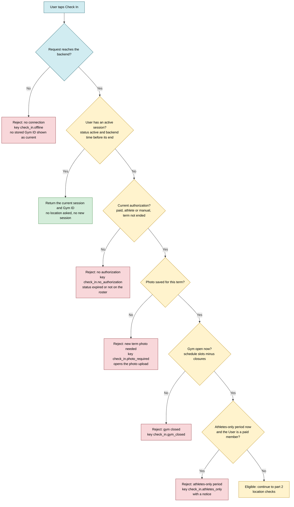
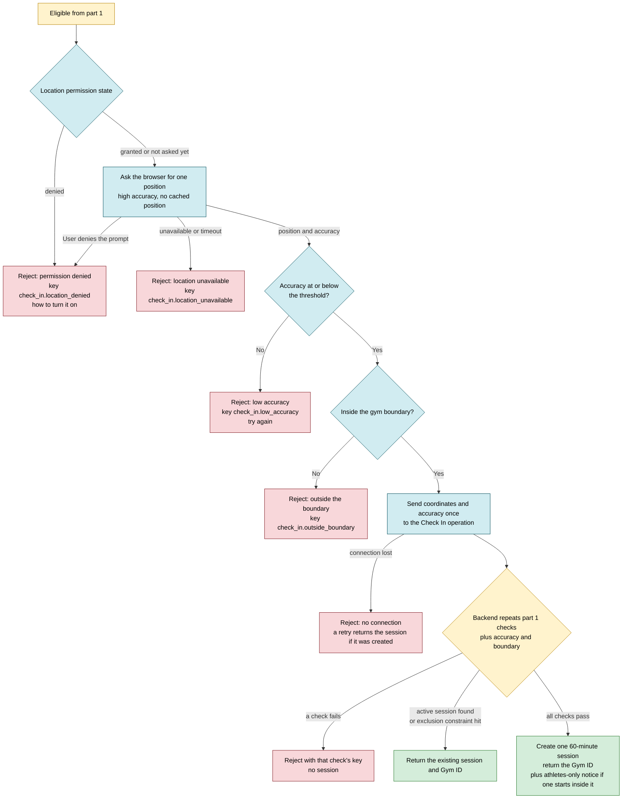
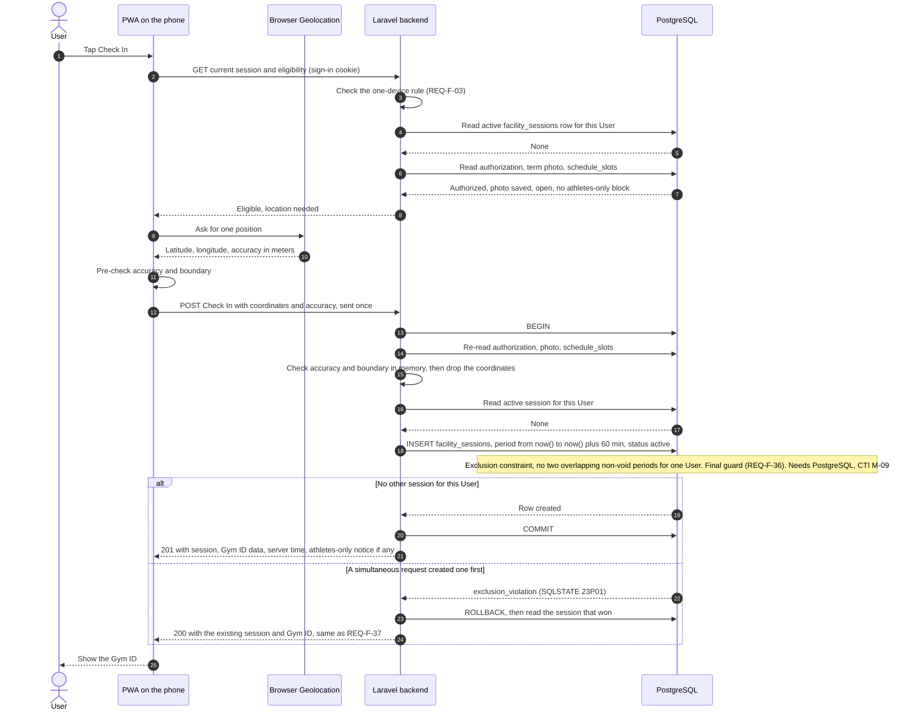
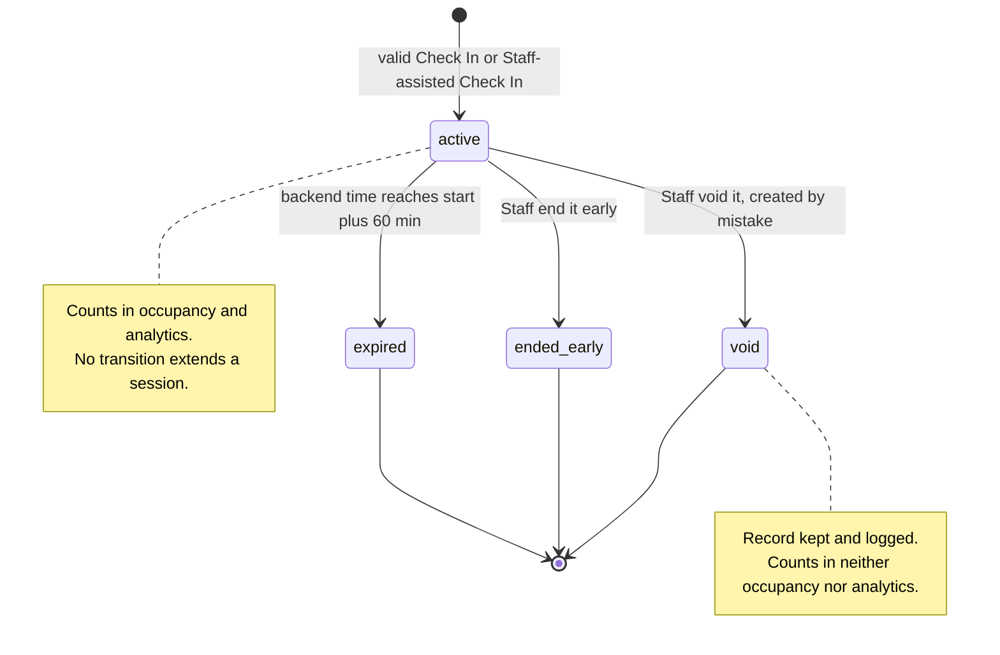
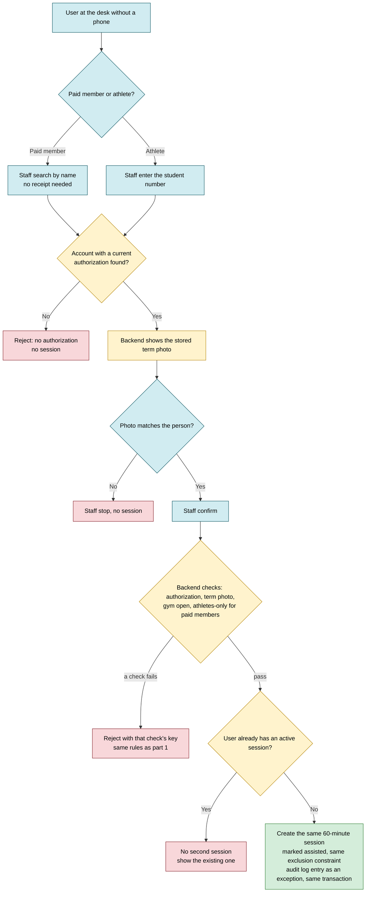
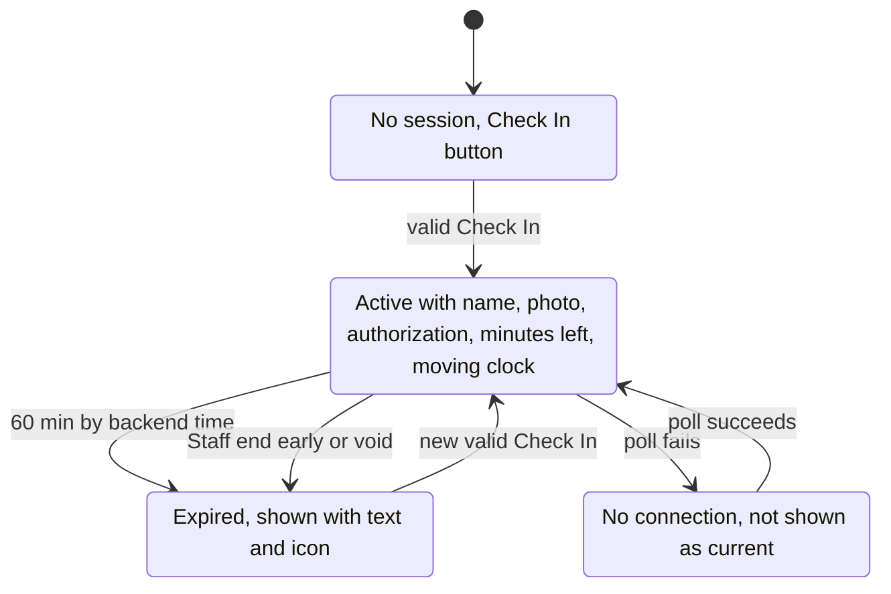
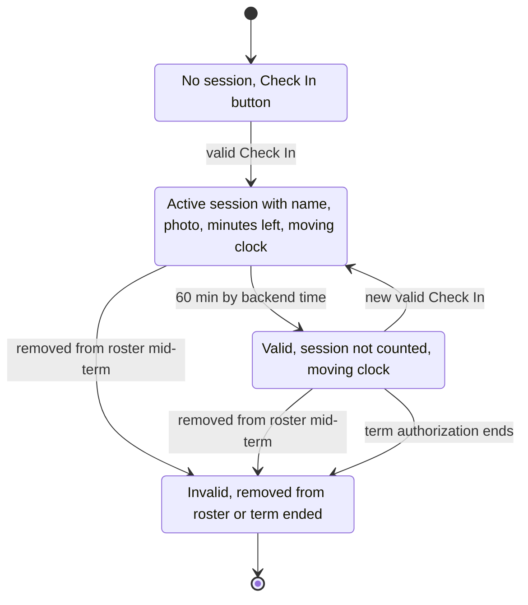
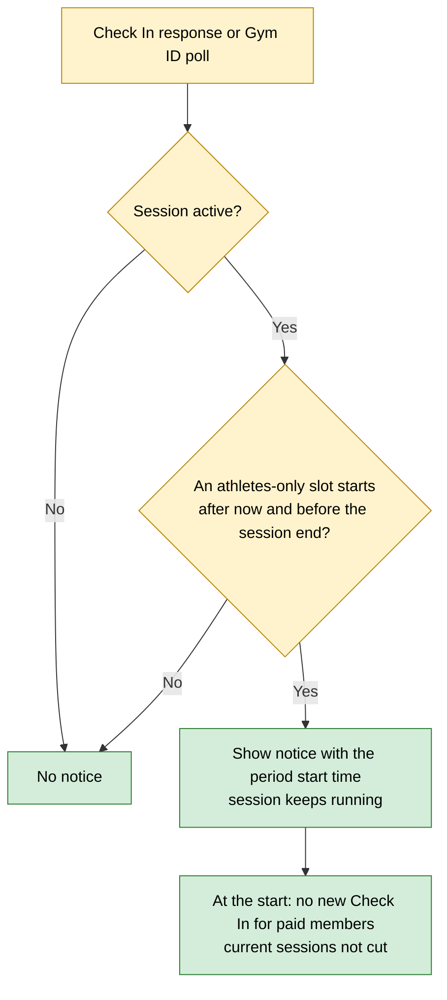
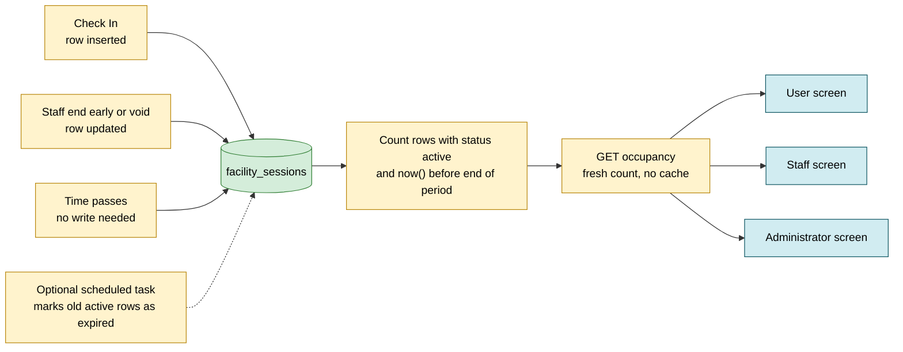
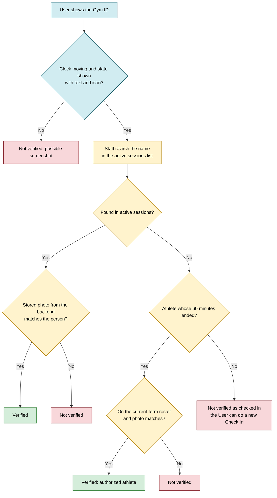

# Check In, session and Gym ID flows

This document draws how Check In decides, how a facility session lives and ends, how Staff do an assisted Check In and verify a Gym ID, what the Gym ID shows in each state, and how occupancy is counted. It covers SRS sections 3.6, 3.7 and 3.8 (GitHub issue #6). The backend is Laravel and the database is PostgreSQL (`docs/context.md` section 2). The single active session rule depends on a PostgreSQL exclusion constraint, so it depends on CTI accepting PostgreSQL (M-09). Values the SRS leaves to design are in "Design decisions to confirm".

Legend used in the flowcharts: blue nodes run on the phone (PWA), yellow nodes run on the backend, red nodes are rejections, green nodes are outcomes that show a session.

## 1. Check In decision flow, part 1: checks before location

The phone asks the backend first. Location is asked only when a new session must be created (REQ-F-37), so every check that does not need location runs before the location prompt. The order and its reasons are in decision D1.

- "No connection" is detected on the phone: the request fails or times out. There is no offline Check In (REQ-NF-26, SRS 2.4).
- The athlete photo check comes from REQ-F-26. A paid member uploads the photo at registration and renewal, so in practice only athletes reach R3.
- The athletes-only check applies only to paid members (REQ-F-82). Manual authorizations: see Gaps.

## 2. Check In decision flow, part 2: location and session creation

- Location comes from the browser Geolocation API (REQ-NF-11). The permission state is read before asking where the browser allows it; otherwise the error of the position request tells denied, unavailable or timeout apart.
- The phone checks accuracy and boundary only to answer fast. The backend repeats every check and is the only one that decides. The client is never trusted for authorization. Location is a condition, not proof of presence (SRS 3.6).
- Coordinates travel once in the Check In request and are not stored. Only the result of the location check may be stored on the session (REQ-NF-03). The boundary, accuracy threshold and gym coordinates come from environment configuration (REQ-NF-28, REQ-NF-29).

## 3. Successful Check In: phone, backend, database

- Steps 13 to 24 are the single protected operation: re-check, look for an active session and create one, in one transaction. The read in step 16 gives a clean answer in the normal case. Under simultaneous requests both reads can see nothing, so the constraint decides (REQ-NF-42 tests this).
- Backend time is the database clock `now()` (REQ-NF-01). The response carries server time so the phone can count minutes left without trusting its own clock.

## 4. Facility session states

- expired is computed from backend time with no checkout (REQ-F-38). It counts in analytics as a visit, not in occupancy. ended_early counts the same way, with its real end time.
- Only Staff and Administrators can end early or void (REQ-F-48). Each correction is an audit log entry (REQ-NF-39). Staff cannot extend a session or create one without authorization.
- Whether an expired or ended_early session can still be voided is open (see Gaps).

## 5. Staff-assisted Check In

- Location is not checked: Staff are at the desk, so the person is in the gym. Every other rule of the User Check In applies (REQ-F-46), including the athletes-only rejection for paid members (REQ-F-82).
- The assisted session goes through the same protected operation as section 3, so the exclusion constraint also guards it. A connection is required (REQ-NF-26). The audit log entry follows REQ-NF-39.

## 6. Gym ID states: paid member

- After 60 minutes the Gym ID says "expired" with text and an icon, not only color (REQ-F-40, REQ-NF-14). Nobody has to leave (REQ-F-38).
- The moving clock runs on the phone in every state where the Gym ID is shown, so Staff can tell a live screen from a screenshot. There is no code or QR (REQ-F-40).
- Without a connection the app does not show a stored Gym ID as current (REQ-NF-26). The same applies to the athlete Gym ID below.
- If an athletes-only period starts inside the active session, the Gym ID shows a notice with its start time while the session is active. The session is never cut (REQ-F-83).

## 7. Gym ID states: athlete

- The athlete Gym ID stays valid while the term authorization is active; the 60 minutes are only a counting rule (REQ-F-38, REQ-F-40). Staff check the roster for an athlete in a_valid (REQ-F-45).
- Removed from the roster mid-term: the Gym ID is invalid at once, the current session keeps counting until it ends, and no new Check In is allowed (REQ-F-49).
- Text for a_valid is not set by the SRS. Proposed: "Authorized athlete, session ended" plus an icon (REQ-NF-14).

## 8. Athletes-only period during an active session

- Covers REQ-F-83 and the rejection side of REQ-F-82. Times shown as ISO date plus 12-hour time in `America/Puerto_Rico` (REQ-NF-37, REQ-NF-38).

## 9. Occupancy counting

- Occupancy is the count of active sessions (REQ-F-41). Because the count is done at query time with backend time, every request already reflects the last Check In, expiration or Staff correction. Expiry is never late.
- Every screen polls the same endpoint every 20 to 30 seconds (REQ-F-43, interval in D6), so all three show the same value after each one updates (REQ-F-42). A failed poll marks the value as not current (REQ-NF-26).
- An athlete removed mid-term keeps counting until the session ends (REQ-F-49). Voided sessions never count. Athletes who stay past 60 minutes are not counted.

## 10. Staff verification of a Gym ID

- Staff verify against backend data, not only the User's screen (REQ-F-45). The active sessions list shows Check In time, authorization and Gym ID (REQ-F-44). A search is a fresh request, so verification never waits for the next poll.
- Staff see only photo, authorization, waiver and emergency contact (REQ-NF-19). The roster lookup needs a read access the role table does not list (see Gaps).

## Design decisions to confirm

### D1. Order of the Check In checks and the two-call flow

Status: Proposed.

- A. Phone first asks the backend for the current session and eligibility (connection, active session, authorization, photo, open, athletes-only). Only if eligible, it asks location and sends one Check In request, where the backend repeats all checks. Pro: no location prompt when Check In would fail anyway; matches REQ-F-37; the same GET serves the Gym ID screen. Con: two requests, about one extra round trip toward the 3 second target (REQ-NF-16).
- B. Ask location first, then one request that checks everything. Pro: one request. Con: asks location from people with no authorization or when the gym is closed; the User fixes location only to learn the gym is closed.
- C. One POST with no location first; the backend answers "location needed" or the active session; the phone retries with location. Pro: one endpoint. Con: the same round trips as A with a less clear contract.

Recommendation: A. Order inside it: connection (nothing works without it), active session (REQ-F-37 must win over all other checks), authorization (the most basic rule, REQ-F-33), term photo (part of the authorization, REQ-F-26), gym open (applies to everyone), athletes-only (needs the authorization type), then location permission, accuracy, boundary. Accuracy comes before boundary because a boundary result with a poor fix cannot be trusted, and "low accuracy" tells the User to retry instead of moving.

### D2. Accuracy and boundary rule

Status: Proposed. Values come from measurement at the gym (REQ-NF-28) and stay out of this issue.

- A. Two separate checks: accuracy at or below a threshold, and distance to the gym coordinates at or below the boundary radius. Pro: simple, each failure has its own message. Con: a fix near the edge with a large accuracy radius can pass.
- B. Distance plus accuracy at or below the boundary radius (the whole uncertainty circle inside the boundary). Pro: strict. Con: rejects people inside the gym when accuracy is poor indoors.
- C. Distance minus accuracy at or below the boundary radius. Pro: lenient indoors. Con: easier to pass from outside.

Recommendation: A, because it maps one to one to the SRS messages and the measurement at the gym can tune both numbers. The threshold and radius are environment settings with a development placeholder (for example 50 m) that is replaced after the gym tests.

### D3. How expiry is computed

Status: Proposed (`context.md` section 2 lists "calculated when queried, scheduled task for cleanup" as Proposed).

- A. Query time is the rule: a session is active while status is active and `now()` is before its end. A scheduled task also marks old rows as expired, only for tidy data. Pro: expiry is exact; the task can fail without wrong counts. Con: one more moving part.
- B. Query time only, never store expired. Pro: least code. Con: every reader (Staff list, analytics) must apply the same time rule.
- C. Scheduled task only. Pro: simple queries. Con: occupancy is wrong until the task runs; breaks REQ-F-38 by up to the task interval.

Recommendation: A, as in `context.md`, with the rule in one place in the backend so all readers share it. B is acceptable if the team wants less code.

### D4. Exclusion constraint and early end

Status: Proposed. Depends on PostgreSQL (M-09).

- A. `EXCLUDE USING gist (user_id WITH =, period WITH &&) WHERE (status <> 'void')`, and ending early cuts the period to the real end time. Pro: the stored period is the real visit, which analytics need anyway. Con: the period changes after insert.
- B. Same constraint with `WHERE (status = 'active')`, period kept at 60 minutes, real end stored in another column. Pro: the period never changes. Con: two end values to keep straight.

Recommendation: A. It needs the `btree_gist` extension, written in SQL in the migration (`context.md` section 2).

### D5. Error message keys and response shape

Status: Proposed.

- A. The backend returns a stable code per reason (`check_in.offline` is phone only; `check_in.no_authorization`, `check_in.photo_required`, `check_in.gym_closed`, `check_in.athletes_only`, `check_in.location_denied`, `check_in.location_unavailable`, `check_in.low_accuracy`, `check_in.outside_boundary`) and the PWA maps it to Spanish and English text from translation files. Pro: one test per code; texts change without code changes (REQ-NF-34). Con: frontend and backend share a list.
- B. The backend returns translated text only. Pro: one place. Con: the phone cannot react per reason (open photo upload, show how to turn on location), and tests depend on wording.

Recommendation: A. Texts themselves are a later design item (REQ-F-33 "Texts: design").

### D6. Polling interval

Status: Proposed. REQ-F-43 allows 20 to 30 seconds.

- A. 20 seconds. Pro: freshest. Con: 50% more requests and battery than 30.
- B. 30 seconds. Pro: fewer requests and less battery on phones. Con: up to 30 seconds of delay on a value that changes only with Check In, expiry or a correction.
- C. 20 for Staff screens, 30 for User screens. Pro: fresh where Staff work. Con: two values to test.

Recommendation: B, one setting, polling only while the page is visible. Minutes left and the moving clock run on the phone from the server end time, so they do not depend on the interval, and Staff searches are fresh requests.

## Gaps and questions

1. REQ-F-33 lists the rejection causes but not "location unavailable or timeout", which the Geolocation API can return. Proposed: its own key `check_in.location_unavailable`. Should REQ-F-33 add it?
2. REQ-F-33 does not list "new term photo needed", although REQ-F-26 blocks Check In without it. Should it be added to the cause list?
3. REQ-F-82 rejects "paid members" during athletes-only periods. It does not say what happens to a User with a manual authorization (REQ-F-87). Proposed: treat manual as paid member, since it fixes order errors.
4. REQ-F-83 says "a User's active session". For an athlete the notice has no effect. Show it to athletes too, or only to paid members?
5. REQ-F-48 does not say if an expired or ended_early session can be voided. Voiding it would change analytics after the fact. Allow it, or only for active sessions?
6. REQ-F-45 and REQ-F-46 need Staff to search Users by name and student number and to check the roster. The Overview role table gives roster access only to Administrators. Proposed: a read-only lookup for Staff (name, photo, authorization status), in line with REQ-NF-19. The role table should say so.
7. Athletes-only slots and regular hours: if an athletes-only slot falls outside regular hours, is the gym open for athletes? Depends on the slot list (G-28).
8. No rule for a closure published, or a term ending, during an active session. Proposed: the session is not cut, like REQ-F-83.
9. Staff-assisted Check In for an athlete on the roster with no account: no session is possible because sessions belong to a User. Only REQ-F-77 (in-person registration, if no mail) would cover it.
10. REQ-NF-03: coordinates must also stay out of request logs and error reports. Not stated in the SRS; noted for implementation.

## Traceability

| Requirement ID | Where it appears |
|---|---|
| REQ-F-26 | 1. Check In decision flow, part 1; 5. Staff-assisted Check In |
| REQ-F-33 | 1. Check In decision flow, part 1; 2. part 2; D1; D5 |
| REQ-F-36 | 2. part 2; 3. Successful Check In; 5. Staff-assisted Check In; D4 |
| REQ-F-37 | 1. part 1 (active session first); 2. part 2; 3. Successful Check In (alt block) |
| REQ-F-38 | 4. Facility session states; 6. Gym ID: paid member; 7. Gym ID: athlete; D3 |
| REQ-F-40 | 6. Gym ID: paid member; 7. Gym ID: athlete |
| REQ-F-41 | 9. Occupancy counting |
| REQ-F-42 | 9. Occupancy counting |
| REQ-F-43 | 9. Occupancy counting; D6 |
| REQ-F-44 | 10. Staff verification of a Gym ID |
| REQ-F-45 | 10. Staff verification of a Gym ID; 7. Gym ID: athlete |
| REQ-F-46 | 5. Staff-assisted Check In |
| REQ-F-48 | 4. Facility session states; 6. Gym ID: paid member |
| REQ-F-49 | 7. Gym ID: athlete; 9. Occupancy counting |
| REQ-F-82 | 1. part 1; 5. Staff-assisted Check In; 8. Athletes-only period |
| REQ-F-83 | 2. part 2 (notice on success); 6. Gym ID: paid member; 8. Athletes-only period |
| REQ-NF-01 | 3. Successful Check In; 4. Facility session states; 9. Occupancy counting |
| REQ-NF-03 | 2. part 2; 3. Successful Check In |
| REQ-NF-11 | 2. part 2 |
| REQ-NF-14 | 6. Gym ID: paid member; 7. Gym ID: athlete; 10. Staff verification |
| REQ-NF-19 | 10. Staff verification of a Gym ID |
| REQ-NF-26 | 1. part 1; 2. part 2; 5. Staff-assisted Check In; 6. Gym ID: paid member; 9. Occupancy counting |
| REQ-NF-28 | 2. part 2; D2 |
| REQ-NF-29 | 2. part 2 |
| REQ-NF-37 | 8. Athletes-only period |
| REQ-NF-39 | 4. Facility session states; 5. Staff-assisted Check In |
| REQ-NF-42 | 3. Successful Check In (alt block) |
