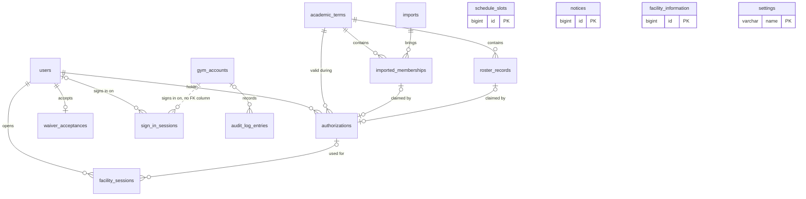
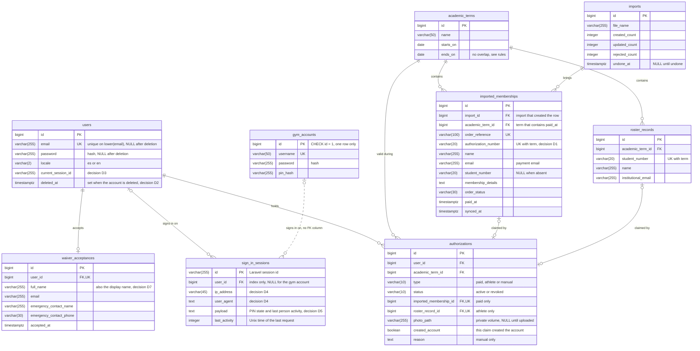
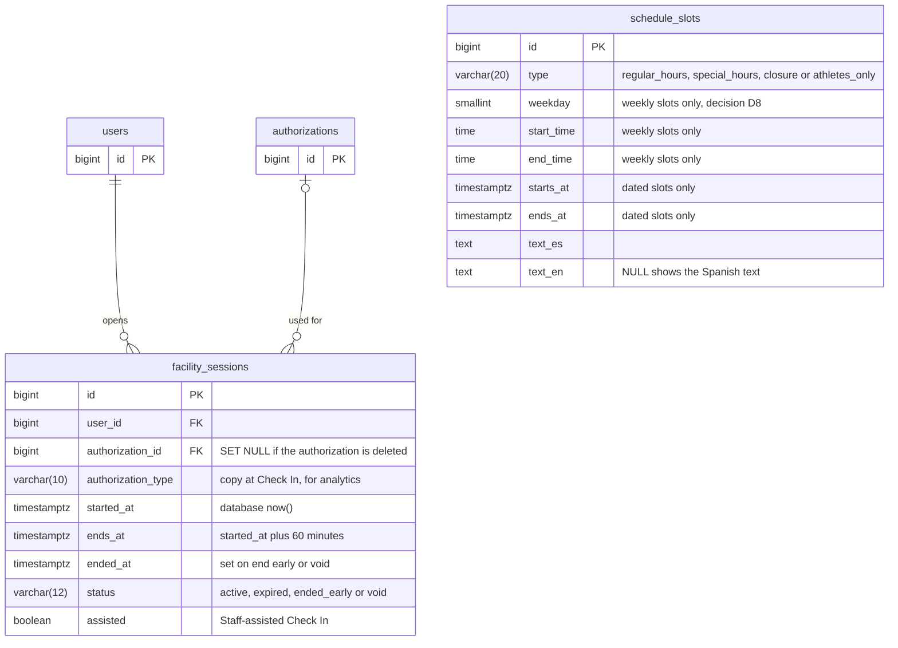
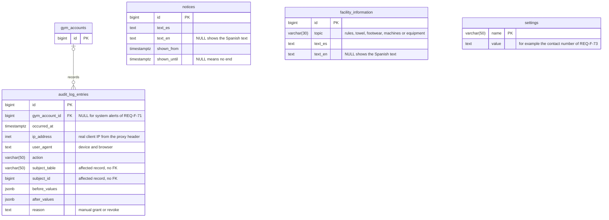

# Data Model

This document turns the logical data model in `design-notes.md` into PostgreSQL tables. It shows each table with its main fields, keys and links, the rules the database itself enforces, and what is deleted or kept when an account is deleted, an import is undone, or an Authorization Number is released. It is the agreement the team builds the migrations from (GitHub issue #4). Field lists hold only what the requirements need, because REQ-NF-21 limits the personal data the system may store.

## Conventions

- Table names are the snake_case plurals of the logical entities, plus `imports` for WooCommerce import batches.
- Every table has a `bigint` identity `id` unless the diagram says otherwise, and Laravel `created_at` and `updated_at`. The timestamps are not drawn.
- Times are `timestamptz`. Term dates are `date` in the `America/Puerto_Rico` time zone (REQ-NF-37).
- `PK` primary key, `FK` foreign key, `UK` unique. A composite unique key is written in the field comment.
- Solid lines are foreign keys in SQL. Dotted lines are links with no foreign key column.
- Laravel framework tables are not drawn: `migrations`, `cache` (also holds the attempt limit counters of REQ-F-07, REQ-F-71 and REQ-NF-48), `jobs`, `failed_jobs` and `password_reset_tokens` (REQ-F-06, pending CTI M-07).

## 1. Overview: tables and links

All 15 tables and how they relate. Fields are in sections 2 to 4.

- A User has many authorizations over time, kept apart from the account (REQ-F-19). Each authorization comes from one imported membership (paid), one roster record (athlete) or neither (manual, REQ-F-87).
- A membership or roster record is claimed by at most one authorization (REQ-F-17).

## 2. Accounts and access

Notes:

- **Claim status** is not a column. A membership or roster record is claimed when an authorization points at it. Releasing the number (REQ-F-74) deletes that authorization, so the number is free again with no flag to reset.
- **Photo.** The term photo belongs to the authorization, not the account (design-notes, REQ-F-26). The bytes are a JPEG on the private volume (REQ-NF-20, REQ-NF-24); the row stores only the relative path. `photo_path` is NULL while a photo is still owed: an athlete in a new term (REQ-F-26) or a manual grant (gap 6). Check In needs a photo; the backend checks it.
- **Expiry** is not stored. An authorization is current when `status = 'active'` and today in `America/Puerto_Rico` is on or before the term's `ends_on` (REQ-F-22, REQ-NF-01). A revoke (REQ-F-87) sets `status = 'revoked'` and keeps the claim, so the number is not freed.
- **`created_account`** is set when registration created the account in the same step as the claim (REQ-F-13). Release uses it to decide whether the account is deleted (REQ-F-74). It cannot be derived from "first authorization", because an import undo can delete the first one.
- **Import rows** store only counts. The list of created, updated and rejected orders (REQ-F-28) is returned on screen and not stored, so rejected orders leave no personal data behind.
- **Athlete link (REQ-F-15).** A signed, expiring link (Laravel temporary signed URL) carries the roster record id, so it needs no table. This assumes the password, photo and waiver are entered after the link is opened. If the registration flow collects them before, a pending registration table is needed.

### Sign-in sessions and the PIN

- `sign_in_sessions` is Laravel's database session table, with `config('session.table')` set to `sign_in_sessions`. Its columns are Laravel's, unchanged except as decision D4 says.
- **One device per User (REQ-F-03).** Not a SQL constraint: Laravel writes the session row at the end of each request, and a unique index on `user_id` would make the new device's insert fail silently. The rule is checked by the backend (decision D3). The gym account has no device limit.
- **PIN active per browser and last person activity (REQ-NF-48).** Both live in the session `payload` of that browser: `pin_unlocked_at` and `last_person_activity_at`. Only requests the frontend marks as made by a person update `last_person_activity_at`. The `last_activity` column cannot be used for the 15-minute rule, because every request, polling included, updates it.

## 3. Sessions and occupancy

`users` and `authorizations` appear only as links; their fields are in section 2.

Notes:

- **When a session is active.** "Active" depends on time and on status. The constraint in section 5 uses the time range `tstzrange(started_at, COALESCE(ended_at, ends_at), '[)')` and skips void rows with `WHERE (status <> 'void')`. An expired session stops blocking by itself once `ends_at` passes, because its range is in the past. Ending early sets `ended_at`, which cuts the range short. PostgreSQL does not allow `now()` in a constraint condition (context.md section 2), and the time range avoids needing it.
- **Why `ends_at` is stored.** `timestamptz + interval` is not immutable in PostgreSQL, so it cannot appear in an index expression. `ends_at` is a plain column, checked with `CHECK (ends_at = started_at + interval '60 minutes')`.
- **`status = 'expired'`** may be written by the scheduled cleanup task, but every read also compares `ends_at` with the database `now()` (REQ-F-38, REQ-NF-01). A late task never changes a result.
- **Occupancy** (REQ-F-41) is the count of rows with `status <> 'void'` whose range contains `now()`. Analytics (REQ-F-61) read the same table: `authorization_type` keeps paid versus athlete after an authorization is deleted, and `user_id` keeps distinct people.
- **Location** is not stored (REQ-NF-03).

## 4. Content and audit

`gym_accounts` appears only as a link; its fields are in section 2.

Notes:

- The affected record is `subject_table` plus `subject_id`, with no foreign key. Deleting a User or undoing an import never removes or changes an audit entry, which must stay until the end of its term (REQ-NF-05, REQ-NF-39, REQ-F-09).
- The audit log names the gym account, not a person (REQ-NF-39). `ip_address` comes from the proxy header, not the proxy's own address (design-notes).
- The location boundary is not a setting: it is configured per environment (REQ-NF-29).

## 5. Database rules

Rules written as SQL in the migrations. Laravel's schema builder cannot express exclusion constraints, so those go in `DB::statement` calls (context.md section 2). "Simultaneous" means two transactions insert at the same moment: the second one waits for the first, then fails with SQLSTATE `23505` (unique) or `23P01` (exclusion), and the backend turns that error into the normal message. A check with SELECT before the INSERT is not enough on its own.

| Rule | Table | Constraint (SQL) | Requirement |
|---|---|---|---|
| Each Authorization Number is claimed by one account at most, also under simultaneous requests | `imported_memberships`, `authorizations` | `UNIQUE (academic_term_id, authorization_number)` on memberships (decision D1) and `UNIQUE (imported_membership_id)` on authorizations. The losing request gets the message of REQ-F-72 | REQ-F-17, REQ-F-10, REQ-NF-42 |
| Each roster record is claimed by one account at most, also under simultaneous requests | `authorizations` | `UNIQUE (roster_record_id)` | REQ-F-17, REQ-NF-42 |
| One active facility session per User, also under simultaneous requests | `facility_sessions` | `CREATE EXTENSION btree_gist;` then `EXCLUDE USING gist (user_id WITH =, tstzrange(started_at, COALESCE(ended_at, ends_at), '[)') WITH &&) WHERE (status <> 'void')`. The losing request returns the current session (REQ-F-37) | REQ-F-36, REQ-F-37, REQ-NF-42, REQ-NF-50 |
| A session lasts 60 minutes and cannot be extended | `facility_sessions` | `CHECK (ends_at = started_at + interval '60 minutes')` and `CHECK (ended_at IS NULL OR ended_at BETWEEN started_at AND ends_at)` | REQ-F-36, REQ-F-38, REQ-F-48 |
| Session time is backend time | `facility_sessions` | `started_at DEFAULT now()`; the insert does not send a time | REQ-NF-01 |
| Session status values, and corrections record when they happened | `facility_sessions` | `CHECK (status IN ('active','expired','ended_early','void'))` and `CHECK ((status IN ('ended_early','void')) = (ended_at IS NOT NULL))` | REQ-F-48 |
| Terms never overlap; gaps are allowed | `academic_terms` | `CHECK (starts_on <= ends_on)` and `EXCLUDE USING gist (daterange(starts_on, ends_on, '[]') WITH &&)`. Ranges need no extension | REQ-F-21 |
| A repeated student number in the same term is rejected | `roster_records` | `UNIQUE (academic_term_id, student_number)` | REQ-F-51 |
| Processing the same order twice gives no duplicate | `imported_memberships` | `UNIQUE (order_reference)`. The import runs `INSERT ... ON CONFLICT (order_reference) DO UPDATE` and does not overwrite `import_id` | REQ-F-30 |
| An order outside every term gives no record | `imported_memberships` | `academic_term_id NOT NULL`. The import finds the term from `paid_at` and rejects the row if none is found | REQ-F-22 |
| One account per email | `users` | `CREATE UNIQUE INDEX ON users (lower(email))`. Deleted accounts have NULL email, which never collides | REQ-F-01, REQ-F-11, REQ-F-78 |
| An authorization has the source its type says | `authorizations` | `CHECK ((type = 'paid' AND imported_membership_id IS NOT NULL AND roster_record_id IS NULL) OR (type = 'athlete' AND roster_record_id IS NOT NULL AND imported_membership_id IS NULL) OR (type = 'manual' AND imported_membership_id IS NULL AND roster_record_id IS NULL))` | REQ-F-19, REQ-F-87 |
| Authorization values | `authorizations` | `CHECK (type IN ('paid','athlete','manual'))`, `CHECK (status IN ('active','revoked'))` | REQ-F-19, REQ-F-87 |
| A manual grant has a reason | `authorizations` | `CHECK (type <> 'manual' OR reason IS NOT NULL)`. Drop it if the gym does not confirm the reason | REQ-F-87 (Proposed) |
| One waiver per account | `waiver_acceptances` | `UNIQUE (user_id)` | REQ-F-60 |
| One shared gym account | `gym_accounts` | `CHECK (id = 1)` | REQ-F-52, REQ-F-88 |
| Chosen language is Spanish or English | `users` | `CHECK (locale IN ('es','en'))` | REQ-NF-33, REQ-NF-35 |
| A schedule slot is either weekly or dated, never both | `schedule_slots` | `CHECK ((weekday IS NOT NULL AND start_time IS NOT NULL AND end_time IS NOT NULL AND starts_at IS NULL AND ends_at IS NULL) OR (weekday IS NULL AND start_time IS NULL AND end_time IS NULL AND starts_at IS NOT NULL AND ends_at IS NOT NULL))`, plus `CHECK (type IN (...))` and `CHECK (type NOT IN ('special_hours','closure') OR starts_at IS NOT NULL)` | REQ-F-55 |

## 6. Deletion: what is deleted, kept or anonymized

Photo files live outside the database, so no foreign key can delete them. The backend deletes the file after the transaction commits. A scheduled task removes files that no authorization points at, in case a delete failed.

| Table or data | (a) User deletes the account (REQ-F-09) | (b) Import is undone (REQ-F-31) | (c) Administrator releases an Authorization Number (REQ-F-74) |
|---|---|---|---|
| `users` | Row kept with no personal data: `email`, `password`, `locale`, `current_session_id` set to NULL, `deleted_at` set (decision D2). The email is free again | Kept | Kept. If `created_account` is true on the released authorization, the account goes through (a) |
| `authorizations` | Deleted. Only expired or revoked ones can exist, because deletion needs no active authorization | Those that point at the deleted memberships are deleted (ON DELETE CASCADE) | The released one is deleted. Others of the same account stay, unless (a) applies |
| Photo files | Deleted with their authorizations | Deleted with their authorizations (decision D6) | Deleted with the released authorization |
| `waiver_acceptances` | Deleted | Kept | Kept, unless (a) applies |
| `sign_in_sessions` | All of the User's rows deleted | Kept | Kept, unless (a) applies |
| `facility_sessions` | Kept and still linked to the anonymous `users` row, so Check In counts, paid versus athlete and distinct people do not change (REQ-F-61) | Kept; `authorization_id` set to NULL; `authorization_type` keeps the type | Kept; `authorization_id` set to NULL |
| `imported_memberships` | Kept: it is a copy of the WooCommerce order, not account data. It becomes unclaimed (gap 5) | Rows with that `import_id` deleted | Kept and unclaimed again |
| `roster_records` | Kept: it is the department's list. It becomes unclaimed | Kept | Not affected |
| `imports` | Not affected | Row kept with `undone_at` set | Not affected |
| `audit_log_entries` | Kept unchanged until the end of the term in which each happened (REQ-NF-05) | Kept; an undo entry is added (REQ-NF-39) | Kept; a release entry is added (REQ-NF-39) |
| `password_reset_tokens` | Rows for the old email deleted | Not affected | Not affected, unless (a) applies |

Foreign key on-delete behavior that follows from this table:

| Foreign key | ON DELETE | Why |
|---|---|---|
| `facility_sessions.user_id` | RESTRICT | Users are never hard-deleted (decision D2); this stops a mistake from erasing Check In history |
| `facility_sessions.authorization_id` | SET NULL | Undo, release and account deletion remove authorizations, and the sessions must stay |
| `authorizations.imported_membership_id` | CASCADE | Undo deletes the authorizations that depend on the memberships (REQ-F-31) |
| `authorizations.roster_record_id` | CASCADE | Removing an athlete from the roster ends the authorization at once (REQ-F-49) |
| `authorizations.user_id` | CASCADE | Only reached if a users row is ever hard-deleted |
| `waiver_acceptances.user_id` | CASCADE | Same as above |
| `authorizations.academic_term_id`, `imported_memberships.academic_term_id`, `roster_records.academic_term_id` | RESTRICT | A term with data cannot be deleted |
| `imported_memberships.import_id` | RESTRICT | Import rows are never deleted; undo sets `undone_at` |
| `audit_log_entries.gym_account_id` | RESTRICT | The gym account is never deleted |
| `sign_in_sessions.user_id` | No SQL foreign key (Laravel default) | The backend deletes the rows in (a) |

## 7. Personal data check (REQ-NF-21)

| Column | Allowed by |
|---|---|
| `users.email`, `users.password`, `users.locale` | REQ-NF-21 (account email, password, chosen language) |
| `imported_memberships`: `name`, `email`, `student_number`, `membership_details`, `authorization_number`, `order_reference`, `order_status`, `paid_at`, term, `synced_at` | REQ-F-29. No billing or address fields |
| `roster_records`: `student_number`, `name`, `institutional_email`, term | REQ-F-51 |
| `authorizations.photo_path` and the file | Term photo |
| `waiver_acceptances`: all fields | REQ-F-60 |
| `audit_log_entries`: `ip_address`, `user_agent`, `before_values`, `after_values` | REQ-NF-39 |
| `sign_in_sessions.ip_address`, `sign_in_sessions.user_agent` | Not listed. See decision D4 |

## Design decisions to confirm

**D1. Uniqueness of the Authorization Number (depends on E-30, G-19).** Status: Proposed.
- A: `UNIQUE (authorization_number)` across all orders. Simplest lookup. A repeat in any term makes the import reject the later order.
- B: `UNIQUE (academic_term_id, authorization_number)`. Registration only accepts current-term numbers, so the lookup stays unambiguous. A repeat inside one term is still rejected and listed in the import result; the Administrator can grant by hand (REQ-F-87). Six random digits repeat inside a term of a few hundred orders with a small but real chance.
- C: no unique on the number; only one claim per membership row. Never rejects an order, but a lookup can match two orders and show the wrong masked email (REQ-F-70).
- Recommendation: B until a real export answers E-30, because it never blocks valid orders from different terms and keeps the lookup safe.

**D2. How an account is deleted (REQ-F-09, REQ-F-74).** Status: Proposed.
- A: keep the `users` row with every personal column set to NULL and `deleted_at` set. Sessions keep their `user_id`, so all counts stay the same. One empty row per deleted account.
- B: delete the `users` row and set `facility_sessions.user_id` to NULL. Visits stay, but distinct people for past periods would drop, which breaks REQ-F-09.
- C: delete the row and keep precomputed daily counts in a new table. Works, but adds a table and a job that must run before any deletion.
- Recommendation: A. It is the only option that keeps distinct-people counts with no extra table. The row holds no personal data.

**D3. One sign-in session per User (REQ-F-03).** context.md section 2 leaves this to implementation. Status: Proposed.
- A: on sign in, delete the User's other rows in `sign_in_sessions`. No new column. Two sign-ins at the same instant can both survive.
- B: store `users.current_session_id` on sign in, and a middleware rejects any other session id. One column. The last sign-in always wins, also when two happen at once.
- Recommendation: B, and also delete the old rows to keep the table small. It is the one that holds under simultaneous sign-ins.

**D4. IP address and user agent in `sign_in_sessions` (REQ-NF-21).** Laravel's session table stores both for every signed-in device, and REQ-NF-21 does not list them. Status: Proposed.
- A: keep them and add them to REQ-NF-21. No code. More personal data stored, with no requirement that uses it.
- B: extend Laravel's database session handler so it writes NULL in both columns. A few lines of code. The audit log still gets the IP from the request itself.
- Recommendation: B, because REQ-NF-21 says the system stores only the listed data.

**D5. Where the PIN state and last person activity live (REQ-NF-48).** Status: Proposed.
- A: in the session `payload` of that browser. No new columns; per browser by nature; ends when the session ends.
- B: new columns `pin_unlocked_at` and `last_person_activity_at` on `sign_in_sessions`. Easy to query, but needs a custom session handler to write them.
- Recommendation: A. Nothing needs to query these values across browsers.

**D6. Photos when an import is undone (REQ-F-31).** REQ-F-31 proposes that photos stay, but the photo is stored with the authorization, and undo deletes the authorization. Status: Proposed.
- A: delete the photo with the authorization. When the User claims again with the corrected file, they upload a photo, as in any renewal (REQ-F-26). Simplest; one more step for the User.
- B: move the photo path to a new `users.pending_photo_path` and reuse it on the next claim. Keeps the photo, but adds a column and splits where photos live.
- C: a separate `photos` table linked to user and term. Changes the logical model.
- Recommendation: A, and change the Proposed text of REQ-F-31 to "accounts stay".

**D7. Where the User's name comes from (REQ-F-40, REQ-F-45).** The Gym ID and the Staff search need a name. Status: Proposed.
- A: `waiver_acceptances.full_name`, already required by REQ-F-60 and copied from the payment record or roster. One place; survives import undo.
- B: the linked membership or roster record. Lost when an import is undone, and can differ between terms.
- C: a `users.name` column. A third copy of the same data.
- Recommendation: A.

**D8. How regular hours repeat (REQ-F-55, REQ-F-33).** Status: Proposed.
- A: one table where a slot is weekly (weekday and local times) or dated (start and end). Regular hours and athletes-only slots can be weekly; special hours and closures are dated. One table, one CHECK.
- B: every slot dated; the Administrator enters each week. Simplest schema, much more data entry.
- C: two tables, weekly and dated. Cleaner columns, two places to read for "is the gym open".
- Recommendation: A. It matches how a gym publishes hours. Summer hours that differ would need a term link later (G-28 is pending).

## Gaps and questions

1. **REQ-F-31 and design-notes disagree on photos.** REQ-F-31 (Proposed) keeps photos on undo, but the photo is stored with the authorization, which undo deletes. See D6.
2. **REQ-F-31, undo after a reconciliation.** When import 2 only updated orders that import 1 created, undoing import 2 deletes nothing and does not restore the old values. Undoing import 1 deletes those orders, including import 2's corrections. The SRS does not say what undo means for updated rows.
3. **REQ-NF-05, audit entries between terms.** Entries are kept "until the end of the term in which it happened", but REQ-F-21 allows gaps between terms. An entry in a gap has no term. What happens after the term ends is pending (G-03).
4. **REQ-NF-21 and Laravel sessions.** The default session table stores IP and user agent (D4). The `cache` table holds attempt counters keyed by IP and email for a short time (REQ-F-07, REQ-F-71); REQ-NF-21 does not list that either.
5. **REQ-F-09 and revoked numbers.** Deleting an account deletes its authorizations, so a revoked current-term Authorization Number becomes claimable again. The SRS does not say if that is wanted.
6. **REQ-F-87, manual grant photo.** The SRS does not say where the photo for a manual authorization comes from. The design leaves `photo_path` NULL until the User uploads one, as for athletes (REQ-F-26).
7. **REQ-F-61 (e), manual authorizations.** Analytics compare paid members with athletes. The SRS does not say where manual grants count. The design keeps `manual` as its own value in `authorization_type`.
8. **Two authorizations in one term.** A paid member who later appears on the roster can claim both (REQ-F-80). The SRS does not forbid it, and does not say which photo the Gym ID shows.
9. **REQ-F-88, open gym sign-in sessions.** Changing the gym account password "withdraws access", but the SRS does not say whether open gym sign-in sessions end at once. If yes, Laravel can compare the password hash stored in the session (to confirm during implementation).
10. **REQ-F-01 cannot be fully enforced by the database.** Uniqueness is per email. A person whose payment email differs from the account email, and who registers while signed out, gets a second account. REQ-F-20 assumes they add the number from inside the account.
11. **REQ-F-25, athlete renewal.** The SRS does not say how a new-term roster record links to the existing account. Matching the student number to the record claimed in an earlier term is the likely rule.
12. **Active sessions after undo or release.** REQ-F-49 says a removed athlete keeps counting until the session ends. The SRS does not say the same for a session whose authorization is deleted by undo or release. The design keeps the session counting.

## Traceability

| Requirement | Where it appears |
|---|---|
| REQ-F-01 | 5. Database rules (one account per email); Gaps 10 |
| REQ-F-03 | 2. Sign-in sessions and the PIN; D3 |
| REQ-F-09 | 6. Deletion, column (a); D2; 4. Content and audit notes |
| REQ-F-10 | 5. Database rules; D1 |
| REQ-F-13 | 2. Accounts and access notes (`created_account`) |
| REQ-F-15 | 2. Accounts and access notes (athlete link) |
| REQ-F-17 | 1. Overview; 5. Database rules (claims and simultaneous claims) |
| REQ-F-19 | 1. Overview; 2. Accounts and access (`authorizations`); 5. Database rules |
| REQ-F-21 | 2. Accounts and access (`academic_terms`); 5. Database rules (exclusion on `daterange`) |
| REQ-F-22 | 2. Accounts and access notes (expiry); 5. Database rules (order outside every term) |
| REQ-F-26 | 2. Accounts and access notes (photo); D6 |
| REQ-F-29 | 2. Accounts and access (`imported_memberships`); 7. Personal data check |
| REQ-F-30 | 5. Database rules (`order_reference`) |
| REQ-F-31 | 6. Deletion, column (b); D6; Gaps 1 and 2 |
| REQ-F-36 | 3. Sessions and occupancy notes; 5. Database rules (exclusion with `btree_gist`) |
| REQ-F-37 | 5. Database rules |
| REQ-F-38 | 3. Sessions and occupancy notes; 5. Database rules |
| REQ-F-41 | 3. Sessions and occupancy notes |
| REQ-F-48 | 3. Sessions and occupancy notes; 5. Database rules |
| REQ-F-49 | 6. Deletion, FK table (`roster_record_id`) |
| REQ-F-51 | 2. Accounts and access (`roster_records`); 5. Database rules |
| REQ-F-52 | 5. Database rules (one gym account) |
| REQ-F-55 | 3. Sessions and occupancy (`schedule_slots`); 5. Database rules; D8 |
| REQ-F-58 | 3 and 4 (`text_en` NULL shows Spanish) |
| REQ-F-60 | 2. Accounts and access (`waiver_acceptances`); 5. Database rules |
| REQ-F-61 | 3. Sessions and occupancy notes; 6. Deletion, column (a) |
| REQ-F-74 | 6. Deletion, column (c); 2. Accounts and access notes |
| REQ-F-78 | 5. Database rules (one account per email) |
| REQ-F-87 | 2. Accounts and access (`authorizations`); 5. Database rules |
| REQ-F-88 | 5. Database rules; Gaps 9 |
| REQ-NF-01 | 3. Sessions and occupancy notes; 5. Database rules |
| REQ-NF-05 | 4. Content and audit notes; 6. Deletion; Gaps 3 |
| REQ-NF-20 | 2. Accounts and access notes (photo) |
| REQ-NF-21 | 7. Personal data check; D4 |
| REQ-NF-33 | 5. Database rules (locale) |
| REQ-NF-39 | 4. Content and audit (`audit_log_entries`); 6. Deletion |
| REQ-NF-42 | 5. Database rules (simultaneous requests) |
| REQ-NF-48 | 2. Sign-in sessions and the PIN; D5 |
