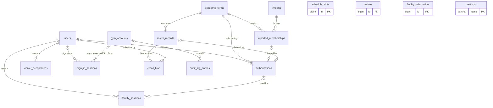
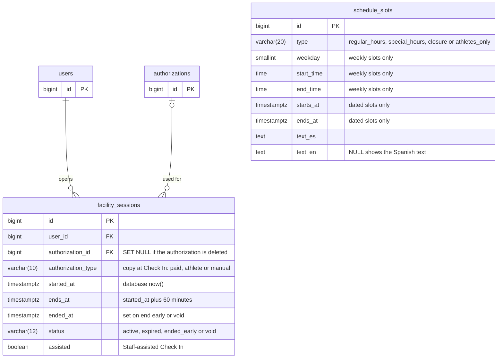
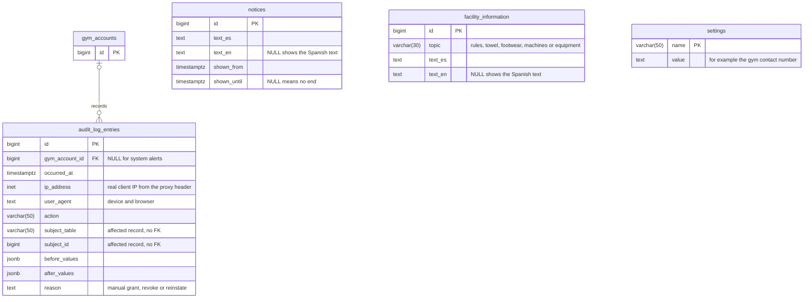

# Data Model

This document turns the logical data model in `design-notes.md` into PostgreSQL tables. It shows each table with its main fields, keys and links, the rules the database itself enforces, and what is deleted or kept when an account is deleted, an import is undone, or an Authorization Number is released. It is the agreement the team builds the migrations from (GitHub issue #4). Field lists hold only what the requirements need, because REQ-NF-21 limits the personal data the system may store.

## Conventions

- Table names are the snake_case plurals of the logical entities, plus `imports` for WooCommerce import batches.
- Every table has a `bigint` identity `id` unless the diagram says otherwise, and Laravel `created_at` and `updated_at`. The timestamps are not drawn.
- Times are `timestamptz`. Term dates are `date` in the `America/Puerto_Rico` time zone (REQ-NF-37).
- `PK` primary key, `FK` foreign key, `UK` unique. A composite unique key is written in the field comment.
- Solid lines are foreign keys in SQL. Dotted lines are links with no foreign key column.
- Laravel framework tables are not drawn: `migrations`, `cache` (also holds the attempt limit counters of REQ-F-07, REQ-F-71, REQ-F-89 and REQ-NF-48, including the PIN attempt counters, and the request limit for emailed links; sign-in counters are keyed by IP and email, link requests by student number, PIN attempts by gym account; all are discarded when the wait ends; E-91, E-93), `jobs`, `failed_jobs` and `password_reset_tokens` (REQ-F-06). Outgoing mail is assumed (E-61): CTI mail first, an external provider if CTI cannot provide it.

## 1. Overview: tables and links

All 16 tables and how they relate. Fields are in sections 2 to 4.

### 1. All tables and links

**Type:** Entity-relationship diagram. **Use it to:** see which tables exist and which ones point at which, before writing the migrations one by one.

- A User has many authorizations over time, kept apart from the account (REQ-F-19), but only one active authorization per term; a revoked one does not count (E-68, E-94). Each authorization comes from one imported membership (paid), one roster record (athlete) or neither (manual, REQ-F-87).
- A membership or roster record is claimed by at most one authorization (REQ-F-17).

## 2. Accounts and access

### 2. Accounts and access tables

**Type:** Entity-relationship diagram. **Use it to:** write the migrations and constraints for accounts, the gym account, sign-in sessions, terms, imports, the roster, emailed links and authorizations.

```mermaid
erDiagram
  users ||--o{ authorizations : "holds"
  users ||--o| waiver_acceptances : "accepts"
  users |o--o{ sign_in_sessions : "signs in on"
  gym_accounts |o..o{ sign_in_sessions : "signs in on, no FK column"
  academic_terms ||--o{ authorizations : "valid during"
  academic_terms ||--o{ imported_memberships : "contains"
  academic_terms ||--o{ roster_records : "contains"
  imports ||--o{ imported_memberships : "brings"
  imported_memberships |o--o| authorizations : "claimed by"
  roster_records |o--o| authorizations : "claimed by"
  roster_records ||--o{ email_links : "link sent for"
  users |o--o{ email_links : "asked for by"

  users {
    bigint id PK
    varchar(255) email UK "unique on lower(email), NULL after deletion"
    varchar(255) password "hash, NULL after deletion"
    varchar(2) locale "es or en, asked at account creation, changed in profile preferences"
    varchar(255) current_session_id "the one session allowed in, checked on every request"
    timestamptz deleted_at "set when the account is deleted"
  }
  gym_accounts {
    bigint id PK "CHECK id = 1, one row only"
    varchar(50) username UK
    varchar(255) password "hash"
    varchar(255) pin_hash "hash of the 4-digit PIN"
    integer pin_version "starts at 1, plus 1 on every PIN change"
    varchar(255) recovery_code_hash "hash of the one-time paper code"
    timestamptz recovery_code_created_at "when the current code was made"
    varchar(2) locale "es or en, one language for every computer, changed without the PIN (E-104)"
  }
  sign_in_sessions {
    varchar(255) id PK "Laravel session id"
    bigint user_id FK "index only, NULL for the gym account"
    varchar(45) ip_address "always NULL"
    text user_agent "always NULL"
    text payload "PIN unlock time and version, last person activity"
    integer last_activity "Unix time of the last request"
  }
  email_links {
    bigint id PK
    varchar(25) purpose "athlete_registration, athlete_link or athlete_in_person"
    varchar(64) token_hash UK "hash of the token in the link or of the in-person code"
    bigint roster_record_id FK "record the link or code is for"
    bigint user_id FK "signed-in User, NULL for registration"
    timestamptz expires_at
    timestamptz used_at "NULL until opened, single use"
  }
  waiver_acceptances {
    bigint id PK
    bigint user_id FK, UK
    varchar(255) full_name "the display name on the Gym ID and in Staff search, set at registration"
    varchar(255) email
    varchar(255) emergency_contact_name "the User can edit it"
    varchar(30) emergency_contact_phone "the User can edit it"
    timestamptz accepted_at
  }
  academic_terms {
    bigint id PK
    varchar(50) name
    date starts_on
    date ends_on "no overlap, see rules"
  }
  imports {
    bigint id PK
    varchar(255) file_name
    integer created_count
    integer updated_count
    integer rejected_count
    jsonb result "counts and the created, updated and rejected rows, shown again in A-07"
    timestamptz undone_at "NULL until undone"
  }
  imported_memberships {
    bigint id PK
    bigint import_id FK "import that created the row"
    bigint academic_term_id FK "term that contains paid_at"
    varchar(100) order_reference UK
    varchar(20) authorization_number "UK with term"
    varchar(255) name
    varchar(255) email "payment email"
    varchar(20) student_number "NULL when absent"
    text membership_details
    varchar(30) order_status
    timestamptz paid_at
    timestamptz synced_at
  }
  roster_records {
    bigint id PK
    bigint academic_term_id FK
    varchar(20) student_number "UK with term"
    varchar(255) name
    varchar(255) institutional_email
  }
  authorizations {
    bigint id PK
    bigint user_id FK
    bigint academic_term_id FK
    varchar(10) type "paid, athlete or manual"
    varchar(10) status "active or revoked, one active per User and term"
    bigint imported_membership_id FK, UK "paid only"
    bigint roster_record_id FK, UK "athlete only"
    varchar(255) photo_path "private volume, NULL until uploaded"
    boolean created_account "this claim created the account"
    text reason "manual grant, or 'removed from roster' when an athlete is removed"
  }
```

Notes:

- **Claim status** is not a column. A membership or roster record is claimed when an authorization points at it. Releasing the number (REQ-F-74) deletes that authorization and keeps the account (E-106), so the number is free again with no flag to reset.
- **Photo.** The term photo belongs to the authorization, not the account (design-notes, REQ-F-26). The bytes are a JPEG on the private volume (REQ-NF-20, REQ-NF-24); the row stores only the relative path. Registration never creates an authorization without a photo (E-69). `photo_path` is NULL only for a manual grant, where the User gives the photo on U-02 before Check In, like an athlete (E-69). An athlete in a new term is found at the first app open by the student number of the account's last claim (REQ-F-26, E-69) and gets the authorization in the same step that saves the new photo (registration-flows diagram 8). Check In needs a photo; the backend checks it.
- **Expiry** is not stored. An authorization is current when `status = 'active'` and today in `America/Puerto_Rico` is on or before the term's `ends_on` (REQ-F-22, REQ-NF-01). Editing a term never blocks: records keep their term and authorization, and the end date follows the term's new `ends_on` (E-88). A revoke (REQ-F-87) sets `status = 'revoked'` and keeps the claim, so the number is not freed. Reinstate on A-05 sets the status back to `active` (E-95).
- **Removing an athlete from the roster (REQ-F-49, E-93)** revokes the authorization: `status = 'revoked'` and `reason = 'removed from roster'`. Nothing is deleted by cascade. The Gym ID stops being valid at once, the current session keeps counting, and no new Check In is allowed. The roster record stays claimed by that authorization.
- **Reinstate (E-95).** The Administrator can return a revoked authorization to active on A-05, for example after removing an athlete by mistake. The action needs a reason, required and free text of 10 characters or more, the same rule as a manual grant and a revoke (E-86), and writes an audit log entry. Reinstate is refused with a message when the person already has an active authorization in that term: the unique index of section 5 rejects it (E-94), and the Administrator revokes the other authorization by hand if needed.
- **One active authorization per User and term (E-68, E-94).** Only active authorizations count: a revoked one does not block a new grant or claim in the same term. This is the owner's decision (E-94). A partial unique index enforces it (section 5). A manual grant for a person who already has an active one is rejected.
- **Authorization Number (E-71).** The number is unique per term, not across terms, and the registration lookup reads only the imported orders of the current term. A number from an ended term gets the same answer as an invalid or claimed one. If a lookup matches two orders, it is denied and shows the gym contact number. This cannot happen while the unique key holds: the import rejects the second order with the same number in the same term. The rule is a backstop.
- **`created_account`** is set when registration created the account in the same step as the claim (REQ-F-13). Release keeps the account in every case (E-87, E-106), so the column does not drive a deletion and no rule reads it now. Whether to keep the column is to confirm. If it stays, it cannot be derived from "first authorization", because an import undo can delete the first one.
- **Import result (E-84).** `imports.result` stores the counts and the created, updated and rejected rows (REQ-F-28), so the Administrator reopens the result later from A-07. Every row holds a name and an email, so how long they are kept is pending (REQ-NF-05, G-03). An import record has no uploaded-by or uploaded-at column: the audit log records each import with the account and the time (REQ-NF-39, E-93).
- **Name (D7).** The name on the Gym ID and in Staff search is `waiver_acceptances.full_name`, written once at registration. It does not depend on the order or the roster, so an import undo does not erase it.
- **Language (E-64).** One language per account. A User picks it at account creation and changes it in profile preferences. The gym account stores one language in `gym_accounts.locale` that applies on every computer, and it changes it without the PIN (E-104). Before an account exists, the app shows Spanish on N-01 and N-02 (E-103); that needs no column.
- **Emailed links and the in-person code (REQ-F-15, E-58, E-62, D9).** Athlete registration and "I am an athlete" use the same link: a random token sent to the roster record's `institutional_email`. The code that Staff generate for in-person registration uses the same table and method, with `purpose = 'athlete_in_person'`, the roster record Staff looked up, and an expiry of 15 minutes. `email_links` stores only the hash of the token or code. A link or code works once, before `expires_at`; using it sets `used_at`. For "I am an athlete" (`purpose = 'athlete_link'`), the claim (an `athlete` authorization) is created only when the link is opened, not when the student number is entered. Link requests are limited with a counter in the `cache` table. The athlete sets the password, photo and waiver on the link page, after the link is opened (E-69), so no pending registration table is needed. Outgoing mail is assumed (E-61).
- **Terms are never deleted (E-107).** A term created by mistake is fixed by editing its dates (E-88). No delete action exists for `academic_terms`.
- **Staff read the roster (E-59).** Staff search `roster_records` of the current term by name or student number, read only. No table change: who may write stays a backend permission rule. Student numbers are shown in full to Staff and the Administrator (E-81).
- **Recovery code (E-60, REQ-F-89, E-78).** The system makes a one-time code of 12 characters in 3 groups of 4, using letters and numbers without look-alikes (no 0 and O, no 1 and l). It is accepted with or without hyphens and in any case. The install command shows it once and stores only its hash in `recovery_code_hash`. Using the code sets a new `password` and `pin_hash`, raises `pin_version`, and stores the hash of a new code with a new `recovery_code_created_at`, all in one transaction, so the old code is used up. In A-14 the Administrator, with the PIN, can also generate a new code: it replaces `recovery_code_hash` and `recovery_code_created_at`, shows the new code once, and writes an audit log entry that says only that the code changed. Attempts are limited with a counter in the `cache` table, like the PIN, and each use writes an audit log entry.
- **PIN (E-83).** The PIN is 4 digits and only its hash is stored. That is 10,000 values, so a leaked database would expose it at once; the attempt limits protect it on screen only.

### Sign-in sessions and the PIN

- `sign_in_sessions` is Laravel's database session table, with `config('session.table')` set to `sign_in_sessions`. Its columns are Laravel's, unchanged except that `ip_address` and `user_agent` are always NULL (decision D4). The session handler is extended to write NULL.
- **One device per User (REQ-F-03).** Not a SQL constraint: Laravel writes the session row at the end of each request, and a unique index on `user_id` would make the new device's insert fail silently. The valid session id is stored in `users.current_session_id`, a middleware checks it on every request, and old rows are deleted (decision D3). The gym account has no device limit.
- **PIN active per browser and last person activity (REQ-NF-48, E-56).** Both live in the session `payload` of that browser, under the keys `pin_unlocked_at`, `pin_version` (the gym account's `pin_version` at the moment of unlock) and `last_person_activity_at`. Every Administrator request compares the session's `pin_version` with `gym_accounts.pin_version`; if they differ, the PIN is closed. A PIN change (also through the recovery code) adds 1 to `gym_accounts.pin_version`, which closes the PIN in every browser at once. Only requests the frontend marks as made by a person update `last_person_activity_at`. The `last_activity` column cannot be used for the 15-minute rule, because every request, polling included, updates it.

## 3. Sessions and occupancy

`users` and `authorizations` appear only as links; their fields are in section 2.

### 3. Sessions and schedule tables

**Type:** Entity-relationship diagram. **Use it to:** write the migrations and constraints for facility sessions and schedule slots.

Notes:

- **When a session is active.** "Active" depends on time and on status. The constraint in section 5 uses the time range `tstzrange(started_at, COALESCE(ended_at, ends_at), '[)')` and skips void rows with `WHERE (status <> 'void')`. An expired session stops blocking by itself once `ends_at` passes, because its range is in the past. Ending early sets `ended_at`, which cuts the range short. PostgreSQL does not allow `now()` in a constraint condition (context.md section 2), and the time range avoids needing it.
- **Why `ends_at` is stored.** `timestamptz + interval` is not immutable in PostgreSQL, so it cannot appear in an index expression. `ends_at` is a plain column, checked with `CHECK (ends_at = started_at + interval '60 minutes')`.
- **`status = 'expired'`** is written by the scheduled cleanup task, but every read also compares `ends_at` with the database `now()` (REQ-F-38, REQ-NF-01). A late task never changes a result. Decided, revisable (owner, 2026-10-19; check-in-flows D3).
- **Early end.** The exclusion constraint uses `WHERE (status <> 'void')`, and an early end shortens the period through `ended_at`. Decided, revisable (owner, 2026-10-19; check-in-flows D4).
- **Occupancy** (REQ-F-41) is the count of rows with `status <> 'void'` whose range contains `now()`. Analytics (REQ-F-61) read the same table: `authorization_type` keeps paid versus athlete versus manual after an authorization is deleted, and `user_id` keeps distinct people. `manual` is its own category in statistics (E-82).
- **Undo and active sessions.** An import can be undone even after Check Ins used its authorizations (E-84). Active sessions keep counting until they end, because `authorization_id` is set to NULL and the row stays.
- **Location** is not stored (REQ-NF-03).
- **My visits (E-105).** The My visits screen (U-09) lists the signed-in User's past Check Ins. It reads the existing `facility_sessions` rows of that `user_id`: no new table and no new column. How far back the list goes and how long the rows are kept stay to confirm (REQ-NF-05, G-03).

## 4. Content and audit

`gym_accounts` appears only as a link; its fields are in section 2.

### 4. Content and audit tables

**Type:** Entity-relationship diagram. **Use it to:** write the migrations and constraints for the audit log, notices, facility information and settings.

Notes:

- The gym contact number is a row in `settings`. The Administrator edits it in A-12, Facility information editor (E-66).
- Schedule slots: one table, weekly or dated (E-90). The regular schedule is written once, and exceptions are separate rows.
- The audit log has no `pin_active` column (E-93). Regenerating the recovery code writes an entry that says only that the code changed, with no before or after values (E-78).
- The affected record is `subject_table` plus `subject_id`, with no foreign key. Deleting a User or undoing an import never removes or changes an audit entry, which must stay until the end of its term (REQ-NF-05, REQ-NF-39, REQ-F-09).
- The audit log names the gym account, not a person (REQ-NF-39). `ip_address` comes from the proxy header, not the proxy's own address (design-notes).
- The location boundary is not a setting: it is configured per environment (REQ-NF-29).

## 5. Database rules

Rules written as SQL in the migrations. Laravel's schema builder cannot express exclusion constraints, so those go in `DB::statement` calls (context.md section 2). "Simultaneous" means two transactions insert at the same moment: the second one waits for the first, then fails with SQLSTATE `23505` (unique) or `23P01` (exclusion), and the backend turns that error into the normal message. A check with SELECT before the INSERT is not enough on its own.

| Rule | Table | Constraint (SQL) | Requirement |
|---|---|---|---|
| Each Authorization Number is claimed by one account at most, also under simultaneous requests | `imported_memberships`, `authorizations` | `UNIQUE (academic_term_id, authorization_number)` on memberships (decision D1, E-71) and `UNIQUE (imported_membership_id)` on authorizations. The losing request gets the message of REQ-F-72 | REQ-F-17, REQ-F-10, REQ-NF-42 |
| Each roster record is claimed by one account at most, also under simultaneous requests | `authorizations` | `UNIQUE (roster_record_id)` | REQ-F-17, REQ-NF-42 |
| One active facility session per User, also under simultaneous requests | `facility_sessions` | `CREATE EXTENSION btree_gist;` then `EXCLUDE USING gist (user_id WITH =, tstzrange(started_at, COALESCE(ended_at, ends_at), '[)') WITH &&) WHERE (status <> 'void')`. The losing request returns the current session (REQ-F-37) | REQ-F-36, REQ-F-37, REQ-NF-42, REQ-NF-50 |
| A session lasts 60 minutes and cannot be extended | `facility_sessions` | `CHECK (ends_at = started_at + interval '60 minutes')` and `CHECK (ended_at IS NULL OR ended_at BETWEEN started_at AND ends_at)` | REQ-F-36, REQ-F-38, REQ-F-48 |
| Session time is backend time | `facility_sessions` | `started_at DEFAULT now()`; the insert does not send a time | REQ-NF-01 |
| Session status values, and corrections record when they happened | `facility_sessions` | `CHECK (status IN ('active','expired','ended_early','void'))` and `CHECK ((status IN ('ended_early','void')) = (ended_at IS NOT NULL))` | REQ-F-48 |
| Terms never overlap; gaps are allowed | `academic_terms` | `CHECK (starts_on <= ends_on)` and `EXCLUDE USING gist (daterange(starts_on, ends_on, '[]') WITH &&)`. Ranges need no extension | REQ-F-21 |
| A repeated student number in the same term is rejected | `roster_records` | `UNIQUE (academic_term_id, student_number)` | REQ-F-51 |
| Processing the same order twice gives no duplicate | `imported_memberships` | `UNIQUE (order_reference)`. The import runs `INSERT ... ON CONFLICT (order_reference) DO UPDATE` and does not overwrite `import_id` | REQ-F-30 |
| An order outside every term gives no record | `imported_memberships` | `academic_term_id NOT NULL`. The import finds the term from `paid_at` and rejects the row if none is found | REQ-F-22 |
| One account per email | `users` | `CREATE UNIQUE INDEX ON users (lower(email))`. Deleted accounts have NULL email, which never collides | REQ-F-01, REQ-F-11, REQ-F-78 |
| An authorization has the source its type says | `authorizations` | `CHECK ((type = 'paid' AND imported_membership_id IS NOT NULL AND roster_record_id IS NULL) OR (type = 'athlete' AND roster_record_id IS NOT NULL AND imported_membership_id IS NULL) OR (type = 'manual' AND imported_membership_id IS NULL AND roster_record_id IS NULL))` | REQ-F-19, REQ-F-87 |
| Authorization values | `authorizations` | `CHECK (type IN ('paid','athlete','manual'))`, `CHECK (status IN ('active','revoked'))` | REQ-F-19, REQ-F-87 |
| One active authorization per User and term | `authorizations` | `CREATE UNIQUE INDEX ON authorizations (user_id, academic_term_id) WHERE (status = 'active')`. Only active authorizations count (owner's decision, E-94), so a revoked one does not block a new grant or claim. A manual grant that would break it is rejected | REQ-F-19, REQ-F-80 (E-68, E-94) |
| A manual grant has a reason | `authorizations` | `CHECK (type <> 'manual' OR reason IS NOT NULL)`. The reason is required, free text of 10 characters or more (E-86); the backend checks the length and writes the reason to the audit log | REQ-F-87 |
| One waiver per account | `waiver_acceptances` | `UNIQUE (user_id)` | REQ-F-60 |
| One shared gym account | `gym_accounts` | `CHECK (id = 1)` | REQ-F-52, REQ-F-88 |
| A PIN change closes the PIN in every browser | `gym_accounts` | `pin_version integer NOT NULL DEFAULT 1`. Every PIN change runs `SET pin_hash = ..., pin_version = pin_version + 1` in one UPDATE. The PIN is 4 digits (E-83) | REQ-NF-48 (E-56) |
| An emailed link is found only by its hash and has the right owner | `email_links` | `UNIQUE (token_hash)`, `CHECK (purpose IN ('athlete_registration','athlete_link','athlete_in_person'))`, `CHECK ((purpose = 'athlete_link') = (user_id IS NOT NULL))` | REQ-F-15, REQ-F-77 (E-58) |
| Chosen language is Spanish or English | `users`, `gym_accounts` | `CHECK (locale IN ('es','en'))` on both tables | REQ-NF-33, REQ-NF-35 |
| A schedule slot is either weekly or dated, never both | `schedule_slots` | `CHECK ((weekday IS NOT NULL AND start_time IS NOT NULL AND end_time IS NOT NULL AND starts_at IS NULL AND ends_at IS NULL) OR (weekday IS NULL AND start_time IS NULL AND end_time IS NULL AND starts_at IS NOT NULL AND ends_at IS NOT NULL))`, plus `CHECK (type IN (...))` and `CHECK (type NOT IN ('special_hours','closure') OR starts_at IS NOT NULL)` | REQ-F-55 |

## 6. Deletion: what is deleted, kept or anonymized

Photo files live outside the database, so no foreign key can delete them. The backend deletes the file after the transaction commits. A scheduled task removes files that no authorization points at, in case a delete failed.

| Table or data | (a) User deletes the account (REQ-F-09) | (b) Import is undone (REQ-F-31) | (c) Administrator releases an Authorization Number (REQ-F-74) |
|---|---|---|---|
| `users` | Row kept with no personal data: `email`, `password`, `locale`, `current_session_id` set to NULL, `deleted_at` set (decision D2). The email is free again | Kept: accounts stay (E-57) | Kept in every release case: also when the claim created the account (E-87) and when the released authorization was the account's only one (E-106) |
| `authorizations` | Deleted. Only expired or revoked ones can exist, because deletion needs no active authorization | Those that point at the deleted memberships are deleted (ON DELETE CASCADE) | Only the released one is deleted. Other authorizations of the same account stay (E-87) |
| Photo files | Deleted with their authorizations | Deleted with their authorizations, row and file (E-57). The User uploads a new photo on the next claim | Deleted with the released authorization, row and file (E-57, E-87), also when the number was added to an existing account |
| `waiver_acceptances` | Deleted | Kept | Kept |
| `sign_in_sessions` | All of the User's rows deleted | Kept | Kept |
| `facility_sessions` | Kept and still linked to the anonymous `users` row, so Check In counts, paid versus athlete and distinct people do not change (REQ-F-61) | Kept; `authorization_id` set to NULL; `authorization_type` keeps the type | Kept; `authorization_id` set to NULL |
| `imported_memberships` | Kept: it is a copy of the WooCommerce order, not account data. It becomes unclaimed (gap 5) | Rows created by that import (`import_id`) deleted. Changes that import made to older records are not reverted (E-84) | Kept and unclaimed again |
| `roster_records` | Kept: it is the department's list. It becomes unclaimed | Kept | Not affected |
| `imports` | Not affected | Row kept with `undone_at` set. The stored result and all its rows stay (E-84) | Not affected |
| `audit_log_entries` | Kept unchanged until the end of the term in which each happened (REQ-NF-05) | Kept; an undo entry is added (REQ-NF-39) | Kept; a release entry is added (REQ-NF-39) |
| `password_reset_tokens` | Rows for the old email deleted | Not affected | Not affected |
| `email_links` | The User's rows deleted | Not affected | Not affected |

Foreign key on-delete behavior that follows from this table:

| Foreign key | ON DELETE | Why |
|---|---|---|
| `facility_sessions.user_id` | RESTRICT | Users are never hard-deleted (decision D2); this stops a mistake from erasing Check In history |
| `facility_sessions.authorization_id` | SET NULL | Undo, release and account deletion remove authorizations, and the sessions must stay |
| `authorizations.imported_membership_id` | CASCADE | Undo deletes the authorizations that depend on the memberships (REQ-F-31) |
| `authorizations.roster_record_id` | RESTRICT | No cascade (E-93). Removing an athlete from the roster sets `status = 'revoked'` with the reason "removed from roster", which ends the Gym ID at once (REQ-F-49). Reinstate (E-95) sets it back to `active` |
| `authorizations.user_id` | CASCADE | Only reached if a users row is ever hard-deleted |
| `waiver_acceptances.user_id` | CASCADE | Same as above |
| `authorizations.academic_term_id`, `imported_memberships.academic_term_id`, `roster_records.academic_term_id` | RESTRICT | Terms are never deleted (E-107); RESTRICT stops a term with data from being removed by mistake |
| `imported_memberships.import_id` | RESTRICT | Import rows are never deleted; undo sets `undone_at` |
| `audit_log_entries.gym_account_id` | RESTRICT | The gym account is never deleted |
| `sign_in_sessions.user_id` | No SQL foreign key (Laravel default) | The backend deletes the rows in (a) |
| `email_links.roster_record_id` | CASCADE | A link or code for a deleted roster record must stop working |
| `email_links.user_id` | CASCADE | Only reached if a users row is ever hard-deleted; the backend deletes the rows in (a) |

## 7. Personal data check (REQ-NF-21)

| Column | Allowed by |
|---|---|
| `users.email`, `users.password`, `users.locale`, `gym_accounts.locale` | REQ-NF-21 (account email, password, chosen language) |
| `imported_memberships`: `name`, `email`, `student_number`, `membership_details`, `authorization_number`, `order_reference`, `order_status`, `paid_at`, term, `synced_at` | REQ-F-29. No billing or address fields |
| `roster_records`: `student_number`, `name`, `institutional_email`, term | REQ-F-51 |
| `authorizations.photo_path` and the file | Term photo |
| `waiver_acceptances`: all fields | REQ-F-60 |
| `audit_log_entries`: `ip_address`, `user_agent`, `before_values`, `after_values` | REQ-NF-39 |
| `imports.result` | Rows of the result hold a name and an email (REQ-F-28, REQ-F-29). How long they are kept is pending (REQ-NF-05, G-03) |
| `sign_in_sessions.ip_address`, `sign_in_sessions.user_agent` | Always NULL, so nothing is stored (decision D4, E-91) |
| `cache` attempt counters | Temporary counters, discarded when the wait ends: sign-in counters by IP and email, link requests by student number, PIN attempts by gym account. REQ-NF-21 now says so (SRS v0.7, E-91) |
| `email_links` | No new personal data: a token hash, times, and links to a roster record and an account. The email goes to `roster_records.institutional_email`, already allowed (REQ-F-51) |
| `gym_accounts.recovery_code_hash`, `gym_accounts.recovery_code_created_at` | Not personal data: a hashed secret of the shared gym account (REQ-F-89) |

## Design decisions

Decided by the owner on 2026-10-17 and 2026-10-19; D10 to D12 on 2026-10-20. The expiry and early-end rules of section 3 are decided and can be revisited. D1 still waits on a real export.

**D1. Uniqueness of the Authorization Number (E-30, G-19).** Decided (owner, 2026-10-19; E-71): option B, `UNIQUE (academic_term_id, authorization_number)`.
- Why: the same number can appear in another term, and registration only reads the current term's orders (E-71), so the lookup stays unambiguous.
- If a lookup matches two orders, it is denied and shows the gym contact number. The import rejects the second order with the same number in the same term and lists it in the import result; the Administrator can grant by hand (REQ-F-87).
- Still pending: the sample Export Orders file. Carlos has to check its columns, how the term is taken from the payment date, and whether two orders in one file share a number.

**D2. How an account is deleted (REQ-F-09, REQ-F-74).** Decided (owner, 2026-10-19): option A, keep the `users` row with every personal column set to NULL and `deleted_at` set.
- Why: sessions keep their `user_id`, so Check In counts and distinct people do not change, and no extra table is needed.
- Releasing an Authorization Number never deletes the account, also when it was the only authorization (E-106).

**D3. One sign-in session per User (REQ-F-03).** Decided (owner, 2026-10-19): option B, `users.current_session_id` plus a middleware that checks it on every request, and old rows are deleted.
- Why: the last sign-in always wins, also when two happen at once.

**D4. IP address and user agent in `sign_in_sessions` (REQ-NF-21).** Decided (owner, 2026-10-19; E-91): option B, Laravel's database session handler is extended to write NULL in both columns.
- Why: REQ-NF-21 lists neither, and the gym does not need to see where a User signed in. Gym actions stay traceable through the audit log, which records IP, device and browser (REQ-NF-39).

**D5. Where the PIN state and last person activity live (REQ-NF-48).** Decided (E-56): option A, in the session `payload` of that browser, plus `gym_accounts.pin_version` so a PIN change closes the PIN in every browser at once.

**D6. Photos when an import is undone (REQ-F-31).** Decided (E-57): option A, the photo (row and file) is deleted with the authorization, on undo and on release; accounts stay, and REQ-F-31 now says so.

**D7. Where the User's name comes from (REQ-F-40, REQ-F-45).** Decided (owner, 2026-10-19): option A, `waiver_acceptances.full_name`.
- Why: it is written once at registration and does not depend on the order or roster, so an import undo does not erase it.

**D8. How regular hours repeat (REQ-F-55, REQ-F-33).** Decided (owner, 2026-10-19; E-90): option A, one table where a slot is weekly (weekday and local times) or dated (start and end).
- Why: the regular schedule is written once and exceptions are separate rows. Regular hours and athletes-only slots can be weekly; special hours and closures are dated. Summer hours that differ would need a term link later (G-28 is pending).

**D9. How emailed links are stored (REQ-F-15, E-58).** Decided (owner, 2026-10-19): option A, an `email_links` table with the token hash, expiry and single use.
- Why: a signed URL can be opened many times until it expires, so it is not single use. The code that Staff generate for in-person registration (E-62) is a new `purpose`, `athlete_in_person`, in the same table and with the same method.

**D10. How the User sees their past visits (E-105).** Decided (owner, 2026-10-20): the My visits screen (U-09) reads the existing `facility_sessions` rows.
- Why: the table already holds each Check In with its User and time, so no table or column is added.
- Still to confirm: how far back the list goes (all history or the current term), and retention of `facility_sessions` (REQ-NF-05, G-03).

**D11. Language of the gym account (E-104).** Decided (owner, 2026-10-20): it stays in `gym_accounts.locale` and changes without the PIN. The control is on the gym dashboard. No change to the model. N-01 and N-02 in Spanish before an account exists (E-103) also needs no change.

**D12. Terms are never deleted (E-107).** Decided (owner, 2026-10-20): no term deletion. A term created by mistake is fixed by editing its dates (E-88).

## Gaps and questions

1. **Resolved by E-57.** Undo and release delete the photo (row and file) with the authorization; accounts stay.
2. **Resolved by E-84.** Undo deletes only what that import created and does not revert changes made to older records. Undoing import 1 deletes its orders, including those import 2 corrected.
3. **REQ-NF-05, audit entries between terms.** Entries are kept "until the end of the term in which it happened", but REQ-F-21 allows gaps between terms. An entry in a gap has no term. What happens after the term ends is pending (G-03).
4. **Resolved by E-91 for the session table.** IP and user agent are NULL. The `cache` counters keyed by IP and email stay for a short time; REQ-NF-21 now says so (SRS v0.7, E-91).
5. **REQ-F-09 and revoked numbers.** Deleting an account deletes its authorizations, so a revoked current-term Authorization Number becomes claimable again. The SRS does not say if that is wanted.
6. **Resolved by E-69.** A User with a manual authorization gives the term photo on U-02 before Check In, like an athlete.
7. **Resolved by E-82.** `manual` is its own value in `authorization_type` and its own category in statistics.
8. **Resolved by E-68 and E-94.** One active authorization per User and term; only active ones count, and a manual grant is rejected when the person already has an active one.
9. **REQ-F-88, open gym sign-in sessions.** Changing the gym account password "withdraws access", but the SRS does not say whether open gym sign-in sessions end at once. If yes, Laravel can compare the password hash stored in the session (to confirm during implementation).
10. **REQ-F-01 cannot be fully enforced by the database.** Uniqueness is per email. A person whose payment email differs from the account email, and who registers while signed out, gets a second account. REQ-F-20 assumes they add the number from inside the account. When the payment email already has an account, registration shows the masked email and asks the person to sign in (E-70).
11. **Resolved by E-69.** At the first app open in a new term, the roster is looked up by the student number of the account's last claim, and the athlete gives the new photo.
12. **Active sessions after release.** E-84 settles undo: active sessions keep counting. For a release, the design keeps the session counting too, but nobody has confirmed it.
13. **Removed athletes: roster search and pending links.** Removing an athlete revokes the authorization and nothing is cascaded (E-93). The record stays claimed by that authorization, so a second record with the same student number in the term is rejected. A mistaken removal is undone with Reinstate on A-05 (E-95). How the roster row is hidden from Staff search is not decided. Links and codes sent for the record before the removal may still create a claim, because the record is no longer deleted. They must stop working; the rule depends on how the record is kept (to confirm).
14. **Retention of rejected import rows.** They are stored with the import result (E-84). How long they are kept is pending (REQ-NF-05, G-03).
15. **Visit history for the User.** Resolved by E-105 (D10): the My visits screen (U-09) reads `facility_sessions`. Still open: how far back the list goes, and retention of `facility_sessions` (REQ-NF-05, G-03).

## Traceability

Diagram titles: 1. All tables and links; 2. Accounts and access tables; 3. Sessions and schedule tables; 4. Content and audit tables.

| Requirement or decision | Where it appears |
|---|---|
| REQ-F-01 | 5. Database rules (one account per email); Gaps 10 |
| REQ-F-03 | Diagram 2 (`users.current_session_id`); Sign-in sessions and the PIN; D3 |
| REQ-F-09 | 6. Deletion, column (a); D2; section 4 notes |
| REQ-F-10 | 5. Database rules; section 2 notes (Authorization Number); D1 |
| REQ-F-13 | Diagram 2 (`authorizations.created_account`) and its notes |
| REQ-F-15 | Diagrams 1 and 2 (`email_links`); section 2 notes (emailed links); 5. Database rules; D9 |
| REQ-F-17 | Diagram 1; 5. Database rules (claims and simultaneous claims); section 2 notes (Authorization Number, E-71) |
| REQ-F-19 | Diagram 1; Diagram 2 (`authorizations`); 5. Database rules (including one active authorization per User and term, E-68, E-94) |
| REQ-F-21 | Diagram 2 (`academic_terms`); 5. Database rules (exclusion on `daterange`) |
| REQ-F-22 | Section 2 notes (expiry); 5. Database rules (order outside every term) |
| REQ-F-26 | Diagram 2 (`authorizations.photo_path`); section 2 notes (photo); D6; Gaps 6 and 11 (E-69) |
| REQ-F-28 | Diagram 2 (`imports.result`); section 2 notes (import result, E-84); 7. Personal data check |
| REQ-F-29 | Diagram 2 (`imported_memberships`); 7. Personal data check |
| REQ-F-30 | 5. Database rules (`order_reference`) |
| REQ-F-31 | 6. Deletion, column (b); D6; Gaps 1 and 2 (resolved, E-84) |
| REQ-F-36 | Diagram 3 (`facility_sessions`); section 3 notes; 5. Database rules (exclusion with `btree_gist`) |
| REQ-F-37 | 5. Database rules |
| REQ-F-38 | Section 3 notes; 5. Database rules |
| REQ-F-41 | Section 3 notes |
| REQ-F-48 | Diagram 3 (`facility_sessions.status`); section 3 notes; 5. Database rules |
| REQ-F-49 | Section 2 notes (removing an athlete, Reinstate E-95); 6. Deletion, FK table (`roster_record_id`, E-93); Gaps 13 |
| REQ-F-51 | Diagram 2 (`roster_records`); 5. Database rules |
| REQ-F-52 | Diagram 2 (`gym_accounts`); 5. Database rules (one gym account) |
| REQ-F-55 | Diagram 3 (`schedule_slots`); 5. Database rules; D8 |
| REQ-F-58 | Diagrams 3 and 4 (`text_en` NULL shows Spanish) |
| REQ-F-60 | Diagram 2 (`waiver_acceptances`); 5. Database rules |
| REQ-F-61 | Diagram 3 (`authorization_type`); section 3 notes (`manual` category, E-82); 6. Deletion, column (a) |
| REQ-F-74 | 6. Deletion, column (c) (E-87, E-106); section 2 notes; D2 |
| REQ-F-77 | Diagram 2 (`email_links.purpose = athlete_in_person`); 5. Database rules; D9 |
| REQ-F-78 | 5. Database rules (one account per email) |
| REQ-F-87 | Diagram 2 (`authorizations`); 5. Database rules (reason, E-86) |
| REQ-F-88 | 5. Database rules; Gaps 9 |
| REQ-F-89 | Diagram 2 (`gym_accounts.recovery_code_hash`, `recovery_code_created_at`); section 2 notes (recovery code, E-78); 7. Personal data check |
| REQ-NF-01 | Section 3 notes; 5. Database rules |
| REQ-NF-05 | Section 4 notes; section 3 notes (My visits); 6. Deletion; Gaps 3 and 15 |
| REQ-NF-20 | Section 2 notes (photo) |
| REQ-NF-21 | 7. Personal data check; D4; Gaps 4 |
| REQ-NF-33 | Diagram 2 (`users.locale`, `gym_accounts.locale`); 5. Database rules (locale) |
| REQ-NF-39 | Diagram 4 (`audit_log_entries`); 6. Deletion |
| REQ-NF-42 | 5. Database rules (simultaneous requests) |
| REQ-NF-48 | Diagram 2 (`gym_accounts.pin_version`, `sign_in_sessions.payload`); Sign-in sessions and the PIN; section 2 notes (PIN, E-83); 5. Database rules; D5 |
| E-56 | Diagram 2 (`gym_accounts.pin_version`); Sign-in sessions and the PIN; 5. Database rules; D5 |
| E-57 | 6. Deletion, columns (b) and (c); D6; Gaps 1 |
| E-58 | Diagrams 1 and 2 (`email_links`); section 2 notes (emailed links); 6. Deletion; D9 |
| E-59 | Section 2 notes (Staff read the roster). No table change |
| E-60 | Diagram 2 (`gym_accounts.recovery_code_hash`); section 2 notes (recovery code, E-78); 7. Personal data check |
| E-68, E-94 | Diagram 2 (`authorizations.status`); section 2 notes; 5. Database rules (one active authorization per User and term); Gaps 8 |
| E-66 | Diagram 4 (`settings`); section 4 notes |
| E-64 | Diagram 2 (`users.locale`, `gym_accounts.locale`); section 2 notes (language); 5. Database rules |
| E-103 | Section 2 notes (language). No table change |
| E-104 | Diagram 2 (`gym_accounts.locale`); section 2 notes (language); D11 |
| E-105 | Section 3 notes (My visits); D10; Gaps 15 |
| E-106 | 6. Deletion, column (c); section 2 notes (`created_account`); D2 |
| E-107 | Section 2 notes (terms); 6. Deletion, FK table; D12 |
| E-84 | Diagram 2 (`imports.result`); section 2 notes (import result); 6. Deletion, column (b); 7. Personal data check; Gaps 14 |
| E-93 | Conventions (`cache`); Diagram 2 (`authorizations.reason`); section 2 notes (removing an athlete); section 4 notes; 6. Deletion, FK table; Gaps 13 |
| E-95 | Section 2 notes (Reinstate); 6. Deletion, FK table; Gaps 13 |
