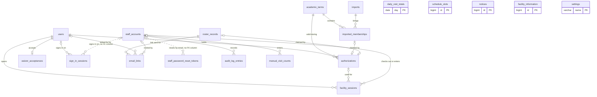
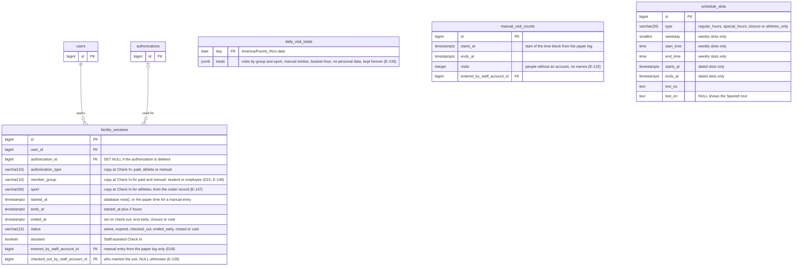
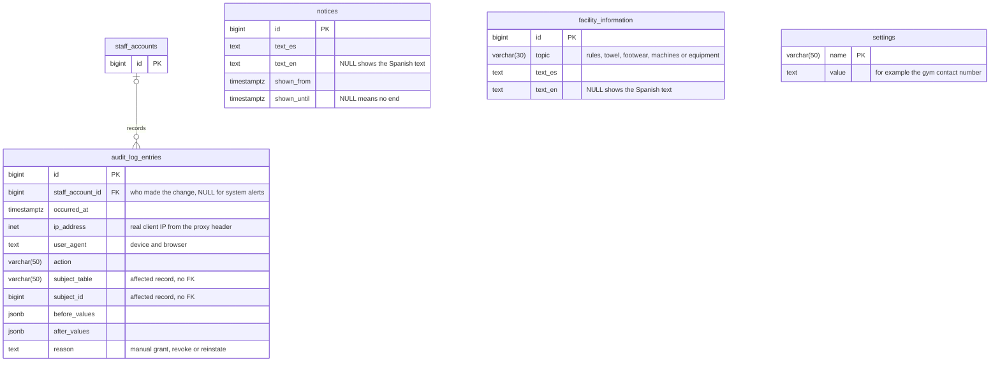

# Data Model

This document turns the logical data model in `design-notes.md` into PostgreSQL tables. It shows each table with its main fields, keys and links, the rules the database itself enforces, and what is deleted or kept when an account is deleted or an Authorization Number is released. It is the agreement the team builds the migrations from (GitHub issue #4). Field lists hold only what the requirements need, because REQ-NF-21 limits the personal data the system may store.

## Conventions

- Table names are the snake_case plurals of the logical entities, plus `imports` for the WooCommerce store sync runs (D19).
- Every table has a `bigint` identity `id` unless the diagram says otherwise, and Laravel `created_at` and `updated_at`. The timestamps are not drawn.
- Times are `timestamptz`. Term dates are `date` in the `America/Puerto_Rico` time zone (REQ-NF-37).
- `PK` primary key, `FK` foreign key, `UK` unique. A composite unique key is written in the field comment.
- Solid lines are foreign keys in SQL. Dotted lines are links with no foreign key column.
- Laravel framework tables are not drawn: `migrations`, `cache` (also holds the attempt limit counters of REQ-F-07 and REQ-F-71, and the request limit for emailed links; sign-in counters are keyed by IP and email, for User and staff accounts alike, link requests by student number; all are discarded when the wait ends; E-91, E-93), `jobs`, `failed_jobs` and `password_reset_tokens` (REQ-F-06). Staff password resets use their own `staff_password_reset_tokens`, drawn in diagram 2. Outgoing mail is assumed (E-61): the CTI mail gateway after CTI authorizes the VM; an external provider only if it does not.

## 1. Overview: tables and links

All 19 tables and how they relate. Fields are in sections 2 to 4.

### 1. All tables and links

**Type:** Entity-relationship diagram. **Use it to:** see which tables exist and which ones point at which, before writing the migrations one by one.

- A User has many authorizations over time, kept apart from the account (REQ-F-19), but only one active authorization per term; a revoked one does not count (E-68, E-94). Each authorization comes from one imported membership (paid), one roster record (athlete) or neither (manual, REQ-F-87).
- A membership or roster record is claimed by at most one authorization (REQ-F-17).
- Staff and Administrators sign in with their own staff account, kept apart from User accounts (D13). There is no shared gym account and no PIN.

## 2. Accounts and access

### 2. Accounts and access tables

**Type:** Entity-relationship diagram. **Use it to:** write the migrations and constraints for accounts, staff accounts, sign-in sessions, terms, imports, the roster, emailed links and authorizations.

```mermaid
erDiagram
  users ||--o{ authorizations : "holds"
  users ||--o| waiver_acceptances : "accepts"
  users |o--o{ sign_in_sessions : "signs in on"
  staff_accounts |o..o{ sign_in_sessions : "signs in on, no FK column"
  academic_terms ||--o{ authorizations : "valid during"
  academic_terms ||--o{ imported_memberships : "contains"
  imports ||--o{ imported_memberships : "brings"
  imported_memberships |o--o| authorizations : "claimed by"
  roster_records |o--o| authorizations : "claimed by"
  roster_records ||--o{ email_links : "link sent for"
  users |o--o{ email_links : "asked for by"
  staff_accounts |o--o{ email_links : "invited by"
  staff_accounts |o..o{ staff_password_reset_tokens : "resets by email, no FK column"

  users {
    bigint id PK
    varchar(255) email UK "unique on lower(email), NULL after deletion"
    varchar(255) password "hash, NULL after deletion"
    varchar(2) locale "es or en, asked at account creation, changed in profile preferences"
    varchar(255) current_session_id "the one session allowed in, checked on every request"
    varchar(100) remember_token "keeps the User signed in on the one device, new on each sign-in and password reset, NULL after sign-out and deletion"
    timestamptz last_signed_in_at "NULL until the first sign-in (E-131)"
    timestamptz deleted_at "set when the account is deleted"
  }
  staff_accounts {
    bigint id PK
    varchar(255) name "shown in the audit log"
    varchar(255) email UK "unique on lower(email)"
    varchar(255) password "hash, NULL until the invite link is used"
    varchar(10) role "staff or admin"
    varchar(2) locale "es or en, changed in the account's preferences"
    timestamptz deactivated_at "NULL while access is allowed, set when the person leaves"
    int session_epoch "0 at first, +1 on each deactivation; a sign-in made before it ends, even after a reactivation"
  }
  staff_password_reset_tokens {
    varchar(255) email PK "email of the staff account"
    varchar(255) token "hash of the token in the link"
    timestamp created_at
  }
  sign_in_sessions {
    varchar(255) id PK "Laravel session id"
    bigint user_id FK "index only, the User's id, NULL for a staff account"
    varchar(45) ip_address "always NULL"
    text user_agent "always NULL"
    text payload "Laravel session data, including the signed-in staff account"
    integer last_activity "Unix time of the last request"
  }
  email_links {
    bigint id PK
    varchar(25) purpose "athlete_registration, athlete_link or staff_invite"
    varchar(64) token_hash UK "hash of the token in the link"
    bigint roster_record_id FK "record the link is for, NULL for staff_invite"
    bigint user_id FK "signed-in User, NULL for registration"
    bigint staff_account_id FK "invited staff account, staff_invite only"
    timestamptz expires_at
    timestamptz used_at "NULL until opened, single use"
  }
  waiver_acceptances {
    bigint id PK
    bigint user_id FK, UK
    varchar(255) full_name "the display name on the Gym ID and in Staff search, set at registration"
    varchar(255) email
    varchar(255) emergency_contact_name "the User can edit it"
    varchar(30) emergency_contact_phone "the User can edit it"
    varchar(20) waiver_version "which text the person accepted (E-134)"
    timestamptz accepted_at
  }
  academic_terms {
    bigint id PK
    varchar(50) name
    date starts_on
    date ends_on "no overlap, see rules"
  }
  imports {
    bigint id PK
    varchar(255) file_name
    integer created_count
    integer updated_count
    integer revoked_count
    integer skipped_count
    jsonb result "the order reference and reason of each skipped order, no names or emails (E-149); the counts are the four columns above"
  }
  imported_memberships {
    bigint id PK
    bigint import_id FK "import that created the row"
    bigint academic_term_id FK "term that contains paid_at"
    varchar(100) order_reference UK
    varchar(20) authorization_number UK "length not checked, may include letters (E-128, E-153)"
    varchar(255) name
    varchar(255) email "payment email"
    varchar(10) member_group "student or employee, from the product variation (D15)"
    text membership_details
    varchar(30) order_status
    timestamptz paid_at
    timestamptz synced_at
  }
  roster_records {
    bigint id PK
    varchar(20) student_number UK "one roster, not one per term (D16)"
    varchar(255) name
    varchar(255) institutional_email "the gym adds it to the list (#62, question 15)"
    varchar(50) sport "from the coach's team list (#62, question 15)"
    timestamptz removed_at "NULL while the athlete is on the roster (D16)"
  }
  authorizations {
    bigint id PK
    bigint user_id FK
    bigint academic_term_id FK
    varchar(10) type "paid, athlete or manual"
    varchar(10) status "active or revoked, one active per User and term"
    bigint imported_membership_id FK, UK "paid only"
    bigint roster_record_id FK "athlete only, UK with term (D16)"
    varchar(255) photo_path "private volume, NULL until uploaded"
    timestamptz photo_pending_at "set when Staff mark the photo as not matching (D17)"
    boolean created_account "this claim created the account"
    varchar(10) member_group "manual only: student or employee, picked by the Administrator (E-148)"
    text reason "manual grant, 'removed from roster', 'order cancelled' or 'order refunded'"
  }
```

Notes:

- **Claim status** is not a column. A membership or roster record is claimed when an authorization points at it. Releasing the number (REQ-F-74) deletes that authorization and keeps the account (E-106), so the number is free again with no flag to reset.
- **Photo.** The term photo belongs to the authorization, not the account (design-notes, REQ-F-26). The bytes are a JPEG on the private volume (REQ-NF-20, REQ-NF-24); the row stores only the relative path. Registration never creates an authorization without a photo (E-69). `photo_path` is NULL for a manual grant until the User gives the photo on U-02 before Check In, like an athlete (E-69), and on a past-term authorization after its photo is deleted when the new-term photo arrives (E-135, D21). An athlete in a new term is found at the first app open by the student number of the account's last claim (REQ-F-26, E-69) and gets the authorization in the same step that saves the new photo (registration-flows diagram 8). Check In needs a photo; the backend checks it. **Photo pending (D17, E-118):** when the photo does not match the person, Staff set `photo_pending_at`; Check In is refused until the person uploads a new photo from their phone, which replaces the file. This is the one case where a photo changes during an active authorization (REQ-F-26). Whether the upload clears the mark by itself or Staff approve it is still open.
- **Expiry** is not stored. An authorization is current when `status = 'active'` and today in `America/Puerto_Rico` is on or before the term's `ends_on` (REQ-F-22, REQ-NF-01). Editing a term never blocks: records keep their term and authorization, and the end date follows the term's new `ends_on` (E-88). A revoke (REQ-F-87) sets `status = 'revoked'` and keeps the claim, so the number is not freed. Reinstate on A-05 sets the status back to `active` (E-95).
- **Removing an athlete from the roster (REQ-F-49, E-93, D16)** sets `roster_records.removed_at` and revokes the current authorization: `status = 'revoked'` and `reason = 'removed from roster'`. Nothing is deleted by cascade. The Gym ID stops being valid at once, the current session keeps counting, and no new Check In is allowed. The roster record stays claimed by that authorization.
- **Reinstate (E-95).** The Administrator can return a revoked authorization to active on A-05, for example after removing an athlete by mistake. The action needs a reason, required and free text of 10 characters or more, the same rule as a manual grant and a revoke (E-86), and writes an audit log entry. Reinstate is refused with a message when the person already has an active authorization in that term: the unique index of section 5 rejects it (E-94), and the Administrator revokes the other authorization by hand if needed.
- **One active authorization per User and term (E-68, E-94).** Only active authorizations count: a revoked one does not block a new grant or claim in the same term. This is the team's decision (E-94). A partial unique index enforces it (section 5). A manual grant for a person who already has an active one is rejected.
- **Authorization Number (E-128, D1).** The number is unique across all orders, not only per term (this replaces the per-term rule of E-71). The registration lookup reads only the orders of the current term, so a number from an ended term gets the same answer as an invalid or claimed one. If the gateway ever repeats a code, the sync rejects the second order and the Administrator sees it in the sync result.
- **`created_account`** is set when registration created the account in the same step as the claim (REQ-F-13). Release keeps the account in every case (E-87, E-106), so the column does not drive a deletion and no rule reads it now. Whether to keep the column is to confirm. If it stays, it cannot be derived from "first authorization", because a release can delete the first one.
- **Sync result (E-84, E-127).** `created_count`, `updated_count`, `revoked_count` and `skipped_count` hold the counts, and `imports.result` lists only the skipped orders, each with its order reference and the reason (REQ-F-28, REQ-F-99, E-149), so the Administrator reopens the result later from A-07. The counts are stored once, in the columns (section 8). No row holds a name or an email (E-149); each sync record is deleted 5 years after it was created (E-131). A sync record has no uploaded-by or uploaded-at column: the audit log records who pressed "Sync now" and when (REQ-NF-39, E-93).
- **Name (D7).** The name on the Gym ID and in Staff search is `waiver_acceptances.full_name`, written once at registration. It does not depend on the order or the roster, so a change to either does not erase it.
- **Language (E-64).** One language per account. A User picks it at account creation and changes it in profile preferences. Each staff account has its own language in `staff_accounts.locale` (D11). Before an account exists, the app uses the language chosen with the switch on N-01, kept on the device (E-159); that needs no column.
- **Emailed links (REQ-F-15, E-58, D9).** Athlete registration and "I am an athlete" use the same link: a random token sent to the roster record's `institutional_email`. `email_links` stores only the hash of the token. A link works once, before `expires_at`; using it sets `used_at`. For "I am an athlete" (`purpose = 'athlete_link'`), the claim (an `athlete` authorization) is created only when the link is opened, not when the student number is entered. Link requests are limited with a counter in the `cache` table. The athlete sets the password, photo and waiver on the link page, after the link is opened (E-69), so no pending registration table is needed. Outgoing mail is assumed (E-61). There is no in-person code (E-117).
- **Terms are never deleted (E-107).** A term created by mistake is fixed by editing its dates (E-88). No delete action exists for `academic_terms`.
- **Staff read the roster (E-59).** Staff search the `roster_records` without `removed_at` by name or student number, read only. No table change: who may write stays a backend permission rule. Student numbers are shown in full to Staff and the Administrator (E-81).
- **Staff accounts (D13, #62 questions 1 to 3).** Every Staff member and Administrator signs in as themselves, with their own email and password, and `role` says what they may do: `staff` for the front desk, `admin` for administration. There is no shared gym account, no PIN and no recovery code. The audit log names the staff account that made each change. When someone leaves, the account is not deleted: `deactivated_at` is set and sign-in is refused, so the audit log keeps pointing at it. A staff account is separate from a User account, so a student employee can have both, with the same email. The install command creates the first Administrator, and Administrators invite Staff by email (E-114, gap 17). An invited account has `password` NULL until the person opens the invite link and sets one.
- **Staff password reset.** Laravel's `password_reset_tokens` is keyed by email, and a User and a staff account may share an email, so one reset would overwrite the other's token. Staff resets use `staff_password_reset_tokens`, with the same shape: the staff account's email as primary key, the token hash and `created_at`.
- **Last sign-in (E-131).** `users.last_signed_in_at` is set on each sign-in. With the last Check In it says when the User was last active, which starts the 5 years before the account is deleted.
- **One roster (D16, E-116).** The roster is one list. Administrators add, edit and remove records by hand; there is no roster import. An athlete keeps one roster record across terms and gets one authorization per term, created at the first app open of the term in the same step that saves the new photo. The waiver is not asked again.
- **Refunds (E-120).** Refunds are made in the payment gateway, outside the store, so the store does not show them. An Administrator revokes the authorization by hand with `reason` set to the refund (REQ-F-87). If an order ever arrives as `refunded` or `cancelled` after it was `completed`, the sync revokes its authorization with `reason = 'order refunded'` or `'order cancelled'`.
- **Store sync (D19, E-127).** Orders come from the store's API, not from a file. Each sync run is a row in `imports` (the name stays): its counts and its `result`. `file_name` holds the sync kind (`registration lookup`, `scheduled` or `sync now`). There is no undo, so the table has no `undone_at`. Only `completed` orders create rows that can be claimed.
- **Roster sport (#62 question 15).** Each coach's list gives the sport, so every roster record stores it. Employees pay through the store and say in the order that they are employees (#62 question 18). They have the same access as paid students, so they keep the `paid` type; `imported_memberships.member_group` says `student` or `employee`, and statistics show them apart (D15).

### Sign-in sessions

- `sign_in_sessions` is Laravel's database session table, with `config('session.table')` set to `sign_in_sessions`. Its columns are Laravel's, unchanged except that `ip_address` and `user_agent` are always NULL (decision D4). The session handler is extended to write NULL.
- **One device per User (REQ-F-03).** Not a SQL constraint: Laravel writes the session row at the end of each request, and a unique index on `user_id` would make the new device's insert fail silently. The valid session id is stored in `users.current_session_id`, a middleware checks it on every request, and old rows are deleted (decision D3).
- **Staff sign-in sessions.** A staff account signs in on the gym dashboard's own sign-in page (REQ-NF-10). Its session row has `user_id` NULL; the signed-in staff account is in the session `payload`, so the User rules on `user_id` (one device, deletion in section 6) never touch a staff session. Staff accounts have no device limit. A staff sign-in ends after 2 hours without a person tapping or typing, an Administrator sign-in after 20 minutes, and deactivating an account ends its open sessions at once (E-130, gap 18).

## 3. Sessions and occupancy

`users` and `authorizations` appear only as links; their fields are in section 2.

### 3. Sessions and schedule tables

**Type:** Entity-relationship diagram. **Use it to:** write the migrations and constraints for facility sessions and schedule slots.

Notes:

- **When a session is active.** "Active" depends on time and on status. The constraint in section 5 uses the time range `tstzrange(started_at, LEAST(COALESCE(ended_at, ends_at), ends_at), '[)')` and skips void rows with `WHERE (status <> 'void')`. An expired session stops blocking by itself once `ends_at` passes, because its range is in the past. Ending early or checking out before `ends_at` sets `ended_at`, which cuts the range short. A check-out after `ends_at` does not stretch the range, so it never blocks a new Check In the person made in the meantime. PostgreSQL does not allow `now()` in a constraint condition (context.md section 2), and the time range avoids needing it.
- **Why `ends_at` is stored.** `timestamptz + interval` is not immutable in PostgreSQL, so it cannot appear in an index expression. `ends_at` is a plain column, checked with `CHECK (ends_at = started_at + interval '2 hours')` (D14).
- **`status = 'expired'`** is written by the scheduled cleanup task, but every read also compares `ends_at` with the database `now()` (REQ-F-38, REQ-NF-01). A late task never changes a result. Decided, revisable (team, 2026-10-19; check-in-flows D3).
- **Early end.** The exclusion constraint uses `WHERE (status <> 'void')`, and an early end shortens the period through `ended_at`. Decided, revisable (team, 2026-10-19; check-in-flows D4).
- **Check-out (D14, E-115).** Staff mark each person's exit from the front desk: `status = 'checked_out'`, `ended_at` is the time of the exit and `checked_out_by_staff_account_id` is who marked it. A check-out writes no audit log entry (E-129). This is the routine way a session ends; `ended_early` stays for corrections, so statistics can tell them apart. A session nobody checks out ends by itself at `ends_at`, 2 hours after the Check In; the app shows it as "closed automatically" (`status = 'expired'`). There is no daily limit: a person may Check In again the same day after a session ends, and each such entry counts as a visit.
- **Closure (D14, E-115).** When a closure is published or the term ends, every active session gets `status = 'closed'` and `ended_at` set to that moment. The app shows "closed by closure".
- **Manual entries (D18, E-119).** After an outage, an Administrator enters each paper log entry with the person and the times. The row has `entered_by_staff_account_id` set, `started_at` and `ended_at` from the paper, and `status = 'checked_out'`. It writes an audit log entry. A wrong one is voided (`status = 'void'`), not deleted (E-146). Statistics count it and can filter it out by `entered_by_staff_account_id IS NOT NULL`. People without an account go in `manual_visit_counts` as a number of visits for a time block, with no names (E-132); they count in visit totals and not in distinct people.
- **Occupancy** (REQ-F-41) is the count of rows with `status <> 'void'` whose range contains `now()`. Analytics (REQ-F-61) read the same table: `authorization_type` keeps paid versus athlete versus manual after an authorization is deleted, `member_group` splits paid into students and employees (D15), and `user_id` keeps distinct people. `manual` is its own category in statistics (E-82).
- **Deleted authorizations and active sessions.** When an authorization is deleted (a release, or an order deleted), active sessions keep counting until they end, because `authorization_id` is set to NULL and the row stays.
- **Location** is not stored (REQ-NF-03).
- **My visits (E-105).** The My visits screen (U-09) lists the signed-in User's past Check Ins. It reads the existing `facility_sessions` rows of that `user_id`: no new table and no new column. The list shows the full history (E-126), and rows are kept 5 years (E-125).

## 4. Content and audit

`staff_accounts` appears only as a link; its fields are in section 2.

### 4. Content and audit tables

**Type:** Entity-relationship diagram. **Use it to:** write the migrations and constraints for the audit log, notices, facility information and settings.

Notes:

- The gym contact number is a row in `settings`. The Administrator edits it in A-12, Facility information editor (E-66).
- Schedule slots: one table, weekly or dated (E-90). The regular schedule is written once, and exceptions are separate rows.
- The audit log has no `pin_active` column (E-93), and with personal accounts there is no PIN to record (D13).
- The affected record is `subject_table` plus `subject_id`, with no foreign key. Deleting a User or an order never removes or changes an audit entry, which stays until the retention rule removes it (E-131, REQ-NF-05, REQ-NF-39, REQ-F-09).
- The audit log names the staff account that made each change, so it says who did what (D13, #62 questions 1 to 3). A staff account is deleted only 5 years after its last deactivation, when every audit entry that names it is already gone (E-145), so an entry never loses its person. `ip_address` comes from the proxy header, not the proxy's own address (design-notes).
- Decided (E-108): nobody can edit or delete an entry through the app, not even the Administrator; no screen and no route for it. Optional enforcement, a team idea: a trigger that rejects UPDATE, and DELETE only by the retention task (E-131, REQ-NF-05).
- Decided (E-108): new `action` values for staff account sign in and sign out. User sign-ins are not logged (D4, REQ-NF-21).
- The location boundary is not a setting: it is configured per environment (REQ-NF-29).

## 5. Database rules

Rules written as SQL in the migrations. Laravel's schema builder cannot express exclusion constraints, so those go in `DB::statement` calls (context.md section 2). "Simultaneous" means two transactions insert at the same moment: the second one waits for the first, then fails with SQLSTATE `23505` (unique) or `23P01` (exclusion), and the backend turns that error into the normal message. A check with SELECT before the INSERT is not enough on its own.

| Rule | Table | Constraint (SQL) | Requirement |
|---|---|---|---|
| Each Authorization Number is claimed by one account at most, also under simultaneous requests | `imported_memberships`, `authorizations` | `UNIQUE (authorization_number)` on memberships (decision D1, E-128) and `UNIQUE (imported_membership_id)` on authorizations. The losing request gets the message of REQ-F-72 | REQ-F-17, REQ-F-10, REQ-NF-42 |
| Each roster record is claimed by one account at most per term, also under simultaneous requests | `authorizations` | `UNIQUE (roster_record_id, academic_term_id)` (D16) | REQ-F-17, REQ-NF-42 |
| One active facility session per User, also under simultaneous requests | `facility_sessions` | `CREATE EXTENSION btree_gist;` then `EXCLUDE USING gist (user_id WITH =, tstzrange(started_at, LEAST(COALESCE(ended_at, ends_at), ends_at), '[)') WITH &&) WHERE (status <> 'void')`. The losing request returns the current session (REQ-F-37) | REQ-F-36, REQ-F-37, REQ-NF-42, REQ-NF-50 |
| A session closes by itself 2 hours after the Check In; only a check-out may come later | `facility_sessions` | `CHECK (ends_at = started_at + interval '2 hours')`, `CHECK (ended_at IS NULL OR ended_at >= started_at)` and `CHECK (status <> 'ended_early' OR ended_at <= ends_at)` (D14) | REQ-F-36, REQ-F-38, REQ-F-48 |
| Session time is backend time, except a manual entry | `facility_sessions` | `started_at DEFAULT now()`; the insert does not send a time. Only a manual entry sends the paper time: `CHECK (entered_by_staff_account_id IS NULL OR status IN ('checked_out','void'))` (D18, E-146) | REQ-NF-01 |
| Session status values, and check-outs and corrections record when they happened | `facility_sessions` | `CHECK (status IN ('active','expired','checked_out','ended_early','closed','void'))` and `CHECK ((status IN ('checked_out','ended_early','closed','void')) = (ended_at IS NOT NULL))` | REQ-F-48 (D14) |
| Terms never overlap; gaps are allowed | `academic_terms` | `CHECK (starts_on <= ends_on)` and `EXCLUDE USING gist (daterange(starts_on, ends_on, '[]') WITH &&)`. Ranges need no extension | REQ-F-21 |
| A student number appears once in the roster | `roster_records` | `UNIQUE (student_number)` (D16) | REQ-F-51 |
| Every roster record has a sport | `roster_records` | `sport NOT NULL` | REQ-F-51 (#62 question 15) |
| Processing the same order twice gives no duplicate | `imported_memberships` | `UNIQUE (order_reference)`. The import runs `INSERT ... ON CONFLICT (order_reference) DO UPDATE` and does not overwrite `import_id` | REQ-F-30 |
| An order outside every term gives no record | `imported_memberships` | `academic_term_id NOT NULL`. The import finds the term from `paid_at` and rejects the row if none is found | REQ-F-22 |
| Every order says if the buyer is a student or an employee | `imported_memberships` | `member_group NOT NULL`, `CHECK (member_group IN ('student','employee'))` | REQ-F-61 (D15) |
| Paid and manual sessions keep the group for statistics | `facility_sessions` | `CHECK (member_group IN ('student','employee'))` and `CHECK ((authorization_type IN ('paid','manual')) = (member_group IS NOT NULL))` | REQ-F-61 (D15, E-148) |
| Athlete sessions keep the sport for statistics | `facility_sessions` | `CHECK ((authorization_type = 'athlete') = (sport IS NOT NULL))` | REQ-F-61 (E-147) |
| A manual grant says student or employee | `authorizations` | `CHECK (member_group IN ('student','employee'))` and `CHECK ((type = 'manual') = (member_group IS NOT NULL))` | REQ-F-87 (E-148) |
| One account per email | `users` | `CREATE UNIQUE INDEX ON users (lower(email))`. Deleted accounts have NULL email, which never collides | REQ-F-01, REQ-F-11, REQ-F-78 |
| An authorization has the source its type says | `authorizations` | `CHECK ((type = 'paid' AND imported_membership_id IS NOT NULL AND roster_record_id IS NULL) OR (type = 'athlete' AND roster_record_id IS NOT NULL AND imported_membership_id IS NULL) OR (type = 'manual' AND imported_membership_id IS NULL AND roster_record_id IS NULL))` | REQ-F-19, REQ-F-87 |
| Authorization values | `authorizations` | `CHECK (type IN ('paid','athlete','manual'))`, `CHECK (status IN ('active','revoked'))` | REQ-F-19, REQ-F-87 |
| One active authorization per User and term | `authorizations` | `CREATE UNIQUE INDEX ON authorizations (user_id, academic_term_id) WHERE (status = 'active')`. Only active authorizations count (the team's decision, E-94), so a revoked one does not block a new grant or claim. A manual grant that would break it is rejected | REQ-F-19, REQ-F-80 (E-68, E-94) |
| A manual grant has a reason | `authorizations` | `CHECK (type <> 'manual' OR reason IS NOT NULL)`. The reason is required, free text of 10 characters or more (E-86); the backend checks the length and writes the reason to the audit log | REQ-F-87 |
| One waiver per account | `waiver_acceptances` | `UNIQUE (user_id)` | REQ-F-60 |
| One staff account per email | `staff_accounts` | `CREATE UNIQUE INDEX ON staff_accounts (lower(email))`. Separate from `users`, so the same email may have a User account too (D13) | REQ-F-52 (D13) |
| A staff account is Staff or Administrator | `staff_accounts` | `CHECK (role IN ('staff','admin'))` | REQ-F-52 (D13) |
| One staff password reset per email | `staff_password_reset_tokens` | `email` is the primary key, apart from `password_reset_tokens`, so a User and a staff account with the same email never collide | REQ-F-06, REQ-F-88 |
| A paper log count is at least one visit, for a real time block | `manual_visit_counts` | `CHECK (visits > 0)` and `CHECK (ends_at > starts_at)` | REQ-F-95 (E-132) |
| An emailed link is found only by its hash and has the right owner | `email_links` | `UNIQUE (token_hash)` and `CHECK ((purpose = 'athlete_registration' AND roster_record_id IS NOT NULL AND user_id IS NULL AND staff_account_id IS NULL) OR (purpose = 'athlete_link' AND roster_record_id IS NOT NULL AND user_id IS NOT NULL AND staff_account_id IS NULL) OR (purpose = 'staff_invite' AND roster_record_id IS NULL AND user_id IS NULL AND staff_account_id IS NOT NULL))` | REQ-F-15, REQ-F-88 (E-58, E-114) |
| Chosen language is Spanish or English | `users`, `staff_accounts` | `CHECK (locale IN ('es','en'))` on both tables | REQ-NF-33, REQ-NF-35 |
| A schedule slot is either weekly or dated, never both | `schedule_slots` | `CHECK ((weekday IS NOT NULL AND start_time IS NOT NULL AND end_time IS NOT NULL AND starts_at IS NULL AND ends_at IS NULL) OR (weekday IS NULL AND start_time IS NULL AND end_time IS NULL AND starts_at IS NOT NULL AND ends_at IS NOT NULL))`, plus `CHECK (type IN (...))` and `CHECK (type NOT IN ('special_hours','closure') OR starts_at IS NOT NULL)` | REQ-F-55 |

## 6. Deletion: what is deleted, kept or anonymized

Photo files live outside the database, so no foreign key can delete them. The backend deletes the file after the transaction commits. In the same transaction that deletes the rows, it writes each photo path to `pending_photo_deletions` (columns `id` and `path`). A path leaves that table once its file is gone, and a scheduled task retries the paths still there every minute, so a failed delete is never lost. There is no queue or worker (decision D4): the task runs in the scheduler container.

There is no import undo any more (E-127, REQ-F-31 Removed), so its old column is gone and the release column is now (b).

| Table or data | (a) User deletes the account (REQ-F-09) | (b) Administrator releases an Authorization Number (REQ-F-74) |
|---|---|---|
| `users` | Row kept with no personal data: `email`, `password`, `locale`, `current_session_id`, `remember_token` set to NULL, `deleted_at` set (decision D2). The email is free again | Kept in every release case: also when the claim created the account (E-87) and when the released authorization was the account's only one (E-106) |
| `authorizations` | Deleted. Only expired or revoked ones can exist, because deletion needs no active authorization | Only the released one is deleted. Other authorizations of the same account stay (E-87) |
| Photo files | Deleted with their authorizations | Deleted with the released authorization, row and file (E-57, E-87), also when the number was added to an existing account |
| `waiver_acceptances` | Deleted | Kept |
| `sign_in_sessions` | All of the User's rows deleted | Kept |
| `facility_sessions` | Kept and still linked to the anonymous `users` row, so Check In counts, paid versus athlete and distinct people do not change (REQ-F-61) | Kept; `authorization_id` set to NULL |
| `imported_memberships` | Kept: it is a copy of the WooCommerce order, not account data. It becomes unclaimed (gap 5) | Kept and unclaimed again |
| `roster_records` | Kept: it is the department's list. It becomes unclaimed | Not affected |
| `imports` | Not affected | Not affected |
| `audit_log_entries` | Kept unchanged for 5 years (E-125, REQ-NF-05) | Kept; a release entry is added (REQ-NF-39) |
| `password_reset_tokens` | Rows for the old email deleted | Not affected |
| `email_links` | The User's rows deleted | Not affected |

Foreign key on-delete behavior that follows from this table:

| Foreign key | ON DELETE | Why |
|---|---|---|
| `facility_sessions.user_id` | RESTRICT | Users are never hard-deleted (decision D2); this stops a mistake from erasing Check In history |
| `facility_sessions.authorization_id` | SET NULL | Release and account deletion remove authorizations, and the sessions must stay |
| `authorizations.imported_membership_id` | CASCADE | An authorization cannot outlive its order. The sync never deletes orders (E-127), so this is reached only by a mistake |
| `authorizations.roster_record_id` | RESTRICT | No cascade (E-93). Removing an athlete from the roster sets `status = 'revoked'` with the reason "removed from roster", which ends the Gym ID at once (REQ-F-49). Reinstate (E-95) sets it back to `active` |
| `authorizations.user_id` | CASCADE | Only reached if a users row is ever hard-deleted |
| `waiver_acceptances.user_id` | CASCADE | Same as above |
| `authorizations.academic_term_id`, `imported_memberships.academic_term_id` | RESTRICT | Terms are never deleted (E-107); RESTRICT stops a term with data from being removed by mistake |
| `imported_memberships.import_id` | RESTRICT | A sync record with orders cannot be deleted by mistake |
| `audit_log_entries.staff_account_id` | RESTRICT | A staff account is deleted 5 years after its last deactivation, after its entries are gone; RESTRICT guards the order (D13, E-145) |
| `sign_in_sessions.user_id` | No SQL foreign key (Laravel default) | The backend deletes the rows in (a) |
| `email_links.roster_record_id` | CASCADE | A link for a deleted roster record must stop working |
| `facility_sessions.entered_by_staff_account_id`, `facility_sessions.checked_out_by_staff_account_id` | RESTRICT | The sessions are deleted at 5 years, before the staff account (E-145) |
| `email_links.user_id` | CASCADE | Only reached if a users row is ever hard-deleted; the backend deletes the rows in (a) |
| `email_links.staff_account_id` | CASCADE | An invite link for a deleted staff account must stop working |

## 7. Personal data check (REQ-NF-21)

| Column | Allowed by |
|---|---|
| `users.email`, `users.password`, `users.locale` | REQ-NF-21 (account email, password, chosen language) |
| `users.last_signed_in_at` | Needed to count the 5 years from the last activity (E-131) |
| `staff_accounts`: `name`, `email`, `password`, `locale` | REQ-NF-21 (name, email, password and language of staff accounts). Needed so the audit log names who did what (D13) |
| `staff_password_reset_tokens.email` | The staff account's email, already allowed above |
| `imported_memberships`: `name`, `email`, `member_group`, `membership_details`, `authorization_number`, `order_reference`, `order_status`, `paid_at`, term, `synced_at` | REQ-F-29. No billing, address, phone, IP or marketing fields, and no student number (E-127). `member_group` comes from the product variation (D15) |
| `roster_records`: `student_number`, `name`, `institutional_email`, `sport` | REQ-F-51 (sport: #62 question 15) |
| `authorizations.photo_path` and the file | Term photo |
| `waiver_acceptances`: all fields | REQ-F-60 |
| `audit_log_entries`: `ip_address`, `user_agent`, `before_values`, `after_values` | REQ-NF-39 |
| `imports.result` | Rows of the result hold a name and an email (REQ-F-28, REQ-F-29). Each sync record is deleted 5 years after it was created (E-131) |
| `sign_in_sessions.ip_address`, `sign_in_sessions.user_agent` | Always NULL, so nothing is stored (decision D4, E-91) |
| `cache` attempt counters | Temporary counters, discarded when the wait ends: sign-in counters by IP and email, link requests by student number. REQ-NF-21 now says so (SRS v0.7, E-91) |
| `email_links` | No new personal data: a token hash, times, and links to a roster record and an account. The email goes to `roster_records.institutional_email`, already allowed (REQ-F-51) |

## 8. Normal form check

Every table was checked against third normal form: each column depends on the table's key, the whole key, and nothing else. Every key is a single column, so no column can depend on part of a key. The design stores each fact once and links tables by foreign key, with the exceptions below. Each one keeps a copy on purpose, because without it the system would lose information or could not enforce a rule. Checked on 2026-11-05 (issue #13).

| Table and columns | What is stored twice | Why the copy is kept | What keeps it right |
|---|---|---|---|
| `facility_sessions.authorization_type`, `member_group`, `sport` | The authorization's type, the group of its order or manual grant, and the roster sport | An authorization can be deleted (release, cancelled order) and a roster sport can be edited. Past visits must keep counting the same in statistics (E-147, E-148) | Copied once at Check In and never updated. CHECKs tie `member_group` to paid and manual, and `sport` to athletes (section 5) |
| `waiver_acceptances.full_name`, `email` | The person's name and email at registration; `users.email` holds the account email | The waiver is the record of what the person accepted, as they typed it then. A later change to the account email must not change it. `full_name` is also the only place the name lives (D7) | Written once at registration. The User edits only the emergency contact |
| `daily_visit_totals.totals` | Counts that could be computed from `facility_sessions` | Visits are deleted after 5 years, but daily totals are kept forever with no personal data (E-133), so they cannot be counted again later. One row per day also keeps statistics fast | Saved each night for the day that ended, with no personal data (E-133, D20). Not decided: whether a visit or paper log entry voided after its day's totals were saved (E-146) changes that day's total |
| `facility_sessions.ends_at` | Always `started_at` plus 2 hours | The exclusion constraint needs a plain column: `now()` and `timestamptz + interval` cannot go in an index (section 3) | `CHECK (ends_at = started_at + interval '2 hours')` |
| `authorizations.academic_term_id` for a paid authorization | The term of its order, also in `imported_memberships.academic_term_id` | "One active authorization per User and term" is a unique index, which needs the term in the same table. For athletes and manual grants the term is the authorization's own data | Set from the order when the claim is made. Terms are never deleted (E-107) |
| `imported_memberships.academic_term_id` | The term that contains `paid_at` | Editing a term's dates (E-88) must not move orders between terms; an order keeps the term it was synced into | Set by the sync from `paid_at`, then left alone |
| `jsonb` columns: `imports.result`, `audit_log_entries.before_values` and `after_values`, `daily_visit_totals.totals` | Several values in one column (first normal form) | Each is a snapshot of how something was at one moment. It is read whole and never searched by field | Written once, never updated. `imports.result` holds only the skipped orders; the counts are stored once, in `created_count`, `updated_count`, `revoked_count` and `skipped_count` |

Two copies looked like repetition but are not: `imported_memberships.name` and `email` come from the store order and can differ from the User's account, and `roster_records.institutional_email` comes from the department's list.

## Design decisions

Decided by the team on 2026-10-17 and 2026-10-19; D10 to D12 on 2026-10-20; D13 to D15 on 2026-11-04, after the gym meeting (#62). The expiry and early-end rules of section 3 are decided and can be revisited.

**D1. Uniqueness of the Authorization Number (E-30, G-19).** Decided (team, 2026-10-19; E-71), changed by the team on 2026-11-04 (E-128): `UNIQUE (authorization_number)` across all orders.
- Why: a read of all 84 store orders found no repeated value among the 69 paid ones. If the gateway ever repeats a code, the sync rejects that order and the Administrator sees it in the sync result.

**D2. How an account is deleted (REQ-F-09, REQ-F-74).** Decided (team, 2026-10-19): option A, keep the `users` row with every personal column set to NULL and `deleted_at` set.
- Why: sessions keep their `user_id`, so Check In counts and distinct people do not change, and no extra table is needed.
- Releasing an Authorization Number never deletes the account, also when it was the only authorization (E-106).

**D3. One sign-in session per User (REQ-F-03).** Decided (team, 2026-10-19): option B, `users.current_session_id` plus a middleware that checks it on every request, and old rows are deleted.
- Why: the last sign-in always wins, also when two happen at once.

**D4. IP address and user agent in `sign_in_sessions` (REQ-NF-21).** Decided (team, 2026-10-19; E-91): option B, Laravel's database session handler is extended to write NULL in both columns.
- Why: REQ-NF-21 lists neither, and the gym does not need to see where a User signed in. Gym actions stay traceable through the audit log, which records IP, device and browser (REQ-NF-39).

**D5. Where the PIN state and last person activity live (REQ-NF-48).** Replaced by D13 (2026-11-04): with personal staff accounts there is no PIN, so there is no PIN state to store.

**D6. Photos when an import is undone (REQ-F-31).** Decided (E-57): option A, the photo (row and file) is deleted with the authorization on release; accounts stay. The undo part is gone: there is no import undo (E-127, REQ-F-31 Removed).

**D7. Where the User's name comes from (REQ-F-40, REQ-F-45).** Decided (team, 2026-10-19): option A, `waiver_acceptances.full_name`.
- Why: it is written once at registration and does not depend on the order or roster, so a change to either does not erase it.

**D8. How regular hours repeat (REQ-F-55, REQ-F-33).** Decided (team, 2026-10-19; E-90): option A, one table where a slot is weekly (weekday and local times) or dated (start and end).
- Why: the regular schedule is written once and exceptions are separate rows. Regular hours and athletes-only slots can be weekly; special hours and closures are dated. Summer hours that differ would need a term link later (G-28 is pending).

**D9. How emailed links are stored (REQ-F-15, E-58).** Decided (team, 2026-10-19): option A, an `email_links` table with the token hash, expiry and single use.
- Why: a signed URL can be opened many times until it expires, so it is not single use. There is no in-person code (E-117).

**D10. How the User sees their past visits (E-105).** Decided (team, 2026-10-20): the My visits screen (U-09) reads the existing `facility_sessions` rows.
- Why: the table already holds each Check In with its User and time, so no table or column is added.
- How far back: the full history (E-126); rows are kept 5 years (E-125).

**D11. Language of the gym dashboard (E-104).** Decided (team, 2026-10-20), updated by D13 (2026-11-04): each staff account has its own language in `staff_accounts.locale`, changed in that account's preferences. The language before an account exists (E-159) needs no change.

**D12. Terms are never deleted (E-107).** Decided (team, 2026-10-20): no term deletion. A term created by mistake is fixed by editing its dates (E-88).

**D13. Personal accounts for Staff and Administrators (G-09, #62 questions 1 to 3).** Decided (team, 2026-11-04), after the gym meeting: option B, one account per person and no PIN, in a separate `staff_accounts` table with a `role` of `staff` or `admin`.
- Why: the audit log must say who did what. A separate table keeps User rules (one device, deletion and anonymizing) apart from staff rules, matches the dashboard's own sign-in page (REQ-NF-10), and lets a student employee have a User account and a staff account with the same email.
- Replaces the shared gym account, the PIN (E-56, E-83, D5) and the recovery code (E-60, E-78). Staff accounts are deactivated, and deleted only 5 years after the last deactivation, so audit entries keep their person (E-145).

**D14. Check-out by Staff and the 2-hour close (G-32, E-115).** Decided (team, 2026-11-04): Staff mark each person's exit, which sets `status = 'checked_out'` and `ended_at`. A session nobody closes ends by itself 2 hours after the Check In (`ends_at`), shown as "closed automatically". A published closure or the end of a term ends every active session at once with `status = 'closed'`. There is no daily limit.
- Why: the department wants Staff to mark exits, and a check-out gives a real count of people inside. The 60 minutes are a guide Staff apply when the gym is full, not a rule. `ended_early` stays for corrections, so statistics tell them apart.
- The exclusion constraint caps the range at `ends_at`, so a late check-out never blocks a new Check In.

**D15. Employees in the statistics (#62 question 18).** Decided (team, 2026-11-04), after the gym meeting: option A, employees stay `paid` members, and the order's group is stored in `imported_memberships.member_group` (`student` or `employee`). Check In copies it to `facility_sessions.member_group`, like `authorization_type`.
- Why: employees pay in the store and say so in the order, and they have the same access as paid students, so every paid rule (athletes-only periods, one active authorization) stays unchanged. Only the statistics show them apart.
- How the store marks an employee: the product variation of the order (E-120, E-127).

**D16. One roster (G-33, E-116).** Decided (team, 2026-11-04): `roster_records` has no term. A student number appears once; `removed_at` marks a removed athlete. Authorizations stay per term, so the claim key becomes `UNIQUE (roster_record_id, academic_term_id)`.
- Why: the department keeps one list, edits it by hand and removes athletes who leave. Per-term authorizations keep the per-term photo and expiry rules.

**D17. Photo pending (G-34, E-118).** Decided (team, 2026-11-04): `authorizations.photo_pending_at`, set by Staff, blocks Check In until a new photo is uploaded.
- Still open: whether the upload clears the mark by itself or Staff approve it.

**D18. Manual entries from the paper log (G-07, E-119).** Decided (team, 2026-11-04): a manual entry is a `facility_sessions` row with `entered_by_staff_account_id` set, the paper times and `status = 'checked_out'`. Only Administrators create them, and each writes an audit log entry.
- Why: the same table keeps statistics in one place, and the column lets reports filter manual entries out. `manual_visit_counts` holds people without an account as counts only (E-132), so no personal data of people outside the app is stored.

**D19. Store sync instead of a file import (E-127).** Decided (team, 2026-11-04): the `imports` table records each sync run from the WooCommerce API. No new table.
- Why: the run counts and the rejected rows still need a home, and the columns already fit. Renaming the table is optional and left to the migration author.

**D20. Daily totals for statistics (E-133).** Decided (team, 2026-11-05): a nightly task writes one `daily_visit_totals` row per day, with counts only. The rows are never deleted.
- Why: visits are deleted 5 years after they happen (E-131), and the department wants statistics forever. Counts carry no personal data.

**D21. Waiver version and current photo only (E-134, E-135).** Decided (team, 2026-11-05): `waiver_acceptances.waiver_version` stores the version of the text accepted. When a new-term photo is saved, the previous authorization's photo file is deleted and its `photo_path` set to NULL. A roster record with `removed_at` is deleted 5 years later (E-136).
- Why: the record must show what each person agreed to, and photos nobody uses only add risk and disk.

## Gaps and questions

1. **Resolved by E-57.** Release deletes the photo (row and file) with the authorization; accounts stay. Import undo is gone (E-127).
2. **Closed by E-127.** There is no import undo any more, so this question no longer applies.
3. **Resolved by E-125.** Every kind of data, the audit log included, is kept 5 years, so entries between terms need no term. Earlier note: **REQ-NF-05, audit entries between terms.** Entries are kept "until the end of the term in which it happened", but REQ-F-21 allows gaps between terms. An entry in a gap has no term. What happens after the term ends is pending (G-03). CTI said no screen or button may edit or delete an entry, and that the log is wanted after an incident; CTI did not speak about retention. 
4. **Resolved by E-91 for the session table.** IP and user agent are NULL. The `cache` counters keyed by IP and email stay for a short time; REQ-NF-21 now says so (SRS v0.7, E-91).
5. **REQ-F-09 and revoked numbers.** Deleting an account deletes its authorizations, so a revoked current-term Authorization Number becomes claimable again. The SRS does not say if that is wanted.
6. **Resolved by E-69.** A User with a manual authorization gives the term photo on U-02 before Check In, like an athlete.
7. **Resolved by E-82.** `manual` is its own value in `authorization_type` and its own category in statistics.
8. **Resolved by E-68 and E-94.** One active authorization per User and term; only active ones count, and a manual grant is rejected when the person already has an active one.
9. **Resolved by E-130.** Deactivating a staff account ends its open sessions at once; a middleware checks `deactivated_at` on every request.
10. **REQ-F-01 cannot be fully enforced by the database.** Uniqueness is per email. A person whose payment email differs from the account email, and who registers while signed out, gets a second account. REQ-F-20 assumes they add the number from inside the account. When the payment email already has an account, registration shows the masked email and asks the person to sign in (E-70).
11. **Resolved by E-69.** At the first app open in a new term, the roster is looked up by the student number of the account's last claim, and the athlete gives the new photo.
12. **Active sessions after release.** For a release, the design keeps the session counting, but nobody has confirmed it.
13. **Resolved by D16.** One roster: a removed athlete has `removed_at` set and is hidden from Staff search. The athlete stays until an Administrator removes them, and Administrators add athletes by hand during the term. Still to confirm: links sent before a removal must stop working; the backend checks `removed_at` when a link is opened.
14. **Retention of rejected import rows.** They are stored with the import result (E-84) and kept 5 years like everything else (E-125). CTI: the reports the gym wants decide which data is kept and for how long. Proposed (E-111): a growth estimate and cleanup options per term or per year.
15. **Visit history for the User.** Resolved by E-105 (D10): the My visits screen (U-09) reads `facility_sessions`. The list shows the full history (E-126), and rows are kept 5 years (E-125).
16. **Resolved by D13.** Staff and Administrators have personal accounts in `staff_accounts`, and `audit_log_entries.staff_account_id` names who made each change.
17. **Resolved (2026-11-05).** The Administrators are the two secretaries and the department director, and the install command creates the first one (E-114). Administrators invite Staff by email, and the invitation is an `email_links` row with `purpose = 'staff_invite'` and `staff_account_id` (D9).
18. **Resolved by E-130.** Staff sessions end after 2 hours without activity and Administrator sessions after 20 minutes; the last person activity lives in the session `payload`, and automatic refreshes do not update it. Deactivation ends open sessions at once (a middleware checks `deactivated_at`).
19. **Resolved.** REQ-NF-21 now lists the name, email, password and language of staff accounts (REQ-F-88).

## Traceability

Diagram titles: 1. All tables and links; 2. Accounts and access tables; 3. Sessions and schedule tables; 4. Content and audit tables.

| Requirement or decision | Where it appears |
|---|---|
| REQ-F-01 | 5. Database rules (one account per email); Gaps 10 |
| REQ-F-03 | Diagram 2 (`users.current_session_id`); Sign-in sessions; D3 |
| REQ-F-09 | 6. Deletion, column (a); D2; section 4 notes |
| REQ-F-10 | 5. Database rules; section 2 notes (Authorization Number); D1 |
| REQ-F-13 | Diagram 2 (`authorizations.created_account`) and its notes |
| REQ-F-15 | Diagrams 1 and 2 (`email_links`); section 2 notes (emailed links); 5. Database rules; D9 |
| REQ-F-17 | Diagram 1; 5. Database rules (claims and simultaneous claims); section 2 notes (Authorization Number, E-71) |
| REQ-F-19 | Diagram 1; Diagram 2 (`authorizations`); 5. Database rules (including one active authorization per User and term, E-68, E-94) |
| REQ-F-21 | Diagram 2 (`academic_terms`); 5. Database rules (exclusion on `daterange`) |
| REQ-F-22 | Section 2 notes (expiry); 5. Database rules (order outside every term) |
| REQ-F-26 | Diagram 2 (`authorizations.photo_path`); section 2 notes (photo); D6; Gaps 6 and 11 (E-69) |
| REQ-F-28 | Diagram 2 (`imports.result`); section 2 notes (import result, E-84); 7. Personal data check |
| REQ-F-29 | Diagram 2 (`imported_memberships`); 7. Personal data check |
| REQ-F-30 | 5. Database rules (`order_reference`) |
| REQ-F-31 | Removed (E-127): no import undo. 6. Deletion (note); D6; Gaps 1 and 2 (resolved, E-84) |
| REQ-F-36 | Diagram 3 (`facility_sessions`); section 3 notes; 5. Database rules (exclusion with `btree_gist`) |
| REQ-F-37 | 5. Database rules |
| REQ-F-38 | Section 3 notes; 5. Database rules |
| REQ-F-41 | Section 3 notes |
| REQ-F-48 | Diagram 3 (`facility_sessions.status`); section 3 notes; 5. Database rules |
| REQ-F-49 | Section 2 notes (removing an athlete, Reinstate E-95); 6. Deletion, FK table (`roster_record_id`, E-93); Gaps 13 |
| REQ-F-51 | Diagram 2 (`roster_records`); 5. Database rules |
| REQ-F-52 | Diagram 2 (`staff_accounts`); section 2 notes (staff accounts); 5. Database rules (staff accounts); D13 |
| REQ-F-55 | Diagram 3 (`schedule_slots`); 5. Database rules; D8 |
| REQ-F-58 | Diagrams 3 and 4 (`text_en` NULL shows Spanish) |
| REQ-F-60 | Diagram 2 (`waiver_acceptances`); 5. Database rules |
| REQ-F-61 | Diagram 3 (`authorization_type`); section 3 notes (`manual` category, E-82); 6. Deletion, column (a) |
| REQ-F-74 | 6. Deletion, column (b) (E-87, E-106); section 2 notes; D2 |
| REQ-F-77 | Removed (E-117): no in-person code |
| REQ-F-78 | 5. Database rules (one account per email) |
| REQ-F-87 | Diagram 2 (`authorizations`); 5. Database rules (reason, E-86) |
| REQ-F-88 | Diagram 2 (`staff_accounts.password`, `staff_password_reset_tokens`); section 2 notes (staff accounts, staff password reset); 5. Database rules; 6. Deletion, FK table (`email_links.staff_account_id`); Gaps 9 and 17 |
| REQ-F-89 | No recovery code with personal staff accounts (D13) |
| REQ-NF-01 | Section 3 notes; 5. Database rules |
| REQ-NF-05 | Section 4 notes; section 3 notes (My visits); 6. Deletion; Gaps 3 and 15 |
| REQ-NF-20 | Section 2 notes (photo) |
| REQ-NF-21 | 7. Personal data check; D4; Gaps 4 |
| REQ-NF-33 | Diagram 2 (`users.locale`, `staff_accounts.locale`); 5. Database rules (locale) |
| REQ-NF-39 | Diagram 4 (`audit_log_entries`); 6. Deletion |
| REQ-NF-42 | 5. Database rules (simultaneous requests) |
| REQ-NF-48 | No PIN with personal staff accounts (D13, D5); staff session limits are gap 18 |
| E-56 | Replaced by D13 (no PIN) |
| E-57 | 6. Deletion, column (b); D6; Gaps 1 |
| E-58 | Diagrams 1 and 2 (`email_links`); section 2 notes (emailed links); 6. Deletion; D9 |
| E-59 | Section 2 notes (Staff read the roster). No table change |
| E-60 | Replaced by D13 (no recovery code) |
| E-68, E-94 | Diagram 2 (`authorizations.status`); section 2 notes; 5. Database rules (one active authorization per User and term); Gaps 8 |
| E-66 | Diagram 4 (`settings`); section 4 notes |
| E-64 | Diagram 2 (`users.locale`, `staff_accounts.locale`); section 2 notes (language); 5. Database rules |
| E-103 | Section 2 notes (language). No table change |
| E-104 | Diagram 2 (`staff_accounts.locale`); section 2 notes (language); D11 |
| E-105 | Section 3 notes (My visits); D10; Gaps 15 |
| E-106 | 6. Deletion, column (b); section 2 notes (`created_account`); D2 |
| E-107 | Section 2 notes (terms); 6. Deletion, FK table; D12 |
| E-84 | Diagram 2 (`imports.result`); section 2 notes (sync result); 7. Personal data check; Gaps 14 |
| E-93 | Conventions (`cache`); Diagram 2 (`authorizations.reason`); section 2 notes (removing an athlete); section 4 notes; 6. Deletion, FK table; Gaps 13 |
| E-95 | Section 2 notes (Reinstate); 6. Deletion, FK table; Gaps 13 |
| #62 gym meeting (2026-11-04) | D13 (staff accounts); D14 (check-out, 2-hour close, closure); D15 (employees); D16 (one roster); D17 (photo pending); D18 (manual entries); Diagram 2 (`staff_accounts`, `roster_records.sport`, `imported_memberships.member_group`); Diagram 3 (`facility_sessions.member_group`); section 2 notes (staff accounts, roster sport); section 3 notes (check-out); section 4 notes; 5. Database rules; Gaps 16 to 19 |
