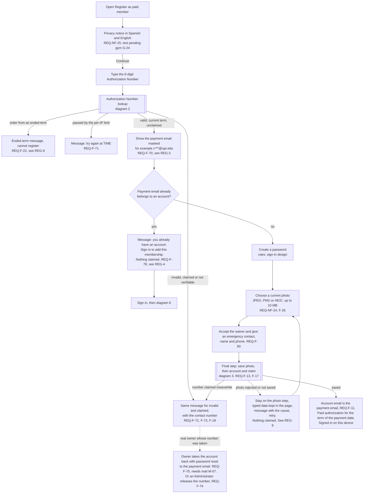
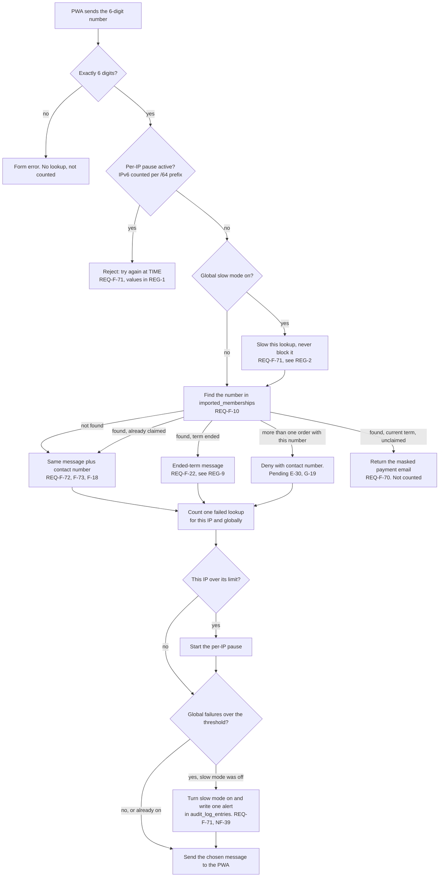
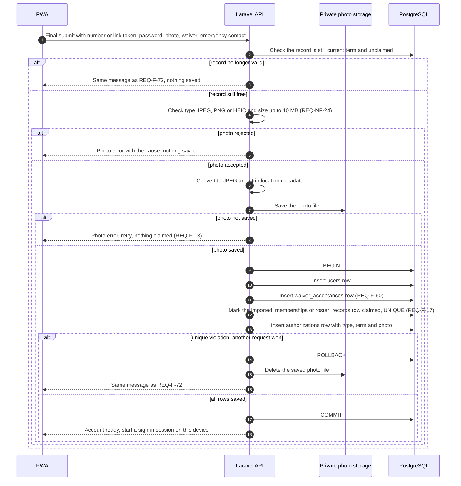
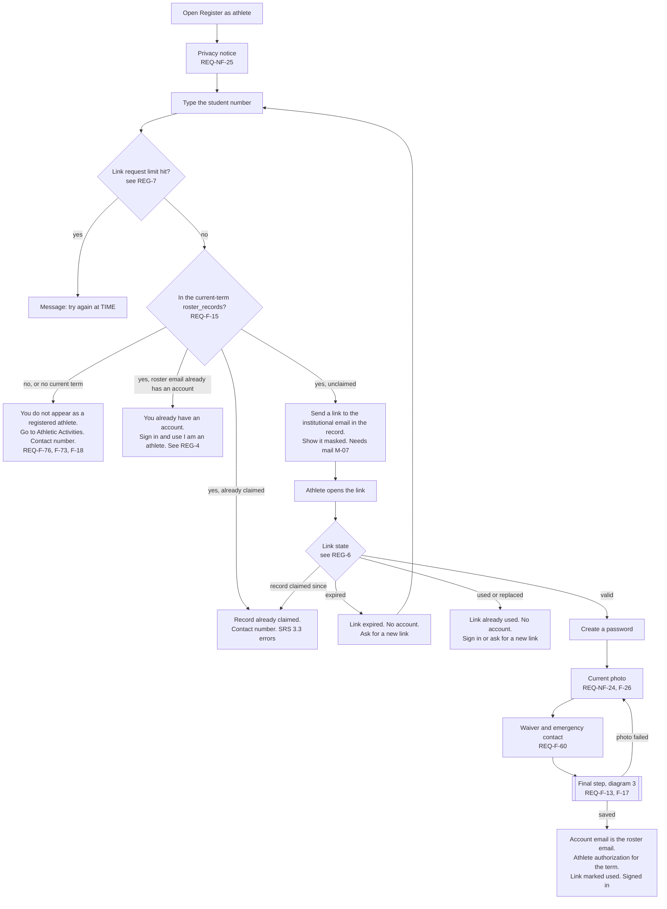
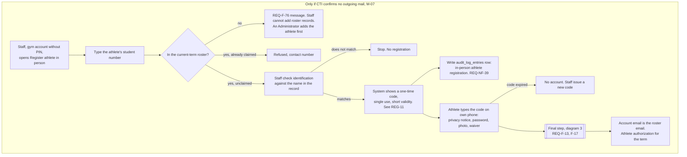
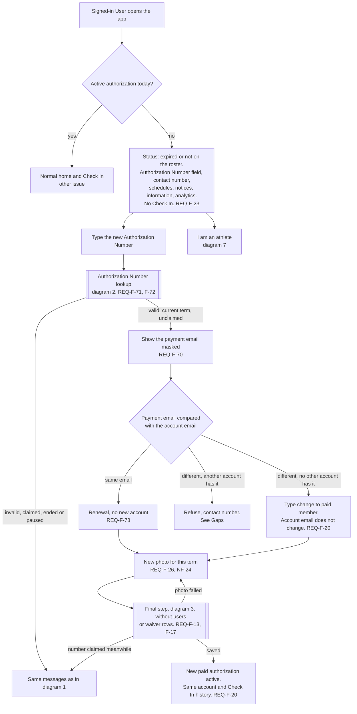
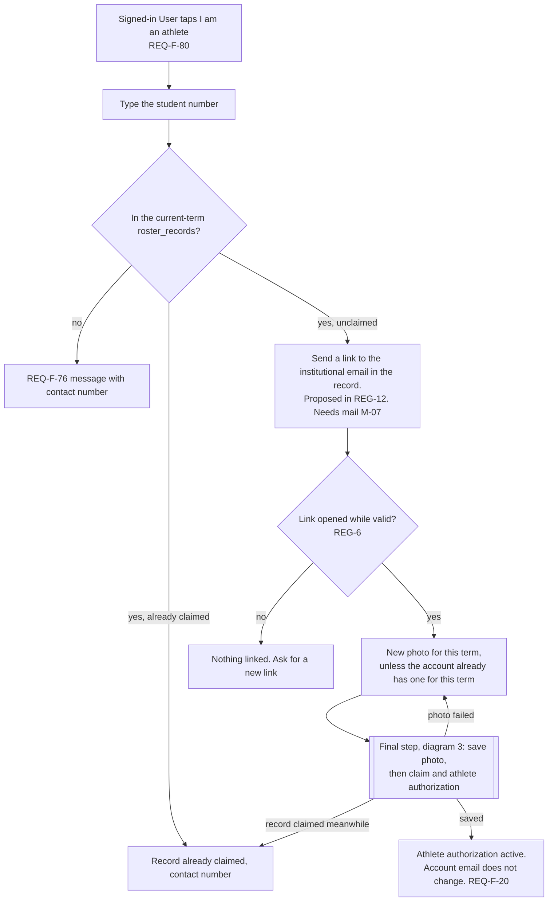
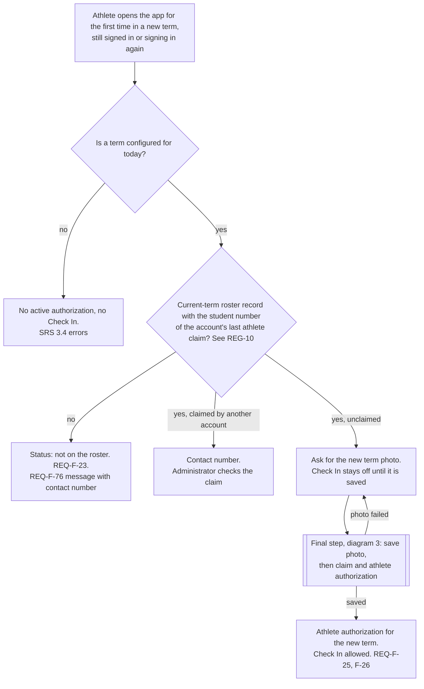
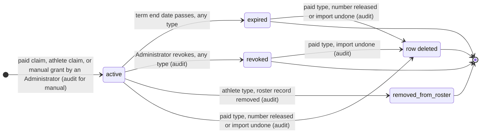

# Registration and authorization flows

These diagrams show how a person gets an account and keeps access to the gym: paid member registration, athlete registration, the in-person athlete fallback, renewal and type change inside the same account, and the states an authorization goes through. They are the base for building the registration and renewal features (issue #5). Sign in and password reset appear only as context. Screen design and texts are out of scope. Requirements come from `docs/requirements/SRS.md` v0.5, sections 3.1 to 3.4 and 3.12, plus REQ-NF-24 and REQ-NF-25. Entity names follow the logical data model in `docs/design/design-notes.md`.

Where a diagram says "see REG-N", the value or choice is a proposal in [Design decisions to confirm](#design-decisions-to-confirm). Diagrams 4 and 7 draw the recommended option.

Two pending answers touch almost every diagram:

- The contact number (REQ-F-73) is pending from the gym (G-25).
- Every email link needs CTI outgoing mail (M-07). Without mail, only diagram 5 is built for athletes, and there is no password reset.

## 1. Paid member registration

The person is not signed in. The privacy notice comes before any field. Password, photo, waiver and emergency contact stay in the page until the final step sends them in one request.

Notes: the term comes from the payment date of the order (REQ-F-22). The member never types or changes the account email (REQ-F-11).

## 2. Authorization Number lookup with limits

Backend view of one lookup. Used by diagram 1 and diagram 6. The PWA sends the number as soon as 6 digits are typed (REQ-F-70).

Notes: a claimed number counts as a failure, so the reply and the counting look the same as for an invalid number (REQ-F-72). If the database cannot answer, the lookup is denied with a "try again later" message (REQ-F-18).

## 3. Final step: photo first, then account and claim

One request, used by every registration and renewal path. Renewal and type change (diagrams 6 to 8) skip the users and waiver_acceptances rows. For athletes the claimed row is in roster_records and the link is marked used in the same transaction.

Notes: the photo is stored with the authorization, not the account (design-notes.md). The waiver is stored with the full name and email from the payment record or the roster (REQ-F-60).

## 4. Athlete registration by email link

Drawn with the recommended option of REG-5: only the student number is asked before the link; password, photo and waiver come after the link is opened. Needs CTI outgoing mail (M-07).

Notes: the account exists only after the final step that follows opening the link (REQ-F-15). The final step checks the link again, so a link that expires while the form is open creates no account.

## 5. In-person athlete registration by Staff

**Only if CTI confirms there is no outgoing mail (M-07).** Otherwise this flow is not built (REQ-F-77, E-41). Drawn with the recommended option of REG-11.

## 6. Renewal and type change with a new Authorization Number

The User is signed in and has no active authorization (REQ-F-23). A paid member renews this way (REQ-F-78). An athlete who becomes a paid member uses the same field (REQ-F-20).

Notes: the photo cannot be replaced while an authorization is active (REQ-F-26). The waiver is not asked again (REQ-F-60).

## 7. "I am an athlete" inside the account

Drawn with the recommended option of REG-12, which adds an email link that REQ-F-80 does not have today. See Gaps.

## 8. Athlete in a new term

An athlete on the new-term roster has nothing to renew (REQ-F-25). The app asks for the new photo before Check In (REQ-F-26, E-38). Drawn with the recommended option of REG-10. A paid member in a new term just sees "expired" and uses diagram 6.

## 9. Authorization states

One row in authorizations. Types: paid, athlete, manual. Transitions marked "audit" write an audit_log_entries row (REQ-NF-39). Claims made by the User are not gym actions and write no audit entry.

| Transition | Rule |
|---|---|
| to active | Paid: diagram 1 or 6 (REQ-F-13, F-78). Athlete: diagram 4, 5, 7 or 8 (REQ-F-15, F-25, F-77, F-80). Manual: REQ-F-87, with reason (Proposed), audit |
| active to expired | End of the term, whatever the purchase date (REQ-F-22). Backend time decides (REQ-NF-01). Account stays, Check In off (REQ-F-23). No audit entry |
| active to revoked | Administrator revokes by hand (REQ-F-87). Audit with reason |
| active to removed_from_roster | Administrator removes the athlete from the roster (REQ-F-49, F-22). Gym ID stops being valid at once; the current facility session keeps counting until it ends. Audit (roster change) |
| to row deleted, release | REQ-F-74. If this claim created the account, the account and its photo are deleted too. If it was added to an existing account, only this authorization goes. The number can be claimed again. Audit |
| to row deleted, import undone | REQ-F-31. Undo deletes the import's imported_memberships rows and the authorizations that depend on them. Accounts and photos stay (Proposed). Audit |

Notes: whether "expired" is a stored status or computed from the term end date is left to the data model issue. Manual and athlete authorizations have no imported membership, so release and import undo do not apply to them.

## Design decisions to confirm

All are **Proposed**. The team decides in the PR review. No standard was cited for these values because none was checked for this document.

### REG-1: Per-IP limit on failed Authorization Number lookups (REQ-F-71)

How many guesses one IP gets. The chance that one guess hits a valid, unclaimed, current-term number is about U / 1,000,000, where U is how many such numbers exist. U is unknown; 300 is used below only as an example.

| Option | What it means | Tradeoff |
|---|---|---|
| A | 10 failures in 15 minutes, then a 15-minute pause | Up to about 960 guesses a day per IP, about 0.3 hits a day at U = 300. Few real users ever see a pause |
| B | 5 failures in an hour, then pause until the hour ends | About 120 guesses a day per IP, about 0.04 hits a day. Easy to explain |
| C | 5 free failures, then a pause that doubles after each further 5 failures (15 min, 30 min, 1 h, ... up to 24 h). Resets after 24 hours without failures | About 35 guesses a day per IP, about 0.01 hits a day. Same idea as the growing wait of REQ-F-07, so one mechanism can serve both |

Recommendation: C. It gives the fewest guesses and a real user who mistypes 1 to 3 times never sees it. Many campus users may share one public IP, but only failures count, so a shared IP is rarely paused. In all options, IPv6 addresses are counted per /64 prefix, because one device can use many addresses inside a /64.

### REG-2: Global slow-down on failed lookups (REQ-F-71, E-53)

The global limit must never block, only slow, and must write an alert entry.

| Option | What it means | Tradeoff |
|---|---|---|
| A | While slow mode is on, the server waits N seconds before answering each lookup | Simplest. Each waiting request holds a PHP worker. A flood can fill every worker and stop the whole app, which is a block in practice |
| B | While slow mode is on, the server answers "check again in N seconds" with a signed ticket. The PWA waits and resends by itself. The server answers only tickets at least N seconds old | No worker is held while waiting. A little more code in the API and the PWA |

Proposed values for both: slow mode turns on when there are more than 100 failed lookups in 10 minutes across all IPs, N = 3 seconds, and it turns off when the count falls below the threshold. One alert entry is written each time slow mode turns on, not one per lookup. Recommendation: B. Honest limit: slowing each lookup does not stop an attacker who uses many IPs in parallel; the per-IP limit and the alert do the real work.

### REG-3: Masking format for emails (REQ-F-70)

| Option | Example for `carlos@upr.edu` | Tradeoff |
|---|---|---|
| A | First character, always 3 stars, full domain: `c***@upr.edu` | Matches the SRS example. Fixed stars hide the length. The domain helps the member recognize the email |
| B | First and last character, full domain: `c***s@upr.edu` | Easier to recognize; shows one more character |
| C | Also mask the domain: `c***@u***.edu` | Shows less; harder to recognize |

Recommendation: A, also for the institutional email shown after the athlete link is sent. A one-character local part shows only `*@domain`.

### REG-4: Record whose email already has an account, person not signed in (REQ-F-78)

| Option | What it means | Tradeoff |
|---|---|---|
| A | Show the masked email and "you already have an account, sign in to add this membership". Nothing is claimed until the person signs in and runs diagram 6 | Keeps one path for renewals, and the new term photo is taken in the same step (REQ-F-26). One more step for the member |
| B | Attach the authorization right away without sign in. Ask for the photo at the next app open before Check In | Fewer steps. Safe, because access goes to the payer's account, but it needs an "active without photo" case that every Check In path must check |

Recommendation: A. The same rule applies to athletes: if the roster email already has an account, the athlete signs in and uses "I am an athlete" (diagram 4).

### REG-5: Where athletes enter password, photo and waiver (REQ-F-15)

| Option | What it means | Tradeoff |
|---|---|---|
| A | Before the link: the athlete fills everything, the server keeps it as a pending registration, and opening the link creates the account | One sitting. But anyone can type an athlete's student number, which is not secret, and set the password and photo. If the real athlete then opens the link, the account belongs to that other person. Also stores photos of people not yet checked, which needs a cleanup task |
| B | After the link: only the student number before; the page opened from the link asks for password, photo and waiver | The person who sets the password is the one who reads the institutional email. No pending personal data. The athlete may switch device between steps |

Recommendation: B. Drawn in diagram 4.

### REG-6: Athlete link validity

| Option | Validity | Tradeoff |
|---|---|---|
| A | 1 hour | Short exposure. Students who do not check institutional email right away must ask again |
| B | 24 hours | Covers checking email later the same day. The link only works for the holder of the institutional mailbox |
| C | 7 days | Fewest repeat requests; a forgotten link stays usable for a long time |

Recommendation: B. In every option the link is single use, a new link cancels the earlier one, the token is stored hashed, and it is checked again in the final step.

### REG-7: Limit on athlete link requests (not in the SRS)

| Option | What it means | Tradeoff |
|---|---|---|
| A | Per student number: at most 1 link every 5 minutes and 5 a day | Stops someone from flooding an athlete's mailbox by typing the student number |
| B | No limit, as the SRS is today | Less code. Any visitor can make the system send many emails to one athlete and spend the CTI mail quota |

Recommendation: A.

### REG-8: What the user sees when the photo or the final step fails (REQ-F-13)

| Option | What it means | Tradeoff |
|---|---|---|
| A | One final request with everything (diagram 3). On failure the user stays on the photo step with the typed data kept in the page, sees the cause (wrong type, over 10 MB, could not be read, server error) and retries. Closing the page loses the data; the number stays free | Simplest. Nothing stored on the server until the end. The photo error shows only at the end |
| B | Upload the photo first to a temporary area, get a reference, and send the rest with that reference at the end | Photo errors show earlier. Needs temporary files and a task that deletes abandoned ones |

Recommendation: A. The password is kept only in page memory, never in browser storage.

### REG-9: Message for an Authorization Number from an ended term (SRS 3.2 errors)

| Option | What it means | Tradeoff |
|---|---|---|
| A | Same message as REQ-F-72 | Reveals nothing. A member with an old receipt does not learn why |
| B | Specific message: this membership was for a term that ended, buy a new one, plus the contact number | Helps real members. It confirms that an old number existed, which gives a guesser nothing to claim |

Recommendation: B. In both options it counts as a failed lookup (diagram 2).

### REG-10: How an athlete's new-term roster record reaches the account (REQ-F-25, F-26)

| Option | What it means | Tradeoff |
|---|---|---|
| A | At the first app open in the new term, match the current-term roster record by the student number of the account's last athlete claim, then claim it together with the new photo (diagram 3) | Same atomic step as registration. That student number was proven by the email link before. An athlete who never opens the app has no new-term authorization |
| B | When the Administrator saves the new roster, link existing accounts by student number automatically, with no photo yet; Check In stays off until the photo is uploaded | Staff see the athlete as authorized even before the athlete opens the app. Adds an "active without photo" case |
| C | Match by institutional email equal to the account email | Fails for accounts whose email is a payment email (REQ-F-20), and when the roster email changes |

Recommendation: A. Drawn in diagram 8. See the Gaps note about Staff-assisted Check In.

### REG-11: In-person athlete registration, where the athlete enters the data (REQ-F-77)

| Option | What it means | Tradeoff |
|---|---|---|
| A | The athlete types password, picks a photo and accepts the waiver on the front desk device | No extra code. The password is typed on a shared computer, and the front desk is a desktop (G-06), so taking a current photo is hard |
| B | After checking identification, Staff get a one-time code (single use, valid 15 minutes). The athlete enters it on their own phone and finishes there | Photo from the phone camera, password on the athlete's own device. Needs the code and its expiry |

Recommendation: B. Only matters if CTI confirms there is no mail.

### REG-12: Email link for "I am an athlete" (REQ-F-80)

| Option | What it means | Tradeoff |
|---|---|---|
| A | Send a link to the institutional email in the roster record; link the record only when it is opened (same proof as REQ-F-15) | Closes the hole described in Gaps. Needs mail (M-07); without mail, this would go through Staff as in diagram 5. Requires an SRS change to REQ-F-80 |
| B | Link right away when the student number is found and unclaimed, as REQ-F-80 says today | Fewer steps. Any signed-in User can take any athlete's record by typing a student number |

Recommendation: A. Drawn in diagram 7.

## Gaps and questions

1. **REQ-F-80 lets anyone take an athlete's record.** SRS 3.3 says the student number is not secret, which is why REQ-F-15 needs an email link. REQ-F-80 links a roster record to any signed-in account with only the student number. A paid member could get free athlete access and block the real athlete. Proposal: REG-12.
2. **"First time they sign in during a new term" (REQ-F-26, E-38) does not fit REQ-F-03.** Sign-in sessions have no inactivity timeout, so an athlete may never sign in again. The diagrams use "first time the app is opened in the new term".
3. **REQ-F-78 does not say what happens when the person is not signed in**, and the athlete flow has no matching rule for a roster email that already has an account. Proposal: REG-4.
4. **A signed-in User enters a number whose payment email belongs to another account.** Neither REQ-F-20 nor REQ-F-78 covers it. Diagram 6 refuses it with the contact number. Team to confirm.
5. **REQ-F-75 does not cover every case.** When a signed-in User with a different email attaches a number (type change, REQ-F-20), the real owner cannot use password reset, because the payment email is not that account's email. Only the release by an Administrator (REQ-F-74) helps.
6. **Two orders with the same Authorization Number** (REQ-F-10, E-30, G-19). Diagram 2 denies the lookup with the contact number until E-30 is answered.
7. **No limit on athlete link requests.** Proposal: REG-7.
8. **Two active authorizations in the same term.** REQ-F-23 shows the Authorization Number field only without an active authorization, but REQ-F-80 has no such condition. Can a paid member with an active authorization also become an athlete in the same term? If yes, which one does Check In use?
9. **Deleted authorizations and analytics.** Release (REQ-F-74) and import undo (REQ-F-31) delete authorizations. In the data model a facility session points only to the User. The paid versus athlete split in REQ-F-61 (e) then needs the facility session to keep the authorization type it was created with. Question for the data model issue.
10. **Staff-assisted Check In for an athlete in a new term** (REQ-F-46) who has not opened the app: with REG-10 option A there is no new-term authorization or photo yet, so Staff cannot check them in. Gym to say if that is acceptable.
11. **Athlete removed from the roster by mistake and added back** (REQ-F-49): the old authorization stays removed_from_roster. With REG-10 option A the athlete gets a new one at the next app open. Not stated in the SRS.
12. **Link tokens and one-time codes have no entity** in the logical data model (design-notes.md). The athlete link (REQ-F-15) and the REG-11 code need a place to be stored, hashed. Question for the data model issue.

## Traceability

| Requirement | Where it appears |
|---|---|
| REQ-F-10 | 2. Authorization Number lookup |
| REQ-F-11 | 1. Paid member registration |
| REQ-F-13 | 1, 3, 4, 5, 6, 7, 8 (final step) |
| REQ-F-15 | 4. Athlete registration by email link; 9. Authorization states |
| REQ-F-18 | 1. Paid member registration; 2. Lookup; 4. Athlete registration |
| REQ-F-20 | 6. Renewal and type change; 7. "I am an athlete" |
| REQ-F-22 | 1. Paid member registration; 2. Lookup (ended term); 9. Authorization states |
| REQ-F-23 | 6. Renewal and type change; 8. Athlete in a new term; 9. Authorization states |
| REQ-F-25 | 8. Athlete in a new term; 9. Authorization states |
| REQ-F-26 | 1, 4, 6, 7, 8 (photo per term) |
| REQ-F-60 | 1. Paid member registration; 3. Final step; 4. Athlete registration; 5. In-person (waiver on the phone) |
| REQ-F-70 | 1. Paid member registration; 2. Lookup; 6. Renewal |
| REQ-F-71 | 2. Lookup; 1 and 6 (pause message) |
| REQ-F-72 | 1. Paid member registration; 2. Lookup; 3. Final step |
| REQ-F-73 | 1, 2, 4, 7, 8 (contact number, pending G-25) |
| REQ-F-74 | 1. Paid member registration (note); 9. Authorization states |
| REQ-F-75 | 1. Paid member registration (dotted path, needs M-07) |
| REQ-F-76 | 4. Athlete registration; 5. In-person; 7. "I am an athlete"; 8. Athlete in a new term |
| REQ-F-77 | 5. In-person athlete registration by Staff |
| REQ-F-78 | 1. Paid member registration; 6. Renewal and type change; 9. Authorization states |
| REQ-F-80 | 7. "I am an athlete"; 9. Authorization states |
| REQ-NF-24 | 1. Paid member registration; 3. Final step; 4, 6 |
| REQ-NF-25 | 1. Paid member registration; 4. Athlete registration; 5. In-person |
| Also shown: REQ-F-17, F-31, F-49, F-87, NF-39 | 3. Final step (F-17); 9. Authorization states (F-31, F-49, F-87, NF-39); 2 and 5 (NF-39) |
