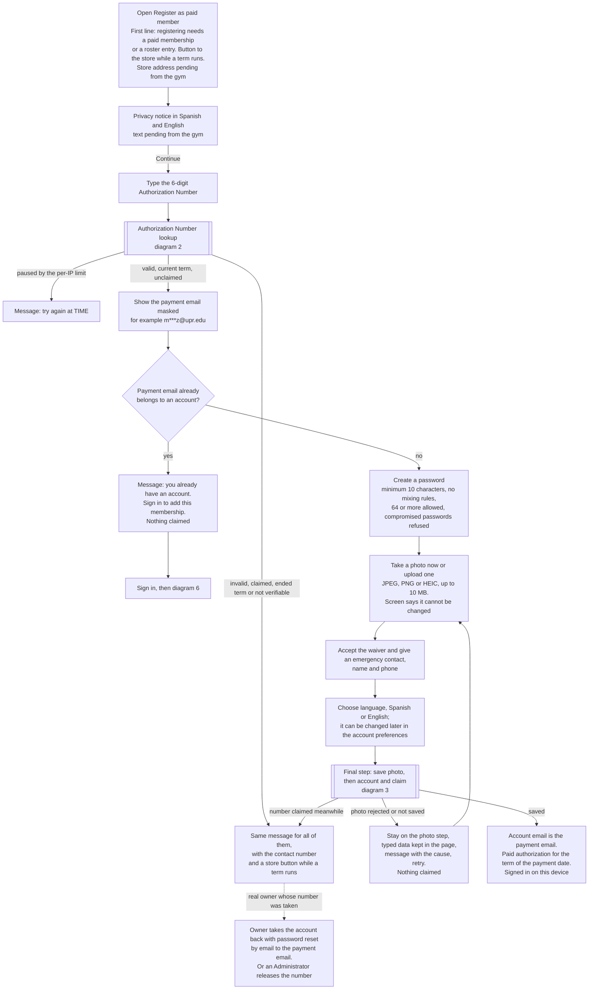
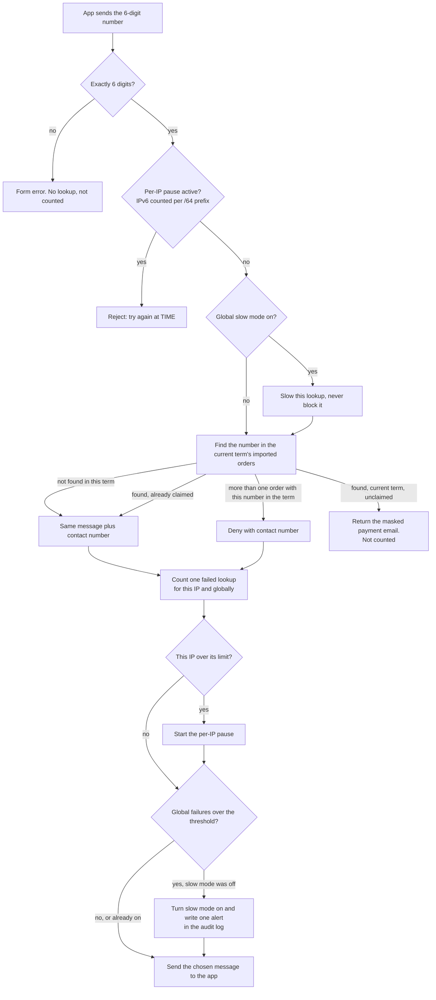
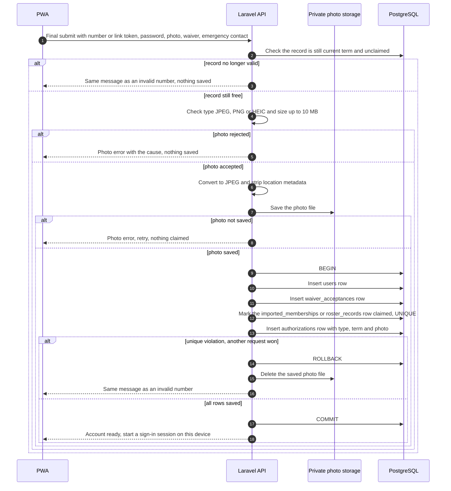
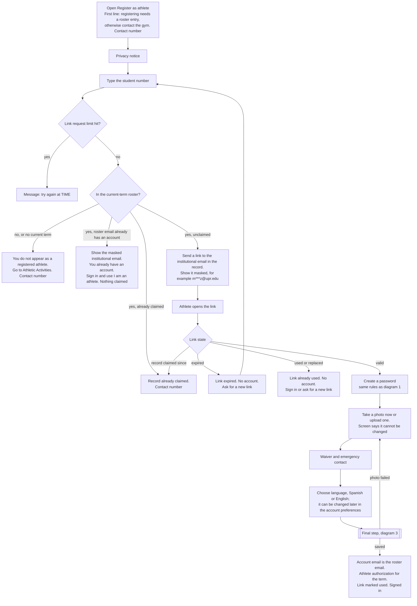
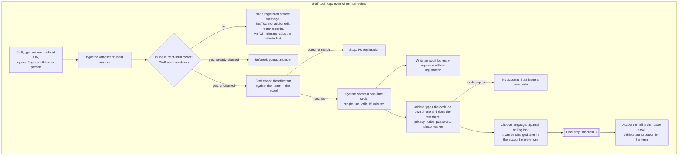
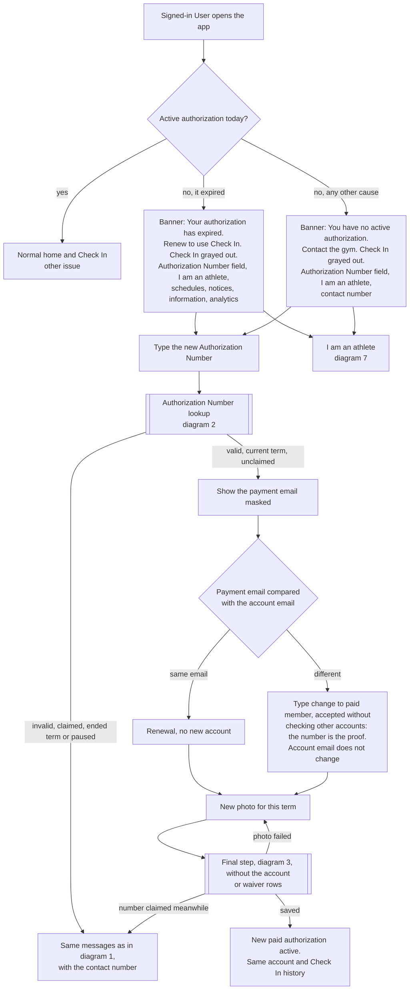
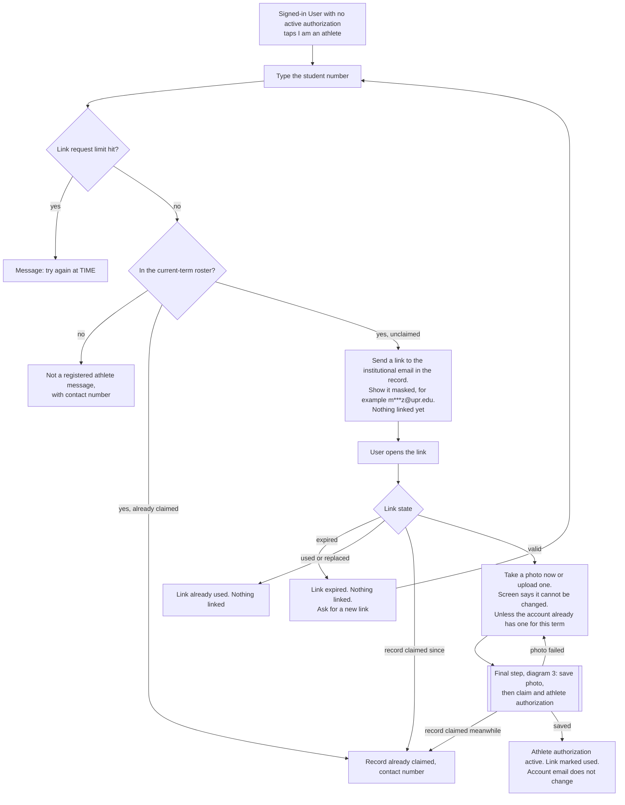
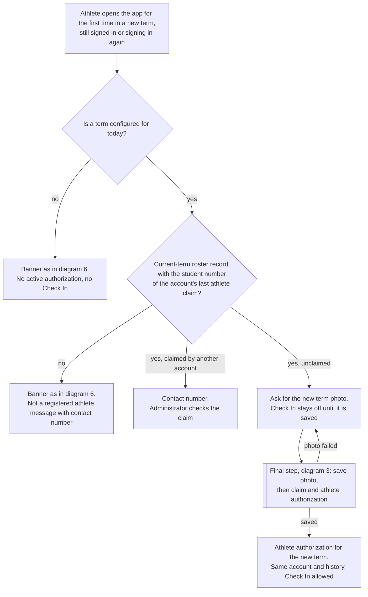
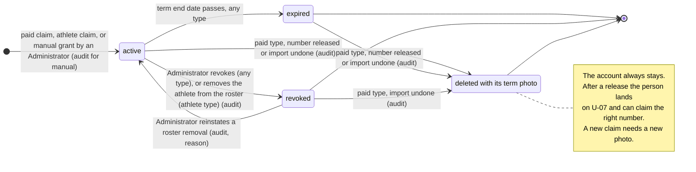

# Registration and authorization flows

These diagrams show how a person gets an account and keeps access to the gym: paid member registration, athlete registration, the in-person athlete registration by Staff, renewal and type change inside the same account, and the states an authorization goes through. They are the base for building the registration and renewal features (issue #5). Sign in and password reset appear only as context. Screen design and texts are out of scope. Requirements come from `docs/requirements/SRS.md` v0.7, with the team decisions up to E-99, sections 3.1 to 3.4 and 3.12, plus REQ-NF-24 and REQ-NF-25. Entity names follow the logical data model in `docs/design/design-notes.md`.

The diagrams use plain words only. Requirement IDs and decision codes are in the "About this diagram" paragraph under each diagram and in [Traceability](#traceability). Where a diagram draws a decision, that paragraph names the item in [Design decisions to confirm](#design-decisions-to-confirm). The diagrams draw the decided options. The limits and the link validity (REG-1, REG-2, REG-6) are still pending.

Two answers are still pending and touch almost every diagram:

- The contact number (REQ-F-73) is pending from the gym (G-25).
- The address of the store page where members pay is pending from the gym. The welcome screen and the paid member registration screen offer a button to it while a term runs (Proposed, E-92, E-96). The athlete registration screen has none.

Mail is assumed available (E-61). CTI described a path: the server runs a mail service (CTI suggests Postfix) and sends through CTI's mail gateway once CTI authorizes the VM (M-07, answered in principle). The authorization is still to be requested, and SPF and DKIM were not discussed. If CTI does not authorize the VM, the fallback is an external provider, which needs approval (M-11). Every email link depends on it: athlete registration (diagram 4), "I am an athlete" (diagram 7, E-58) and password reset.

The welcome screen (N-01) and the sign-in screen (N-02) are always in Spanish, because no account exists yet. The person chooses the language when the account is created (E-103, E-64). After sign in, the account language applies, so a User with an English account sees these two screens in Spanish while signed out.

## Diagrams

### 1. Paid member registration

**Type:** User flow. **Use it to:** build the paid member registration screens and their error messages.

**About this diagram:** The person is not signed in; the privacy notice (REQ-NF-25, text pending G-24) comes before any field, and password, photo, waiver and emergency contact stay in the page until the final step sends them in one request (REQ-F-13, F-17, F-60, NF-24, F-26). Messages follow REQ-F-72, F-73, F-18 (invalid or claimed), REQ-F-22 with REG-9 (an ended-term number gets the same message), REQ-F-71 (pause), REQ-F-70 with REG-3 (masking), REQ-F-78 with REG-4 (email already has an account) and REG-8 (photo failure). The first line is E-92 and the store button (Proposed) is E-96; the photo step is E-69; the password rules are E-63; the language step is E-64, and the screens before it are in Spanish (E-103). The dotted path is REQ-F-75 (needs mail) and REQ-F-74.

Notes: the term comes from the payment date of the order (REQ-F-22). The member never types or changes the account email (REQ-F-11). The welcome screen and the screens up to the language step are in Spanish, because the account language does not exist yet (E-103). The store button (Proposed) appears only while a term runs, because the store sells only then (G-26, assumed, the gym still confirms). The password rule has no mixing rules and allows at least 64 characters. NIST SP 800-63B-4 asks for at least 15 characters for single-factor passwords; the team chose 10 as a documented deviation for phone use. The compromised-password check is an external call that sends only part of a hash. SRS 2.4 and REQ-NF-51 say so (E-98), and a test must cover the case where that service does not answer (#30).

Note on message M1: When a person paid but the receipt never arrived, the message also gives the procedure (call, visit, bring the receipt) in words the gym writes, with the contact number (G-25). Whether Staff may add the person by hand after seeing the receipt is the gym's decision (G-09); today only the Administrator can (E-35, REQ-F-87).

### 2. Authorization Number lookup with limits

**Type:** System flow. **Use it to:** write the backend lookup check, its per-IP and global limits, and their tests.

**About this diagram:** Backend view of one lookup, used by diagrams 1 and 6. The PWA sends the number as soon as 6 digits are typed (REQ-F-70); the lookup reads the imported_memberships rows of the current term only (REQ-F-10, E-71), the limits are REQ-F-71 with values in REG-1 and REG-2 (pending), and the alert goes to audit_log_entries (REQ-NF-39). The Authorization Number is unique per term (E-71).

Notes: a claimed number counts as a failure, so the reply and the counting look the same as for an invalid number (REQ-F-72). A number from an ended term is simply not found, because the lookup never reads old terms (E-71, REG-9). It gets the same message and counts as a failure. If the database cannot answer, the lookup is denied with a "try again later" message (REQ-F-18). When two orders of the same term share a number, the lookup is denied with the contact number, and the import rejects the second order with that number (E-71). Still pending: someone opens the sample Export Orders file to check its columns, how the term is taken from the payment date, and whether two orders in one file share a number.

### 3. Final step: photo first, then account and claim

**Type:** Sequence diagram. **Use it to:** write the final save endpoint, its transaction and the tests for photo failure and a lost race.

**About this diagram:** One request, used by every registration and renewal path (REQ-F-13, F-17, F-60, NF-24; failure messages follow REQ-F-72). Renewal, type change and "I am an athlete" (diagrams 6 to 8) skip the users and waiver_acceptances rows. For athletes the claimed row is in roster_records and the email link is marked used in the same transaction.

Notes: the photo is stored with the authorization, not the account (design-notes.md). The waiver is stored with the full name and email from the payment record or the roster (REQ-F-60). On any failure the PWA returns to the photo step with the typed data kept in the page, and the password stays only in page memory (REG-8).

### 4. Athlete registration by email link

**Type:** User flow. **Use it to:** build the athlete registration screens, the link email and their error messages.

**About this diagram:** Drawn with the decided option of REG-5 (E-69): only the student number is asked before the link; password, photo and waiver come after the link is opened and are saved together, so there is never an authorization without a photo (E-69; REQ-F-15, NF-25, NF-24, F-26, F-60). The language step is E-64, and the screens before it are in Spanish (E-103). The request limit is REG-7 (E-73) and the link rules are REG-6 (pending); messages follow REQ-F-76, F-73, F-18, SRS 3.3 errors and REG-4 (E-70). The first line is E-92. The link needs mail (assumed available, E-61).

Notes: the account exists only after the final step that follows opening the link (REQ-F-15). The final step checks the link again, so a link that expires while the form is open creates no account. Athletes do not buy a membership (REQ-F-25), so this screen has no store button (E-96). A paid member who opens it by mistake goes back to the welcome screen, which has one (E-96).

Note on message X1: Proposed: the roster exists only after the gym loads the term list, so an athlete who registers earlier gets this message. If the gym gives the date lists are ready (G-33), N-04 can say so.

Proposed: emails usually come from a no-reply address (CTI's common practice); the exact sender is open (M-07). Team proposal: each email carries the gym contact number (G-25).

### 5. In-person athlete registration by Staff

**Type:** User flow. **Use it to:** build the front desk screen and the one-time code step.

**About this diagram:** A Staff tool that stays even when mail exists (E-62, E-61). Staff do not enter any data for the person; they only generate the code and check identification. Staff see the current-term roster as a read-only list and can search it by student number, but adding, editing, removing and importing records stay Administrator only (E-59, still to be confirmed by the gym). The code is stored like the email links, in the email_links table, as a new type with hash, expiry and single use (data-model D9, decided by the owner 2026-10-19). Drawn with the decided option of REG-11 (E-62); the not-on-roster message is REQ-F-76, the audit entry is REQ-NF-39, and the final step covers REQ-F-13, F-17 and F-60. The language step is E-64, and the screens before it are in Spanish (E-103). The "only if there is no mail" condition of REQ-F-77 and E-41 no longer applies.

### 6. Renewal and type change with a new Authorization Number

**Type:** User flow. **Use it to:** build the renewal screen for a signed-in User and its error messages.

**About this diagram:** The User is signed in and has no active authorization (REQ-F-23). A person has at most one active authorization per term, and a revoked one does not block a new grant or claim in the same term (E-68, E-94). So "I am an athlete" and the Authorization Number field show only in this state. The two banners (E-67) cover expired, and every other cause: revoked, import undone, number released or no current term. Both banners show the Authorization Number field (E-97), so a person whose authorization an import undo or a release removed can claim a number again (REQ-F-31); "I am an athlete" shows under both banners (E-100). A paid member renews this way (REQ-F-78), and an athlete who becomes a paid member uses the same field (REQ-F-20); the lookup is REQ-F-70, F-71, F-72 and the final step is REQ-F-13, F-17, F-26, NF-24.

Notes: the photo cannot be replaced while an authorization is active (REQ-F-26). The waiver is not asked again (REQ-F-60). The banner texts are drafts; the final wording is written in the wireframes (REQ-F-23, E-67). Under the other-cause banner, a number that cannot be claimed gets the same message with the contact number (E-97). A signed-in User who types a number whose payment email belongs to another account is accepted (E-70): the number reached an email the person gave, so having it is the proof. The risk is that this holds only if numbers cannot be guessed (E-30), so the lookup limits of diagram 2 still apply. A real owner who finds the number already claimed contacts the gym, and an Administrator can release it (REQ-F-74). A release never deletes the account, even when the number was its only authorization: the person signs in, lands on this screen under the "no active authorization" banner, and can claim the correct number (E-106).

### 7. "I am an athlete" inside the account

**Type:** User flow. **Use it to:** build the "I am an athlete" screen, its link email and its error messages.

**About this diagram:** Decided in E-58 (REG-12): typing the student number links nothing; the roster record is linked only when the link sent to its institutional email is opened (REQ-F-80, REQ-F-15). The link works like the athlete registration link (single use, expires, stored hashed, requests limited; REG-7 is decided, REG-6 is pending) and needs mail (assumed available, E-61). The photo is saved together with the claim on the link page, so there is never an authorization without a photo (E-69). The account already has its password and waiver, so the link page asks only for the photo. Messages follow REQ-F-76 and F-73; the account email does not change (REQ-F-20).

Proposed: emails usually come from a no-reply address (CTI's common practice); the exact sender is open (M-07). Team proposal: each email carries the gym contact number (G-25).

### 8. Athlete in a new term

**Type:** User flow. **Use it to:** build the new-term photo prompt and the check that matches the new roster record.

**About this diagram:** An athlete on the new-term roster has nothing to renew (REQ-F-25); the app asks for the new photo before Check In (REQ-F-26, E-38). Drawn with the decided option of REG-10 (E-69): at the first app open in the new term, the roster is looked up by the student number of the account's last athlete claim. The account and its history are kept (REQ-F-20). The no-term case follows SRS 3.4 errors and the not-on-roster case REQ-F-23 and F-76. A paid member in a new term just sees "expired" and uses diagram 6.

### 9. Authorization states

**Type:** State diagram. **Use it to:** write the authorization status rules, the release and import undo actions, and their tests.

**About this diagram:** One row in authorizations; types are paid, athlete and manual. A person has at most one active authorization per term (E-68, E-94). Transitions marked "audit" write an audit_log_entries row (REQ-NF-39); claims made by the User are not gym actions and write no audit entry. Release (REQ-F-74) and import undo (REQ-F-31) delete the authorization together with its term photo, row and file (E-57). The account always stays, also when the deleted authorization was its only one (E-106). Removing an athlete from the roster does not delete anything: the authorization becomes revoked with the reason "removed from roster" (E-93). An Administrator can undo a mistaken removal with Reinstate (E-95).

| Transition | Rule |
|---|---|
| to active | Paid: diagram 1 or 6 (REQ-F-13, F-78). Athlete: diagram 4, 5, 7 or 8 (REQ-F-15, F-25, F-77, F-80). Manual: REQ-F-87, audit, reason required as free text of 10 characters or more (E-86). A manual grant is rejected when the person already has an active authorization for the term (E-68, E-94). The User gives the term photo before Check In, as an athlete does (E-69). Reinstate also leads here, see the reinstate row |
| active to expired | End of the term, whatever the purchase date (REQ-F-22). When an Administrator edits the term, the authorization end date follows the new term end (E-88). Backend time decides (REQ-NF-01). Account stays, Check In off (REQ-F-23). No audit entry |
| active to revoked | Administrator revokes by hand (REQ-F-87). Audit, reason required (E-86) |
| active to revoked, removed from roster | Administrator removes the athlete from the roster (REQ-F-49, F-22). The reason is "removed from roster" (E-93). Gym ID stops being valid at once; the current facility session keeps counting until it ends, and there is no new Check In. Audit (roster change) |
| revoked to active, reinstate | Administrator uses Reinstate on A-05 for an athlete removed from the roster by mistake (E-95). The revoked authorization goes back to active. Audit entry. The reason is required, free text of 10 characters or more, the same rule as a manual grant (E-86, E-95). Reinstate is refused with a message when the person already has an active authorization in that term (E-94). The athlete does not claim the record again |
| to deleted, release | REQ-F-74. Only that authorization and its term photo (row and file) are deleted. The account and history always stay (E-87, E-57), also when the claim created the account and it was the account's only authorization (E-106). The person signs in, lands on U-07 and can claim the correct number (diagram 6). The number can be claimed again, with a new photo. Audit |
| to deleted, import undone | REQ-F-31, E-57. Always allowed, even after Check Ins used the authorizations; active sessions keep counting until they end (E-84). Undo deletes the import's imported_memberships rows and the authorizations that came from them, together with their term photo (row and file). It does not revert changes made to older records (E-84). Accounts stay. When the person claims again with the corrected file, they upload a new photo, as in any renewal. Audit |

Notes: the data model does not store expired: it is computed from the term end date (data-model section 2). Manual and athlete authorizations have no imported membership, so release and import undo do not apply to them.

## Design decisions to confirm

REG-1, REG-2, REG-6 and REG-14 are still **Proposed**; they wait on the owner. REG-3, REG-4, REG-5, REG-7, REG-8, REG-9, REG-10, REG-11, REG-12 and REG-13 are **Decided**. Each decided item keeps its options for the record and says which option was chosen and why. No standard was cited for the pending values because none was checked for this document.

### REG-1: Per-IP limit on failed Authorization Number lookups (REQ-F-71)

**Pending.** How many guesses one IP gets. The chance that one guess hits a valid, unclaimed, current-term number is about U / 1,000,000, where U is how many such numbers exist. U is unknown; 300 is used below only as an example.

| Option | What it means | Tradeoff |
|---|---|---|
| A | 10 failures in 15 minutes, then a 15-minute pause | Up to about 960 guesses a day per IP, about 0.3 hits a day at U = 300. Few real users ever see a pause |
| B | 5 failures in an hour, then pause until the hour ends | About 120 guesses a day per IP, about 0.04 hits a day. Easy to explain |
| C | 5 free failures, then a pause that doubles after each further 5 failures (15 min, 30 min, 1 h, ... up to 24 h). Resets after 24 hours without failures | About 35 guesses a day per IP, about 0.01 hits a day. Same idea as the growing wait of REQ-F-07, so one mechanism can serve both |

Recommendation: C. It gives the fewest guesses and a real user who mistypes 1 to 3 times never sees it. Many campus users may share one public IP, but only failures count, so a shared IP is rarely paused. In all options, IPv6 addresses are counted per /64 prefix, because one device can use many addresses inside a /64.

### REG-2: Global slow-down on failed lookups (REQ-F-71, E-53)

**Pending.** The global limit must never block, only slow, and must write an alert entry.

| Option | What it means | Tradeoff |
|---|---|---|
| A | While slow mode is on, the server waits N seconds before answering each lookup | Simplest. Each waiting request holds a PHP worker. A flood can fill every worker and stop the whole app, which is a block in practice |
| B | While slow mode is on, the server answers "check again in N seconds" with a signed ticket. The PWA waits and resends by itself. The server answers only tickets at least N seconds old | No worker is held while waiting. A little more code in the API and the PWA |

Proposed values for both: slow mode turns on when there are more than 100 failed lookups in 10 minutes across all IPs, N = 3 seconds, and it turns off when the count falls below the threshold. One alert entry is written each time slow mode turns on, not one per lookup. Recommendation: B. Honest limit: slowing each lookup does not stop an attacker who uses many IPs in parallel; the per-IP limit and the alert do the real work.

### REG-3: Masking format for emails (REQ-F-70)

**Decided (E-72): B.** The mask shows the first and last letter of the part before the @, for example `m***z@upr.edu`. It also applies to the institutional email shown after the athlete link is sent. The earlier recommendation was A.

| Option | Example for `carlos@upr.edu` | Tradeoff |
|---|---|---|
| A | First character, always 3 stars, full domain: `c***@upr.edu` | Matches the SRS example. Fixed stars hide the length. The domain helps the member recognize the email |
| B | First and last character, full domain: `c***s@upr.edu` | Easier to recognize; shows one more character |
| C | Also mask the domain: `c***@u***.edu` | Shows less; harder to recognize |

How a local part of one or two characters is masked is not decided yet.

### REG-4: Record whose email already has an account, person not signed in (REQ-F-78)

**Decided (E-70): A.** Show the masked email and "you already have an account, sign in to add it". Nothing is claimed. The same rule applies to athletes. Why: it is consistent with E-69, so there is never an authorization without a photo.

| Option | What it means | Tradeoff |
|---|---|---|
| A | Show the masked email and "you already have an account, sign in to add this membership". Nothing is claimed until the person signs in and runs diagram 6 | Keeps one path for renewals, and the new term photo is taken in the same step (REQ-F-26). One more step for the member |
| B | Attach the authorization right away without sign in. Ask for the photo at the next app open before Check In | Fewer steps. Safe, because access goes to the payer's account, but it needs an "active without photo" case that every Check In path must check |

For athletes, if the roster email already has an account, the athlete signs in and uses "I am an athlete" (diagram 4).

### REG-5: Where athletes enter password, photo and waiver (REQ-F-15)

**Decided (E-69): B.** Only the student number before the link; the page opened from the link asks for password, photo and waiver. This follows from E-69 (everything is saved together on the link page) and the screen map draws it the same way; the owner did not answer it directly. Why: the person who sets the password is the one who reads the institutional email.

| Option | What it means | Tradeoff |
|---|---|---|
| A | Before the link: the athlete fills everything, the server keeps it as a pending registration, and opening the link creates the account | One sitting. But anyone can type an athlete's student number, which is not secret, and set the password and photo. If the real athlete then opens the link, the account belongs to that other person. Also stores photos of people not yet checked, which needs a cleanup task |
| B | After the link: only the student number before; the page opened from the link asks for password, photo and waiver | The person who sets the password is the one who reads the institutional email. No pending personal data. The athlete may switch device between steps |

Drawn in diagram 4.

### REG-6: Athlete link validity

**Pending.**

| Option | Validity | Tradeoff |
|---|---|---|
| A | 1 hour | Short exposure. Students who do not check institutional email right away must ask again |
| B | 24 hours | Covers checking email later the same day. The link only works for the holder of the institutional mailbox |
| C | 7 days | Fewest repeat requests; a forgotten link stays usable for a long time |

Recommendation: B. In every option the link is single use, a new link cancels the earlier one, the token is stored hashed, and it is checked again in the final step.

### REG-7: Limit on athlete link requests (not in the SRS)

**Decided (E-73): A.** At most 1 link every 5 minutes and 5 a day per student number. The athlete registration and "I am an athlete" screens get a "link request limit" state. Why: it stops someone from flooding an athlete's mailbox by typing the student number.

| Option | What it means | Tradeoff |
|---|---|---|
| A | Per student number: at most 1 link every 5 minutes and 5 a day | Stops someone from flooding an athlete's mailbox by typing the student number |
| B | No limit, as the SRS is today | Less code. Any visitor can make the system send many emails to one athlete and spend the CTI mail quota |

### REG-8: What the user sees when the photo or the final step fails (REQ-F-13)

**Decided (owner, 2026-10-17): A.** One submit at the end. On failure the person returns to the photo step with the typed data kept in the page, sees the cause and retries. Closing the page loses the data, and the number stays free. The password is kept only in page memory, never in browser storage. Why: it is the simplest option and nothing is stored on the server until the end.

| Option | What it means | Tradeoff |
|---|---|---|
| A | One final request with everything (diagram 3). On failure the user stays on the photo step with the typed data kept in the page, sees the cause (wrong type, over 10 MB, could not be read, server error) and retries. Closing the page loses the data; the number stays free | Simplest. Nothing stored on the server until the end. The photo error shows only at the end |
| B | Upload the photo first to a temporary area, get a reference, and send the rest with that reference at the end | Photo errors show earlier. Needs temporary files and a task that deletes abandoned ones |

### REG-9: Message for an Authorization Number from an ended term (SRS 3.2 errors)

**Decided (E-71): A.** The same message as an invalid or already claimed number. The lookup is limited to the current term's imported orders. The message can still carry the contact number and a button to the store while a term runs (Proposed, E-92, E-96). Why: the system should not keep track of every number ever used. In a new term the 6-digit numbers can repeat, so a number that is not valid now is simply not valid.

| Option | What it means | Tradeoff |
|---|---|---|
| A | Same message as REQ-F-72 | Reveals nothing. A member with an old receipt does not learn why |
| B | Specific message: this membership was for a term that ended, buy a new one, plus the contact number | Helps real members. It confirms that an old number existed, which gives a guesser nothing to claim |

In both options it counts as a failed lookup (diagram 2).

### REG-10: How an athlete's new-term roster record reaches the account (REQ-F-25, F-26)

**Decided (E-69): A.** At the first app open in the new term, look up the current-term roster by the student number of the account's last athlete claim and ask for the new photo before Check In. Why: no returning User may lose their visit history across terms, and A keeps the same account and history. Option C can split accounts.

| Option | What it means | Tradeoff |
|---|---|---|
| A | At the first app open in the new term, match the current-term roster record by the student number of the account's last athlete claim, then claim it together with the new photo (diagram 3) | Same atomic step as registration. That student number was proven by the email link before. An athlete who never opens the app has no new-term authorization |
| B | When the Administrator saves the new roster, link existing accounts by student number automatically, with no photo yet; Check In stays off until the photo is uploaded | Staff see the athlete as authorized even before the athlete opens the app. Adds an "active without photo" case |
| C | Match by institutional email equal to the account email | Fails for accounts whose email is a payment email (REQ-F-20), and when the roster email changes |

Drawn in diagram 8. See the Gaps note about Staff-assisted Check In.

### REG-11: In-person athlete registration, where the athlete enters the data (REQ-F-77)

**Decided (E-62): B.** After checking identification, Staff generate a one-time code (single use, valid 15 minutes). The athlete finishes everything else on their own phone: password, photo and waiver. Staff do not fill in data for the person. The tool stays even when mail exists (E-62, E-61). Why: the photo comes from the phone camera and the password is typed on the athlete's own device.

| Option | What it means | Tradeoff |
|---|---|---|
| A | The athlete types password, picks a photo and accepts the waiver on the front desk device | No extra code. The password is typed on a shared computer, and the front desk is a desktop (G-06), so taking a current photo is hard |
| B | After checking identification, Staff get a one-time code (single use, valid 15 minutes). The athlete enters it on their own phone and finishes there | Photo from the phone camera, password on the athlete's own device. Needs the code and its expiry |

### REG-12: Email link for "I am an athlete" (REQ-F-80)

**Decided (E-58):** the system sends a link to the institutional email in the roster record and links the record only when the link is opened, with the same link mechanism as athlete registration; it needs outgoing mail, which is assumed available (E-61). Drawn in diagram 7.

### REG-13: Language of the welcome and sign-in screens

**Decided (E-103).** The welcome screen (N-01) and the sign-in screen (N-02) are always in Spanish. The person chooses the language in the language step when the account is created (E-64). After sign in, the account language applies. Why: no account, and so no language, exists before that step. A User with an English account sees these two screens in Spanish while signed out. Drawn in diagrams 1, 4 and 5.

### REG-14: One registration number field (E-112)

**Proposed (E-112).** A: keep two paths (today). B: one field; paid members type the receipt number, athletes the student number; the system looks in the current-term roster first, then in the imported orders (CTI suggestion; a remark that most likely came from the CTI side said the current choice is fine). Tradeoffs: one screen and fewer choices; depends on number formats nobody has confirmed; a 6-digit receipt number could collide with a student number; the 'not on the roster' message (REQ-F-76) and the lookup limits would have to cover one field.

## Gaps and questions

1. **REQ-F-80 lets anyone take an athlete's record.** Resolved by E-58: the record is linked only after the link sent to its institutional email is opened.
2. **"First time they sign in during a new term" (REQ-F-26, E-38) does not fit REQ-F-03.** Sign-in sessions have no inactivity timeout, so an athlete may never sign in again. Resolved (E-69): the trigger is the first app open in the new term, and the roster is looked up by the student number of the last claim (REQ-F-26).
3. **REQ-F-78 does not say what happens when the person is not signed in**, and the athlete flow has no matching rule for a roster email that already has an account. Resolved (E-70, REG-4).
4. **A signed-in User enters a number whose payment email belongs to another account.** Resolved (E-70): the number is accepted without checking the payment email. Diagram 6 draws it.
5. **REQ-F-75 does not cover every case.** When a signed-in User with a different email attaches a number (type change, REQ-F-20), the real owner cannot use password reset, because the payment email is not that account's email. Only the release by an Administrator (REQ-F-74) helps. E-70 makes this case more likely. Whether the release is enough is still open.
6. **Two orders with the same Authorization Number** (REQ-F-10, E-30, G-19). Decided (E-71): the number is unique per term. Diagram 2 denies the lookup with the contact number when two orders match, and the import rejects the second one. Still pending: the check of the sample Export Orders file.
7. **No limit on athlete link requests.** Resolved (E-73, REG-7).
8. **Two active authorizations in the same term.** Resolved (E-68, E-94): one active authorization per User per term. A revoked one does not block a new grant or claim. "I am an athlete" shows only when the User has no active authorization, the Authorization Number field is hidden for an active one, and a manual grant is rejected when the person already has an active one (REQ-F-19, F-80, F-87).
9. **Deleted authorizations and analytics.** Release (REQ-F-74) and import undo (REQ-F-31) delete authorizations. In the data model a facility session points only to the User. The paid versus athlete split in REQ-F-61 (e) then needs the facility session to keep the authorization type it was created with. Resolved in the data model: `facility_sessions.authorization_type` keeps the type.
10. **Staff-assisted Check In for an athlete in a new term** (REQ-F-46) who has not opened the app: with REG-10 option A there is no new-term authorization or photo yet, so Staff cannot check them in. Gym to say if that is acceptable. With E-59 Staff can see the athlete on the current-term roster (read-only), but that alone does not give an authorization.
11. **Athlete removed from the roster by mistake** (REQ-F-49): the authorization becomes revoked with the reason "removed from roster" (E-93). Resolved (E-95): an Administrator uses a Reinstate action on A-05, which returns the revoked authorization to active, writes an audit entry and requires a reason of 10 characters or more, as in E-86 (decided). It is refused with the message "this person already has an active authorization this term" when the person already has an active authorization in that term, for example a paid number claimed after the removal (E-94, E-95); the Administrator revokes the other one by hand if needed. The athlete does not claim the record again.
12. **Link tokens and one-time codes have no entity** in the logical data model (design-notes.md). Resolved (data-model D9, decided by the owner 2026-10-19): an email_links table stores the athlete link, the "I am an athlete" link and the in-person code (a new type), each with hash, expiry and single use.
13. **A manual authorization is created without a photo** (E-69, diagram 9), while registration never creates an authorization without one (E-69, E-70). The User gives the term photo before Check In. Check In stays off for it until the photo is saved.
14. **Release of a number that was the account's only authorization** (REQ-F-74). Resolved (E-106): the account always stays, without an authorization. The person signs in, sees U-07 and can claim the correct number. Only the authorization and its term photo are deleted.
15. **Waiver.** Open for the gym (G-21): (a) read and accept on screen (drawn); (b) read, tick and sign with a finger on the phone, stored as an image of fixed size (CTI was unsure it works in a web page; the team says it has done it before); (c) a hand-signed paper that someone scans or photographs, which needs document upload, size limits, a validity check and more backup space. Draw (a). Also open for the team: the data that proves who accepted and when (time, account, text version).

## Traceability

| Requirement or decision | Where it appears |
|---|---|
| REQ-F-10 | 2. Authorization Number lookup with limits |
| REQ-F-11 | 1. Paid member registration |
| REQ-F-13 | 1, 3, 4, 5, 6, 7, 8 (final step) |
| REQ-F-15 | 4. Athlete registration by email link; 7. "I am an athlete" inside the account; 9. Authorization states |
| REQ-F-18 | 1. Paid member registration; 2. Authorization Number lookup with limits; 4. Athlete registration by email link |
| REQ-F-20 | 6. Renewal and type change with a new Authorization Number; 7. "I am an athlete" inside the account; 8. Athlete in a new term |
| REQ-F-22 | 1. Paid member registration; 2. Authorization Number lookup with limits (ended term is not found); 9. Authorization states |
| REQ-F-23 | 6. Renewal and type change (banners); 8. Athlete in a new term; 9. Authorization states |
| REQ-F-25 | 8. Athlete in a new term; 9. Authorization states |
| REQ-F-26 | 1, 4, 6, 7, 8 (photo per term) |
| REQ-F-31 | 9. Authorization states (import undo deletes the authorization and its term photo, E-57) |
| REQ-F-60 | 1. Paid member registration; 3. Final step: photo first, then account and claim; 4. Athlete registration by email link; 5. In-person athlete registration by Staff (waiver on the phone) |
| REQ-F-70 | 1. Paid member registration; 2. Authorization Number lookup with limits; 6. Renewal and type change |
| REQ-F-71 | 2. Authorization Number lookup with limits; 1 and 6 (pause message) |
| REQ-F-72 | 1. Paid member registration; 2. Authorization Number lookup with limits; 3. Final step |
| REQ-F-73 | 1, 2, 4, 6, 7, 8 (contact number, pending G-25) |
| REQ-F-74 | 1. Paid member registration (dotted path); 6 (notes); 9. Authorization states |
| REQ-F-75 | 1. Paid member registration (dotted path, needs mail) |
| REQ-F-76 | 4. Athlete registration by email link; 5. In-person athlete registration by Staff; 7. "I am an athlete" inside the account; 8. Athlete in a new term |
| REQ-F-77 | 5. In-person athlete registration by Staff |
| REQ-F-78 | 1. Paid member registration; 6. Renewal and type change; 9. Authorization states |
| REQ-F-80 | 7. "I am an athlete" inside the account (email link, E-58); 9. Authorization states |
| REQ-F-91 | 1. Paid member registration; 4. Athlete registration by email link (upfront line and contact number; the store option is on diagram 1 only, E-96) |
| REQ-NF-24 | 1. Paid member registration; 3. Final step; 4, 6 |
| REQ-NF-25 | 1. Paid member registration; 4. Athlete registration by email link; 5. In-person athlete registration by Staff |
| REQ-NF-51 | 1. Paid member registration; 4. Athlete registration by email link (password rules and compromised-password check, E-63, E-98) |
| Also shown: REQ-F-17, F-49, F-87, NF-39 | 3. Final step (F-17); 9. Authorization states (F-49, F-87, NF-39); 2 and 5 (NF-39) |
| E-56 (PIN state) | Not in this file |
| E-57 (photos on import undo and release) | 9. Authorization states |
| E-58 ("I am an athlete" by email link) | 7. "I am an athlete" inside the account; REG-12; Gaps 1 and 12 |
| E-59 (Staff see the roster read-only) | 5. In-person athlete registration by Staff; Gap 10 |
| E-60 (recovery code) | Not in this file |
| E-61 (mail assumed available) | intro; 1, 4, 5, 7; REG-12 |
| E-62 (Staff one-time code, tool kept) | 5; REG-11 |
| E-63 (password rules) | 1, 4 |
| E-64 (language chosen at account creation) | 1, 4, 5 |
| E-67 (banners for a User with no active authorization) | 6 |
| E-103 (N-01 and N-02 in Spanish before an account exists) | intro; 1, 4, 5; REG-13 |
| E-106 (account kept when a release removes the only authorization) | 6 (notes); 9. Authorization states; Gap 14 |
| E-68, E-94 (one active authorization per User per term) | 6, 7, 9; Gaps 8, 11 |
| E-69 (photo with the registration, athlete data after the link, new term, manual grant photo) | 1, 4, 7, 8, 9; REG-5; REG-10; Gaps 2, 13 |
| E-70 (email already has an account; number accepted for another account's email) | 1, 4, 6; REG-4; Gaps 3, 4 |
| E-71 (number unique per term, ended-term number gets the same message) | 1, 2, 6; REG-9; Gap 6 |
| E-72 (email mask) | 1, 4, 7; REG-3 |
| E-73 (athlete link request limit) | 4, 7; REG-7; Gap 7 |
| E-84, E-86, E-87, E-88 (undo and undo scope, reason, release, term edit) | 9. Authorization states |
| E-92 (upfront line) | 1, 4; intro |
| E-93 (roster removal revokes with a reason) | 9. Authorization states; Gap 11 |
| E-95 (Reinstate on A-05) | 9. Authorization states; Gap 11 |
| E-96 (store button on the welcome and paid registration screens only, Proposed) | 1, 4; intro |
| E-97 (Authorization Number field under both banners) | 6 |
| E-98 (compromised-password check described as an external call) | 1 (notes) |
| E-100 ("I am an athlete" under both banners) | 6 |
| REG-8 (failure returns to the photo step, owner 2026-10-17) | 1, 3 |
| Data-model D9 (email_links table, owner 2026-10-19) | 5; Gap 12 |
