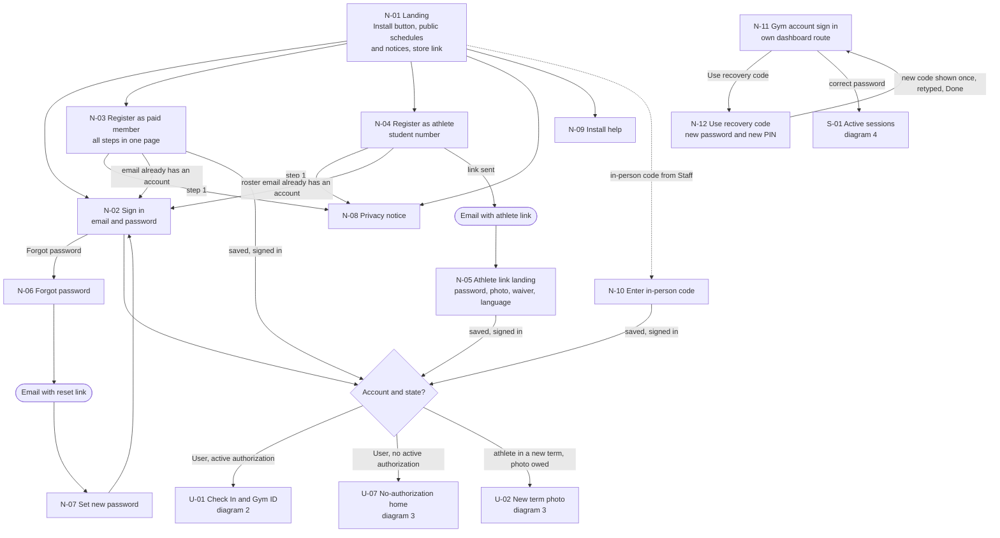
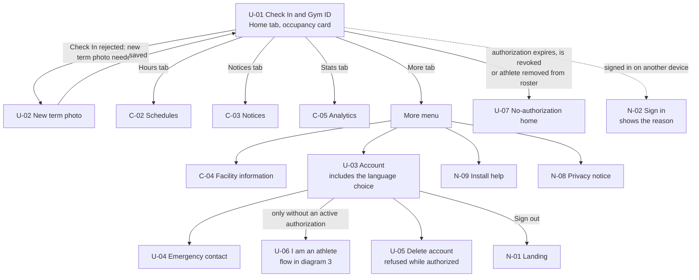
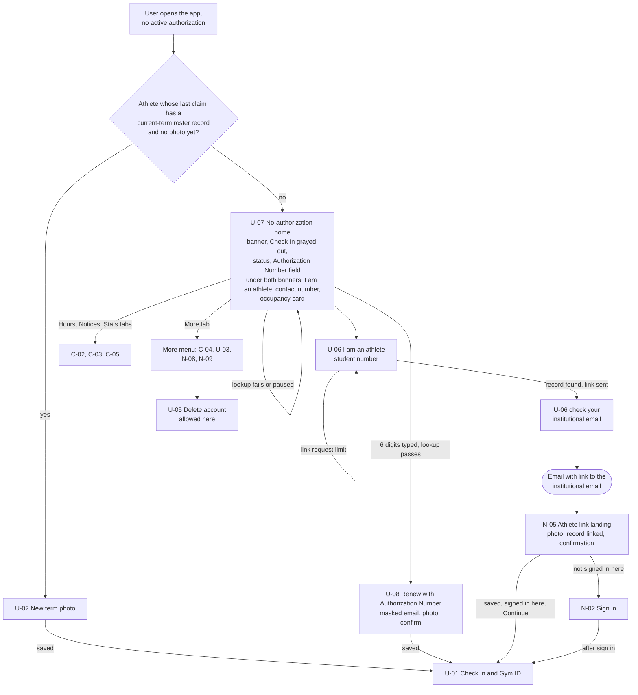
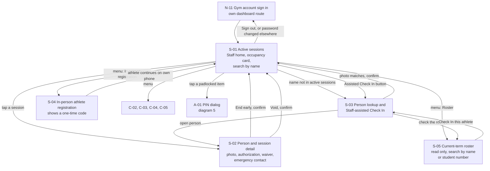
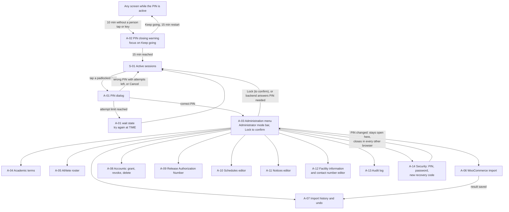
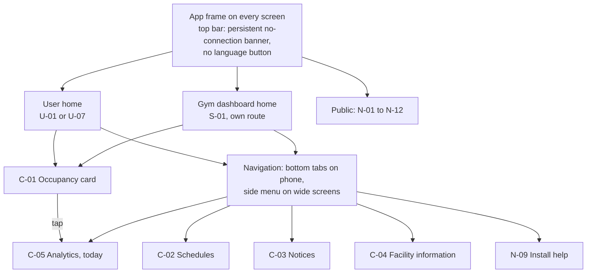
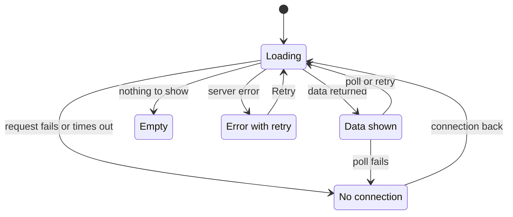

# Screen map by role

This document lists every screen of the PWA, groups them by role, and draws how a person moves between them. Each screen has a short stable id (N for not signed in, U for User, C for shared, S for Staff, A for Administrator) so wireframe and feature issues can refer to it. Public screens use N, not P, so they do not look like the professor question codes P-01 to P-05 in `team.md`. It covers GitHub issue #8. Flows, state names and rules come from the finished design files: `architecture.md`, `data-model.md`, `registration-flows.md` (REG-N decisions), `check-in-flows.md` (D-N decisions) and `admin-flows.md` (D-N decisions, here written "admin D-N"). Requirements come from `docs/requirements/SRS.md` v0.7, with the team decisions up to E-99. Wireframes and visual design are out of scope. Where a diagram follows a choice from [Design decisions to confirm](#design-decisions-to-confirm), the diagram draws the chosen option and the note under it names the choice (SM-N). The owner decided SM-1 to SM-6 and the gaps in a design review between 2026-10-17 and 2026-10-19 (issue #52). Parts still open say "to confirm".

Pending answers touch several screens:

- Outgoing mail (CTI, M-07) is assumed available (E-61). The first choice is CTI outgoing mail. If CTI cannot provide it, the prototype uses an external provider, which needs approval to send data off the CTI VM (M-11). N-04, N-05, N-06, N-07 and U-06 use it. N-10 and S-04 stay as the in-person registration tool for Staff (E-62, REQ-F-77).
- Contact number (gym, G-25). N-01, N-03, N-04, U-06, U-07 and U-08 show it.
- Store address (gym). N-01 and N-03 send paid members to the store where the membership is bought while a term runs (Proposed): store link, address pending from the gym (E-92, E-96).

## Diagrams

### 1. Public screens

**Type:** Navigation map. **Use it to:** draw the wireframes of the public screens and build their routes.

**About this diagram:** Mail is assumed available (E-61). N-10 is the in-person route: Staff give a one-time code from S-04 and the athlete finishes on their own phone (E-62, REG-11, REQ-F-77). N-11 sits on the gym dashboard route and has no link from N-02: Staff reach it by typing its address (SM-5). N-12 is the recovery code screen (E-60, REQ-F-89). The store link on N-01 shows while a term runs (Proposed, E-92). N-04 has no store link (E-96).

- N-03, N-05 and N-10 are wizards inside one page. Typed data stays in page memory until the final save and is lost on reload (REG-8, REQ-F-13). The password stays in memory only.
- N-01 shows the schedules (C-02) and notices (C-03) before sign in. Occupancy and analytics need a sign in (SM Gap 5).
- A signed-in person who opens N-01 goes straight to the home of diagram 2, 3 or 4.
- N-12 ends on N-11, where the person signs in with the new password (E-78). It does not sign anyone in by itself. Done stays off until the person retypes the new recovery code.
- Which language N-01 and N-02 use before an account exists: to confirm.

### 2. User with an active authorization

**Type:** Navigation map. **Use it to:** draw the wireframes of the User screens and build the tabs and routes.

**About this diagram:** Tabs follow SM-1. U-06 appears only when the User has no active authorization, because a User holds one active authorization per term (Gaps 2). The sign-out on another device is REQ-F-03.

- U-01 holds the Check In button and the Gym ID in the states of `check-in-flows.md` sections 6 and 7. Check In rejections are states of U-01, not separate screens, except "new term photo needed", which opens U-02. The server sends a fixed cause code for each rejection and the app writes the text in the account's language (E-74).
- The language is chosen when the account is created and changed in the preferences of U-03 (C-06, SM-2). There is no language button in the top bar.
- During the athletes-only period the whole theme of the User app changes color, so every User sees the period at a glance. A text notice with the start time and an icon stay on U-01 for every User, athletes and paid members (E-76).

### 3. User with no active authorization

**Type:** Navigation map. **Use it to:** draw the wireframes of the no-authorization home, renewal and "I am an athlete" screens, and build their routes.

**About this diagram:** This is the home of REQ-F-23. A new term starts on the first app open in that term: the app looks up the roster by the student number of the account's last claim and asks for the new photo on U-02 (REG-10, E-69). This keeps the same account and its history. The roster record is linked only when the email link is opened (E-58, REQ-F-80), and the photo is saved at that moment with the link, so no authorization exists without a photo (E-69).

- U-07 replaces U-01 as the home. The tabs are the same; the Home tab shows U-07 (SM-4). A banner at the top says why there is no authorization and Check In is shown but grayed out (E-67). The Authorization Number field shows under both banners (E-97): a person whose authorization an import undo or a release removed can claim the number again (REQ-F-31). If the number cannot be claimed, the message carries the contact number. I am an athlete shows under both banners (E-100).
- Messages for a failed lookup are the ones of N-03 (REQ-F-71, F-72, F-73). A number that is not valid in the current term gets the same message as an invalid or claimed one (REG-9).
- N-05 reuses the athlete link landing of diagram 1 with a second mode: the link comes from U-06, so there is no password or waiver step, only the photo and the "record linked" confirmation. Opening the link never signs a person in. The order of sign in and photo in this mode is left to the wireframes.
- A User with a manual authorization and no photo also gets U-02 before Check In (E-69).

### 4. Staff (gym account without the PIN)

**Type:** Navigation map. **Use it to:** draw the wireframes of the front desk screens and build the Staff menu and routes.

**About this diagram:** S-05 is the read-only roster that Staff got with E-59 (REQ-F-45, F-49); the gym still has to confirm it (G-09). S-04 stays as a Staff tool even though mail is assumed (E-62, E-61): Staff need no PIN, generate a one-time code valid for 15 minutes, and the athlete fills in everything else on their own phone at N-10. Staff do not fill in data for the person.

- The Staff and Administrator screens are a dashboard on their own route, not part of the User PWA. Staff and Administrator do not use the PWA (E-65).
- The dashboard menu shows the Administrator items grayed out with a padlock. Tapping one opens the PIN dialog (E-65, SM-3).
- Staff use S-05 to check an athlete whose 60 minutes ended (REQ-F-45) and to find a student number before an assisted Check In. S-05 has no add, edit, remove or import: those stay on A-05.
- "Check In this athlete" opens S-03 with the student number filled in (E-81). Staff and the Administrator see the student number in full on every screen they use.
- Staff can void only active sessions. S-01 lists them and there is no list of past sessions (E-80).
- Staff have no account settings screen. Changing the gym account password is an Administrator action (A-14), or anyone with the recovery code at N-12.
- The dashboard does not change color during the athletes-only period (E-76).

### 5. Administrator (gym account with the PIN)

**Type:** Navigation map. **Use it to:** draw the wireframes of the administration screens and build the PIN dialog, the closing warning and the routes.

**About this diagram:** The wait state is admin D2. After a PIN change the PIN closes in every other browser because of the PIN version of E-56 (REQ-NF-48); the browser that made the change stores the new version and stays open, as in `admin-flows.md`. The PIN has 4 digits and uses a numeric keypad (E-83).

- While the PIN is active, the Staff screens (S-01 to S-05) and shared screens stay in the same menu (SM-3). The Administrator unlocks the items in place, on the same screen.
- To confirm: whether the separate A-03 menu screen disappears, since the dashboard menu already lists the Administrator items. A-03 stays in this map until then.
- To confirm: whether a Lock button returns the dashboard to Staff mode. The padlocked menu is decided; the Lock button is not.
- Every Administrator screen shows a notice when no term covers today, and every error names that reason (E-85).
- The PIN state and the last person activity are kept in the session data of that browser (E-56, REQ-NF-48). Each Administrator request compares the PIN version kept there with the gym account's version. Changing the PIN in A-14 closes the PIN in every other browser; this browser stores the new version and stays open.
- Unsaved input on an Administrator form is lost when the PIN closes (`admin-flows.md` section 2). A-02 gives 5 minutes of warning.

### 6. Shared screens and the app frame

**Type:** Navigation map. **Use it to:** build the app frame, the top bar and the navigation component that every role shares.

**About this diagram:** The navigation component is SM-1; the language choice is SM-2; the banner is SM-6.

- Every signed-in role sees C-01 to C-05 with the same data (REQ-F-42, F-55, F-61). C-02 and C-03 are also public on N-01. Analytics need no PIN (REQ-F-61).
- C-06 is a setting, not a screen, and the top bar has no language button (SM-2). The language question is asked when the account is created, and the User is told it can be changed later in the preferences of U-03. The choice is saved on the account (`users.locale`), so emails use it (REQ-NF-35).
- The gym account has one language stored on the account, the same on every computer (E-64). Where Staff or the Administrator change it on the dashboard, and whether that needs the PIN: to confirm. It is stored in `gym_accounts.locale` (data model).
- The top bar banner stays on screen while there is no connection. Each section also shows "updated at TIME" (E-77, SM-6).
- During the athletes-only period the whole User app changes theme color. Without a connection the app returns to the normal color, and the banner says the data is not current. The app does not claim an athletes-only period from cached schedules (E-76, REQ-NF-26). The color is the owner's choice and the text notice with an icon stays, because color cannot be the only signal (WCAG 1.4.1).

### 7. Standard data states

**Type:** State diagram. **Use it to:** build the loading, empty, error and no-connection states of every data screen, and write test cases for them.

Every screen that loads data from `/api` follows this contract. The inventory names how each state looks on each screen.

**About this diagram:** What stays visible without a connection is SM-6, option B.

- No connection: the app shell still opens from the service worker, but `/api` is never cached (`architecture.md`, REQ-NF-26). Actions that need the server are disabled with a reason.
- Content already loaded stays on screen with "not current, updated at TIME". Occupancy shows no number. The Gym ID shows "not valid now" and its clock stops (SM-6).
- Empty is never an error. A period with no data in C-05 shows zeros (REQ-F-61).

## 8. Screen inventory

Device: "Phone" means designed for a phone first. "Desk" means the gym mostly uses it on the front desk desktop computer, which the gym still has to confirm (G-06). Every screen works on both sizes (REQ-NF-10, one codebase).

### Public

| ID | Screen | Roles | Purpose | Key states | Device | Requirements |
|---|---|---|---|---|---|---|
| N-01 | Landing | Not signed in | Choose sign in or register; Install button; links to N-08 and N-09; public schedules (C-02) and notices (C-03); one line that registering needs a paid membership or a roster entry, with the contact number, and a button to the store while a term runs (Proposed; store link, address pending from the gym) | Loading: app shell. No connection: banner, sign in and register disabled. Install button hidden where the browser has no install event. Signed in: redirect to home. Language before sign in: to confirm | Phone | REQ-NF-10, NF-33, F-66, F-91 |
| N-02 | Sign in | User | Email and password. No link to N-11 (SM-5) | Loading: button busy. Error: wrong credentials, without saying if the email exists (SRS 3.1). Wait: "try again at TIME" (REQ-F-07). No connection: form kept, submit disabled. Special: "you signed in on another device" (REQ-F-03) | Phone | REQ-F-02, F-03, F-07 |
| N-03 | Register as paid member | Not signed in | Steps: privacy notice, Authorization Number, masked email, password, photo (take it now or upload it; the screen says it cannot be changed), waiver and emergency contact, choose language (Spanish or English; it can be changed later in the account preferences), final save. A line says a paid membership is needed first, with the contact number and a button to the store while a term runs (Proposed; store link, address pending from the gym) | Loading: lookup after 6 digits; slow mode waits (REG-2). Error: one message for an invalid number, a claimed number and a number from an ended term, with contact number (lookup covers the current term only, REG-9); per-IP pause "try again at TIME"; photo rejected, stays on photo step with data kept in the page, lost if the page closes (REG-8). No connection: data kept in page, submit disabled. Special: "you already have an account, sign in to add it" with the masked email, for example `m***z@upr.edu`; nothing is claimed (REG-4, REG-3) | Phone | REQ-F-10, F-11, F-13, F-18, F-60, F-70, F-71, F-72, F-73, F-91, NF-24, NF-25 |
| N-04 | Register as athlete | Not signed in | Privacy notice, student number, link sent. The language is chosen at N-05, where the account is created. A line says the athlete must be on the roster, with the contact number. No store button, because athletes do not buy (E-96); a paid member who lands here goes back to N-01 | Loading: lookup. Error: not on the roster with contact number (REQ-F-76); record claimed; link request limit (1 link every 5 minutes and 5 per day for each student number, REG-7). No connection: submit disabled. Special: "link sent to m***z@upr.edu", first and last letter before the @ (REG-3); "you already have an account, sign in to add it" with the masked email; nothing is claimed | Phone | REQ-F-15, F-73, F-76, F-91, NF-25 |
| N-05 | Athlete link landing | Not signed in, or a User | Two modes. From an N-04 link: password, photo (take it now or upload it; the screen says it cannot be changed), waiver, choose language (Spanish or English; it can be changed later in the account preferences), one final save. No authorization exists without the photo (E-69). From a U-06 link: the photo step, then the roster record is linked to the account that asked and a confirmation (E-58) | Loading: link check. Error: link expired, already used or replaced, record claimed since (REG-6); photo rejected, back to the photo step with data kept. No connection: data kept, submit disabled. Special (U-06 mode): "record linked to the account m***z@..." with Continue when that account is signed in here, Sign in otherwise | Phone | REQ-F-13, F-15, F-60, F-80, NF-24 |
| N-06 | Forgot password | User | Ask for a reset link | Loading. Error: server error. No connection. Special: the same answer whether the email exists or not: "if that email has an account, we sent a link" (E-63) | Phone | REQ-F-06, F-75 |
| N-07 | Set new password | User | From the reset link: new password | Loading: link check. Error: link expired or used; password rules. No connection | Phone | REQ-F-06, F-75 |
| N-08 | Privacy notice | Everyone | Notice in Spanish and English, shown before any personal data | Loading. Error. No connection: notice is static text in the app, so it still shows. Text pending G-24 | Phone | REQ-NF-25 |
| N-09 | Install help | Everyone | Install button in Chromium browsers; iPhone steps with Share | Special: button hidden without the install event; "already installed" when opened as the installed app. Static, works without connection | Phone | REQ-F-66 |
| N-10 | Enter in-person code | Athlete with a one-time code from Staff | Code from Staff, then privacy notice, password, photo, waiver, choose language (Spanish or English; it can be changed later in the account preferences) | Loading. Error: code wrong or expired (REG-11); photo rejected. No connection: submit disabled | Phone | REQ-F-77, F-13, F-60, NF-25 |
| N-11 | Gym account sign in | Gym account | Gym username and password, on the dashboard route with its own address and no link from N-02 (SM-5); "Use recovery code" link to N-12 | Loading. Error: wrong credentials. Wait: REQ-F-07. No connection. Special: "signed out because the password changed" (`admin-flows.md` section 4) | Desk | REQ-F-07, F-52, F-88, F-89 |
| N-12 | Use recovery code | Anyone with the paper recovery code | Type the recovery code (12 characters in 3 groups of 4, letters and numbers without 0, O, 1 or l; accepted with or without hyphens and in any case, E-78), then a new gym account password and a new 4-digit PIN with a numeric keypad (E-83); then see the new recovery code once (E-60) | Loading. Error: wrong code with attempts left; password or PIN rules not met. Wait: "try again at TIME", limited like the PIN. No connection: submit disabled. Special: new code shown once, with "write it down and keep it in a safe place"; Done stays off until the person retypes the new code in a field (E-78); Done then returns to N-11 to sign in; other browsers signed out and the PIN closed everywhere; each use writes an audit log entry (A-13) | Desk | REQ-F-89, F-88, NF-39, NF-48 |

### User

| ID | Screen | Roles | Purpose | Key states | Device | Requirements |
|---|---|---|---|---|---|---|
| U-01 | Check In and Gym ID | User with active authorization | Home. Check In button; Gym ID after a valid Check In; C-01 card | Empty: no session yet, Check In button. Loading: checking eligibility, waiting for location, sending. Error: one state per cause code of check-in D5, with the text written by the app in the account's language (no authorization, gym closed, athletes-only, location denied with how to turn it on, location unavailable, low accuracy, outside boundary, new term photo needed). No connection: Check In refused; Gym ID shows "not valid now" and the clock stops (SM-6). Special: paid member active with minutes left and moving clock; paid expired with text and icon; athlete shown as "Authorized athlete, Fall 2026" (the term) with the moving clock, never minutes left, never "expired" or "session ended"; tag "Athlete" or "Member" with an icon and a different color for each (colors to pick); invalid after roster removal; athletes-only notice with start time for every User, and the theme color of the app changes during that period (E-76) | Phone | REQ-F-33, F-36, F-37, F-38, F-40, F-49, F-82, F-83, F-90, NF-11, NF-14, NF-16, NF-26 |
| U-02 | New term photo | Athlete in a new term; manual grant without photo | Upload the term photo before Check In. Opens at the first app open in the new term, after the roster is found by the student number of the account's last claim (REG-10) | Loading: upload. Error: type or size (REQ-NF-24); record claimed by another account, contact number. No connection: upload disabled | Phone | REQ-F-25, F-26, F-13, NF-24 |
| U-03 | Account | User | Name, account email (read only), current authorization and term, language choice (C-06), links to U-04, U-05, U-06 (only without an active authorization), sign out | Loading. Error. No connection: data marked not current | Phone | REQ-F-01, F-11, F-19 |
| U-04 | Emergency contact | User | See and edit the emergency contact at any time; Staff always see the current value (E-79, REQ-F-60) | Loading. Error: name or phone invalid. No connection: save disabled | Phone | REQ-F-60 |
| U-05 | Delete account | User | Explain what is deleted and kept, confirm | Error: refused with the reason while an authorization is active. No connection: disabled. Special: after deletion, back to N-01 | Phone | REQ-F-09 |
| U-06 | I am an athlete | User with no active authorization | Student number, then "check your institutional email". Nothing is linked yet: the record is linked only when the email link is opened at N-05, where the photo is also saved (E-58) | Loading. Error: not on the roster with contact number (REQ-F-76); record claimed; link request limit (1 link every 5 minutes and 5 per day for each student number, REG-7). No connection: submit disabled. Special (end state): "check your institutional email m***z@upr.edu" | Phone | REQ-F-20, F-26, F-76, F-80 |
| U-07 | No-authorization home | User with no active authorization | Banner on top, Check In shown but grayed out, Authorization Number field, I am an athlete, contact number, C-01 card | Loading. Error. No connection: field disabled. Special: two banners (E-67, REQ-F-23). Expired: "Your authorization has expired. Renew to use Check In." with the Authorization Number field (U-08) and I am an athlete. Any other cause (revoked, import undone, number released, athlete removed from the roster, no current term): "You have no active authorization. Contact the gym." with the contact number and the Authorization Number field, so a person whose authorization an import undo or a release removed can claim the number again (E-97, REQ-F-31). A number that cannot be claimed gets the same message with the contact number. The texts are drafts; the final wording is written in the wireframes. I am an athlete shows under both banners (E-100). Contact number pending G-25 | Phone | REQ-F-23, F-73 |
| U-08 | Renew with Authorization Number | User with no active authorization | After a valid number: masked email, renewal or type change, photo, confirm | Loading: lookup, save. Error: same messages as N-03. A number whose payment email belongs to another account is accepted: having the number is the proof (E-70). No connection: data kept, submit disabled | Phone | REQ-F-20, F-26, F-70, F-71, F-72, F-78 |

### Shared (C-02 and C-03 are also public)

| ID | Screen | Roles | Purpose | Key states | Device | Requirements |
|---|---|---|---|---|---|---|
| C-01 | Occupancy card | User, Staff, Administrator | Estimated occupancy with "updated at TIME", on every home | Loading: placeholder, no number. Empty: 0 is a real value. Error and no connection: number hidden, "not current" with icon (REQ-NF-26). Polls every 20 to 30 s (check-in D6) | Both | REQ-F-41, F-42, F-43, NF-26 |
| C-02 | Schedules | Everyone, also before sign in (shown on N-01) | Regular hours, special hours, closures, athletes-only slots; "open now" or "closed now" | Loading. Empty: "no schedule published". Error. No connection: loaded content stays with "not current, updated at TIME" (SM-6) | Both | REQ-F-55, F-58, NF-37, NF-38 |
| C-03 | Notices | Everyone, also before sign in (shown on N-01) | Current maintenance notices and updates | Loading. Empty: "no notices". Error. No connection: loaded content stays with "not current, updated at TIME" (SM-6) | Both | REQ-F-55, F-58 |
| C-04 | Facility information | User, Staff, Administrator | Rules, towel, footwear, machines, equipment instructions | Loading. Empty per topic. Error. No connection: loaded content stays with "not current, updated at TIME" (SM-6). Stretch: a QR code opens one topic (REQ-F-59) | Both | REQ-F-55, F-58, F-59 |
| C-05 | Analytics | User, Staff, Administrator, no PIN | Period picker and metrics (a) to (f); manual authorizations count as a third category next to paid members and athletes (E-82) | Loading. Empty: zeros, not an error. Error. No connection: charts already loaded stay with "not current, updated at TIME" (SM-6) | Both | REQ-F-61, NF-37, NF-38 |
| C-06 | Language setting | Users and the gym account | Spanish or English for every text. Asked when the account is created, with a notice that it can change later; changed in the preferences of U-03. No button in the top bar (E-64) | Special: one language per account, saved on the account for Users and for the gym account, so a change applies on every computer (E-64); page `lang` changes with the texts. Where Staff or the Administrator change it, and whether it needs the PIN: to confirm. Language of N-01 and N-02 before an account exists: to confirm | Both | REQ-NF-33, NF-34, NF-35, NF-36 |

### Staff (also reachable by the Administrator)

| ID | Screen | Roles | Purpose | Key states | Device | Requirements |
|---|---|---|---|---|---|---|
| S-01 | Active sessions | Staff, Administrator | Home of the dashboard route. C-01 card, list of active sessions with name, Check In time, authorization, and minutes left for paid members (for an athlete the list shows "athlete" and the Check In time instead, E-99); search by name; menu with the Administrator items grayed out and a padlock (SM-3) | Loading. Empty: "no active sessions". Error. No connection: list marked not current, actions disabled. Search is a fresh request, never cached | Desk | REQ-F-42, F-43, F-44, F-45, NF-26 |
| S-02 | Person and session detail | Staff, Administrator | Photo from the backend, authorization, waiver acceptance, emergency contact, session; End early and Void with confirm | Loading: photo. Error: session already ended or changed by another browser. No connection: actions disabled. Special: only active sessions can be voided; no list of past sessions, and past statistics do not change (E-80) | Desk | REQ-F-45, F-48, NF-19, NF-20, NF-39 |
| S-03 | Person lookup and Staff-assisted Check In | Staff, Administrator | Search by name (paid member) or student number (athlete); compare the photo; confirm Check In; link to S-05 to check the roster | Loading. Empty: no match. Error: cause keys (no authorization, photo required, gym closed, athletes-only for paid members). No connection: disabled. Special: person already has an active session, shown instead of a new one; opens with the student number filled in after "Check In this athlete" on S-05; the student number is shown in full (E-81) | Desk | REQ-F-36, F-45, F-46, F-82, NF-39 |
| S-04 | In-person athlete registration | Staff, Administrator, no PIN | Student number, roster check, ID check, one-time code valid for 15 minutes. Staff do not fill in data for the person: the athlete does it on their own phone at N-10 (E-62) | Loading. Error: not on the roster, Staff cannot add records (REQ-F-76, F-77); record claimed. No connection. Special: code with its expiry time | Desk | REQ-F-77, NF-39 |
| S-05 | Current-term roster | Staff, Administrator | Read-only list of the current-term roster records; search by name or student number; "Check In this athlete" opens S-03 (E-59) | Loading. Empty: "no records in this term"; no term covers today. Empty search: no match. Error. No connection: list marked not current, search disabled. Special: no add, edit, remove or import controls; search is a fresh request, never cached; the student number is shown in full (E-81). Gym still to confirm (G-09) | Desk | REQ-F-45, F-46, F-49, F-51 |

### Administrator (PIN active in this browser)

| ID | Screen | Roles | Purpose | Key states | Device | Requirements |
|---|---|---|---|---|---|---|
| A-01 | PIN dialog | Staff | Type the 4-digit PIN on a numeric keypad (E-83). Opens when Staff tap a padlocked item (E-65) | Loading. Error: wrong PIN, attempts left. Wait: "try again at TIME", Staff work continues (admin D2). No connection | Desk | REQ-F-52, NF-48 |
| A-02 | PIN closing warning | Administrator | After 10 minutes without a person tap or key press: "PIN closes in 5 minutes" and Keep going | Special: Keep going restarts 15 minutes; at 15 minutes back to S-01 and unsaved input lost | Desk | REQ-NF-48, NF-13 |
| A-03 | Administration menu | Administrator | Entry to A-04 to A-14; Administrator mode bar. Lock button: to confirm. Whether this screen disappears because the dashboard menu already lists these items: to confirm | Special: notice when no term covers today (E-85, admin D9) | Desk | REQ-F-21, F-52 |
| A-04 | Academic terms | Administrator | List, create and edit terms | Loading. Empty: no terms, notice. Error: dates in wrong order; overlap names the other term. Special: an edit is never blocked when records fall outside the new dates; records keep their term and only the end date of their authorization follows the new term end (E-88). No connection: save disabled | Desk | REQ-F-21 |
| A-05 | Athlete roster | Administrator | Pick a term; list, add, edit, remove records; Reinstate an athlete removed by mistake; import a list | Loading. Empty: no records in this term. Error: unexpected format imports nothing; repeated student number. Error: Reinstate refused when the person already has an active authorization in that term (E-94). Special: list result (added, rejected rows); the student number is shown in full (E-81); removal confirm says the Gym ID stops being valid at once. Reinstate returns the revoked authorization to active; it needs a reason of at least 10 characters (the same rule as a manual grant, E-86) and writes an audit log entry (E-95). Format pending G-10 | Desk | REQ-F-49, F-51, NF-39 |
| A-06 | WooCommerce import | Administrator | Upload an Export Orders file and see the result | Loading: processing. Error: unexpected format imports nothing; a second order with the same Authorization Number in the same term is rejected (E-71). Special: result with counts and the created, updated and rejected rows, saved so it can be reopened from A-07 (E-84). Columns pending E-55 | Desk | REQ-F-22, F-28, F-29, F-30 |
| A-07 | Import history and undo | Administrator | List imports; reopen the saved result of one (E-84); undo one. Undo is always allowed, even after Check Ins used its authorizations; the confirm shows counts of authorizations, sessions and photos as information and does not block, and active sessions keep counting until they end (E-84) | Loading. Empty: no imports. Error. Special: undone imports marked, kept in the list | Desk | REQ-F-31, NF-39 |
| A-08 | Accounts | Administrator | Find an account by name or email; see authorizations; grant manual, revoke (each with a reason); delete on the User's request after the Administrator confirmed in person, with identification, at the gym (E-89) | Loading. Empty: no match. Error: grant refused (term ended, or the person already has an active authorization in that term, E-94); reason missing or shorter than 10 characters, free text written to the audit log (E-86); delete refused with an active authorization. Special: a manual authorization counts as `manual` in C-05 (E-82); the User is asked for the term photo on U-02 before Check In (E-69) | Desk | REQ-F-09, F-87, NF-39 |
| A-09 | Release Authorization Number | Administrator | Type the number; see account, masked email, claim time; confirm | Loading. Empty: number not claimed. Special: the release deletes only that authorization and its term photo; the account, its other authorizations and its history stay, also when the claim created the account (E-87, admin D12) | Desk | REQ-F-74, NF-39 |
| A-10 | Schedules editor | Administrator | Regular hours, special hours, closures, athletes-only slots, Spanish and English text. Each slot repeats weekly or has a concrete date: the regular schedule is written once and exceptions are separate entries (E-90) | Loading. Empty. Error: Spanish text missing. Slot list pending G-28 | Desk | REQ-F-55, F-58, F-82, NF-39 |
| A-11 | Notices editor | Administrator | Create, edit, delete notices in Spanish and English. A help text says notices are public, so they must hold no sensitive data (E-66) | Loading. Empty. Error: Spanish text missing | Desk | REQ-F-55, F-58 |
| A-12 | Facility information editor | Administrator | Edit rules, towel, footwear, machines, equipment instructions; edit the gym contact number (E-66) | Loading. Error: Spanish text missing; contact number empty or invalid | Desk | REQ-F-55, F-58 |
| A-13 | Audit log | Administrator | Filter by date and action; entry with time, IP address, device, before and after; lookup alerts; recovery code uses and code changes (the entry says only that the code changed, E-78) | Loading. Empty: no entries for the filter. Error | Desk | REQ-NF-39, F-71, F-89 |
| A-14 | Security | Administrator | Change the PIN (4 digits, numeric keypad, E-83) and the gym account password, with the current PIN. "Generate new code" button: voids the old recovery code, shows the new one once, and asks the person to retype it to continue, like N-12 (E-78) | Error: wrong current PIN counts toward the limit; rules not met; retyped code does not match. Special: other browsers signed out after a password change; after a PIN change the PIN closes in every other browser and stays open here (E-56) | Desk | REQ-F-88, NF-48 |

Every A screen also shows "No connection: actions disabled" and Loading, as in diagram 7.

## 9. Role table coverage

Each action of the SRS Overview role table and the screen where it happens.

| Action (role table) | Screen ids |
|---|---|
| Register | N-03, N-04, N-05 (N-10 for in-person registration) |
| Sign in | N-02 (User), N-11 (gym account, on its own dashboard route) |
| Check In; show the Gym ID | U-01 |
| Renew | U-08, U-06 then N-05 (photo saved there), U-02 for a new term |
| Delete own account | U-05 |
| See schedules and notices, also before sign in | C-02, C-03 (public on N-01) |
| See occupancy and facility information, signed in | C-01, C-04 |
| See facility analytics, signed in | C-05 |
| Choose the language | U-03 (Users); gym account: place to confirm (C-06) |
| See active sessions and verify a Gym ID | S-01, S-02, S-03, S-05 |
| Staff-assisted Check In | S-03 |
| End a session early or void it | S-02 |
| See a User's waiver and emergency contact | S-02 |
| Register in person an athlete on the roster (Staff, no PIN) | S-04, then N-10 |
| See the current-term athlete roster, read only (Staff and Administrator) | S-05 |
| Change the athlete roster | A-05 |
| Reinstate an athlete removed from the roster by mistake | A-05 |
| Academic terms | A-04 |
| WooCommerce import and undo | A-06, A-07 |
| Schedules, closures, athletes-only slots | A-10 |
| Notices, facility information | A-11, A-12 |
| Edit the gym contact number | A-12 |
| Grant or revoke an authorization by hand | A-08 |
| Release a claimed Authorization Number | A-09 |
| Delete a User's account when the User asks | A-08 |
| See the audit log | A-13 |
| Change the PIN and the gym account password | A-14 |
| Generate a new recovery code, with the PIN | A-14 |
| Set a new gym account password and PIN with the recovery code (only with the code) | N-11, then N-12 |

Not in the role table but needed: N-06 and N-07 (REQ-F-06), N-08 (REQ-NF-25), N-09 (REQ-F-66), U-04 (REQ-F-60), C-06 (REQ-NF-33). The SRS role table splits the row of schedules, notices, occupancy and facility information in two (E-66), and gains the contact number action for A-12 (E-66) and the Reinstate action for A-05 (E-95).

## 10. Phone and front desk

- Phone first (REQ-NF-10): every N screen except N-11 and N-12, every U and C screen. These are the screens about 150 people a day use (REQ-NF-15). Check In must be usable in under 3 seconds (REQ-NF-16), so U-01 is the first screen after sign in and loads nothing it does not need.
- Front desk desktop, pending G-06: S-01 to S-05, A-01 to A-14, N-11, N-12. S-01, S-05 and A-13 are tables that need a wide layout. A-05 and A-06 upload files that usually live on a computer.
- If the gym says Staff also use phones (G-06), S-01 to S-03 and S-05 need the phone layout too. One codebase keeps this possible (REQ-NF-10; that the dashboard shares the PWA codebase is to confirm, E-65). A-screens stay desktop-first.
- C screens are used on both.

## 11. Accessibility notes

All screens target WCAG 2.2 level AA (REQ-NF-13). Notes only where a screen has a specific need. WCAG success criteria cited below were checked in https://www.w3.org/TR/WCAG22/.

- **A-02 PIN closing warning.** Opens as a modal dialog. Keyboard focus moves to Keep going, and screen readers announce the dialog text (REQ-NF-48, WCAG 2.2.1 Timing Adjustable). Focus returns to where it was when the dialog closes. The remaining time is shown as text, and is not announced every second.
- **U-01 Gym ID moving clock.** The clock must move: it is how Staff tell a live screen from a screenshot (REQ-F-40). WCAG 2.2.2 Pause, Stop, Hide exempts movement that is essential to the activity. The clock shows the current time with seconds as text, changes at most once per second, and never flashes (E-75).
- **U-01 Gym ID states.** Active, expired, "Authorized athlete", invalid and no connection each have a text label and an icon, not only a color. The "Athlete" and "Member" tags carry text and an icon next to their color, and the athletes-only theme color comes with the text notice and an icon (REQ-F-40, REQ-NF-14, WCAG 1.4.1 Use of Color). One color must not mean two things, so the tag colors and the theme color are picked together (E-76, E-75).
- **U-01, S-03 Check In results.** Rejections and success are status messages that screen readers read without moving focus (WCAG 4.1.3 Status Messages). Each says the cause in words.
- **C-01, S-01 polling.** A new occupancy value after each poll is not announced, to avoid noise. The "not current" state is announced once.
- **C-06 language setting.** The page `lang` attribute changes with the texts (REQ-NF-36, WCAG 3.1.1). Each option is written in its own language ("English", "Español") and marked with that language (WCAG 3.1.2).
- **Bottom tabs and the Check In button (SM-1).** Targets at least 24 by 24 CSS pixels (WCAG 2.5.8). The fixed tab bar must not cover the focused element (WCAG 2.4.11).
- **A-01 PIN dialog.** Numeric keypad for the 4-digit PIN; the error and the wait time are text, not only a red field.
- **N-12 and A-14 new recovery code.** Shown as text, never as an image, so screen readers can read it and it can be copied. The field where the person retypes it accepts the code with or without hyphens and in any case.
- **Offline banner.** The persistent top banner is text with an icon. The theme color of the User app goes back to normal without a connection (E-76).

## Design decisions to confirm

All six are decided. Carlos Pepin, the owner, answered them in the design review of 2026-10-17. The option tables stay as the record of what was compared.

### SM-1: Navigation for Users on the phone

| Option | What it means | Tradeoff |
|---|---|---|
| A | Bottom tab bar: Home (U-01 or U-07), Hours (C-02), Notices (C-03), Stats (C-05), More (C-04, U-03, N-08, N-09). On wide screens the same items as a side menu | One tap to every common screen, reachable with the thumb. Five tabs is the practical limit; anything new goes in More |
| B | Menu button that opens a list | Room for any number of items. Every screen except home needs two taps, and items are hidden from people who do not open the menu |
| C | Home with tiles, no persistent navigation | Simple home. Back to home between every screen; more taps |

Decided (owner, 2026-10-17): A. Check In and the Gym ID stay one tap away from anywhere, and the Staff and Administrator side menu on the desktop can use the same component.

### SM-2: Where the language switch lives (REQ-NF-33)

| Option | What it means | Tradeoff |
|---|---|---|
| A | A small "English" or "Español" button in the top bar of every screen, public screens included | Always visible, also to a person who cannot read the current language well enough to find a menu. Takes top bar space |
| B | Only in More (Users) and in the menu (gym account) | Clean top bar. Hard to find for someone who does not read Spanish, and absent before sign in |
| C | Top bar on public screens, More after sign in | Visible when it matters most. Two places to build and test |
| Decided | None of A, B or C. The language is asked when the account is created, and the User is told it can change later in profile preferences or settings. No language button in the top bar | One language per account, so the app and the emails agree. The language of N-01 and N-02, before an account exists, is not decided: to confirm |

Decided (owner, 2026-10-17): the own option above (E-64). The language belongs to the account, so one setting covers every device and every email.

### SM-3: Staff and Administrator layout

| Option | What it means | Tradeoff |
|---|---|---|
| A | One layout; Administrator items always shown with a lock icon; tapping one opens A-01 | The Administrator finds every item in one place. Front desk students see the full Administrator menu and may tap it by mistake |
| B | One layout; without the PIN the menu shows only "Unlock administration"; with the PIN the Administrator items appear in the same menu, plus a bar "Administrator mode" with Lock | Staff see only their work. Matches `admin-flows.md` section 2 ("the interface hides Administrator screens without the PIN"). The Administrator keeps Staff screens without switching areas |
| C | Separate area with its own menu, entered with the PIN; leaving it returns to Staff | Clear separation. Moving between session work and administration needs a switch; two layouts to build |
| Decided | Option A with a change: one menu with everything, and the Administrator items shown grayed out with a padlock for Staff. Tapping a grayed item opens the PIN dialog | Staff see what the Administrator can do. The Lock button that returns to Staff mode is not decided: to confirm |

Decided (owner, 2026-10-17): A with the padlock (E-65). The Administrator finds every item in one place and the padlock tells Staff the item needs the PIN. In every option the backend decides each action (REQ-F-52), so the padlock is for clarity, not security.

### SM-4: Home screen per role

| Option | What it means | Tradeoff |
|---|---|---|
| A | User with active authorization: U-01. User without: U-07. Gym account: S-01. After the PIN: A-03 | Each role starts where its most common task is. After the PIN, the Administrator goes to the menu of what the PIN unlocks |
| B | As A, but after the PIN the Administrator stays on the screen where Unlock was tapped | Fewer jumps when the PIN is asked in the middle of a task. Needs the Unlock button to remember where it came from |
| C | One dashboard for every role with role-specific cards | One screen to design. Check In moves below other cards, which works against REQ-NF-16 |
| Decided | Users use the PWA (U-01 or U-07). Staff and Administrator use a dashboard on a different route and do not touch the PWA. Staff land on S-01. The Administrator taps a padlocked item, types the PIN, and the item unlocks on the same screen | Two services on separate routes, in the same codebase (REQ-NF-10, a reading to confirm). Whether the A-03 menu screen disappears: to confirm |

Decided (owner, 2026-10-17): the own option above (E-65). The Administrator does not change screens after the PIN.

### SM-5: Where the gym account signs in

| Option | What it means | Tradeoff |
|---|---|---|
| A | Same screen as Users (N-02); the field accepts an email or the gym username | One screen. The label "email or username" confuses 150 Users a day for the sake of one account |
| B | Separate screen N-11 at its own address, bookmarked on the front desk computer, with a small link from N-02 | Clear labels and messages for each. One more small screen. The address is not secret and gives no extra security |
| C | Separate screen N-11 on the dashboard route, with no link from N-02. Staff reach it by typing the address | Users never see the gym sign in. Staff must know the address |

Decided (owner, 2026-10-17): C (E-65). The 150 Users a day never see a gym sign in. Staff reach N-11 by typing the dashboard address. Attempt limits (REQ-F-07) apply the same on both screens.

### SM-6: What screens show without a connection (REQ-NF-26)

| Option | What it means | Tradeoff |
|---|---|---|
| A | Every data screen hides its data and shows only "No connection" | Simplest rule. A User loses the schedule they were reading |
| B | Schedules, notices, information and analytics already loaded in this visit stay on screen with "not current, updated at TIME". Occupancy hides its number. The Gym ID shows "No connection, not valid now" with an icon and the moving clock stops, so Staff see at once it is not live | Keeps harmless content readable and never shows occupancy or a Gym ID as current. Two behaviors to test |

Decided (owner, 2026-10-17): B (E-77), with a persistent top banner for the whole app and "updated at TIME" on each section. Data stays only in page memory, since the service worker never caches `/api`.

## Gaps and questions

1. **REQ-F-23 lists two statuses only.** Decided (E-67). U-07 shows a banner and a grayed Check In. Expired: "Your authorization has expired. Renew to use Check In." Any other cause (revoked, import undone, number released, no current term): "You have no active authorization. Contact the gym." REQ-F-23 lists both banners (SRS v0.7). Decided (E-97): the Authorization Number field shows under both banners. Decided (E-100): I am an athlete shows under both banners.
2. **Where "I am an athlete" appears.** Decided (E-68, E-94). A User holds one active authorization per term; a revoked one does not count. U-06 shows only when the User has no active authorization, U-03 hides it otherwise, and a manual grant is refused when the person already has an active one.
3. **No screen owns the contact number.** Decided (E-66). A-12 edits it, and the role table gets that action. A-14 keeps its name "Security".
4. **Staff lookup is not in the role table.** Resolved by E-59: Staff see the current-term roster read only (S-05); the gym still has to confirm (G-09).
5. **Public schedules and notices.** Decided (E-66). N-01 shows C-02 and C-03 before sign in. Occupancy and analytics stay behind sign in. A-11 shows a help text that notices hold no sensitive data.
6. **Password reset answer.** Decided (E-63). N-06 gives the same answer whether the email exists or not.
7. **Gym account language.** Decided (E-64). One language stored on the gym account, not on each device, as for Users. Open: where Staff or the Administrator change it, and whether it needs the PIN.
8. **Front desk devices (G-06).** Open, waits for the gym. The Desk column assumes a desktop computer. If Staff also use phones, S-01 to S-03 and S-05 need a phone layout.
9. **Lock button.** Open. The padlocked menu is decided (E-65). Whether a Lock button returns the dashboard to Staff mode is to confirm.
10. **A-03 menu screen.** Open. With the Administrator items unlocked in place (E-65), the separate A-03 screen may disappear. A-03 stays in this map until the owner confirms.
11. **Same codebase for the dashboard.** Open. The dashboard runs on its own route (E-65). That it shares the codebase of the PWA (REQ-NF-10) is a reading to confirm.
12. **Language before an account exists.** Open. N-01 and N-02 have no account language yet (E-64).
13. **Store address.** Open. N-01 and N-03 link to the store while a term runs (Proposed), and the gym has not given the address (E-92).
14. **A visit history screen for Users.** Open and not applied. No screen shows a User their past visits.

## Traceability

| Requirement or decision | Where it appears |
|---|---|
| REQ-F-23 | Diagram 3. User with no active authorization; 8. Inventory U-07, U-08; Gaps 1 |
| REQ-F-52 | Diagram 4. Staff; diagram 5. Administrator; 8. Inventory N-11, A-01, A-03; 9. Coverage; SM-3 |
| REQ-F-55 | Diagram 6. Shared screens and the app frame; 8. Inventory C-02, C-03, C-04, A-10, A-11, A-12; 9. Coverage |
| REQ-F-61 | Diagram 6. Shared screens and the app frame; diagram 7. Standard data states; 8. Inventory C-05; 9. Coverage |
| REQ-F-66 | Diagram 1. Public screens (N-01, N-09); 8. Inventory N-01, N-09 |
| REQ-NF-10 | 8. Inventory (Device column); 10. Phone and front desk; SM-1 |
| REQ-NF-13 | 11. Accessibility notes; 8. Inventory A-02 |
| REQ-NF-33 | Diagram 6. Shared screens and the app frame (C-06); 8. Inventory C-06; 11. Accessibility notes; SM-2 |
| REQ-F-03, F-07 | Diagram 1. Public screens; diagram 2. User with an active authorization; 8. Inventory N-02, N-11 |
| REQ-F-06, F-75 | Diagram 1. Public screens; 8. Inventory N-06, N-07 |
| REQ-F-09 | Diagrams 2 and 3 (U-05); 8. Inventory U-05, A-08 |
| REQ-F-13, F-15, F-60, F-70, F-71, F-72, F-73, F-76, F-91, NF-24, NF-25 | Diagram 1. Public screens; 8. Inventory N-03, N-04, N-05, N-10 |
| REQ-F-20, F-25, F-26, F-78 | Diagram 3. User with no active authorization; 8. Inventory U-02, U-06, U-08 |
| REQ-F-80, E-58 | Diagram 3. User with no active authorization (U-06, N-05); 8. Inventory U-06, N-05, U-02; 9. Coverage (Renew) |
| REQ-F-33, F-36, F-37, F-38, F-40, F-82, F-83, F-90, NF-11, NF-14, NF-16 | Diagram 2. User with an active authorization; 8. Inventory U-01; 11. Accessibility notes; E-74, E-75, E-76 |
| REQ-F-41, F-42, F-43, NF-26 | Diagram 6. Shared screens and the app frame; diagram 7. Standard data states; 8. Inventory C-01, S-01; SM-6 |
| REQ-F-44, F-45, F-46, F-48, F-77, NF-19 | Diagram 4. Staff; 8. Inventory S-01 to S-05 |
| REQ-F-49, E-59 | Diagram 4. Staff (S-05); 8. Inventory S-05, A-05; 9. Coverage; Gaps 4 |
| REQ-F-21, F-28, F-31, F-74, F-87, F-88, NF-39 | Diagram 5. Administrator; 8. Inventory A-04 to A-14 |
| REQ-NF-48, E-56 | Diagram 5. Administrator (A-01, A-02, A-14); 8. Inventory A-01, A-02, A-14, N-12; 11. Accessibility notes |
| REQ-F-89, E-60 | Diagram 1. Public screens (N-11, N-12); diagram 5. Administrator (A-14); 8. Inventory N-11, N-12, A-13, A-14; 9. Coverage; 11. Accessibility notes |
| REQ-NF-35, NF-36 | Diagram 6. Shared screens and the app frame; 11. Accessibility notes |
| SM-1 to SM-6, E-64, E-65, E-77 | Design decisions to confirm; diagrams 1, 2, 4, 5, 6, 7 |
| E-63, E-64, E-66, E-67, E-68 | Diagram 3 (U-07); diagram 1 (N-01, N-06); 8. Inventory U-07, N-01, N-06, A-11, A-12, C-02, C-03, C-06; 9. Coverage; Gaps 1 to 7 |
| E-61, E-62, E-69 to E-73, REG-8 | Diagram 1. Public screens; diagram 3. User with no active authorization; diagram 4. Staff (S-04); 8. Inventory N-03, N-04, N-05, N-10, U-02, U-06, U-08, S-04 |
| E-74 to E-76, E-78 to E-81 | Diagram 2. User with an active authorization; diagram 4. Staff; 8. Inventory U-01, U-04, S-02, S-03, S-05, N-12; 11. Accessibility notes |
| E-82 to E-90 | Diagram 5. Administrator; 8. Inventory C-05, A-03 to A-10 |
| E-75, E-76, E-78, E-92 | Diagrams 1, 2 and 6; 8. Inventory N-01, N-03, N-04, U-01, A-13, A-14; 11. Accessibility notes; Gaps 13 |
| E-94 | 8. Inventory A-08; Gaps 2 |
| E-95 | 8. Inventory A-05; 9. Coverage |
| E-96 | Diagram 1. Public screens; 8. Inventory N-01, N-03, N-04 |
| E-97 | Diagram 3. User with no active authorization; 8. Inventory U-07; Gaps 1 |
| E-99 | 8. Inventory S-01 |
| E-100 | Diagram 3. User with no active authorization; 8. Inventory U-07; Gaps 1 |
