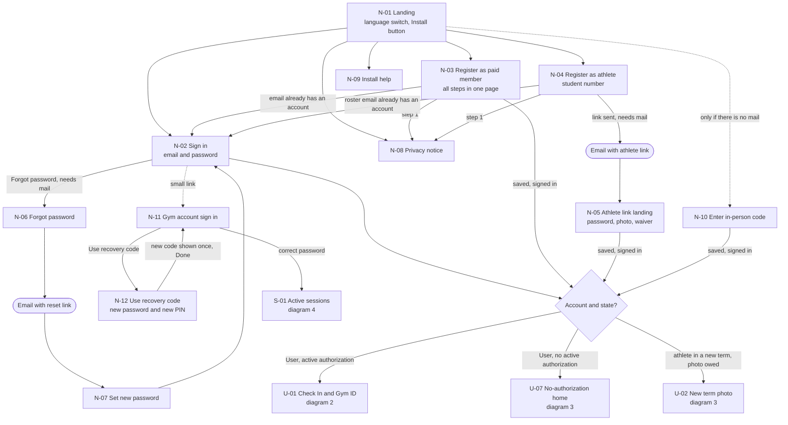
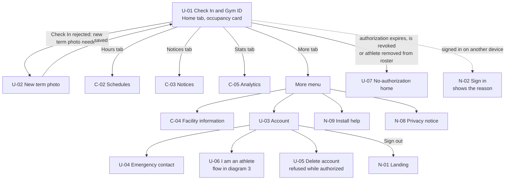
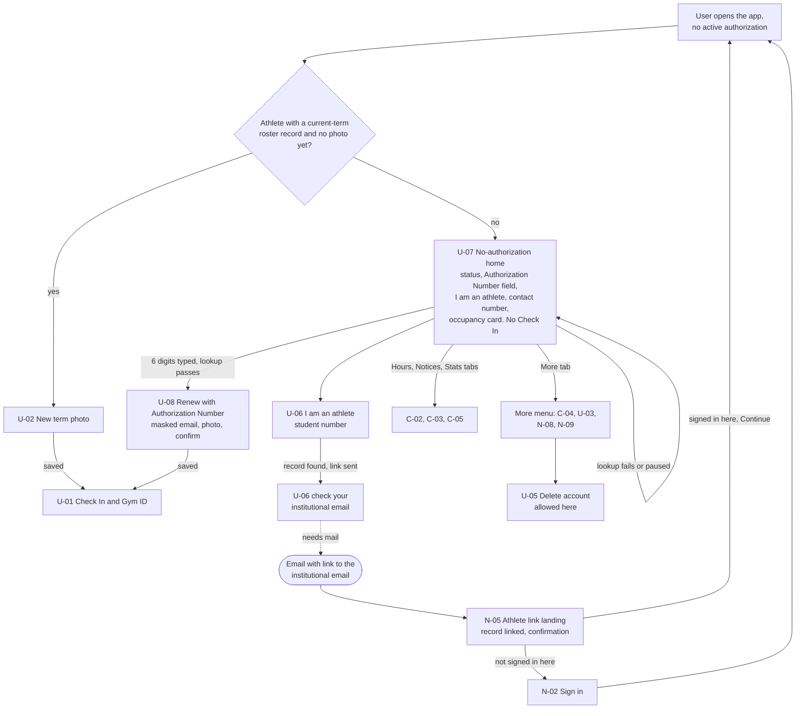
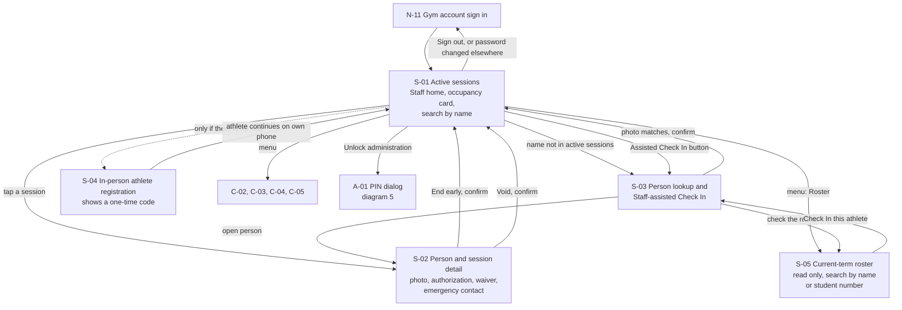
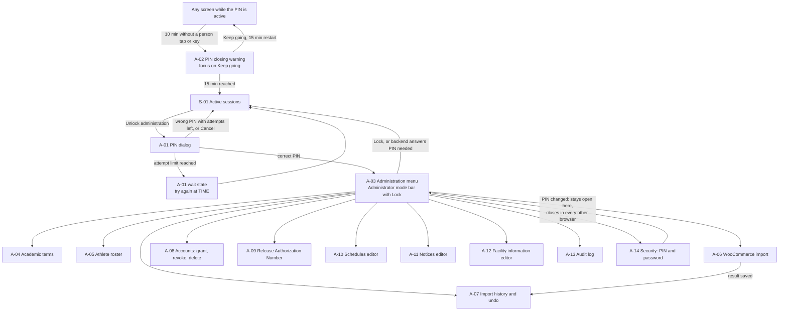
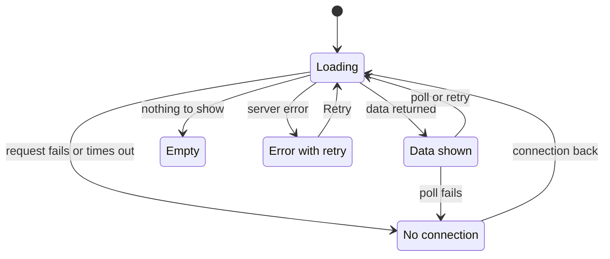

# Screen map by role

This document lists every screen of the PWA, groups them by role, and draws how a person moves between them. Each screen has a short stable id (N for not signed in, U for User, C for shared, S for Staff, A for Administrator) so wireframe and feature issues can refer to it. Public screens use N, not P, so they do not look like the professor question codes P-01 to P-05 in `team.md`. It covers GitHub issue #8. Flows, state names and rules come from the finished design files: `architecture.md`, `data-model.md`, `registration-flows.md` (REG-N decisions), `check-in-flows.md` (D-N decisions) and `admin-flows.md` (D-N decisions, here written "admin D-N"). Requirements come from `docs/requirements/SRS.md` v0.6, which includes the team decisions E-56 to E-60 of 2026-10-14. Wireframes and visual design are out of scope. Where a diagram follows a choice from [Design decisions to confirm](#design-decisions-to-confirm), the diagram draws the recommended option and the note under it names the choice (SM-N).

Two pending answers touch several screens:

- Outgoing mail (CTI, M-07). N-04, N-05, N-06, N-07 and U-06 need it. Without mail, N-06, N-07 and the email links are not built, and N-10 and S-04 are built instead (REQ-F-77).
- Contact number (gym, G-25). N-03, N-04, U-06, U-07 and U-08 show it.

## Diagrams

### 1. Public screens

**Type:** Navigation map. **Use it to:** draw the wireframes of the public screens and build their routes.

**About this diagram:** "Needs mail" waits on CTI's answer (M-07); N-10 exists only without mail (REQ-F-77, REG-11). The small link to N-11 is SM-5. N-12 is the recovery code screen (E-60, REQ-F-89).

- N-03, N-05 and N-10 are wizards inside one page. Typed data stays in page memory until the final save and is lost on reload (REG-8, REQ-F-13).
- A signed-in person who opens N-01 goes straight to the home of diagram 2, 3 or 4.
- N-12 ends on N-11, where the person signs in with the new password (Proposed). It does not sign anyone in by itself.

### 2. User with an active authorization

**Type:** Navigation map. **Use it to:** draw the wireframes of the User screens and build the tabs and routes.

**About this diagram:** Tabs follow SM-1. Where U-06 appears is Gaps 2. The sign-out on another device is REQ-F-03.

- U-01 holds the Check In button and the Gym ID in the states of `check-in-flows.md` sections 6 and 7. Check In rejections are states of U-01, not separate screens, except "new term photo needed", which opens U-02.
- The language switch (C-06) is in the top bar of every screen (SM-2).

### 3. User with no active authorization

**Type:** Navigation map. **Use it to:** draw the wireframes of the no-authorization home, renewal and "I am an athlete" screens, and build their routes.

**About this diagram:** This is the home of REQ-F-23. The first decision is REG-10. The roster record is linked only when the email link is opened (E-58, REQ-F-80), and the term photo is then asked on U-02 like any athlete in a new term. "Needs mail" waits on CTI (M-07).

- U-07 replaces U-01 as the home. The tabs are the same; the Home tab shows U-07 (SM-4).
- Messages for a failed lookup are the ones of N-03 (REQ-F-71, F-72, F-73, REG-9).
- N-05 reuses the athlete link landing of diagram 1 with a second mode: the link comes from U-06, so there is no password or waiver step, only the "record linked" confirmation. Opening the link never signs a person in.

### 4. Staff (gym account without the PIN)

**Type:** Navigation map. **Use it to:** draw the wireframes of the front desk screens and build the Staff menu and routes.

**About this diagram:** S-05 is the read-only roster that Staff got with E-59 (REQ-F-45, F-49); the gym still has to confirm it (G-09). S-04 exists only without mail (M-07); the athlete continues at N-10.

- Staff use S-05 to check an athlete whose 60 minutes ended (REQ-F-45) and to find a student number before an assisted Check In. S-05 has no add, edit, remove or import: those stay on A-05.
- "Check In this athlete" opens S-03 with the student number filled in (Proposed).
- Staff have no account settings screen. Changing the gym account password is an Administrator action (A-14), or anyone with the recovery code at N-12.

### 5. Administrator (gym account with the PIN)

**Type:** Navigation map. **Use it to:** draw the wireframes of the administration screens and build the PIN dialog, the closing warning and the routes.

**About this diagram:** The wait state is admin D2. After a PIN change the PIN closes in every other browser because of the PIN version of E-56 (REQ-NF-48); the browser that made the change stores the new version and stays open, as in `admin-flows.md`.

- While the PIN is active, the Staff screens (S-01 to S-05) and shared screens stay in the same menu (SM-3).
- The PIN state and the last person activity are kept in the session data of that browser (E-56, REQ-NF-48). Each Administrator request compares the PIN version kept there with the gym account's version. Changing the PIN in A-14 closes the PIN in every other browser; this browser stores the new version and stays open.
- Unsaved input on an Administrator form is lost when the PIN closes (`admin-flows.md` section 2). A-02 gives 5 minutes of warning.

### 6. Shared screens and the app frame

**Type:** Navigation map. **Use it to:** build the app frame, the top bar and the navigation component that every role shares.

**About this diagram:** The navigation component is SM-1; the top bar switch is SM-2.

- Every signed-in role sees C-01 to C-05 with the same data (REQ-F-42, F-55, F-61). Analytics need no PIN (REQ-F-61).
- C-06 is a control, not a screen. For a User the choice is saved on the account (`users.locale`), so emails use it (REQ-NF-35). The gym account has no locale column, so the choice is kept in that browser only.

### 7. Standard data states

**Type:** State diagram. **Use it to:** build the loading, empty, error and no-connection states of every data screen, and write test cases for them.

Every screen that loads data from `/api` follows this contract. The inventory names how each state looks on each screen.

**About this diagram:** What stays visible without a connection is SM-6.

- No connection: the app shell still opens from the service worker, but `/api` is never cached (`architecture.md`, REQ-NF-26). Actions that need the server are disabled with a reason.
- Empty is never an error. A period with no data in C-05 shows zeros (REQ-F-61).

## 8. Screen inventory

Device: "Phone" means designed for a phone first. "Desk" means the gym mostly uses it on the front desk desktop computer, which the gym still has to confirm (G-06). Every screen works on both sizes (REQ-NF-10, one codebase).

### Public

| ID | Screen | Roles | Purpose | Key states | Device | Requirements |
|---|---|---|---|---|---|---|
| N-01 | Landing | Not signed in | Choose sign in or register; Install button; links to N-08 and N-09 | Loading: app shell. No connection: banner, sign in and register disabled. Install button hidden where the browser has no install event. Signed in: redirect to home | Phone | REQ-NF-10, NF-33, F-66 |
| N-02 | Sign in | User | Email and password | Loading: button busy. Error: wrong credentials, without saying if the email exists (SRS 3.1). Wait: "try again at TIME" (REQ-F-07). No connection: form kept, submit disabled. Special: "you signed in on another device" (REQ-F-03) | Phone | REQ-F-02, F-03, F-07 |
| N-03 | Register as paid member | Not signed in | Steps: privacy notice, Authorization Number, masked email, password, photo, waiver and emergency contact, final save | Loading: lookup after 6 digits; slow mode waits (REG-2). Error: same message for invalid and claimed, with contact number; ended-term message (REG-9); per-IP pause "try again at TIME"; photo rejected, stays on photo step with data kept (REG-8). No connection: data kept in page, submit disabled. Special: "you already have an account, sign in" (REG-4) | Phone | REQ-F-10, F-11, F-13, F-18, F-60, F-70, F-71, F-72, F-73, NF-24, NF-25 |
| N-04 | Register as athlete | Not signed in | Privacy notice, student number, link sent | Loading: lookup. Error: not on the roster with contact number (REQ-F-76); record claimed; link request limit (REG-7). No connection: submit disabled. Special: "link sent to c***@upr.edu" (REG-3); "you already have an account, use I am an athlete" | Phone | REQ-F-15, F-73, F-76, NF-25 |
| N-05 | Athlete link landing | Not signed in, or a User | Two modes. From an N-04 link: password, photo, waiver, final save. From a U-06 link: the roster record is linked to the account that asked, then a confirmation (E-58) | Loading: link check. Error: link expired, already used or replaced, record claimed since (REG-6); photo rejected (N-04 mode). No connection: data kept, submit disabled. Special (U-06 mode): "record linked to the account m***@..." with Continue when that account is signed in here, Sign in otherwise; the term photo is then asked on U-02 | Phone | REQ-F-13, F-15, F-60, F-80, NF-24 |
| N-06 | Forgot password | User | Ask for a reset link | Loading. Error: server error. No connection. Special: same answer whether the email exists or not (Proposed, Gaps 6). Not built without mail | Phone | REQ-F-06, F-75 |
| N-07 | Set new password | User | From the reset link: new password | Loading: link check. Error: link expired or used; password rules. No connection | Phone | REQ-F-06, F-75 |
| N-08 | Privacy notice | Everyone | Notice in Spanish and English, shown before any personal data | Loading. Error. No connection: notice is static text in the app, so it still shows. Text pending G-24 | Phone | REQ-NF-25 |
| N-09 | Install help | Everyone | Install button in Chromium browsers; iPhone steps with Share | Special: button hidden without the install event; "already installed" when opened as the installed app. Static, works without connection | Phone | REQ-F-66 |
| N-10 | Enter in-person code | Athlete, only if no mail | Code from Staff, then privacy notice, password, photo, waiver | Loading. Error: code wrong or expired (REG-11); photo rejected. No connection: submit disabled | Phone | REQ-F-77, F-13, F-60, NF-25 |
| N-11 | Gym account sign in | Gym account | Gym username and password (SM-5); "Use recovery code" link to N-12 | Loading. Error: wrong credentials. Wait: REQ-F-07. No connection. Special: "signed out because the password changed" (`admin-flows.md` section 4) | Desk | REQ-F-07, F-52, F-88, F-89 |
| N-12 | Use recovery code | Anyone with the paper recovery code | Type the recovery code, then a new gym account password and a new PIN; then see the new recovery code once (E-60) | Loading. Error: wrong code with attempts left; password or PIN rules not met. Wait: "try again at TIME", limited like the PIN. No connection: submit disabled. Special: new code shown once, with "write it down and keep it in a safe place" and Done (Proposed: Done asks to confirm the code was written down); other browsers signed out and the PIN closed everywhere; each use writes an audit log entry (A-13) | Desk | REQ-F-89, F-88, NF-39, NF-48 |

### User

| ID | Screen | Roles | Purpose | Key states | Device | Requirements |
|---|---|---|---|---|---|---|
| U-01 | Check In and Gym ID | User with active authorization | Home. Check In button; Gym ID after a valid Check In; C-01 card | Empty: no session yet, Check In button. Loading: checking eligibility, waiting for location, sending. Error: one state per cause key of check-in D5 (no authorization, gym closed, athletes-only, location denied with how to turn it on, location unavailable, low accuracy, outside boundary). No connection: Check In refused; Gym ID not shown as current (SM-6). Special: active with minutes left and moving clock; paid expired with text and icon; athlete "session ended, still authorized"; invalid after roster removal; athletes-only notice with start time | Phone | REQ-F-33, F-36, F-37, F-38, F-40, F-49, F-82, F-83, NF-11, NF-14, NF-16, NF-26 |
| U-02 | New term photo | Athlete in a new term; athlete just linked with "I am an athlete"; manual grant without photo | Upload the term photo before Check In | Loading: upload. Error: type or size (REQ-NF-24); record claimed by another account, contact number. No connection: upload disabled | Phone | REQ-F-25, F-26, F-13, NF-24 |
| U-03 | Account | User | Name, account email (read only), current authorization and term, links to U-04, U-05, U-06, sign out | Loading. Error. No connection: data marked not current | Phone | REQ-F-01, F-11, F-19 |
| U-04 | Emergency contact | User | See and edit the emergency contact (Proposed in REQ-F-60) | Loading. Error: name or phone invalid. No connection: save disabled | Phone | REQ-F-60 |
| U-05 | Delete account | User | Explain what is deleted and kept, confirm | Error: refused with the reason while an authorization is active. No connection: disabled. Special: after deletion, back to N-01 | Phone | REQ-F-09 |
| U-06 | I am an athlete | User | Student number, then "check your institutional email". Nothing is linked yet: the record is linked only when the email link is opened at N-05 (E-58) | Loading. Error: not on the roster with contact number (REQ-F-76); record claimed; link request limit. No connection: submit disabled. Special (end state): "check your institutional email c***@upr.edu" | Phone | REQ-F-20, F-26, F-76, F-80 |
| U-07 | No-authorization home | User with no active authorization | Status, Authorization Number field, I am an athlete, contact number, C-01 card. No Check In | Loading. Error. No connection: field disabled. Special: status "expired" or "not on the roster" (REQ-F-23), other causes in Gaps 1; contact number pending G-25; no term configured | Phone | REQ-F-23, F-73 |
| U-08 | Renew with Authorization Number | User with no active authorization | After a valid number: masked email, renewal or type change, photo, confirm | Loading: lookup, save. Error: same messages as N-03; payment email belongs to another account, refused with contact number. No connection: data kept, submit disabled | Phone | REQ-F-20, F-26, F-70, F-71, F-72, F-78 |

### Shared (every signed-in role)

| ID | Screen | Roles | Purpose | Key states | Device | Requirements |
|---|---|---|---|---|---|---|
| C-01 | Occupancy card | User, Staff, Administrator | Estimated occupancy with "updated at TIME", on every home | Loading: placeholder, no number. Empty: 0 is a real value. Error and no connection: number hidden, "not current" with icon (REQ-NF-26). Polls every 20 to 30 s (check-in D6) | Both | REQ-F-41, F-42, F-43, NF-26 |
| C-02 | Schedules | User, Staff, Administrator | Regular hours, special hours, closures, athletes-only slots; "open now" or "closed now" | Loading. Empty: "no schedule published". Error. No connection: SM-6 | Both | REQ-F-55, F-58, NF-37, NF-38 |
| C-03 | Notices | User, Staff, Administrator | Current maintenance notices and updates | Loading. Empty: "no notices". Error. No connection: SM-6 | Both | REQ-F-55, F-58 |
| C-04 | Facility information | User, Staff, Administrator | Rules, towel, footwear, machines, equipment instructions | Loading. Empty per topic. Error. No connection: SM-6. Stretch: a QR code opens one topic (REQ-F-59) | Both | REQ-F-55, F-58, F-59 |
| C-05 | Analytics | User, Staff, Administrator, no PIN | Period picker and metrics (a) to (f) | Loading. Empty: zeros, not an error. Error. No connection: charts hidden, "not current" | Both | REQ-F-61, NF-37, NF-38 |
| C-06 | Language switch | Everyone | Button that switches every text between Spanish and English | Special: saved on the account for Users, in the browser for the gym account; page `lang` changes with the texts | Both | REQ-NF-33, NF-34, NF-35, NF-36 |

### Staff (also reachable by the Administrator)

| ID | Screen | Roles | Purpose | Key states | Device | Requirements |
|---|---|---|---|---|---|---|
| S-01 | Active sessions | Staff, Administrator | Home. C-01 card, list of active sessions with name, Check In time, authorization, minutes left; search by name | Loading. Empty: "no active sessions". Error. No connection: list marked not current, actions disabled. Search is a fresh request, never cached | Desk | REQ-F-42, F-43, F-44, F-45, NF-26 |
| S-02 | Person and session detail | Staff, Administrator | Photo from the backend, authorization, waiver acceptance, emergency contact, session; End early and Void with confirm | Loading: photo. Error: session already ended or changed by another browser. No connection: actions disabled. Special: voiding an ended session, open (check-in Gaps 5) | Desk | REQ-F-45, F-48, NF-19, NF-20, NF-39 |
| S-03 | Person lookup and Staff-assisted Check In | Staff, Administrator | Search by name (paid member) or student number (athlete); compare the photo; confirm Check In; link to S-05 to check the roster | Loading. Empty: no match. Error: cause keys (no authorization, photo required, gym closed, athletes-only for paid members). No connection: disabled. Special: person already has an active session, shown instead of a new one | Desk | REQ-F-36, F-45, F-46, F-82, NF-39 |
| S-04 | In-person athlete registration | Staff, Administrator, only if no mail | Student number, roster check, ID check, one-time code | Loading. Error: not on the roster, Staff cannot add records (REQ-F-76, F-77); record claimed. No connection. Special: code with its expiry time | Desk | REQ-F-77, NF-39 |
| S-05 | Current-term roster | Staff, Administrator | Read-only list of the current-term roster records; search by name or student number; "Check In this athlete" opens S-03 (E-59) | Loading. Empty: "no records in this term"; no term covers today. Empty search: no match. Error. No connection: list marked not current, search disabled. Special: no add, edit, remove or import controls; search is a fresh request, never cached. Gym still to confirm (G-09) | Desk | REQ-F-45, F-46, F-49, F-51 |

### Administrator (PIN active in this browser)

| ID | Screen | Roles | Purpose | Key states | Device | Requirements |
|---|---|---|---|---|---|---|
| A-01 | PIN dialog | Staff | Type the PIN to unlock Administrator actions | Loading. Error: wrong PIN, attempts left. Wait: "try again at TIME", Staff work continues (admin D2). No connection | Desk | REQ-F-52, NF-48 |
| A-02 | PIN closing warning | Administrator | After 10 minutes without a person tap or key press: "PIN closes in 5 minutes" and Keep going | Special: Keep going restarts 15 minutes; at 15 minutes back to S-01 and unsaved input lost | Desk | REQ-NF-48, NF-13 |
| A-03 | Administration menu | Administrator | Entry to A-04 to A-14; Administrator mode bar with Lock | Special: banner when no term covers today (admin D9) | Desk | REQ-F-21, F-52 |
| A-04 | Academic terms | Administrator | List, create and edit terms | Loading. Empty: no terms, banner. Error: dates in wrong order; overlap names the other term; edit leaves records outside (Proposed). No connection: save disabled | Desk | REQ-F-21 |
| A-05 | Athlete roster | Administrator | Pick a term; list, add, edit, remove records; import a list | Loading. Empty: no records in this term. Error: unexpected format imports nothing; repeated student number. Special: list result (added, rejected rows); removal confirm says the Gym ID stops being valid at once. Format pending G-10 | Desk | REQ-F-49, F-51, NF-39 |
| A-06 | WooCommerce import | Administrator | Upload an Export Orders file and see the result | Loading: processing. Error: unexpected format imports nothing. Special: result with created, updated, rejected (admin D6). Columns pending E-55 | Desk | REQ-F-22, F-28, F-29, F-30 |
| A-07 | Import history and undo | Administrator | List imports; undo one, with counts on the confirm (admin D7) | Loading. Empty: no imports. Error. Special: undone imports marked, kept in the list | Desk | REQ-F-31, NF-39 |
| A-08 | Accounts | Administrator | Find an account by name or email; see authorizations; grant manual, revoke (with reason); delete on the User's request | Loading. Empty: no match. Error: grant refused (term ended, existing authorization); reason missing; delete refused with an active authorization | Desk | REQ-F-09, F-87, NF-39 |
| A-09 | Release Authorization Number | Administrator | Type the number; see account, masked email, claim time; confirm | Loading. Empty: number not claimed. Special: confirm says whether the account is deleted or only the authorization (admin D12) | Desk | REQ-F-74, NF-39 |
| A-10 | Schedules editor | Administrator | Regular hours, special hours, closures, athletes-only slots, Spanish and English text | Loading. Empty. Error: Spanish text missing. Slot list pending G-28 | Desk | REQ-F-55, F-58, F-82, NF-39 |
| A-11 | Notices editor | Administrator | Create, edit, delete notices in Spanish and English | Loading. Empty. Error: Spanish text missing | Desk | REQ-F-55, F-58 |
| A-12 | Facility information editor | Administrator | Edit rules, towel, footwear, machines, equipment instructions | Loading. Error: Spanish text missing | Desk | REQ-F-55, F-58 |
| A-13 | Audit log | Administrator | Filter by date and action; entry with time, IP address, device, before and after; lookup alerts; recovery code uses | Loading. Empty: no entries for the filter. Error | Desk | REQ-NF-39, F-71, F-89 |
| A-14 | Security | Administrator | Change the PIN and the gym account password, with the current PIN | Error: wrong current PIN counts toward the limit; rules not met. Special: other browsers signed out after a password change; after a PIN change the PIN closes in every other browser and stays open here (E-56) | Desk | REQ-F-88, NF-48 |

Every A screen also shows "No connection: actions disabled" and Loading, as in diagram 7.

## 9. Role table coverage

Each action of the SRS Overview role table and the screen where it happens.

| Action (role table) | Screen ids |
|---|---|
| Register | N-03, N-04, N-05 (N-10 without mail) |
| Sign in | N-02 (User), N-11 (gym account) |
| Check In; show the Gym ID | U-01 |
| Renew | U-08, U-06 then N-05, U-02 |
| Delete own account | U-05 |
| See occupancy, schedules, notices, facility information | C-01, C-02, C-03, C-04 |
| See facility analytics | C-05 |
| See active sessions and verify a Gym ID | S-01, S-02, S-03, S-05 |
| Staff-assisted Check In | S-03 |
| End a session early or void it | S-02 |
| See a User's waiver and emergency contact | S-02 |
| Register in person an athlete on the roster (only without mail) | S-04, then N-10 |
| See the current-term athlete roster, read only (Staff and Administrator) | S-05 |
| Change the athlete roster | A-05 |
| Academic terms | A-04 |
| WooCommerce import and undo | A-06, A-07 |
| Schedules, closures, athletes-only slots | A-10 |
| Notices, facility information | A-11, A-12 |
| Grant or revoke an authorization by hand | A-08 |
| Release a claimed Authorization Number | A-09 |
| Delete a User's account when the User asks | A-08 |
| See the audit log | A-13 |
| Change the PIN and the gym account password | A-14 |
| Set a new gym account password and PIN with the recovery code (only with the code) | N-11, then N-12 |

Not in the role table but needed: N-06 and N-07 (REQ-F-06), N-08 (REQ-NF-25), N-09 (REQ-F-66), U-04 (REQ-F-60), C-06 (REQ-NF-33).

## 10. Phone and front desk

- Phone first (REQ-NF-10): every N screen except N-11 and N-12, every U and C screen. These are the screens about 150 people a day use (REQ-NF-15). Check In must be usable in under 3 seconds (REQ-NF-16), so U-01 is the first screen after sign in and loads nothing it does not need.
- Front desk desktop, pending G-06: S-01 to S-05, A-01 to A-14, N-11, N-12. S-01, S-05 and A-13 are tables that need a wide layout. A-05 and A-06 upload files that usually live on a computer.
- If the gym says Staff also use phones (G-06), S-01 to S-03 and S-05 need the phone layout too. One codebase keeps this possible (REQ-NF-10). A-screens stay desktop-first.
- C screens are used on both.

## 11. Accessibility notes

All screens target WCAG 2.2 level AA (REQ-NF-13). Notes only where a screen has a specific need. WCAG success criteria cited below were checked in https://www.w3.org/TR/WCAG22/.

- **A-02 PIN closing warning.** Opens as a modal dialog. Keyboard focus moves to Keep going, and screen readers announce the dialog text (REQ-NF-48, WCAG 2.2.1 Timing Adjustable). Focus returns to where it was when the dialog closes. The remaining time is shown as text, and is not announced every second.
- **U-01 Gym ID moving clock.** The clock must move: it is how Staff tell a live screen from a screenshot (REQ-F-40). WCAG 2.2.2 Pause, Stop, Hide exempts movement that is essential to the activity. Proposed: the clock shows the current time with seconds as text, changes at most once per second, and never flashes.
- **U-01 Gym ID states.** Active, expired, "session ended, still authorized", invalid and no connection each have a text label and an icon, not only a color (REQ-NF-14, WCAG 1.4.1 Use of Color).
- **U-01, S-03 Check In results.** Rejections and success are status messages that screen readers read without moving focus (WCAG 4.1.3 Status Messages). Each says the cause in words.
- **C-01, S-01 polling.** A new occupancy value after each poll is not announced, to avoid noise. The "not current" state is announced once.
- **C-06 language switch.** The page `lang` attribute changes with the texts (REQ-NF-36, WCAG 3.1.1). The button label is written in the target language ("English", "Español") and marked with its own language (WCAG 3.1.2).
- **Bottom tabs and the Check In button (SM-1).** Targets at least 24 by 24 CSS pixels (WCAG 2.5.8). The fixed tab bar must not cover the focused element (WCAG 2.4.11).
- **A-01 PIN dialog.** Numeric keypad on phones; the error and the wait time are text, not only a red field.
- **N-12 new recovery code.** Shown as text, never as an image, so screen readers can read it and it can be copied.

## Design decisions to confirm

All are **Proposed**. The team decides in the PR review.

### SM-1: Navigation for Users on the phone

| Option | What it means | Tradeoff |
|---|---|---|
| A | Bottom tab bar: Home (U-01 or U-07), Hours (C-02), Notices (C-03), Stats (C-05), More (C-04, U-03, N-08, N-09). On wide screens the same items as a side menu | One tap to every common screen, reachable with the thumb. Five tabs is the practical limit; anything new goes in More |
| B | Menu button that opens a list | Room for any number of items. Every screen except home needs two taps, and items are hidden from people who do not open the menu |
| C | Home with tiles, no persistent navigation | Simple home. Back to home between every screen; more taps |

Recommendation: A. Check In and the Gym ID stay one tap away from anywhere, and the Staff and Administrator side menu on the desktop can use the same component.

### SM-2: Where the language switch lives (REQ-NF-33)

| Option | What it means | Tradeoff |
|---|---|---|
| A | A small "English" or "Español" button in the top bar of every screen, public screens included | Always visible, also to a person who cannot read the current language well enough to find a menu. Takes top bar space |
| B | Only in More (Users) and in the menu (gym account) | Clean top bar. Hard to find for someone who does not read Spanish, and absent before sign in |
| C | Top bar on public screens, More after sign in | Visible when it matters most. Two places to build and test |

Recommendation: A. REQ-NF-33 asks for a button that switches all texts, and the person who needs it most may not read the menu.

### SM-3: Staff and Administrator layout

| Option | What it means | Tradeoff |
|---|---|---|
| A | One layout; Administrator items always shown with a lock icon; tapping one opens A-01 | The Administrator finds every item in one place. Front desk students see the full Administrator menu and may tap it by mistake |
| B | One layout; without the PIN the menu shows only "Unlock administration"; with the PIN the Administrator items appear in the same menu, plus a bar "Administrator mode" with Lock | Staff see only their work. Matches `admin-flows.md` section 2 ("the interface hides Administrator screens without the PIN"). The Administrator keeps Staff screens without switching areas |
| C | Separate area with its own menu, entered with the PIN; leaving it returns to Staff | Clear separation. Moving between session work and administration needs a switch; two layouts to build |

Recommendation: B. In every option the backend decides each action (REQ-F-52), so hiding items is only for clarity, not security.

### SM-4: Home screen per role

| Option | What it means | Tradeoff |
|---|---|---|
| A | User with active authorization: U-01. User without: U-07. Gym account: S-01. After the PIN: A-03 | Each role starts where its most common task is. After the PIN, the Administrator goes to the menu of what the PIN unlocks |
| B | As A, but after the PIN the Administrator stays on the screen where Unlock was tapped | Fewer jumps when the PIN is asked in the middle of a task. Needs the Unlock button to remember where it came from |
| C | One dashboard for every role with role-specific cards | One screen to design. Check In moves below other cards, which works against REQ-NF-16 |

Recommendation: A, and B only for the case where the backend asks for the PIN in the middle of an action (`admin-flows.md` section 2): after the PIN the person returns to that screen.

### SM-5: Where the gym account signs in

| Option | What it means | Tradeoff |
|---|---|---|
| A | Same screen as Users (N-02); the field accepts an email or the gym username | One screen. The label "email or username" confuses 150 Users a day for the sake of one account |
| B | Separate screen N-11 at its own address, bookmarked on the front desk computer, with a small link from N-02 | Clear labels and messages for each. One more small screen. The address is not secret and gives no extra security |

Recommendation: B. Attempt limits (REQ-F-07) apply the same on both screens.

### SM-6: What screens show without a connection (REQ-NF-26)

| Option | What it means | Tradeoff |
|---|---|---|
| A | Every data screen hides its data and shows only "No connection" | Simplest rule. A User loses the schedule they were reading |
| B | Schedules, notices, information and analytics already loaded in this visit stay on screen with "not current, updated at TIME". Occupancy hides its number. The Gym ID shows "No connection, not valid now" with an icon and the moving clock stops, so Staff see at once it is not live | Keeps harmless content readable and never shows occupancy or a Gym ID as current. Two behaviors to test |

Recommendation: B. Data stays only in page memory, since the service worker never caches `/api`.

## Gaps and questions

1. **REQ-F-23 lists two statuses only.** U-07 shows "expired" or "not on the roster". It does not say what a User sees after a manual revoke (REQ-F-87), after an import undo or release deleted the authorization (REQ-F-31, F-74), or when no term covers today. Proposed: add "revoked" and "no current authorization" with the contact number.
2. **Where "I am an athlete" appears.** REQ-F-80 has no condition, but REQ-F-23 shows it only without an active authorization. U-03 shows it to every User until the team answers `registration-flows.md` Gaps 8 (two authorizations in one term).
3. **No screen owns the contact number.** The `settings` table holds it (`data-model.md`), and it will change over time, but the role table gives no one an action to edit it. Proposed: add it to A-14 (renamed "Security and settings") and to the role table.
4. **Staff lookup is not in the role table.** Resolved by E-59: Staff see the current-term roster read only (S-05); the gym still has to confirm (G-09).
5. **Public schedules and notices.** The role table gives schedules and notices only to signed-in roles. People deciding whether to buy a membership might want the hours before they have an account. Should N-01 show C-02 and C-03?
6. **Password reset answer.** SRS 3.1 says sign in must not reveal whether an email exists, but says nothing for N-06. Proposed: the same answer in both cases.
7. **Gym account language.** REQ-NF-33 says every text switches, but `gym_accounts` has no locale. The choice is kept per browser, which fits a shared account. Confirm.
8. **Front desk devices (G-06).** The Desk column assumes a desktop computer. If Staff also use phones, S-01 to S-03 and S-05 need a phone layout.

## Traceability

| Requirement or decision | Where it appears |
|---|---|
| REQ-F-23 | Diagram 3. User with no active authorization; 8. Inventory U-07, U-08; Gaps 1 |
| REQ-F-52 | Diagram 4. Staff; diagram 5. Administrator; 8. Inventory N-11, A-01, A-03; 9. Coverage; SM-3 |
| REQ-F-55 | Diagram 6. Shared screens and the app frame; 8. Inventory C-02, C-03, C-04, A-10, A-11, A-12; 9. Coverage |
| REQ-F-61 | Diagram 6. Shared screens and the app frame; diagram 7. Standard data states; 8. Inventory C-05; 9. Coverage |
| REQ-F-66 | Diagram 1. Public screens (N-01, N-09); 8. Inventory N-01, N-09 |
| REQ-NF-10 | 8. Inventory (Device column); 10. Phone and front desk; SM-1 |
| REQ-NF-13 | 11. Accessibility notes; 8. Inventory A-02 |
| REQ-NF-33 | Diagram 6. Shared screens and the app frame (C-06); 8. Inventory C-06; 11. Accessibility notes; SM-2 |
| REQ-F-03, F-07 | Diagram 1. Public screens; diagram 2. User with an active authorization; 8. Inventory N-02, N-11 |
| REQ-F-06, F-75 | Diagram 1. Public screens; 8. Inventory N-06, N-07 |
| REQ-F-09 | Diagrams 2 and 3 (U-05); 8. Inventory U-05, A-08 |
| REQ-F-13, F-15, F-60, F-70, F-71, F-72, F-73, F-76, NF-24, NF-25 | Diagram 1. Public screens; 8. Inventory N-03, N-04, N-05, N-10 |
| REQ-F-20, F-25, F-26, F-78 | Diagram 3. User with no active authorization; 8. Inventory U-02, U-06, U-08 |
| REQ-F-80, E-58 | Diagram 3. User with no active authorization (U-06, N-05); 8. Inventory U-06, N-05, U-02; 9. Coverage (Renew) |
| REQ-F-33, F-36, F-37, F-38, F-40, F-82, F-83, NF-11, NF-14, NF-16 | Diagram 2. User with an active authorization; 8. Inventory U-01; 11. Accessibility notes |
| REQ-F-41, F-42, F-43, NF-26 | Diagram 6. Shared screens and the app frame; diagram 7. Standard data states; 8. Inventory C-01, S-01; SM-6 |
| REQ-F-44, F-45, F-46, F-48, F-77, NF-19 | Diagram 4. Staff; 8. Inventory S-01 to S-05 |
| REQ-F-49, E-59 | Diagram 4. Staff (S-05); 8. Inventory S-05, A-05; 9. Coverage; Gaps 4 |
| REQ-F-21, F-28, F-31, F-74, F-87, F-88, NF-39 | Diagram 5. Administrator; 8. Inventory A-04 to A-14 |
| REQ-NF-48, E-56 | Diagram 5. Administrator (A-01, A-02, A-14); 8. Inventory A-01, A-02, A-14, N-12; 11. Accessibility notes |
| REQ-F-89, E-60 | Diagram 1. Public screens (N-11, N-12); 8. Inventory N-11, N-12, A-13; 9. Coverage; 11. Accessibility notes |
| REQ-NF-35, NF-36 | Diagram 6. Shared screens and the app frame; 11. Accessibility notes |
