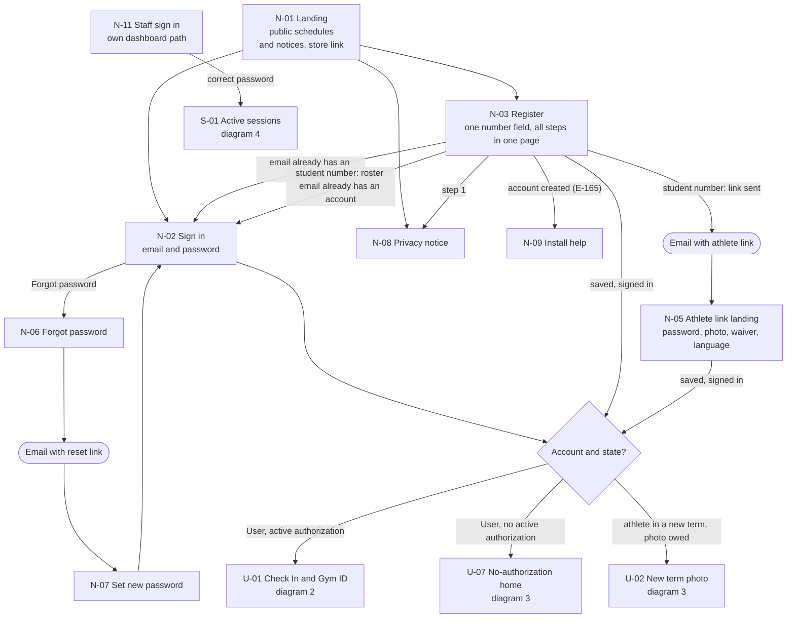
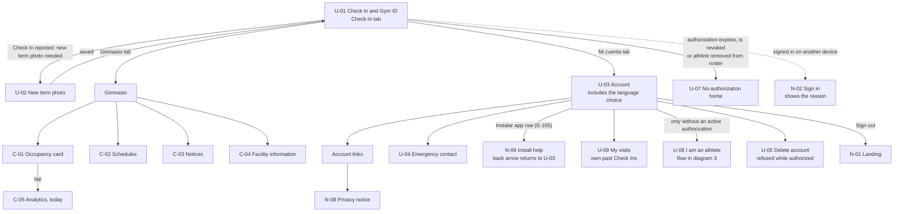
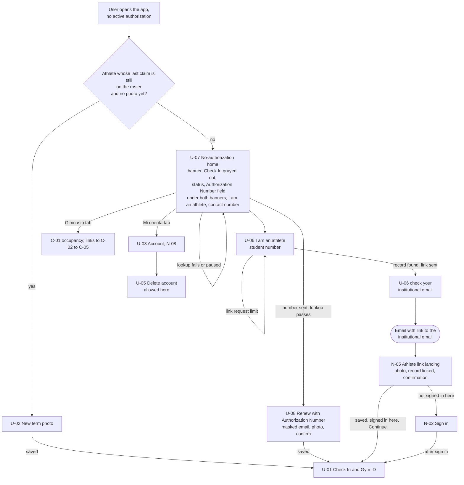
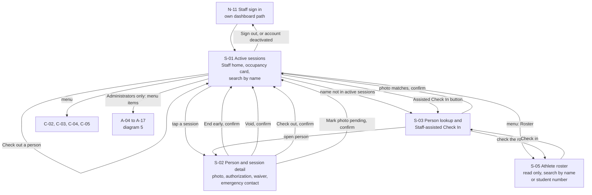
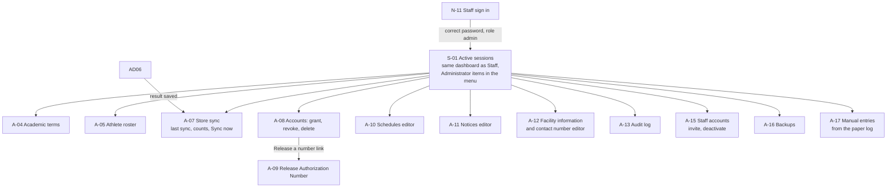
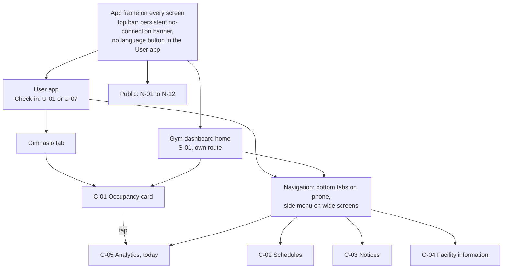
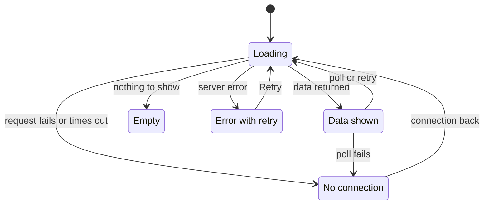

# Screen map by role

This document lists every screen of the PWA, groups them by role, and draws how a person moves between them. Each screen has a short stable id (N for not signed in, U for User, C for shared, S for Staff, A for Administrator) so wireframe and feature issues can refer to it. Public screens use N, not P, so they do not look like the professor question codes P-01 to P-05 in `team.md`. It covers GitHub issue #8. Flows, state names and rules come from the finished design files: `architecture.md`, `data-model.md`, `registration-flows.md` (REG-N decisions), `check-in-flows.md` (D-N decisions) and `admin-flows.md` (D-N decisions, here written "admin D-N"). Requirements come from `docs/requirements/SRS.md` v0.10, with the team decisions up to E-128. Wireframes and visual design are out of scope. Where a diagram follows a choice from [Design decisions to confirm](#design-decisions-to-confirm), the diagram draws the chosen option and the note under it names the choice (SM-N). The team decided SM-1 to SM-6 and the gaps in a design review between 2026-10-17 and 2026-10-19 (issue #52), and the wireframe questions on 2026-10-20 (E-101 to E-107). On 2026-11-04 personal staff accounts replaced the shared gym account and the PIN (E-114), so the PIN screens (A-01, A-02), the recovery screen (N-12), Security (A-14) and the in-person registration screens (N-10, S-04) are removed, and A-15 to A-17 are new. Parts still open say "to confirm".

Pending answers touch several screens:

- Outgoing mail (CTI, M-07) is assumed available (E-61). CTI described a relay through its mail gateway once CTI authorizes the VM (M-07); SPF and DKIM are still open. If CTI does not authorize the VM, the prototype uses an external provider, which needs approval to send data off the CTI VM (M-11). N-03, N-05, N-06, N-07 and U-06 use it. N-10 and S-04, the in-person registration tool, are removed (E-117, REQ-F-77).
- Contact number (gym, G-25). N-01, N-03, U-06, U-07 and U-08 show it.
- Store address (gym). N-01 and N-03 have a "Buy membership" button that opens the store. It does not redirect, it shows only while a term runs, and the address is a setting (E-92, E-96, E-126).

## Diagrams

### 1. Public screens

**Type:** Navigation map. **Use it to:** draw the wireframes of the public screens and build their routes.

**About this diagram:** Mail is assumed available (E-61). Athletes register only with the link sent to the roster email; there is no in-person code, and if the link fails they call the office at 265-3866 (E-117). N-11 sits on the gym dashboard path and has no link from N-02: Staff and Administrators reach it by typing its address (SM-5, E-124). The store button on N-01 shows while a term runs (E-126). N-03 is the one registration screen for paid members and athletes (E-153).

- N-03 and N-05 are wizards inside one page. Typed data stays in page memory until the final save and is lost on reload (REG-8, REQ-F-13). The password stays in memory only.
- N-01 shows the schedules (C-02) and notices (C-03) before sign in. Occupancy and analytics need a sign in (SM Gap 5).
- A signed-in person who opens N-01 goes straight to the home of diagram 2, 3 or 4.
- N-01 has a Spanish / English switch, Spanish by default; the choice stays on the device and applies to every screen before sign in. The account language is asked on N-03 and N-05 with that choice preselected (E-159).

### 2. User with an active authorization

**Type:** Navigation map. **Use it to:** draw the wireframes of the User screens and build the tabs and routes.

**About this diagram:** Tabs are Gimnasio, Check-in and Mi cuenta (E-164, updating SM-1). U-06 appears only when the User has no active authorization, because a User holds one active authorization per term (Gaps 2). The sign-out on another device is REQ-F-03.

- U-01 holds the Check In button and the Gym ID in the states of `check-in-flows.md` sections 6 and 7. Check In rejections are states of U-01, not separate screens, except "new term photo needed", which opens U-02. The server sends a fixed cause code for each rejection and the app writes the text in the account's language (E-74).
- The language is chosen when the account is created and changed in the preferences of U-03 (C-06, SM-2). There is no language button in the top bar of the User app (E-64, E-104).
- U-09 lists the User's own past Check Ins, newest first, each with date and time. It opens from U-03 (E-105, REQ-F-92) and never shows location (REQ-NF-03). It shows the full history, kept 5 years (E-126, E-125).
- During the athletes-only period the whole theme of the User app changes color, so every User sees the period at a glance. A text notice with the start time and an icon stay on U-01 for every User, athletes and paid members (E-76).

### 3. User with no active authorization

**Type:** Navigation map. **Use it to:** draw the wireframes of the no-authorization home, renewal and "I am an athlete" screens, and build their routes.

**About this diagram:** This is the home of REQ-F-23. A new term starts on the first app open in that term: the app looks up the roster by the student number of the account's last claim and asks for the new photo on U-02 (REG-10, E-69). This keeps the same account and its history. The roster record is linked only when the email link is opened (E-58, REQ-F-80), and the photo is saved at that moment with the link, so no authorization exists without a photo (E-69).

- U-07 replaces U-01 in the Check-in tab. The tabs stay Gimnasio, Check-in and Mi cuenta; occupancy stays on Gimnasio (E-164). A banner at the top says why there is no authorization and Check In is shown but grayed out (E-67). The Authorization Number field shows under both banners (E-97): a person whose authorization a release removed can claim the number again (REQ-F-74). If the number cannot be claimed, the message carries the contact number. I am an athlete shows under both banners (E-100).
- Messages for a failed lookup are the ones of N-03 (REQ-F-71, F-72, F-73). A number that is not valid in the current term gets the same message as an invalid or claimed one (REG-9).
- N-05 reuses the athlete link landing of diagram 1 with a second mode: the link comes from U-06, so there is no password or waiver step, only the photo and the "record linked" confirmation. Opening the link never signs a person in. The order of sign in and photo in this mode is left to the wireframes.
- A User with a manual authorization and no photo also gets U-02 before Check In (E-69).

### 4. Staff (staff account with the Staff role)

**Type:** Navigation map. **Use it to:** draw the wireframes of the front desk screens and build the Staff menu and routes.

**About this diagram:** S-05 is the read-only roster that Staff got with E-59 (REQ-F-45, F-49); the gym still has to confirm it (G-09). Staff check a person out from S-01 or S-02 (E-115, REQ-F-48) and mark a photo as pending from S-02 (E-118, REQ-F-94). There is no in-person registration tool any more (E-117).

- The Staff and Administrator screens are a dashboard on their own path under the app's name (E-124), not part of the User PWA. Staff and Administrator do not use the PWA (E-65).
- The dashboard menu shows the Administrator items only to Administrators, and the backend decides each action by role (E-114, REQ-F-52).
- Staff use S-05 to check an athlete with no open session (REQ-F-45) and to find a student number before an assisted Check In. S-05 has no add, edit, remove or import: those stay on A-05.
- "Check in" opens S-03 with the student number filled in (E-81). Staff and the Administrator see the student number in full on every screen they use.
- Staff can void only active sessions. S-01 lists them and there is no list of past sessions (E-80).
- Staff have no account settings screen. How a Staff member changes their own password or recovers a forgotten one is not decided (`admin-flows.md` gap 1).
- The dashboard does not change color during the athletes-only period (E-76).

### 5. Administrator (staff account with the Administrator role)

**Type:** Navigation map. **Use it to:** draw the wireframes of the administration screens and build the dashboard menu and routes.

**About this diagram:** an Administrator signs in with their own staff account and lands on the same dashboard as Staff. The menu also shows the Administrator items, and the backend allows each action by role (REQ-F-52, E-114). There is no PIN dialog, no closing warning, no Lock button and no "Administrator mode" bar.

- A-03 stays removed and the IDs A-04 to A-13 do not change (E-102). A-01, A-02 and A-14 are removed (E-114). A-15 to A-17 are new: staff accounts (REQ-F-88), backups (REQ-NF-06) and manual entries (REQ-F-95).
- A-09 is not a menu item. It opens from a secondary link next to the search in A-08, because a release starts from a number, not from a person.
- Every Administrator screen shows a notice when no term covers today, and every error names that reason (E-85).
- Unsaved input on an Administrator form is no longer lost to a PIN timeout (`admin-flows.md` section 2).

### 6. Shared screens and the app frame

**Type:** Navigation map. **Use it to:** build the app frame, the top bar and the navigation component that every role shares.

**About this diagram:** The User tabs are Gimnasio, Check-in and Mi cuenta (E-164); the navigation component is SM-1; the language choice is SM-2; the banner is SM-6.

- Every signed-in role sees C-01 to C-05 with the same data (REQ-F-42, F-55, F-61). C-02 and C-03 are also public on N-01. Analytics are open to every signed-in role (REQ-F-61).
- C-06 is a setting, not a screen, and the top bar of the User app has no language button (SM-2, E-104). The language question is asked when the account is created, and the User is told it can be changed later in the preferences of U-03. The choice is saved on the account (`users.locale`), so emails use it (REQ-NF-35).
- Each staff account has its own language, stored on the account (`staff_accounts.locale`, data model). The control is in the account preferences on the dashboard and may also be a button in the dashboard top bar; the wireframe picks the placement (E-104, data-model D11).
- The top bar banner stays on screen while there is no connection. Each section also shows "updated at TIME" (E-77, SM-6).
- During the athletes-only period the whole User app changes theme color. Without a connection the app returns to the normal color, and the banner says the data is not current. The app does not claim an athletes-only period from cached schedules (E-76, REQ-NF-26). The color is the team's choice and the text notice with an icon stays, because color cannot be the only signal (WCAG 1.4.1).

### 7. Standard data states

**Type:** State diagram. **Use it to:** build the loading, empty, error and no-connection states of every data screen, and write test cases for them.

Every screen that loads data from `/api` follows this contract. The inventory names how each state looks on each screen.

**About this diagram:** What stays visible without a connection is SM-6, option B.

- No connection: the app shell still opens from the service worker, but `/api` is never cached (`architecture.md`, REQ-NF-26). Actions that need the server are disabled with a reason.
- Content already loaded stays on screen with "not current, updated at TIME". Occupancy shows no number. The Gym ID shows "not valid now" and its clock stops (SM-6).
- Empty is never an error. A period with no data in C-05 shows zeros (REQ-F-61).

## 8. Screen inventory

Device: "Phone" means designed for a phone first. "Desk" means the gym mostly uses it on the front desk desktop computer, which the gym still has to confirm (G-06). Every screen works on both sizes (REQ-NF-10, one codebase). The map has 41 screens. A-03 (E-102), N-04 (E-153), N-10, S-04 (E-117), N-12, A-01, A-02 and A-14 (E-114) are removed and keep their IDs. U-09 was added (E-105), and A-15 to A-17 are new (E-114, E-119, E-122).

### Public

| ID | Screen | Roles | Purpose | Key states | Device | Requirements |
|---|---|---|---|---|---|---|
| N-01 | Landing | Not signed in | Choose sign in or register; link to N-08 (no Install button, E-165); public schedules (C-02) and notices (C-03); one line that registering needs a paid membership or a roster entry, with the contact number, and a "Buy membership" button that opens the store (no redirect, only while a term runs; the address is a setting, E-126) | Loading: app shell. No connection: banner, sign in and register disabled. Signed in: redirect to home. Language: Spanish / English switch, Spanish by default (E-159) | Phone | REQ-NF-10, NF-33, F-91 |
| N-02 | Sign in | User | Email and password. No link to N-11 (SM-5) | Loading: button busy. Error: wrong credentials, without saying if the email exists (SRS 3.1). Wait: "try again at TIME" (REQ-F-07). No connection: form kept, submit disabled. Special: "you signed in on another device" (REQ-F-03). Language: the choice made on N-01, kept on the device; the account language applies after sign in (E-159) | Phone | REQ-F-02, F-03, F-07 |
| N-03 | Register | Not signed in | One number field for paid members and athletes (E-153). Exactly 9 digits is a student number: an athlete gets "link sent" and continues at N-05. Anything else is an Authorization Number, with no length check. Steps for a paid member: privacy notice, number, masked email, password, photo (take it now or upload it; the screen says it cannot be changed), waiver and emergency contact, choose language (Spanish or English; it can be changed later in the account preferences), final save. A line says a paid membership is needed first, with the contact number and a "Buy membership" button that opens the store (no redirect, only while a term runs; the address is a setting, E-126) | Loading: lookup when the number is sent, letters allowed (E-128); if the number is not in the app yet, the lookup asks the store right then (REQ-F-97), and if the store does not answer the message says to try again later; slow mode waits (REG-2). Error: one message for an invalid number, a claimed number and a number from an ended term, with contact number (lookup covers the current term only, REG-9); a 9-digit number not on the roster: not on the roster with contact number (REQ-F-76), plus a line that the student number is only for athletes and a paid member uses the Authorization Number from the receipt email, with the picture of where it is; student number: record claimed, link request limit (1 link every 5 minutes and 5 per day for each student number, REG-7); per-IP pause "try again at TIME"; photo rejected, stays on photo step with data kept in the page, lost if the page closes (REG-8). No connection: data kept in page, submit disabled. Special: "you already have an account, sign in to add it" with the masked email, for example `m***z@upr.edu`; nothing is claimed (REG-4, REG-3); student number: "link sent to m***z@upr.edu", first and last letter before the @ (REG-3) | Phone | REQ-F-10, F-11, F-13, F-15, F-18, F-60, F-70, F-71, F-72, F-73, F-76, F-91, F-97, NF-24, NF-25 |
| N-04 | Removed | None | N-04: removed (E-153), merged into N-03. The ID stays in this table so the other N IDs keep their numbers. The athlete steps are in N-03 and N-05 | Not a screen | Phone | REQ-F-15, F-76 (now N-03) |
| N-05 | Athlete link landing | Not signed in, or a User | Two modes. From an N-03 link: password, photo (take it now or upload it; the screen says it cannot be changed), waiver, choose language (Spanish or English; it can be changed later in the account preferences), one final save. No authorization exists without the photo (E-69). From a U-06 link: the photo step, then the roster record is linked to the account that asked and a confirmation (E-58) | Loading: link check. Error: link expired, already used or replaced, record claimed since (REG-6); photo rejected, back to the photo step with data kept. No connection: data kept, submit disabled. Special (U-06 mode): "record linked to the account m***z@..." with Continue when that account is signed in here, Sign in otherwise | Phone | REQ-F-13, F-15, F-60, F-80, NF-24 |
| N-06 | Forgot password | User | Ask for a reset link | Loading. Error: server error. No connection. Special: the same answer whether the email exists or not: "if that email has an account, we sent a link" (E-63) | Phone | REQ-F-06, F-75 |
| N-07 | Set new password | User | From the reset link: new password | Loading: link check. Error: link expired or used; password rules. No connection | Phone | REQ-F-06, F-75 |
| N-08 | Privacy notice | Everyone | Notice in Spanish and English, shown before any personal data | Loading. Error. No connection: notice is static text in the app, so it still shows. Text pending G-24 | Phone | REQ-NF-25 |
| N-09 | Install help | Everyone | Install button in Chromium browsers; iPhone steps with Share. Opens once right after the account is created and from the Instalar app row of U-03; its back arrow returns to U-03 (E-165) | Special: button hidden without the install event; "already installed" when opened as the installed app. Static, works without connection | Phone | REQ-F-66 |
| N-10 | Removed | None | N-10: removed (E-117). The ID stays in this table so the other N IDs keep their numbers. Athletes register only with the link sent to the roster email (N-03, N-05); if it fails they call the office at 265-3866 | Not a screen | Phone | REQ-F-77 (Removed) |
| N-11 | Staff sign in | Staff, Administrator | Email and password of a staff account, on the dashboard path with no link from N-02 (SM-5, E-124) | Loading. Error: wrong credentials. Wait: REQ-F-07. No connection. Special: a deactivated account is refused (REQ-F-88) | Desk | REQ-F-07, F-52, F-88 |
| N-12 | Removed | None | N-12: removed (E-114). There is no recovery code, so there is no screen to use it | Not a screen | Desk | REQ-F-89 (Removed) |

### User

| ID | Screen | Roles | Purpose | Key states | Device | Requirements |
|---|---|---|---|---|---|---|
| U-01 | Check In and Gym ID | User with active authorization | Check-in tab. Entry button; Gym ID after a valid Check In; visit-ended confirmation | Empty: no session, Check In button. Loading: obtaining location and submitting; authorization is checked before enabling the button, without a separate verification screen. The backend rechecks the current rules on submit (E-163). Error: no authorization, gym closed, athletes-only period, location denied with instructions, location unavailable, low accuracy, outside boundary, new term photo needed and photo pending. No connection: Check In disabled; Gym ID says "not valid now", shows the last successful update time and stops the elapsed duration. Active: Member or Athlete tag with text and icon, Check In time and elapsed HH:MM:SS, no countdown or term on the card. Ended: cause and total duration; Continue returns to Registra tu entrada when access is still valid, for both roles. Roster removal invalidates athlete access. Athletes-only notice includes the start time for both roles (E-163, E-164) | Phone | REQ-F-33, F-36, F-37, F-38, F-40, F-49, F-82, F-83, F-90, NF-11, NF-14, NF-16, NF-26 |
| U-02 | New term photo | Athlete in a new term; manual grant without photo; any User whose photo Staff marked pending | Upload the term photo before Check In. Opens at the first app open in the new term, after the roster is found by the student number of the account's last claim (REG-10). It also opens when Staff mark the photo pending (E-118) | Loading: upload. Error: type or size (REQ-NF-24); record claimed by another account, contact number. No connection: upload disabled. Special (photo pending): the new photo replaces the old one during an active authorization, an exception to REQ-F-26; whether the upload clears the mark by itself or Staff approve it is open (E-118) | Phone | REQ-F-25, F-26, F-13, F-94, NF-24 |
| U-03 | Account | User | Name, account email (read only), current authorization and term, language choice (C-06), links to U-04, N-09 (Instalar app row, E-165), U-09, U-05, U-06 (only without an active authorization), sign out | Loading. Error. No connection: data marked not current | Phone | REQ-F-01, F-11, F-19, F-66 |
| U-04 | Emergency contact | User | See and edit the emergency contact at any time; Staff always see the current value (E-79, REQ-F-60) | Loading. Error: name or phone invalid. No connection: save disabled | Phone | REQ-F-60 |
| U-05 | Delete account | User | Explain what is deleted and kept, confirm | Error: refused with the reason while an authorization is active. No connection: disabled. Special: after deletion, back to N-01 | Phone | REQ-F-09 |
| U-06 | I am an athlete | User with no active authorization | Student number, then "check your institutional email". Nothing is linked yet: the record is linked only when the email link is opened at N-05, where the photo is also saved (E-58) | Loading. Error: not on the roster with contact number (REQ-F-76); record claimed; link request limit (1 link every 5 minutes and 5 per day for each student number, REG-7). No connection: submit disabled. Special (end state): "check your institutional email m***z@upr.edu" | Phone | REQ-F-20, F-26, F-76, F-80 |
| U-07 | No-authorization home | User with no active authorization | Banner on top, Check In shown but grayed out, Authorization Number field, I am an athlete and contact number. Occupancy is on Gimnasio (E-164) | Loading. Error. No connection: field disabled. Special: two banners (E-67, REQ-F-23). Expired: "Your authorization has expired. Renew to use Check In." with the Authorization Number field (U-08) and I am an athlete. Any other cause (revoked, import undone, number released, athlete removed from the roster, no current term): "You have no active authorization. Contact the gym." with the contact number and the Authorization Number field, so a person whose authorization an import undo or a release removed can claim the number again (E-97, REQ-F-31). A number that cannot be claimed gets the same message with the contact number. The texts are drafts; the final wording is written in the wireframes. I am an athlete shows under both banners (E-100). Contact number pending G-25 | Phone | REQ-F-23, F-73 |
| U-08 | Renew with Authorization Number | User with no active authorization | After a valid number: masked email, renewal or type change, photo, confirm | Loading: lookup, save. Error: same messages as N-03. A number whose payment email belongs to another account is accepted: having the number is the proof (E-70). No connection: data kept, submit disabled | Phone | REQ-F-20, F-26, F-70, F-71, F-72, F-78 |
| U-09 | My visits | User | The User's own past Check Ins, newest first, each with date and time. Opens from U-03 (E-105). Location is never shown (REQ-NF-03). It shows the full history, kept 5 years (E-126, E-125) | Loading. Empty: no Check Ins yet. Error: message with Retry. No connection: loaded list stays with "not current, updated at TIME"; with nothing loaded, the no-connection message (SM-6) | Phone | REQ-F-92 (new), NF-03 |

### Shared (C-02 and C-03 are also public)

| ID | Screen | Roles | Purpose | Key states | Device | Requirements |
|---|---|---|---|---|---|---|
| C-01 | Occupancy card | User, Staff, Administrator | Estimated occupancy with "updated at TIME", on Gimnasio for Users and S-01 for the dashboard (E-164) | Loading: placeholder, no number. Empty: 0 is a real value. Error and no connection: number hidden, "not current" with icon (REQ-NF-26). Polls every 20 to 30 s (check-in D6) | Both | REQ-F-41, F-42, F-43, NF-26 |
| C-02 | Schedules | Everyone, also before sign in (shown on N-01) | Regular hours, special hours, closures, athletes-only slots; "open now" or "closed now" | Loading. Empty: "no schedule published". Error. No connection: loaded content stays with "not current, updated at TIME" (SM-6) | Both | REQ-F-55, F-58, NF-37, NF-38 |
| C-03 | Notices | Everyone, also before sign in (shown on N-01) | Current maintenance notices and updates | Loading. Empty: "no notices". Error. No connection: loaded content stays with "not current, updated at TIME" (SM-6) | Both | REQ-F-55, F-58 |
| C-04 | Facility information | User, Staff, Administrator | Rules, towel, footwear, machines, equipment instructions | Loading. Empty per topic. Error. No connection: loaded content stays with "not current, updated at TIME" (SM-6). Stretch: a QR code opens one topic (REQ-F-59) | Both | REQ-F-55, F-58, F-59 |
| C-05 | Analytics | User, Staff, Administrator | Period picker with buttons for day, week, month, term and year plus a free date range (E-142), and metrics (a) to (g) of REQ-F-61: visits per day and per hour with the peak hour, athletes against student members and employee members, visits per sport. Manual authorizations count as paid members for every rule (E-126); how they show is to confirm. Administrators also see a button to download the chosen period as PDF or Excel (REQ-F-101, E-141); the end-of-term summary is this download with the term chosen (E-144). Other roles have no download | Loading. Empty: zeros, not an error. Error. No connection: charts already loaded stay with "not current, updated at TIME" (SM-6) | Both | REQ-F-61, F-101, NF-37, NF-38 |
| C-06 | Language setting | Users and staff accounts | Spanish or English for every text. Asked when the account is created, with a notice that it can change later; changed in the preferences of U-03. No button in the top bar of the User app (E-64). The gym dashboard may have one (E-104) | Special: one language per account, saved on the account for Users and for each staff account, so a change applies on every computer (E-64); page `lang` changes with the texts. On the dashboard the control may be a setting and/or a button in the dashboard top bar; the wireframe picks the placement (E-104). Before an account exists, N-01 has a Spanish / English switch, Spanish by default; the choice comes preselected when the language is asked on N-03 and N-05 (E-159) | Both | REQ-NF-33, NF-34, NF-35, NF-36 |

### Staff (also reachable by the Administrator)

| ID | Screen | Roles | Purpose | Key states | Device | Requirements |
|---|---|---|---|---|---|---|
| S-01 | Active sessions | Staff, Administrator | Home of the dashboard. C-01 card, list of active sessions with name, Check In time, authorization, and time left before the automatic close for paid members (for an athlete the list shows "athlete" and the Check In time instead, E-99); a Check out action on each row (E-115); search by name; the menu shows the Administrator items only to Administrators (E-114) | Loading. Empty: "no active sessions". Error. No connection: list marked not current, actions disabled. Search is a fresh request, never cached | Desk | REQ-F-42, F-43, F-44, F-45, F-48, NF-26 |
| S-02 | Person and session detail | Staff, Administrator | Photo from the backend, authorization, waiver acceptance, emergency contact, session; Check out, End early and Void with confirm; Mark photo pending (E-118) | Loading: photo. Error: session already ended or changed by another browser. No connection: actions disabled. Special: only active sessions can be checked out, ended early or voided; no list of past sessions, and past statistics do not change (E-80). With a photo pending: the mark shows, and Check In stays off until the person uploads a new photo | Desk | REQ-F-45, F-48, F-94, NF-19, NF-20, NF-39 |
| S-03 | Person lookup and Staff-assisted Check In | Staff, Administrator | Search by name (paid member) or student number (athlete); compare the photo; confirm Check In; link to S-05 to check the roster | Loading. Empty: no match. Error: cause keys (no authorization, photo required, photo pending, gym closed, athletes-only for paid members). No connection: disabled. Special: person already has an active session, shown instead of a new one; opens with the student number filled in after "Check in" on S-05; the student number is shown in full (E-81) | Desk | REQ-F-36, F-45, F-46, F-82, NF-39 |
| S-04 | Removed | None | S-04: removed (E-117). The ID stays in this table so the other S IDs keep their numbers. There is no in-person registration code | Not a screen | Desk | REQ-F-77 (Removed) |
| S-05 | Athlete roster | Staff, Administrator | Read-only list of the roster records; search by name or student number; "Check in" opens S-03 (E-59) | Loading. Empty: "no records". Empty search: no match. Error. No connection: list marked not current, search disabled. Special: an athlete with an active session shows "Entrada registrada" and the entry time instead of "Check in"; no add, edit or remove controls; search is a fresh request, never cached; the student number is shown in full (E-81). Gym still to confirm (G-09) | Desk | REQ-F-45, F-46, F-49, F-51 |

### Administrator (staff account with the Administrator role)

| ID | Screen | Roles | Purpose | Key states | Device | Requirements |
|---|---|---|---|---|---|---|
| A-01 | Removed | None | A-01: removed (E-114). There is no PIN dialog | Not a screen | Desk | REQ-NF-48 (Removed) |
| A-02 | Removed | None | A-02: removed (E-114). There is no PIN to close, so no closing warning | Not a screen | Desk | REQ-NF-48 (Removed) |
| A-03 | Removed | None | A-03: removed (E-102). The ID stays in this table so A-04 to A-13 keep their numbers. The Administrator uses the dashboard (S-01) directly, with the Administrator items in the menu (E-114) | Not a screen. The notice when no term covers today shows on every Administrator screen (E-85, admin D9) | Desk | REQ-F-21, F-52 |
| A-04 | Academic terms | Administrator | List, create and edit terms. No delete button: terms are never deleted, and a term created by mistake is fixed by editing it (E-107) | Loading. Empty: no terms, notice. Error: dates in wrong order; overlap names the other term. Special: no delete states; an edit is never blocked when records fall outside the new dates; records keep their term and only the end date of their authorization follows the new term end (E-88). No connection: save disabled | Desk | REQ-F-21 |
| A-05 | Athlete roster | Administrator | List, add, edit and remove roster records by hand, and download the roster as Word or PDF (E-140): name, sport, student number, institutional email. There is no file import (E-116). The add form stays open and empty after each save, for the next athlete; the sport keeps the last value and is shown large at the top of the form (E-139). Reinstate an athlete removed by mistake | Loading. Empty: no records yet. Error: repeated student number. Error: Reinstate refused when the person already has an active authorization in that term (E-94). Special: the student number is shown in full (E-81); removal confirm says the Gym ID stops being valid at once. Reinstate returns the revoked authorization to active; it needs a reason of at least 10 characters (the same rule as a manual grant, E-86) and writes an audit log entry (E-95) | Desk | REQ-F-49, F-51, F-100, NF-39 |
| A-06 | Removed | None | A-06: removed (E-127). The ID stays in this table so the other A IDs keep their numbers. There is no file to upload; the Store sync screen is A-07 | Not a screen | Desk | REQ-F-31 (Removed) |
| A-07 | Store sync | Administrator | See when the last sync ran and its counts (orders created, updated, revoked and skipped), the skipped orders with their reason, and press "Sync now". The read-only key is not shown or edited here: it lives in the server's environment file (E-127) | Loading: sync running, button busy. Empty: no sync yet. Error: the store did not answer, so nothing changed; the screen shows the error and the date of the last good sync. Special: a skipped order shows its reason (outside every term, Authorization Number used by another order, invalid field). No connection: Sync now disabled. Layout: wireframe | Desk | REQ-F-22, F-28, F-29, F-30, F-98, F-99, NF-39 |
| A-08 | Accounts | Administrator | Find an account by name or email; see authorizations; grant manual, revoke (each with a reason; revoke is also how a refunded membership is handled, because refunds are made in the payment gateway portal and the store never shows them, E-120); delete on the User's request after the Administrator confirmed in person, with identification, at the gym (E-89) | Loading. Empty: no match. Error: grant refused (term ended, or the person already has an active authorization in that term, E-94); reason missing or shorter than 10 characters, free text written to the audit log (E-86); delete refused with an active authorization. Special: a manual authorization counts as a paid member for every rule (E-126); the User is asked for the term photo on U-02 before Check In (E-69) | Desk | REQ-F-09, F-87, NF-39 |
| A-09 | Release Authorization Number | Administrator | Type the number; see account, masked email, claim time; confirm. The confirmation text says that releasing a number never deletes the account: only that authorization and its term photo go (E-106) | Loading. Empty: number not claimed. Special: the release deletes only that authorization and its term photo; the account, its other authorizations and its history stay, also when the claim created the account and it was the account's only authorization. The person signs in, sees U-07 and can claim the correct number (E-87, E-106, admin D12) | Desk | REQ-F-74, NF-39 |
| A-10 | Schedules editor | Administrator | Regular hours, special hours, closures, athletes-only slots, Spanish and English text. Each slot repeats weekly or has a concrete date: the regular schedule is written once and exceptions are separate entries (E-90) | Loading. Empty. Error: Spanish text missing. Slot list pending G-28 | Desk | REQ-F-55, F-58, F-82, NF-39 |
| A-11 | Notices editor | Administrator | Create, edit, delete notices in Spanish and English. A help text says notices are public, so they must hold no sensitive data (E-66) | Loading. Empty. Error: Spanish text missing | Desk | REQ-F-55, F-58 |
| A-12 | Facility information editor | Administrator | Edit rules, towel, footwear, machines, equipment instructions; edit the gym contact number (E-66) | Loading. Error: Spanish text missing; contact number empty or invalid | Desk | REQ-F-55, F-58 |
| A-13 | Audit log | Administrator | Filter by date, action and staff account; roster changes are one of the filters, so there is no separate roster report (E-126). Entry with time, staff account, IP address, device, before and after; lookup alerts. Decided (E-108, CTI's request to student projects): export the entries shown to CSV or Excel, no edit or delete control for anyone | Loading. Empty: no entries for the filter. Error | Desk | REQ-NF-39, F-71, F-93 |
| A-14 | Removed | None | A-14: removed (E-114). There is no PIN, password-with-PIN or recovery code to manage | Not a screen | Desk | REQ-F-89, REQ-NF-48 (Removed) |
| A-15 | Staff accounts | Administrator | List staff accounts with role and status; invite a Staff member by email (name, email); deactivate an account with confirm (REQ-F-88). Accounts are never deleted | Loading. Empty: only the first Administrator. Error: email already used by a staff account. Special: deactivated accounts stay in the list, marked; an invited account shows "invited" until the person sets a password (`admin-flows.md` section 4). No connection: actions disabled | Desk | REQ-F-52, F-88, NF-39 |
| A-16 | Backups | Administrator | The date of the last backup; Back up now; Download a backup; Restore a backup already on the server, with confirm. Two backups are kept (E-122) | Loading. Empty: no backup yet. Error: backup or restore failed. Special: the restore confirm says it replaces everything saved after that backup, audit log entries included; a downloaded backup holds all personal data and photos. No connection: actions disabled | Desk | REQ-NF-06 |
| A-17 | Manual entries | Administrator | Enter a paper log entry after an outage: find the person, type the entry time and the exit time (E-119). People without an account are entered only as a count for a time block, for example 3 visits on Tuesday from 2 to 4, with no names (E-132) | Loading. Empty: no manual entries yet. Error: exit before entry; overlaps another session of the person; a count of zero visits or a block that ends before it starts. Special: each entry writes an audit log entry with who entered it (REQ-NF-39); entries count in statistics and can be filtered out (REQ-F-61); counts are part of the visit totals and left out of distinct-people counts. No connection: actions disabled | Desk | REQ-F-95, F-61, NF-39 |

Every A screen also shows "No connection: actions disabled" and Loading, as in diagram 7.

## 9. Role table coverage

Each action of the SRS Overview role table and the screen where it happens.

| Action (role table) | Screen ids |
|---|---|
| Register | N-03, N-05 |
| Sign in | N-02 (User), N-11 (staff account, on its own dashboard path) |
| Check In; show the Gym ID | U-01 |
| Renew | U-08, U-06 then N-05 (photo saved there), U-02 for a new term |
| Delete own account | U-05 |
| See schedules and notices, also before sign in | C-02, C-03 (public on N-01) |
| See occupancy and facility information, signed in | C-01, C-04 |
| See facility analytics, signed in | C-05 |
| Choose the language | U-03 (Users); staff accounts: C-06 on the dashboard, placement set in the wireframe (E-104) |
| See active sessions and verify a Gym ID | S-01, S-02, S-03, S-05 |
| Staff-assisted Check In | S-03 |
| Check a person out | S-01, S-02 |
| End a session early or void it | S-02 |
| Mark a photo as pending | S-02 |
| See a User's waiver and emergency contact | S-02 |
| See the athlete roster, read only (Staff and Administrator) | S-05 |
| Change the athlete roster | A-05 |
| Reinstate an athlete removed from the roster by mistake | A-05 |
| Academic terms | A-04 |
| WooCommerce store sync | A-07 |
| Schedules, closures, athletes-only slots | A-10 |
| Notices, facility information | A-11, A-12 |
| Edit the gym contact number | A-12 |
| Grant or revoke an authorization by hand, also to revoke a refunded membership (E-120) | A-08 |
| Release a claimed Authorization Number | A-09 |
| Delete a User's account when the User asks | A-08 |
| See the audit log | A-13 |
| Invite Staff by email, deactivate staff accounts | A-15 |
| Enter paper log entries after an outage | A-17 |
| Back up now, download or restore a backup | A-16 |
| Download the statistics of a chosen period | C-05 (Administrators) |
| Download the athlete roster | A-05 |

Not in the role table but needed: N-06 and N-07 (REQ-F-06), N-08 (REQ-NF-25), N-09 (REQ-F-66), U-04 (REQ-F-60), U-09 (REQ-F-92, E-105) and C-06 (REQ-NF-33). The SRS role table splits the row of schedules, notices, occupancy and facility information in two (E-66), and gains the contact number action for A-12 (E-66) and the Reinstate action for A-05 (E-95).

## 10. Phone and front desk

- Phone first (REQ-NF-10): every N screen except N-11, every U and C screen. These are the screens about 150 people a day use (REQ-NF-15). Check In must be usable in under 3 seconds (REQ-NF-16), so U-01 is the first screen after sign in and loads nothing it does not need.
- Front desk desktop, pending G-06: S-01 to S-03, S-05, A-04 to A-13, A-15 to A-17, N-11. S-01, S-05 and A-13 are tables that need a wide layout. A-06 is removed (E-127).
- If the gym says Staff also use phones (G-06), S-01 to S-03 and S-05 need the phone layout too. One codebase keeps this possible (REQ-NF-10; that the dashboard shares the PWA codebase is to confirm, E-65). A-screens stay desktop-first.
- C screens are used on both.

## 11. Accessibility notes

All screens target WCAG 2.2 level AA (REQ-NF-13). Notes only where a screen has a specific need. WCAG success criteria cited below were checked in https://www.w3.org/TR/WCAG22/.

- **U-01 Gym ID moving clock.** The clock must move: it is how Staff tell a live screen from a screenshot (REQ-F-40). WCAG 2.2.2 Pause, Stop, Hide exempts movement that is essential to the activity. The indicator shows elapsed duration from the backend Check In time as HH:MM:SS, advances at most once per second, and never flashes (E-163).
- **U-01 Gym ID states.** Active, visit ended, invalid and no connection each have a text label and an icon, not only a color. The "Athlete" and "Member" tags carry text and an icon next to their color, and the athletes-only theme color comes with the text notice and an icon (REQ-F-40, REQ-NF-14, WCAG 1.4.1 Use of Color). One color must not mean two things, so the tag colors and the theme color are picked together (E-76, E-75).
- **U-01, S-03 Check In results.** Rejections and success are status messages that screen readers read without moving focus (WCAG 4.1.3 Status Messages). Each says the cause in words.
- **C-01, S-01 polling.** A new occupancy value after each poll is not announced, to avoid noise. The "not current" state is announced once.
- **C-06 language setting.** The page `lang` attribute changes with the texts (REQ-NF-36, WCAG 3.1.1). Each option is written in its own language ("English", "Español") and marked with that language (WCAG 3.1.2).
- **Bottom tabs and the Check In button (SM-1).** Targets at least 24 by 24 CSS pixels (WCAG 2.5.8). The fixed tab bar must not cover the focused element (WCAG 2.4.11).
- **Offline banner.** The persistent top banner is text with an icon. The theme color of the User app goes back to normal without a connection (E-76).

## Design decisions to confirm

All six are decided. The team answered them in the design review of 2026-10-17. The option tables stay as the record of what was compared. The wireframe answers of 2026-10-20 closed the notes that SM-2, SM-3 and SM-4 left open (E-101 to E-104). On 2026-11-04 E-114 replaced the shared gym account and the PIN: the parts of SM-2, SM-3, SM-4 and SM-5 that mention the PIN, the padlock or the gym account were replaced, and the option tables stay as a record of what was compared.

### SM-1: Navigation for Users on the phone

| Option | What it means | Tradeoff |
|---|---|---|
| A | Bottom tab bar: Home (U-01 or U-07), Hours (C-02), Notices (C-03), Stats (C-05), More (C-04, U-03, N-08). On wide screens the same items as a side menu | One tap to every common screen, reachable with the thumb. Five tabs is the practical limit; anything new goes in More |
| B | Menu button that opens a list | Room for any number of items. Every screen except home needs two taps, and items are hidden from people who do not open the menu |
| C | Home with tiles, no persistent navigation | Simple home. Back to home between every screen; more taps |

Decided (team, 2026-10-17): A. Updated by E-164: User tabs are Gimnasio, Check-in and Mi cuenta. Check In stays one tap away; C-01 is on Gimnasio. Staff and Administrators keep the role-based dashboard menu.

### SM-2: Where the language switch lives (REQ-NF-33)

| Option | What it means | Tradeoff |
|---|---|---|
| A | A small "English" or "Español" button in the top bar of every screen, public screens included | Always visible, also to a person who cannot read the current language well enough to find a menu. Takes top bar space |
| B | Only in More (Users) and in the menu (gym account) | Clean top bar. Hard to find for someone who does not read Spanish, and absent before sign in |
| C | Top bar on public screens, More after sign in | Visible when it matters most. Two places to build and test |
| Decided | None of A, B or C. The language is asked when the account is created, and the User is told it can change later in profile preferences or settings. No language button in the top bar of the User app (E-104) | One language per account, so the app and the emails agree. Before an account exists, N-01 has a Spanish / English switch (E-159, which replaces E-103) |

Decided (team, 2026-10-17): the own option above (E-64). The language belongs to the account, so one setting covers every device and every email. On the gym dashboard the control needs no extra permission and may also be a button in the dashboard top bar (E-104).

### SM-3: Staff and Administrator layout

| Option | What it means | Tradeoff |
|---|---|---|
| A | One layout; Administrator items always shown with a lock icon; tapping one opens A-01 | The Administrator finds every item in one place. Front desk students see the full Administrator menu and may tap it by mistake |
| B | One layout; without the PIN the menu shows only "Unlock administration"; with the PIN the Administrator items appear in the same menu, plus a bar "Administrator mode" with Lock | Staff see only their work. Matches `admin-flows.md` section 2 ("the interface hides Administrator screens without the PIN"). The Administrator keeps Staff screens without switching areas |
| C | Separate area with its own menu, entered with the PIN; leaving it returns to Staff | Clear separation. Moving between session work and administration needs a switch; two layouts to build |
| Decided, then replaced by E-114 | Option A with a change: one menu with everything, and the Administrator items shown grayed out with a padlock for Staff. Tapping a grayed item opens the PIN dialog | Staff see what the Administrator can do. A Lock button in an Administrator mode bar returns to Staff with one tap (E-101) |

Decided (team, 2026-10-17): A with the padlock (E-65). The Administrator finds every item in one place and the padlock tells Staff the item needs the PIN. In every option the backend decides each action (REQ-F-52), so the padlock is for clarity, not security. Replaced on 2026-11-04 by E-114: with personal accounts and no PIN, the menu shows the Administrator items only to Administrators. There is no padlock, Lock button or Administrator mode bar.

### SM-4: Home screen per role

| Option | What it means | Tradeoff |
|---|---|---|
| A | User with active authorization: U-01. User without: U-07. Gym account: S-01. After the PIN: A-03 | Each role starts where its most common task is. After the PIN, the Administrator goes to the menu of what the PIN unlocks |
| B | As A, but after the PIN the Administrator stays on the screen where Unlock was tapped | Fewer jumps when the PIN is asked in the middle of a task. Needs the Unlock button to remember where it came from |
| C | One dashboard for every role with role-specific cards | One screen to design. Check In moves below other cards, which works against REQ-NF-16 |
| Decided, then updated by E-114 | Users use the PWA (U-01 or U-07). Staff and Administrators use a dashboard on a different path and do not touch the PWA. Both land on S-01, and the Administrator items in the menu show only to Administrators | Two services on separate routes, in the same codebase (REQ-NF-10, a reading to confirm). The A-03 menu screen is removed (E-102) |

Decided (team, 2026-10-17): the own option above (E-65). The Administrator does not change screens to reach the Administrator items.

### SM-5: Where staff accounts sign in

| Option | What it means | Tradeoff |
|---|---|---|
| A | Same screen as Users (N-02); the field accepts an email or the gym username | One screen. The label "email or username" confuses 150 Users a day for the sake of one account |
| B | Separate screen N-11 at its own address, bookmarked on the front desk computer, with a small link from N-02 | Clear labels and messages for each. One more small screen. The address is not secret and gives no extra security |
| C | Separate screen N-11 on the dashboard route, with no link from N-02. Staff reach it by typing the address | Users never see the gym sign in. Staff must know the address |

Decided (team, 2026-10-17): C (E-65). The 150 Users a day never see a gym sign in. Staff reach N-11 by typing the dashboard address. Attempt limits (REQ-F-07) apply the same on both screens.

### SM-6: What screens show without a connection (REQ-NF-26)

| Option | What it means | Tradeoff |
|---|---|---|
| A | Every data screen hides its data and shows only "No connection" | Simplest rule. A User loses the schedule they were reading |
| B | Schedules, notices, information and analytics already loaded in this visit stay on screen with "not current, updated at TIME". Occupancy hides its number. The Gym ID shows "No connection, not valid now" with an icon and the moving clock stops, so Staff see at once it is not live | Keeps harmless content readable and never shows occupancy or a Gym ID as current. Two behaviors to test |

Decided (team, 2026-10-17): B (E-77), with a persistent top banner for the whole app and "updated at TIME" on each section. Data stays only in page memory, since the service worker never caches `/api`.

## Gaps and questions

1. **REQ-F-23 lists two statuses only.** Decided (E-67). U-07 shows a banner and a grayed Check In. Expired: "Your authorization has expired. Renew to use Check In." Any other cause (revoked, number released, no current term): "You have no active authorization. Contact the gym." REQ-F-23 lists both banners (SRS v0.7). Decided (E-97): the Authorization Number field shows under both banners. Decided (E-100): I am an athlete shows under both banners.
2. **Where "I am an athlete" appears.** Decided (E-68, E-94). A User holds one active authorization per term; a revoked one does not count. U-06 shows only when the User has no active authorization, U-03 hides it otherwise, and a manual grant is refused when the person already has an active one.
3. **No screen owns the contact number.** Decided (E-66). A-12 edits it, and the role table gets that action. A-14 kept its name "Security" until E-114 removed it.
4. **Staff lookup is not in the role table.** Resolved by E-59: Staff see the roster read only (S-05); the gym still has to confirm (G-09).
5. **Public schedules and notices.** Decided (E-66). N-01 shows C-02 and C-03 before sign in. Occupancy and analytics stay behind sign in. A-11 shows a help text that notices hold no sensitive data.
6. **Password reset answer.** Decided (E-63). N-06 gives the same answer whether the email exists or not.
7. **Staff account language.** Decided (E-64, E-104, E-114). Each staff account has its own language, changed in its preferences. The control is C-06 on the dashboard and may also be a button in the dashboard top bar; the wireframe picks the placement.
8. **Front desk devices (G-06).** Open, waits for the gym. The Desk column assumes a desktop computer. If Staff also use phones, S-01 to S-03 and S-05 need a phone layout.
9. **Lock button.** Replaced by E-114: there is no PIN, so there is no Lock button and no Administrator mode bar.
10. **A-03 menu screen.** Decided (E-102). A-03 is removed. A-04 to A-13 keep their IDs and the inventory marks A-03 as removed.
11. **Same codebase for the dashboard.** Open. The dashboard runs on its own route (E-65). That it shares the codebase of the PWA (REQ-NF-10) is a reading to confirm.
12. **Language before an account exists.** Decided (E-159, replaces E-103). N-01 has a Spanish / English switch, Spanish by default, kept on the device until there is an account. The account language is asked on N-03 and N-05 with that choice preselected.
13. **Store address.** Open. N-01 and N-03 have a "Buy membership" button that opens the store while a term runs, with no redirect (E-126). The address is a setting, and the gym has not given it (E-92).
14. **A visit history screen for Users.** Decided (E-105, E-126). U-09 My visits shows the User's full history of past Check Ins, reached from U-03, kept 5 years (E-125).
15. **Shared gym account or one sign-in per person.** Resolved by E-114: one account per person. N-11 is the staff sign-in. A-01, A-02, N-12 and A-14 are removed, and A-15 to A-17 are new.
16. **Upload and import result screens.** Resolved by E-127. The orders come from the store's API, so the file upload (A-06) and the import history with undo are gone. A-07 keeps its ID and becomes the Store sync screen; A-06 is marked removed and no ID was renumbered.

## Traceability

| Requirement or decision | Where it appears |
|---|---|
| REQ-F-23 | Diagram 3. User with no active authorization; 8. Inventory U-07, U-08; Gaps 1 |
| REQ-F-52 | Diagram 4. Staff; diagram 5. Administrator; 8. Inventory N-11, S-01, A-03 (removed), A-15; 9. Coverage; SM-3 |
| REQ-F-55 | Diagram 6. Shared screens and the app frame; 8. Inventory C-02, C-03, C-04, A-10, A-11, A-12; 9. Coverage |
| REQ-F-61 | Diagram 6. Shared screens and the app frame; diagram 7. Standard data states; 8. Inventory C-05; 9. Coverage |
| REQ-F-66 | Diagram 1. Public screens (N-09); 2. User (U-03 Instalar app row); 8. Inventory N-09 |
| REQ-NF-10 | 8. Inventory (Device column); 10. Phone and front desk; SM-1 |
| REQ-NF-13 | 11. Accessibility notes |
| REQ-NF-33 | Diagram 6. Shared screens and the app frame (C-06); 8. Inventory C-06; 11. Accessibility notes; SM-2 |
| REQ-F-03, F-07 | Diagram 1. Public screens; diagram 2. User with an active authorization; 8. Inventory N-02, N-11 |
| REQ-F-06, F-75 | Diagram 1. Public screens; 8. Inventory N-06, N-07 |
| REQ-F-09 | Diagrams 2 and 3 (U-05); 8. Inventory U-05, A-08 |
| REQ-F-13, F-15, F-60, F-70, F-71, F-72, F-73, F-76, F-91, NF-24, NF-25 | Diagram 1. Public screens; 8. Inventory N-03, N-05 |
| REQ-F-20, F-25, F-26, F-78 | Diagram 3. User with no active authorization; 8. Inventory U-02, U-06, U-08 |
| REQ-F-80, E-58 | Diagram 3. User with no active authorization (U-06, N-05); 8. Inventory U-06, N-05, U-02; 9. Coverage (Renew) |
| REQ-F-33, F-36, F-37, F-38, F-40, F-82, F-83, F-90, NF-11, NF-14, NF-16 | Diagram 2. User with an active authorization; 8. Inventory U-01; 11. Accessibility notes; E-74, E-75, E-76 |
| REQ-F-41, F-42, F-43, NF-26 | Diagram 6. Shared screens and the app frame; diagram 7. Standard data states; 8. Inventory C-01, S-01; SM-6 |
| REQ-F-44, F-45, F-46, F-48, F-94, NF-19 | Diagram 4. Staff; 8. Inventory S-01 to S-03, S-05 |
| REQ-F-49, E-59 | Diagram 4. Staff (S-05); 8. Inventory S-05, A-05; 9. Coverage; Gaps 4 |
| REQ-F-21, F-28, F-29, F-30, F-74, F-87, F-88, F-98, F-99, NF-39 | Diagram 5. Administrator; 8. Inventory A-04 to A-13, A-15 to A-17 |
| REQ-F-31 (removed), E-84 (import result and undo) | Replaced by E-127: 8. Inventory marks A-06 removed; A-07 is the Store sync screen |
| REQ-F-97 | 8. Inventory N-03 |
| REQ-NF-48 (removed), E-56 | Replaced by E-114: 8. Inventory marks A-01 and A-02 removed |
| REQ-F-89 (removed), E-60 | Replaced by E-114: 8. Inventory marks N-12 and A-14 removed |
| REQ-NF-35, NF-36 | Diagram 6. Shared screens and the app frame; 11. Accessibility notes |
| SM-1 to SM-6, E-64, E-65, E-77 | Design decisions to confirm; diagrams 1, 2, 4, 5, 6, 7 |
| E-63, E-64, E-66, E-67, E-68 | Diagram 3 (U-07); diagram 1 (N-01, N-06); 8. Inventory U-07, N-01, N-06, A-11, A-12, C-02, C-03, C-06; 9. Coverage; Gaps 1 to 7 |
| E-61, E-69 to E-73, REG-8 | Diagram 1. Public screens; diagram 3. User with no active authorization; 8. Inventory N-03, N-05, U-02, U-06, U-08 |
| E-74 to E-76, E-78 to E-81 | Diagram 2. User with an active authorization; diagram 4. Staff; 8. Inventory U-01, U-04, S-02, S-03, S-05; 11. Accessibility notes |
| E-82 to E-90 | Diagram 5. Administrator; 8. Inventory C-05, A-04 to A-10 |
| E-75, E-76, E-78, E-92 | Diagrams 1, 2 and 6; 8. Inventory N-01, N-03, U-01, A-13; 11. Accessibility notes; Gaps 13 |
| E-94 | 8. Inventory A-08; Gaps 2 |
| E-95 | 8. Inventory A-05; 9. Coverage |
| E-96 | Diagram 1. Public screens; 8. Inventory N-01, N-03 |
| E-97 | Diagram 3. User with no active authorization; 8. Inventory U-07; Gaps 1 |
| E-99 | 8. Inventory S-01 |
| E-100 | Diagram 3. User with no active authorization; 8. Inventory U-07; Gaps 1 |
| REQ-F-92, E-105 | Diagram 2. User with an active authorization; 8. Inventory U-03, U-09; 9. Coverage; Gaps 14 |
| E-101 | Replaced by E-114: 8. Inventory S-01, A-03; Gaps 9 |
| E-102 | Diagram 5. Administrator; 8. Inventory A-03; SM-4; Gaps 10 |
| E-103 | Diagram 1. Public screens; 8. Inventory N-01, N-02, C-06; SM-2; Gaps 12 |
| E-104 | Diagram 6. Shared screens and the app frame; 8. Inventory C-06; 9. Coverage; SM-2; Gaps 7 |
| E-106 | 8. Inventory A-09 |
| E-107 | 8. Inventory A-04 |
| E-114 | Diagrams 1, 4 and 5; 8. Inventory N-11, N-12, A-01, A-02, A-14, A-15; 9. Coverage; SM-3, SM-4, SM-5; Gaps 7, 9, 15 |
| E-115 | Diagram 4. Staff; 8. Inventory U-01, S-01, S-02 |
| E-116 | Diagram 4. Staff (S-05); 8. Inventory S-05, A-05 |
| E-117 | Diagram 1. Public screens; 8. Inventory N-10, S-04 (removed) |
| E-118 | Diagram 4. Staff; 8. Inventory U-01, U-02, S-02, S-03 |
| E-119 | Diagram 5. Administrator; 8. Inventory A-17 |
| E-121 | 8. Inventory C-05 |
| E-122 | Diagram 5. Administrator; 8. Inventory A-16 |
| E-124 | Diagram 1. Public screens; 8. Inventory N-11 |
| E-125, E-126 | Diagram 2; 8. Inventory N-01, N-03, U-09, A-13, C-05; Gaps 13, 14 |
| E-127 | Diagram 5. Administrator; 8. Inventory N-03, A-06 (removed), A-07; Gap 16 |
| E-128 | 8. Inventory N-03; diagram 3 (U-07) |
| E-153 | Diagram 1. Public screens; 8. Inventory N-03, N-04 (removed), N-05; diagram 3 (U-07) |
| E-120 | 8. Inventory A-08 |
